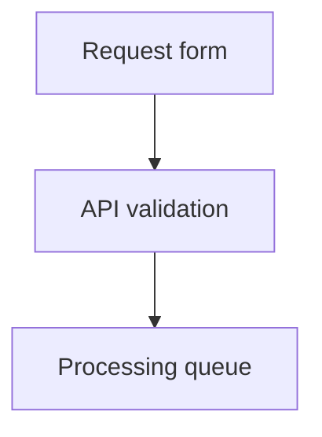
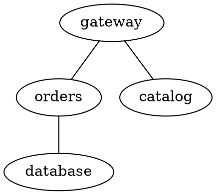

# blueprint4llm

**Markdown plans → diagrams, UI prototypes, HTML, and PDF.**

Write a plan yourself or with an agent. Review the system and screens before implementation.
Markdown stays the source of truth; the CLI renders it without calling an LLM.


## Quick start

Requires **Node.js ≥22.13.0**, npm, and Puppeteer's Chrome.

```bash
npm install --global blueprint4llm
```

Save this as `plan.md`:

````markdown
# Request workflow


````

```bash
blueprint4llm plan.md --serve
```

Open the printed URL, normally `http://127.0.0.1:8080/`. Saving the Markdown or a referenced
local image refreshes the preview. The toolbar offers dark mode and PDF download. Stop with `Ctrl+C`.

Chrome is normally installed automatically. If install scripts were blocked, install it manually:

```bash
npm exec --yes --package=puppeteer@25.14.0 -- puppeteer browsers install chrome
```

## How it works


## Formats

Use fenced blocks alongside CommonMark and GitHub Flavored Markdown: text, tables, lists,
links, images, and code. Ordinary code blocks receive syntax highlighting.

| Format     | Fence                   | Input and support                                                                                                                                     |
| ---------- | ----------------------- | ----------------------------------------------------------------------------------------------------------------------------------------------------- |
| D2         | `d2`                    | Self-contained D2 source rendered offline with bundled WebAssembly. Supports containers, connections, styles, SQL tables, UML classes, and sequences. |
| Mermaid    | `mermaid`               | Flows, sequences, classes, states, and ER diagrams. Uses a vertical layout where supported.                                                           |
| Graphviz   | `graphviz`, `dot`       | One offline DOT graph rendered to SVG in a worker. Supports verified `dot`, `neato`, `circo`, `fdp`, `osage`, `patchwork`, and `twopi` engines.       |
| PlantUML   | `plantuml`              | Standard `@start…` / `@end…` diagrams. Local engine; no Java, external includes, or network requests.                                                 |
| draw.io    | `drawio`, `draw.io`     | Structural JSON with nodes, groups, labels, and edges. Automatic layout; no XML.                                                                      |
| Wiremark   | `wireframe`, `wiremark` | Screens and controls described as text. `wireframe` is the canonical fence.                                                                           |
| Pencil     | `pencil`, `pen`         | Embedded `.pen` JSONC, schema 2.21. Frames, groups, shapes, paths, and text; no images, components, gradients, or effects.                            |
| Balsamiq   | `balsamiq`              | One Mockups 3 JSON mockup with common controls. Preserves positions and text; no `.bmpr`, `.bmml`, assets, or symbols.                                |
| Figma      | `figma`                 | REST API JSON rendered locally, or a frame URL exported through the Figma API. URL mode needs a token.                                                |
| Excalidraw | `excalidraw`            | Strict `.excalidraw` JSON v2. Keeps positions, rotations, groups, shapes, text, and ordinary arrows; unsupported items get placeholders.              |
| Vega-Lite  | `vega-lite`, `vegalite` | Vega-Lite 6 specifications with embedded data; rendered locally as static SVG.                                                                        |

|                                                                  draw.io · release flow                                                                   |                                                                   Pencil · profile screen                                                                   |
| :-------------------------------------------------------------------------------------------------------------------------------------------------------: | :---------------------------------------------------------------------------------------------------------------------------------------------------------: |
|  |  |

### D2 diagrams

Put one self-contained D2 document in a `d2` fence. The bundled `@d2lang/d2` 0.1.34 WebAssembly
engine compiles and renders locally. It needs no Go installation, D2 CLI, network connection, or
external render service. See [`examples/blueprint-d2.md`](examples/blueprint-d2.md) for one diagram
with nested containers, SQL and UML shapes, a sequence diagram, and Cyrillic labels.

D2's native `direction`, ordinary shapes and connections, labels, containers, styles, classes, SQL
tables, UML classes, and sequence diagrams are supported. The default layout is `dagre`; choose
`elk` and the one supported static light theme with native configuration:

```d2
vars: {
  d2-config: {
    layout-engine: elk
    theme-id: 0
  }
}
direction: right
client -> service: запрос
```

Fence metadata is not supported. Keep all source in the block: imports, path references, layers,
scenarios, steps, TALA, sketch mode, animation, icons and images, links, tooltips, Markdown, and
LaTeX labels are rejected. Unknown `vars.d2-config` settings and theme IDs also produce a
diagnostic. Ordinary labels, including Cyrillic, use the local Noto Sans fonts. D2 diagrams retain
their static light colors in dark document themes.

Each block is limited to 256 KiB. An active render stops after 30 seconds; at most two D2 jobs run
at once. SVG output is limited to 4 MiB and 8,192 px per side. The shared SVG validator rejects
active content and external resources. D2 is available in HTML, live preview, VS Code, PDF, and
single-diagram SVG/PNG/JPEG export.

### Graphviz diagrams

Use `graphviz` or `dot` for one Graphviz DOT `graph` or `digraph`. The local `@viz-js/viz` 3.31.0
package embeds Graphviz 16.1.0 as WebAssembly. Rendering runs in a disposable Node.js worker, so it
does not need a system `dot` command and a synchronous layout can be stopped on timeout or preview
cancellation. It works offline. See [`examples/blueprint-graphviz.md`](examples/blueprint-graphviz.md)
for a directed graph with a cluster and an undirected graph.

Fence metadata accepts one `engine=<name>` value. The default is `dot`; the verified engines are
`circo`, `dot`, `fdp`, `neato`, `osage`, `patchwork`, and `twopi`.



The DOT graph attribute `layout` takes precedence over fence metadata `engine`. Each fence must
contain one graph. Repeated, unknown, and empty metadata values, empty fences, and extra graphs
produce diagnostics. Clusters, ports, record labels, HTML-like labels, and Unicode labels are
supported. Graphviz font metrics can differ from browser and PDF font metrics; non-ASCII labels can
produce renderer warnings.

The renderer does not load images, files, stylesheets, fonts, or URLs named in DOT. Graphviz uses no
filesystem or network bridge in the worker. External SVG links and CSS resources are rejected by
the shared SVG validator. Each source is limited to 256 KiB; workers stop after 30 seconds, with
at most two active workers. SVG output is limited to 4 MiB and 8,192 CSS pixels per side. The
existing HTML, preview, VS Code, PDF, and SVG/PNG/JPEG export paths render Graphviz diagrams.

### draw.io diagrams

Embed structural JSON in a `drawio` or `draw.io` fence. For multiple pages, select one with
`page=<id>` in the fence metadata. Use `direction=TB` (default) or `direction=LR`.
The renderer builds a new layout; original coordinates and styles are not preserved.
The package includes a complete example in `examples/blueprint-draw.io.md`.

### Excalidraw scenes

Paste one complete `.excalidraw` JSON v2 document into an `excalidraw` fence. The local renderer
keeps saved coordinates, dimensions, rotations, element order, groups, text, and ordinary line and
arrow points. It uses no editor, network calls, or new runtime dependency. See
[`examples/blueprint-excalidraw.md`](examples/blueprint-excalidraw.md).

The static SVG profile supports rectangles, ellipses, diamonds, text, lines, and ordinary arrows.
It uses sans-serif text in HTML and SVG and the existing Noto Sans font in PDF. It does not reproduce
Excalidraw's hand-drawn RoughJS outlines or original font metrics. Non-solid fills, rough outlines,
rounding, nonstandard arrowheads, and links produce warnings; images and other unsupported elements
remain visible as labeled placeholders. Scene background and authored colors stay the same in both
document themes. See [`docs/reference.md`](docs/reference.md) for the complete supported subset.

Each block is limited to 1 MiB of UTF-8 JSON, 3,000 elements, nesting depth 100, 10,000 points per
line or arrow, 100,000 points per scene, and 100 group IDs per element. Coordinates and dimensions
are limited to 1,000,000; font sizes to 512; stroke widths to 100. Output SVG is limited to 4 MiB.
Image data in `files` is ignored. Clipboard JSON, `.excalidrawlib`, links to scenes, and embedded
scene metadata in PNG or SVG are not supported. The existing image export limits apply. PDF scales
a tall scene to 220 mm and does not split it across pages.

### Figma frames

JSON mode needs a root `DOCUMENT` and works offline without a token. Select a frame with
`node=12:34` in the fence metadata. The local renderer supports containers, basic shapes,
vector paths, text, and solid fills; use URL mode for gradients, effects, masks, and images.

URL mode accepts HTTPS `/design/` or `/file/` frame URLs. Use a personal access token with
`file_content:read` permission. Token lookup order: `CompileOptions.figmaAccessToken`,
`FIGMA_ACCESS_TOKEN`, then `.env` in the current working directory. The token is sent only
to `api.figma.com`; exported SVGs are embedded in the result.

### OpenAPI contracts

Put an existing OpenAPI 3.1.1 contract in an `openapi` fence. The renderer creates a static SVG
reference with every operation, parameter, request body, response, and component schema expanded.
YAML 1.2 and strict JSON are supported. Ordinary `yaml` and `json` fences remain code blocks. See
[`examples/blueprint-openapi.md`](examples/blueprint-openapi.md) for a complete example.

The renderer supports the fields it displays, local `#/...` JSON Pointer references, schema
composition, and recursive schema references. It does not fetch files or URLs. External references,
other OpenAPI versions, nonstandard JSON Schema dialects, and unsupported identifier keywords such
as `$id` and `$anchor` produce diagnostics. Other valid OpenAPI fields that the reference does not
show produce warnings with source locations. These checks do not replace a full OpenAPI validator.

The source limit is 256 KiB per block. A contract can contain up to 200 operations, 500 named
schemas, 2,000 references, and 5,000 rendered lines. The resulting SVG is at most 1,200 px wide,
16,384 px high, and 4 MiB. HTML, live preview, VS Code, and SVG/PNG/JPEG export show the full SVG.
PDF printing scales each diagram to a maximum height of 220 mm, so a large contract can be small on
the page. One OpenAPI block is not split across PDF pages.

### Vega-Lite charts

Use `vega-lite` or `vegalite` for one Vega-Lite 6 specification. Supply strict JSON and keep data
inside `data.values` or root `datasets`. The local Vega-Lite schema validates every field; the
renderer uses the bundled Vega and Vega-Lite browser libraries in an isolated Chromium page. It
does not fetch data, images, fonts, or schemas. The output is static SVG, so selection, binding,
streaming, image marks, projections, and automatic container resize are not available. Tooltip
fields are retained and produce a warning because static images cannot show interactive tooltips.
The renderer accepts Vega-Lite's unit, layer, concat, facet, and repeat views; bar, line, point,
circle, square, area, rect, rule, tick, text, arc, trail, boxplot, errorbar, and errorband marks;
and filter, calculate, aggregate, joinaggregate, bin, timeUnit, stack, fold, and inline lookup
transforms. Parameters must have constant values. A `$schema`, when supplied, must be the bundled
Vega-Lite v6 schema identifier shown in the example.

Single views default to 480 × 300 px, a white background, and sans-serif text. Explicit sizes and
colors are preserved. Data colors are not inverted in dark or high-contrast themes. Each block is
limited to 256 KiB, 64 JSON levels, 50,000 AST nodes, 10,000 source rows, 100 expanded views, 100
transforms, 50,000 computed rows per dataset, 50,000 scenegraph items, 4 MiB SVG, 4,096 px per
side, and 16 million pixels. Rendering stops after 30 seconds. See
[`examples/blueprint-vega-lite.md`](examples/blueprint-vega-lite.md) for a complete offline chart.

### Apache ECharts

Use the `echarts` fence for one strict JSON ECharts option object. The local ECharts 6.1.0
renderer validates a documented static profile, then renders SVG with ECharts' SVG server-side
renderer in a worker thread. It does not execute JavaScript, fetch external data or assets, or add
browser dependencies. The chart uses 800 × 450 px by default. Set only `width` and `height` as
fence metadata; each must be an integer from 240 to 1,600 px.

The profile supports bar, line, pie, scatter, radar, heatmap, and gauge series, including mixed bar
and line series. Data must be inline in `series.data` or in one root `dataset` with `dimensions`,
rectangular `source` rows, and explicit `series.encode`. Only the fields used by the example and
the documented chart styles are accepted. Unknown options fail with a JSON Pointer and source
location. Simple linear gradients are supported for the chart palette, series fills, and backgrounds.
Formatters are plain templates with `{a}`, `{b}`, `{c}`, `{d}`, `{name}`, `{value}`, and
`{percent}` placeholders; they cannot contain HTML or JavaScript. Tooltips, toolbox, data zoom,
brush, timeline, transforms, URLs, image symbols, callbacks, custom series, and mixed coordinate
systems are not supported. Legacy `grid.containLabel: true` is rejected; set explicit margins.
Animation and interaction are disabled for static SVG output.

The supported option fields are:

| Area              | Accepted fields                                                                                                                                                                                                                                                                                    |
| ----------------- | -------------------------------------------------------------------------------------------------------------------------------------------------------------------------------------------------------------------------------------------------------------------------------------------------- |
| Root              | `title`, `legend`, `grid`, `xAxis`, `yAxis`, `radar`, `visualMap`, `dataset`, `series`, `color`, `backgroundColor`, `textStyle`, `animation`, `silent`                                                                                                                                             |
| Title             | `show`, `text`, `subtext`, `left`, `top`, `right`, `bottom`, `itemGap`, `padding`, `backgroundColor`, `borderColor`, `borderWidth`, `borderRadius`, `textStyle`, `subtextStyle`                                                                                                                    |
| Legend            | `show`, `type: "plain"`, `orient`, `left`, `top`, `right`, `bottom`, `width`, `height`, `itemWidth`, `itemHeight`, `itemGap`, `icon`, `data`, `formatter`, `textStyle`, `selectedMode: false`                                                                                                      |
| Grid              | `show`, `left`, `right`, `top`, `bottom`, `width`, `height`, `containLabel: false`, `backgroundColor`, `borderColor`, `borderWidth`, `shadowBlur`, `shadowColor`                                                                                                                                   |
| Axes              | `type`, `name`, `show`, `position`, `offset`, `nameLocation`, `nameGap`, `nameRotate`, `nameTextStyle`, `inverse`, `boundaryGap`, `min`, `max`, `scale`, `splitNumber`, `minInterval`, `maxInterval`, `interval`, `logBase`, `data`, `axisLine`, `axisTick`, `axisLabel`, `splitLine`, `splitArea` |
| Text style        | `color`, `fontStyle`, `fontWeight`, `fontSize`, `fontFamily`, `lineHeight`, `width`, `overflow`, `align`, `verticalAlign`, `backgroundColor`, `borderColor`, `borderWidth`, `borderRadius`, `padding`                                                                                              |
| Series common     | `type`, `name`, `data`, `encode`, `datasetIndex: 0`, `xAxisIndex`, `yAxisIndex`, `coordinateSystem`, `label`, `itemStyle`, `lineStyle`, `areaStyle`, `emphasis: { disabled }`, `select: { disabled }`, `silent`, `animation`, `selectedMode: false`                                                |
| Bar               | `stack`, `barWidth`, `barMaxWidth`, `barMinHeight`, `barGap`, `barCategoryGap`, `showBackground`, `backgroundStyle`, `roundCap`                                                                                                                                                                    |
| Line              | `stack`, `smooth`, `step`, `connectNulls`, `showSymbol`, `symbol`, `symbolSize`                                                                                                                                                                                                                    |
| Pie               | `radius`, `center`, `roseType`, `clockwise`, `startAngle`, `minAngle`, `padAngle`, `avoidLabelOverlap`, `stillShowZeroSum`, `percentPrecision`, `labelLine`                                                                                                                                        |
| Scatter and radar | `symbol`, `symbolSize`; radar also accepts the root `radar.indicator`, `shape`, `radius`, `center`, `startAngle`, `splitNumber`, `name`, `axisLine`, `splitLine`, and `splitArea`                                                                                                                  |
| Heatmap           | `blurSize`, `minOpacity`, `maxOpacity`; requires root `visualMap` with `min`, `max`, `dimension`, layout, `inRange.color`, and optional `outOfRange.color`                                                                                                                                         |
| Gauge             | `min`, `max`, `startAngle`, `endAngle`, `splitNumber`, `radius`, `center`, `axisLine`, `axisTick`, `splitLine`, `axisLabel`, `pointer`, `progress`, `anchor`, `detail`, `title`                                                                                                                    |

Chart-specific data uses numbers and null gaps for bar/line, `[category, value]` pairs for bar/line,
`[x, y]` for scatter, `{ name, value }` objects for pie/gauge/radar, and `[x, y, value]` for
heatmap. Bar and line also accept `{ name, value, itemStyle }` items. Radar values must match the
number of indicators. Dataset `dimensions` are unique strings and every `source` row must have one
finite number, string, or null per dimension. `encode` uses only `x`, `y`, `value`, or `itemName`
and must refer to an existing dimension.

Each block is limited to 256 KiB, 32 JSON levels, 100,000 AST nodes, and 4 KiB per source line.
Charts accept at most 20 series, 10,000 combined data points or dataset rows, and 32 dataset
dimensions. Rendering runs in a worker with a 128 MiB old-generation heap limit, a 10 second time
limit, and at most two concurrent charts. SVG output is limited to 4 MiB. Colors remain as authored
in dark mode. See [`examples/blueprint-echarts.md`](examples/blueprint-echarts.md) for examples of
all supported series and dataset encoding.

## Commands

| Task                 | Command                                                                |
| -------------------- | ---------------------------------------------------------------------- |
| Live preview         | `blueprint4llm plan.md --serve --port=8080`                            |
| Validate for CI      | `blueprint4llm plan.md --check`                                        |
| Validate with report | `blueprint4llm plan.md --check --report-json=diagnostics.json`         |
| Export with report   | `blueprint4llm plan.md --out=plan.html --report-json=diagnostics.json` |
| Export HTML          | `blueprint4llm plan.md --out=plan.html`                                |
| Export with counts   | `blueprint4llm plan.md --out=plan.html --diagnostics-summary`          |
| Export PDF           | `blueprint4llm plan.md --out=plan.pdf --format=pdf`                    |
| Export SVG           | `blueprint4llm plan.md --out=visual.svg --format=svg`                  |
| Export PNG           | `blueprint4llm plan.md --out=visual.png --format=png`                  |
| Export JPEG          | `blueprint4llm plan.md --out=visual.jpeg --format=jpeg`                |

Image exports require **exactly one supported visual block**; the quick start example qualifies.
`--out` creates parent directories. Each invocation produces one format; HTML is the default.
`--check` validates Markdown, diagrams, and local images without writing HTML or assets. The optional
`--report-json=<file>` writes a UTF-8 JSON report atomically. It works with `--check` and one-shot
exports. The report path must differ from the input and output paths, including symlink aliases.
`--report-json` cannot be used with `--serve`.

Generated documents omit the overall error and warning count by default. Add
`--diagnostics-summary` to HTML or PDF exports and live previews to include it. A failed diagram
still shows its full message at its position; the other Markdown and valid diagrams remain available.
HTML and PDF exports are saved even when a diagram has an error, then the command exits with code
`1`. SVG, PNG, and JPEG exports do not replace an existing file when their diagram has an error.
Warnings alone exit with code `0`. Invalid arguments, including report path conflicts, exit with
code `2`.

The report has `schemaVersion: 1`, a `status` of `ok` or `error`, summary counts, and ordered
diagnostics. Each diagnostic includes `severity`, a stable `code`, `scope`, source path, optional
Markdown coordinates and diagram identity, and the full message. Codes are `diagram.render`,
`diagram.limit`, `diagram.svg`, `renderer.warning`, `document.read`, `document.compile`,
`output.render`, and `output.write`. The optional `outputs` object lists files that the invocation
actually saved. For example, `--check` reports have no `outputs` field.

Fatal document or export failures stop that operation. If a JSON report was requested, it includes a
document or output diagnostic when the report can still be written. An unwritable report is reported
on stderr and exits with code `1`; any HTML or PDF already saved remains available. See
[`examples/blueprint-diagnostics.md`](examples/blueprint-diagnostics.md) for a document with two
independent diagram errors and a valid diagram between them.

In live preview, failed diagrams stay inline and the PDF uses that same compiled document. The
overall count is opt-in through `--diagnostics-summary`. Fixing the source removes the diagnostics on
the next build. A fatal document error still shows a diagnostic page until the source is fixed.

## Output and limits

| Topic            | Behavior                                                                                                                                                            |
| ---------------- | ------------------------------------------------------------------------------------------------------------------------------------------------------------------- |
| HTML             | Embeds diagram SVGs; local images are copied to an adjacent `assets/` folder. Open the output directly in a browser.                                                |
| PDF              | A4 pages with local Noto Sans fonts and selectable text. Wide D2 diagrams use landscape pages. External images must be saved locally before export.                 |
| Image paths      | Resolve relative to the Markdown file. Paths and symlinks that escape its directory are rejected.                                                                   |
| Offline use      | Local renderers need no network; Figma URL blocks fetch during compilation. HTML still needs a connection for external images.                                      |
| Safety           | Raw HTML is escaped. SVGs are checked for active content and external resources. User scripts and graphical editing are not supported.                              |
| Document limits  | 5 MiB of Markdown, 100 visual blocks, and normally 256 KiB per block.                                                                                               |
| JSON limits      | draw.io, Pencil, and Figma: 1 MiB and 10,000 cells/nodes. Balsamiq: 256 KiB and 3,000 controls.                                                                     |
| Vega-Lite limits | 256 KiB source, 64 levels, 50,000 AST nodes, 10,000 source rows, 100 expanded views and transforms, 50,000 computed rows/items, and 4 MiB SVG.                      |
| OpenAPI limits   | 256 KiB source, 200 operations, 500 named schemas, 2,000 references, 5,000 layout lines, and 4 MiB SVG.                                                             |
| Timeouts         | Mermaid, PlantUML, and Vega-Lite: 30 seconds. draw.io layout: 5 seconds. PDF: 60 seconds.                                                                           |
| Chrome on Linux  | Requires Chrome system libraries. If sandbox startup fails, rendering retries with `--no-sandbox`. Set `BLUEPRINT4LLM_DISABLE_CHROME_SANDBOX=1` to force this mode. |

## Agent and editor workflows

| Workflow     | Setup                                                                                                                                                                                        |
| ------------ | -------------------------------------------------------------------------------------------------------------------------------------------------------------------------------------------- |
| Coding agent | Install the CLI, then run `npx skills add evgenyigumnov/blueprint4llm --skill blueprint4llm`. The skill guides visual planning, validation, and review.                                      |
| VS Code      | Install a built VSIX with `code --install-extension <file.vsix>`. Open a Markdown file and run **Blueprint: Open Preview to the Side**. Use **Blueprint: Export Preview as PDF** to save it. |

The VS Code preview compiles unsaved edits with a 200 ms delay, configurable through
`blueprint4llm.preview.debounceMs`. It requires desktop VS Code ≥1.101.0 and Puppeteer's Chrome.

## Programmatic API

Install locally with `npm install blueprint4llm`, then use the ESM exports:

```js
import { compileMarkdown, writeBlueprintOutput } from 'blueprint4llm';

const compiled = await compileMarkdown('# Plan\n\nReady for review.', {
  sourceFile: './plan.md',
  includeDiagnosticsSummary: true,
});

await writeBlueprintOutput('./plan.html', {
  html: compiled.html,
  assets: compiled.assets,
});
```

| Export                                        | Purpose                                                                                      |
| --------------------------------------------- | -------------------------------------------------------------------------------------------- |
| `compileMarkdown(markdown, options)`          | Returns `html`, `title`, `assets`, legacy `warnings`/`errors`, and structured `diagnostics`. |
| `renderPdf(compiled, { signal }?)`            | Generates PDF bytes; pass them as `pdf` to `writeBlueprintOutput()`.                         |
| `writeBlueprintOutput(path, options)`         | Writes HTML and/or PDF with assets; returns absolute output paths.                           |
| `startPreviewServer({ input, port, signal })` | Returns `url`, `port`, and an asynchronous `close()` method.                                 |

`warnings` and `errors` remain formatted string arrays for existing consumers. `diagnostics` adds
structured records; it is optional in the public result types so older compiler implementations can
continue to provide only the string arrays. The built-in compiler always returns `diagnostics`.
Set `includeDiagnosticsSummary: true` in `CompileOptions` to add an accessible count to generated
HTML. It is disabled by default. `startPreviewServer()` accepts the same option.

## Development

From a repository clone:

```bash
npm ci
npx puppeteer browsers install chrome
npm run build
npm run typecheck
npm run lint
npm run format:check
npm test
```

Run the CLI directly with `node dist/cli.js`, or use `npm link` to expose the command globally.
`npm test` builds the CLI and runs unit and integration tests; Chrome must be installed.
To build the VSIX, run `npm install` and `npm run package` from `vscode-extension/`.
