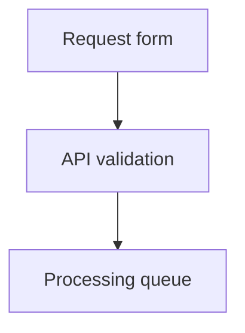

# blueprint4llm

**Markdown plans → diagrams, UI prototypes, HTML, and PDF.**

Write a plan yourself or with an agent. Review the system and screens before implementation.
Markdown stays the source of truth; the CLI renders it without calling an LLM.


## Quick start

Requires **Node.js ≥22.13.0**, npm, and Puppeteer's Chrome.

```bash
npm install --global blueprint4llm
```

Save this as `plan.md`:

````markdown
# Request workflow


````

```bash
blueprint4llm plan.md --serve
```

Open the printed URL, normally `http://127.0.0.1:8080/`. Saving the Markdown or a referenced
local image refreshes the preview. The toolbar offers dark mode and PDF download. Stop with `Ctrl+C`.

Chrome is normally installed automatically. If install scripts were blocked, install it manually:

```bash
npm exec --yes --package=puppeteer@25.14.0 -- puppeteer browsers install chrome
```

## How it works


## Formats

Use fenced blocks alongside CommonMark and GitHub Flavored Markdown: text, tables, lists,
links, images, and code. Ordinary code blocks receive syntax highlighting.

| Format   | Fence                   | Input and support                                                                                                          |
| -------- | ----------------------- | -------------------------------------------------------------------------------------------------------------------------- |
| Mermaid  | `mermaid`               | Flows, sequences, classes, states, and ER diagrams. Uses a vertical layout where supported.                                |
| PlantUML | `plantuml`              | Standard `@start…` / `@end…` diagrams. Local engine; no Java, external includes, or network requests.                      |
| draw.io  | `drawio`, `draw.io`     | Structural JSON with nodes, groups, labels, and edges. Automatic layout; no XML.                                           |
| Wiremark | `wireframe`, `wiremark` | Screens and controls described as text. `wireframe` is the canonical fence.                                                |
| Pencil   | `pencil`, `pen`         | Embedded `.pen` JSONC, schema 2.21. Frames, groups, shapes, paths, and text; no images, components, gradients, or effects. |
| Balsamiq | `balsamiq`              | One Mockups 3 JSON mockup with common controls. Preserves positions and text; no `.bmpr`, `.bmml`, assets, or symbols.     |
| Figma    | `figma`                 | REST API JSON rendered locally, or a frame URL exported through the Figma API. URL mode needs a token.                     |

|                                                                  draw.io · release flow                                                                   |                                                                   Pencil · profile screen                                                                   |
| :-------------------------------------------------------------------------------------------------------------------------------------------------------: | :---------------------------------------------------------------------------------------------------------------------------------------------------------: |
|  |  |

### draw.io diagrams

Embed structural JSON in a `drawio` or `draw.io` fence. For multiple pages, select one with
`page=<id>` in the fence metadata. Use `direction=TB` (default) or `direction=LR`.
The renderer builds a new layout; original coordinates and styles are not preserved.
The package includes a complete example in `examples/blueprint-draw.io.md`.

### Figma frames

JSON mode needs a root `DOCUMENT` and works offline without a token. Select a frame with
`node=12:34` in the fence metadata. The local renderer supports containers, basic shapes,
vector paths, text, and solid fills; use URL mode for gradients, effects, masks, and images.

URL mode accepts HTTPS `/design/` or `/file/` frame URLs. Use a personal access token with
`file_content:read` permission. Token lookup order: `CompileOptions.figmaAccessToken`,
`FIGMA_ACCESS_TOKEN`, then `.env` in the current working directory. The token is sent only
to `api.figma.com`; exported SVGs are embedded in the result.

## Commands

| Task            | Command                                                 |
| --------------- | ------------------------------------------------------- |
| Live preview    | `blueprint4llm plan.md --serve --port=8080`             |
| Validate for CI | `blueprint4llm plan.md --check`                         |
| Export HTML     | `blueprint4llm plan.md --out=plan.html`                 |
| Export PDF      | `blueprint4llm plan.md --out=plan.pdf --format=pdf`     |
| Export SVG      | `blueprint4llm plan.md --out=visual.svg --format=svg`   |
| Export PNG      | `blueprint4llm plan.md --out=visual.png --format=png`   |
| Export JPEG     | `blueprint4llm plan.md --out=visual.jpeg --format=jpeg` |

Image exports require **exactly one supported visual block**; the quick start example qualifies.
`--out` creates parent directories. Each invocation produces one format; HTML is the default.
`--check` validates Markdown, diagrams, and local images without writing output. Errors exit with
code `1`; warnings go to stderr. In live preview, fixing the source clears the diagnostic page.

## Output and limits

| Topic           | Behavior                                                                                                                                                            |
| --------------- | ------------------------------------------------------------------------------------------------------------------------------------------------------------------- |
| HTML            | Embeds diagram SVGs; local images are copied to an adjacent `assets/` folder. Open the output directly in a browser.                                                |
| PDF             | A4 pages with local Noto Sans fonts and selectable text. External images must be saved locally before export.                                                       |
| Image paths     | Resolve relative to the Markdown file. Paths and symlinks that escape its directory are rejected.                                                                   |
| Offline use     | Local renderers need no network; Figma URL blocks fetch during compilation. HTML still needs a connection for external images.                                      |
| Safety          | Raw HTML is escaped. SVGs are checked for active content and external resources. User scripts and graphical editing are not supported.                              |
| Document limits | 5 MiB of Markdown, 100 visual blocks, and normally 256 KiB per block.                                                                                               |
| JSON limits     | draw.io, Pencil, and Figma: 1 MiB and 10,000 cells/nodes. Balsamiq: 256 KiB and 3,000 controls.                                                                     |
| Timeouts        | Mermaid and PlantUML: 30 seconds. draw.io layout: 5 seconds. PDF: 60 seconds.                                                                                       |
| Chrome on Linux | Requires Chrome system libraries. If sandbox startup fails, rendering retries with `--no-sandbox`. Set `BLUEPRINT4LLM_DISABLE_CHROME_SANDBOX=1` to force this mode. |

## Agent and editor workflows

| Workflow     | Setup                                                                                                                                                                                        |
| ------------ | -------------------------------------------------------------------------------------------------------------------------------------------------------------------------------------------- |
| Coding agent | Install the CLI, then run `npx skills add evgenyigumnov/blueprint4llm --skill blueprint4llm`. The skill guides visual planning, validation, and review.                                      |
| VS Code      | Install a built VSIX with `code --install-extension <file.vsix>`. Open a Markdown file and run **Blueprint: Open Preview to the Side**. Use **Blueprint: Export Preview as PDF** to save it. |

The VS Code preview compiles unsaved edits with a 200 ms delay, configurable through
`blueprint4llm.preview.debounceMs`. It requires desktop VS Code ≥1.101.0 and Puppeteer's Chrome.

## Programmatic API

Install locally with `npm install blueprint4llm`, then use the ESM exports:

```js
import { compileMarkdown, writeBlueprintOutput } from 'blueprint4llm';

const compiled = await compileMarkdown('# Plan\n\nReady for review.', {
  sourceFile: './plan.md',
});

await writeBlueprintOutput('./plan.html', {
  html: compiled.html,
  assets: compiled.assets,
});
```

| Export                                        | Purpose                                                               |
| --------------------------------------------- | --------------------------------------------------------------------- |
| `compileMarkdown(markdown, options)`          | Returns `html`, `title`, `assets`, `warnings`, and optional `errors`. |
| `renderPdf(compiled, { signal }?)`            | Generates PDF bytes; pass them as `pdf` to `writeBlueprintOutput()`.  |
| `writeBlueprintOutput(path, options)`         | Writes HTML and/or PDF with assets; returns absolute output paths.    |
| `startPreviewServer({ input, port, signal })` | Returns `url`, `port`, and an asynchronous `close()` method.          |

## Development

From a repository clone:

```bash
npm ci
npx puppeteer browsers install chrome
npm run build
npm run typecheck
npm run lint
npm run format:check
npm test
```

Run the CLI directly with `node dist/cli.js`, or use `npm link` to expose the command globally.
`npm test` builds the CLI and runs unit and integration tests; Chrome must be installed.
To build the VSIX, run `npm install` and `npm run package` from `vscode-extension/`.
