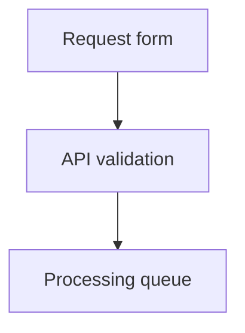

# blueprint4llm

**Markdown plans → diagrams, UI prototypes, HTML, and PDF.**

Write a plan yourself or with an agent. Review the system and screens before implementation.
Markdown stays the source of truth; the CLI renders it without calling an LLM.


## Quick start

Requires **Node.js ≥22.13.0**, npm, and Puppeteer's Chrome.

```bash
npm install --global blueprint4llm
```

Save this as `plan.md`:

````markdown
# Request workflow


````

```bash
blueprint4llm plan.md --serve
```

Open the printed URL, normally `http://127.0.0.1:8080/`. Saving the Markdown or a referenced
local image refreshes the preview. The toolbar offers dark mode and PDF download. Stop with `Ctrl+C`.

Chrome is normally installed automatically. If install scripts were blocked, install it manually:

```bash
npm exec --yes --package=puppeteer@25.14.0 -- puppeteer browsers install chrome
```

## How it works


## Formats

Use fenced blocks alongside CommonMark and GitHub Flavored Markdown: text, tables, lists,
links, images, and code. Ordinary code blocks receive syntax highlighting.

| Format   | Fence                   | Input and support                                                                                                          |
| -------- | ----------------------- | -------------------------------------------------------------------------------------------------------------------------- |
| Mermaid  | `mermaid`               | Flows, sequences, classes, states, and ER diagrams. Uses a vertical layout where supported.                                |
| PlantUML | `plantuml`              | Standard `@start…` / `@end…` diagrams. Local engine; no Java, external includes, or network requests.                      |
| draw.io  | `drawio`, `draw.io`     | Structural JSON with nodes, groups, labels, and edges. Automatic layout; no XML.                                           |
| Wiremark | `wireframe`, `wiremark` | Screens and controls described as text. `wireframe` is the canonical fence.                                                |
| Pencil   | `pencil`, `pen`         | Embedded `.pen` JSONC, schema 2.21. Frames, groups, shapes, paths, and text; no images, components, gradients, or effects. |
| Balsamiq | `balsamiq`              | One Mockups 3 JSON mockup with common controls. Preserves positions and text; no `.bmpr`, `.bmml`, assets, or symbols.     |
| Figma    | `figma`                 | REST API JSON rendered locally, or a frame URL exported through the Figma API. URL mode needs a token.                     |

|                                                                  draw.io · release flow                                                                   |                                                                   Pencil · profile screen                                                                   |
| :-------------------------------------------------------------------------------------------------------------------------------------------------------: | :---------------------------------------------------------------------------------------------------------------------------------------------------------: |
|  |  |

### draw.io diagrams

Embed structural JSON in a `drawio` or `draw.io` fence. For multiple pages, select one with
`page=<id>` in the fence metadata. Use `direction=TB` (default) or `direction=LR`.
The renderer builds a new layout; original coordinates and styles are not preserved.
The package includes a complete example in `examples/blueprint-draw.io.md`.

### Figma frames

JSON mode needs a root `DOCUMENT` and works offline without a token. Select a frame with
`node=12:34` in the fence metadata. The local renderer supports containers, basic shapes,
vector paths, text, and solid fills; use URL mode for gradients, effects, masks, and images.

URL mode accepts HTTPS `/design/` or `/file/` frame URLs. Use a personal access token with
`file_content:read` permission. Token lookup order: `CompileOptions.figmaAccessToken`,
`FIGMA_ACCESS_TOKEN`, then `.env` in the current working directory. The token is sent only
to `api.figma.com`; exported SVGs are embedded in the result.

### OpenAPI contracts

Put an existing OpenAPI 3.1.1 contract in an `openapi` fence. The renderer creates a static SVG
reference with every operation, parameter, request body, response, and component schema expanded.
YAML 1.2 and strict JSON are supported. Ordinary `yaml` and `json` fences remain code blocks. See
[`examples/blueprint-openapi.md`](examples/blueprint-openapi.md) for a complete example.

The renderer supports the fields it displays, local `#/...` JSON Pointer references, schema
composition, and recursive schema references. It does not fetch files or URLs. External references,
other OpenAPI versions, nonstandard JSON Schema dialects, and unsupported identifier keywords such
as `$id` and `$anchor` produce diagnostics. Other valid OpenAPI fields that the reference does not
show produce warnings with source locations. These checks do not replace a full OpenAPI validator.

The source limit is 256 KiB per block. A contract can contain up to 200 operations, 500 named
schemas, 2,000 references, and 5,000 rendered lines. The resulting SVG is at most 1,200 px wide,
16,384 px high, and 4 MiB. HTML, live preview, VS Code, and SVG/PNG/JPEG export show the full SVG.
PDF printing scales each diagram to a maximum height of 220 mm, so a large contract can be small on
the page. One OpenAPI block is not split across PDF pages.

## Commands

| Task                 | Command                                                                |
| -------------------- | ---------------------------------------------------------------------- |
| Live preview         | `blueprint4llm plan.md --serve --port=8080`                            |
| Validate for CI      | `blueprint4llm plan.md --check`                                        |
| Validate with report | `blueprint4llm plan.md --check --report-json=diagnostics.json`         |
| Export with report   | `blueprint4llm plan.md --out=plan.html --report-json=diagnostics.json` |
| Export HTML          | `blueprint4llm plan.md --out=plan.html`                                |
| Export with counts   | `blueprint4llm plan.md --out=plan.html --diagnostics-summary`          |
| Export PDF           | `blueprint4llm plan.md --out=plan.pdf --format=pdf`                    |
| Export SVG           | `blueprint4llm plan.md --out=visual.svg --format=svg`                  |
| Export PNG           | `blueprint4llm plan.md --out=visual.png --format=png`                  |
| Export JPEG          | `blueprint4llm plan.md --out=visual.jpeg --format=jpeg`                |

Image exports require **exactly one supported visual block**; the quick start example qualifies.
`--out` creates parent directories. Each invocation produces one format; HTML is the default.
`--check` validates Markdown, diagrams, and local images without writing HTML or assets. The optional
`--report-json=<file>` writes a UTF-8 JSON report atomically. It works with `--check` and one-shot
exports. The report path must differ from the input and output paths, including symlink aliases.
`--report-json` cannot be used with `--serve`.

Generated documents omit the overall error and warning count by default. Add
`--diagnostics-summary` to HTML or PDF exports and live previews to include it. A failed diagram
still shows its full message at its position; the other Markdown and valid diagrams remain available.
HTML and PDF exports are saved even when a diagram has an error, then the command exits with code
`1`. SVG, PNG, and JPEG exports do not replace an existing file when their diagram has an error.
Warnings alone exit with code `0`. Invalid arguments, including report path conflicts, exit with
code `2`.

The report has `schemaVersion: 1`, a `status` of `ok` or `error`, summary counts, and ordered
diagnostics. Each diagnostic includes `severity`, a stable `code`, `scope`, source path, optional
Markdown coordinates and diagram identity, and the full message. Codes are `diagram.render`,
`diagram.limit`, `diagram.svg`, `renderer.warning`, `document.read`, `document.compile`,
`output.render`, and `output.write`. The optional `outputs` object lists files that the invocation
actually saved. For example, `--check` reports have no `outputs` field.

Fatal document or export failures stop that operation. If a JSON report was requested, it includes a
document or output diagnostic when the report can still be written. An unwritable report is reported
on stderr and exits with code `1`; any HTML or PDF already saved remains available. See
[`examples/blueprint-diagnostics.md`](examples/blueprint-diagnostics.md) for a document with two
independent diagram errors and a valid diagram between them.

In live preview, failed diagrams stay inline and the PDF uses that same compiled document. The
overall count is opt-in through `--diagnostics-summary`. Fixing the source removes the diagnostics on
the next build. A fatal document error still shows a diagnostic page until the source is fixed.

## Output and limits

| Topic           | Behavior                                                                                                                                                            |
| --------------- | ------------------------------------------------------------------------------------------------------------------------------------------------------------------- |
| HTML            | Embeds diagram SVGs; local images are copied to an adjacent `assets/` folder. Open the output directly in a browser.                                                |
| PDF             | A4 pages with local Noto Sans fonts and selectable text. External images must be saved locally before export.                                                       |
| Image paths     | Resolve relative to the Markdown file. Paths and symlinks that escape its directory are rejected.                                                                   |
| Offline use     | Local renderers need no network; Figma URL blocks fetch during compilation. HTML still needs a connection for external images.                                      |
| Safety          | Raw HTML is escaped. SVGs are checked for active content and external resources. User scripts and graphical editing are not supported.                              |
| Document limits | 5 MiB of Markdown, 100 visual blocks, and normally 256 KiB per block.                                                                                               |
| JSON limits     | draw.io, Pencil, and Figma: 1 MiB and 10,000 cells/nodes. Balsamiq: 256 KiB and 3,000 controls.                                                                     |
| OpenAPI limits  | 256 KiB source, 200 operations, 500 named schemas, 2,000 references, 5,000 layout lines, and 4 MiB SVG.                                                             |
| Timeouts        | Mermaid and PlantUML: 30 seconds. draw.io layout: 5 seconds. PDF: 60 seconds.                                                                                       |
| Chrome on Linux | Requires Chrome system libraries. If sandbox startup fails, rendering retries with `--no-sandbox`. Set `BLUEPRINT4LLM_DISABLE_CHROME_SANDBOX=1` to force this mode. |

## Agent and editor workflows

| Workflow     | Setup                                                                                                                                                                                        |
| ------------ | -------------------------------------------------------------------------------------------------------------------------------------------------------------------------------------------- |
| Coding agent | Install the CLI, then run `npx skills add evgenyigumnov/blueprint4llm --skill blueprint4llm`. The skill guides visual planning, validation, and review.                                      |
| VS Code      | Install a built VSIX with `code --install-extension <file.vsix>`. Open a Markdown file and run **Blueprint: Open Preview to the Side**. Use **Blueprint: Export Preview as PDF** to save it. |

The VS Code preview compiles unsaved edits with a 200 ms delay, configurable through
`blueprint4llm.preview.debounceMs`. It requires desktop VS Code ≥1.101.0 and Puppeteer's Chrome.

## Programmatic API

Install locally with `npm install blueprint4llm`, then use the ESM exports:

```js
import { compileMarkdown, writeBlueprintOutput } from 'blueprint4llm';

const compiled = await compileMarkdown('# Plan\n\nReady for review.', {
  sourceFile: './plan.md',
  includeDiagnosticsSummary: true,
});

await writeBlueprintOutput('./plan.html', {
  html: compiled.html,
  assets: compiled.assets,
});
```

| Export                                        | Purpose                                                                                      |
| --------------------------------------------- | -------------------------------------------------------------------------------------------- |
| `compileMarkdown(markdown, options)`          | Returns `html`, `title`, `assets`, legacy `warnings`/`errors`, and structured `diagnostics`. |
| `renderPdf(compiled, { signal }?)`            | Generates PDF bytes; pass them as `pdf` to `writeBlueprintOutput()`.                         |
| `writeBlueprintOutput(path, options)`         | Writes HTML and/or PDF with assets; returns absolute output paths.                           |
| `startPreviewServer({ input, port, signal })` | Returns `url`, `port`, and an asynchronous `close()` method.                                 |

`warnings` and `errors` remain formatted string arrays for existing consumers. `diagnostics` adds
structured records; it is optional in the public result types so older compiler implementations can
continue to provide only the string arrays. The built-in compiler always returns `diagnostics`.
Set `includeDiagnosticsSummary: true` in `CompileOptions` to add an accessible count to generated
HTML. It is disabled by default. `startPreviewServer()` accepts the same option.

## Development

From a repository clone:

```bash
npm ci
npx puppeteer browsers install chrome
npm run build
npm run typecheck
npm run lint
npm run format:check
npm test
```

Run the CLI directly with `node dist/cli.js`, or use `npm link` to expose the command globally.
`npm test` builds the CLI and runs unit and integration tests; Chrome must be installed.
To build the VSIX, run `npm install` and `npm run package` from `vscode-extension/`.
