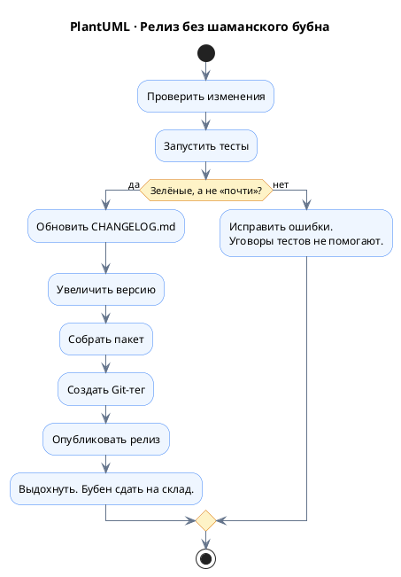
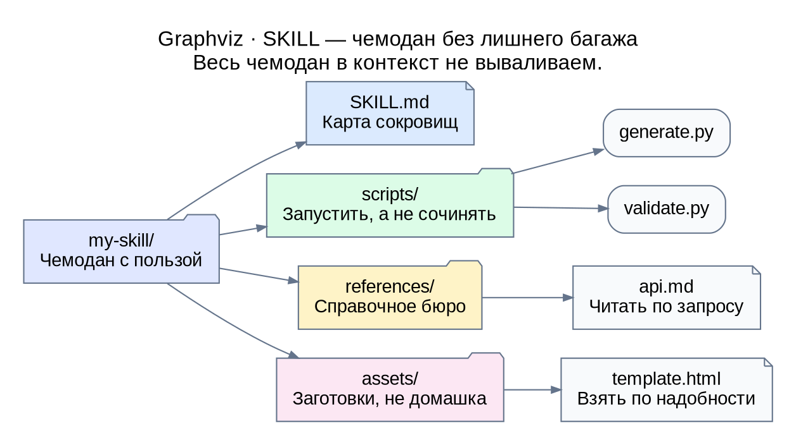
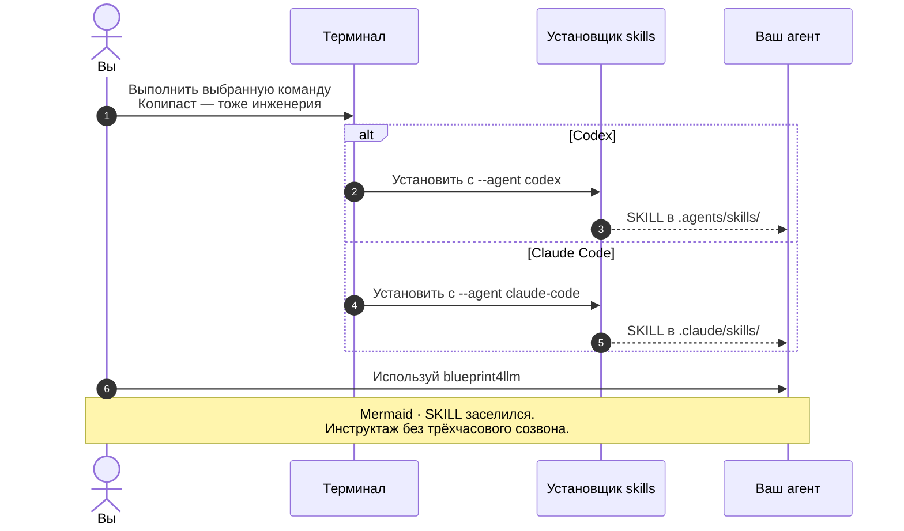

# Я считал SKILL-ы бесполезной тратой токенов, пока не написал свой

Скажу честно: я не понимал, зачем нужны SKILL-ы для LLM-агентов. Вот с MCP все понятно: полезная вещь, с помощью которой можно дать LLM доступ к базе данных или к Figma. Единственный недостаток: чтобы не тратить много токенов, желательно не подключать сразу 30 MCP-серверов. И вообще, лучше отключать лишние и подключать только те, которые действительно нужны для задачи. В этом свете SKILL-ы казались мне бесполезным оверхедом, который жрет токены как не в себя. В TikTok часто видел россказни в духе: подключи такой SKILL или сразу целую пачку, и будет тебе счастье. У меня сразу возникала мысль: если подключить их все, лимиты по подписке будут заканчиваться не к обеду, а уже утром.

```excalidraw
{
  "type": "excalidraw", "version": 2,
  "elements": [
    {"strokeColor": "#17324d", "backgroundColor": "transparent", "fillStyle": "solid", "strokeWidth": 2, "strokeStyle": "solid", "roughness": 0, "opacity": 100, "groupIds": [], "roundness": null, "isDeleted": false, "id": "title", "type": "text", "x": 20, "y": 16, "width": 800, "height": 36, "text": "Excalidraw · Паника скептика", "fontSize": 25, "fontFamily": 2, "textAlign": "center", "lineHeight": 1.3},
    {"strokeColor": "#334155", "backgroundColor": "#edf5ff", "fillStyle": "solid", "strokeWidth": 2, "strokeStyle": "solid", "roughness": 0, "opacity": 100, "groupIds": [], "roundness": null, "isDeleted": false, "id": "start", "type": "rectangle", "x": 20, "y": 85, "width": 220, "height": 155},
    {"strokeColor": "#334155", "backgroundColor": "#fff6db", "fillStyle": "solid", "strokeWidth": 2, "strokeStyle": "solid", "roughness": 0, "opacity": 100, "groupIds": [], "roundness": null, "isDeleted": false, "id": "tokens", "type": "rectangle", "x": 310, "y": 85, "width": 220, "height": 155},
    {"strokeColor": "#334155", "backgroundColor": "#ffe8eb", "fillStyle": "solid", "strokeWidth": 2, "strokeStyle": "solid", "roughness": 0, "opacity": 100, "groupIds": [], "roundness": null, "isDeleted": false, "id": "limit", "type": "rectangle", "x": 600, "y": 85, "width": 220, "height": 155},
    {"strokeColor": "#334155", "backgroundColor": "transparent", "fillStyle": "solid", "strokeWidth": 2, "strokeStyle": "solid", "roughness": 0, "opacity": 100, "groupIds": [], "roundness": null, "isDeleted": false, "id": "t1", "type": "text", "x": 30, "y": 103, "width": 200, "height": 30, "text": "08:00", "fontSize": 24, "fontFamily": 2, "textAlign": "center", "lineHeight": 1.3},
    {"strokeColor": "#334155", "backgroundColor": "transparent", "fillStyle": "solid", "strokeWidth": 2, "strokeStyle": "solid", "roughness": 0, "opacity": 100, "groupIds": [], "roundness": null, "isDeleted": false, "id": "b1", "type": "text", "x": 30, "y": 148, "width": 200, "height": 75, "text": "«Подключу всё.\nСчастье оптом!»", "fontSize": 18, "fontFamily": 2, "textAlign": "center", "lineHeight": 1.3},
    {"strokeColor": "#334155", "backgroundColor": "transparent", "fillStyle": "solid", "strokeWidth": 2, "strokeStyle": "solid", "roughness": 0, "opacity": 100, "groupIds": [], "roundness": null, "isDeleted": false, "id": "t2", "type": "text", "x": 320, "y": 103, "width": 200, "height": 30, "text": "08:05", "fontSize": 24, "fontFamily": 2, "textAlign": "center", "lineHeight": 1.3},
    {"strokeColor": "#334155", "backgroundColor": "transparent", "fillStyle": "solid", "strokeWidth": 2, "strokeStyle": "solid", "roughness": 0, "opacity": 100, "groupIds": [], "roundness": null, "isDeleted": false, "id": "b2", "type": "text", "x": 320, "y": 148, "width": 200, "height": 75, "text": "Токены:\n«Завтрак подан!»", "fontSize": 18, "fontFamily": 2, "textAlign": "center", "lineHeight": 1.3},
    {"strokeColor": "#334155", "backgroundColor": "transparent", "fillStyle": "solid", "strokeWidth": 2, "strokeStyle": "solid", "roughness": 0, "opacity": 100, "groupIds": [], "roundness": null, "isDeleted": false, "id": "t3", "type": "text", "x": 610, "y": 103, "width": 200, "height": 30, "text": "08:06", "fontSize": 24, "fontFamily": 2, "textAlign": "center", "lineHeight": 1.3},
    {"strokeColor": "#334155", "backgroundColor": "transparent", "fillStyle": "solid", "strokeWidth": 2, "strokeStyle": "solid", "roughness": 0, "opacity": 100, "groupIds": [], "roundness": null, "isDeleted": false, "id": "b3", "type": "text", "x": 610, "y": 148, "width": 200, "height": 75, "text": "Лимит:\n«Я уже поел».", "fontSize": 18, "fontFamily": 2, "textAlign": "center", "lineHeight": 1.3},
    {"strokeColor": "#334155", "backgroundColor": "transparent", "fillStyle": "solid", "strokeWidth": 2, "strokeStyle": "solid", "roughness": 0, "opacity": 100, "groupIds": [], "roundness": null, "isDeleted": false, "id": "a1", "type": "arrow", "x": 247, "y": 164, "width": 55, "height": 0, "points": [[0, 0], [55, 0]], "startArrowhead": null, "endArrowhead": "triangle", "elbowed": false},
    {"strokeColor": "#334155", "backgroundColor": "transparent", "fillStyle": "solid", "strokeWidth": 2, "strokeStyle": "solid", "roughness": 0, "opacity": 100, "groupIds": [], "roundness": null, "isDeleted": false, "id": "a2", "type": "arrow", "x": 537, "y": 164, "width": 55, "height": 0, "points": [[0, 0], [55, 0]], "startArrowhead": null, "endArrowhead": "triangle", "elbowed": false},
    {"strokeColor": "#64748b", "backgroundColor": "transparent", "fillStyle": "solid", "strokeWidth": 2, "strokeStyle": "solid", "roughness": 0, "opacity": 100, "groupIds": [], "roundness": null, "isDeleted": false, "id": "note", "type": "text", "x": 20, "y": 267, "width": 800, "height": 58, "text": "Страх автора до знакомства со SKILL-ами.\nВ следующем абзаце токены подадут апелляцию.", "fontSize": 18, "fontFamily": 2, "textAlign": "center", "lineHeight": 1.3}
  ],
  "appState": {"viewBackgroundColor": "#ffffff"}, "files": {}
}
```

Почему же все-таки SKILL-ы полезны и нужны? Ну, во-первых, по сравнению с MCP SKILL-ы не раздувают контекст: каждый подключенный SKILL добавляет не десятки тысяч токенов, а 1-2 сотни. Так как в контекст сначала попадают только название и описание SKILL-а, можно безболезненно добавить 30 своих SKILL-ов без особых последствий. Когда потребуется использовать SKILL, LLM-агент сам подтянет его описание, если поймет из контекста задачи, что это нужно, или пользователь сам скажет ему использовать такой SKILL для работы.

```vega-lite
{
  "$schema": "https://vega.github.io/schema/vega-lite/v6.json",
  "title": {
    "text": "Vega-Lite · Сначала визитки, потом чемоданы",
    "subtitle": [
      "Иллюстрация оценки из абзаца: 100–200 токенов на название и описание.",
      "Полные инструкции ждут своей задачи — чемоданы пока в гардеробе."
    ],
    "anchor": "start",
    "fontSize": 22,
    "subtitleFontSize": 12
  },
  "description": "Иллюстративный расчёт начального контекста: 1, 10 и 30 SKILL-ов при оценке 100–200 токенов на название и описание одного SKILL-а.",
  "width": 520,
  "height": 200,
  "data": {
    "values": [
      {
        "skills": "1 SKILL",
        "min": 100,
        "max": 200,
        "range": "100–200"
      },
      {
        "skills": "10 SKILL-ов",
        "min": 1000,
        "max": 2000,
        "range": "1 000–2 000"
      },
      {
        "skills": "30 SKILL-ов",
        "min": 3000,
        "max": 6000,
        "range": "3 000–6 000"
      }
    ]
  },
  "encoding": {
    "y": {
      "field": "skills",
      "type": "ordinal",
      "title": null,
      "sort": [
        "1 SKILL",
        "10 SKILL-ов",
        "30 SKILL-ов"
      ],
      "axis": {
        "labelFontSize": 14
      }
    },
    "x": {
      "field": "min",
      "type": "quantitative",
      "title": "Токены в начальном контексте",
      "scale": {
        "domain": [
          0,
          7500
        ]
      },
      "axis": {
        "tickCount": 4
      }
    }
  },
  "layer": [
    {
      "mark": {
        "type": "rule",
        "strokeWidth": 18,
        "color": "#60a5fa"
      },
      "encoding": {
        "x2": {
          "field": "max"
        }
      }
    },
    {
      "mark": {
        "type": "point",
        "filled": true,
        "size": 70,
        "color": "#1e40af"
      }
    },
    {
      "mark": {
        "type": "point",
        "filled": true,
        "size": 70,
        "color": "#1e40af"
      },
      "encoding": {
        "x": {
          "field": "max",
          "type": "quantitative"
        }
      }
    },
    {
      "mark": {
        "type": "text",
        "align": "left",
        "dx": 12,
        "fontSize": 14,
        "color": "#17324d"
      },
      "encoding": {
        "x": {
          "field": "max",
          "type": "quantitative"
        },
        "text": {
          "field": "range"
        }
      }
    }
  ],
  "config": {
    "font": "sans-serif",
    "axis": {
      "labelFontSize": 12,
      "titleFontSize": 13,
      "gridColor": "#e2e8f0"
    },
    "view": {
      "stroke": null
    }
  }
}
```

Во-вторых, LLM-модели обучаются на самых популярных и известных вещах. Например, всем очевидно, что LLM без проблем может работать с Git или писать программу на Python. Но если вы сами разработали программу или для работы вам нужно пользоваться малоизвестной тулзой или технологией, SKILL тут просто незаменим. Вам достаточно создать файл SKILL.md и описать в нем, как работать с этой программой или технологией. Таким образом, вы облегчаете жизнь LLM: при выполнении ваших задач ей не придется искать в интернете документацию и лазить по сайтам, чтобы понять, как этим пользоваться. А уж тем более, если в интернете ничего нет, потому что ваша программа закрыта для публичного доступа.

```d2
direction: right
agent: "LLM-агент\nGit знает" {
  width: 120
  height: 100
  style.fill: "#eaf2ff"
  style.font-size: 16
}
guide: "D2 · SKILL.md\nПереводчик\nс корпоративного" {
  label.near: center-center
  width: 200
  height: 120
  style.fill: "#dcfce7"
  style.font-size: 16
}
tool: "Наша тулза\nПоисковик\nне в курсе" {
  label.near: center-center
  width: 130
  height: 120
  style.fill: "#fef3c7"
  style.font-size: 16
}
agent -> guide
guide -> tool
```

В-третьих, LLM-модель обычно не знает, как у вас устроен процесс разработки. Например, агент умеет пользоваться Git, запускать тесты, собирать проект и создавать релизы. Обучать его этому не нужно. Но он не знает, как именно в вашей компании принято выпускать релизы. Skill может описывать последовательность действий: проверить изменения, запустить тесты, обновить CHANGELOG.md, увеличить версию, собрать пакет, создать Git-тег и опубликовать релиз. То есть Skill помогает освоить не технологию, а конкретный бизнес-процесс.



В-четвертых, SKILL представляет собой не просто инструкцию, а целый набор инструментов. Помимо SKILL.md, в него можно положить готовые скрипты, документацию, шаблоны и другие файлы. И самое интересное: все эти файлы не загружаются в контекст автоматически. Агент читает их только по необходимости, а готовые скрипты может просто запускать, не тратя токены на генерацию кода. Таким образом, SKILL позволяет объединить инструкции, документацию и исполняемый код в один пакет, не раздувая контекст LLM. Например, структура может выглядеть так:

```
my-skill/
├── SKILL.md
├── scripts/
│   ├── generate.py
│   └── validate.py
├── references/
│   └── api.md
└── assets/
    └── template.html
```



Самое забавное: SKILL-ы я заценил именно тогда, когда написал свою программу blueprint4llm. Идея ее создания возникла после того, как я попросил LLM-агента сгенерировать файл plan.md с описанием задачи. Обычно он выдает большую портянку текста, которую медленно и тоскливо приходится читать. Мне захотелось сократить текст и добавить больше блок-схем, таблиц, диаграмм и прототипов пользовательских интерфейсов. Как известно, в файлах .md (Markdown) из средств визуализации доступны только таблицы и диаграммы Mermaid. В них нет чартов, графиков, гистограмм, полноценных UML-диаграмм и прототипов UI. В итоге с помощью blueprint4llm я добавил в .md поддержку таких форматов, как PlantUML, draw.io, Pencil, Balsamiq, Graphviz, Figma, OpenAPI, Excalidraw, Vega-Lite, ECharts и D2.

```balsamiq
{
  "mockup": {
    "version": "1.0",
    "measuredW": "800",
    "measuredH": "430",
    "controls": {
      "control": [
        { "ID": "canvas", "typeID": "Rectangle", "x": "0", "y": "0", "w": "800", "h": "430", "zOrder": "0", "properties": { "color": "#ffffff" } },
        { "ID": "title", "typeID": "Title", "x": "22", "y": "15", "w": "754", "h": "34", "zOrder": "1", "properties": { "text": "Balsamiq · plan.md: портянка на пенсии", "size": "24", "bold": "true" } },
        { "ID": "subtitle", "typeID": "Label", "x": "22", "y": "53", "w": "754", "h": "24", "zOrder": "2", "properties": { "text": "Идеи те же. У читателя появился шанс дочитать до обеда.", "size": "14" } },
        { "ID": "source", "typeID": "Rectangle", "x": "22", "y": "94", "w": "240", "h": "264", "zOrder": "3", "properties": { "color": "#f1f5f9" } },
        { "ID": "source-title", "typeID": "Label", "x": "38", "y": "110", "w": "210", "h": "26", "zOrder": "4", "properties": { "text": "До: роман в 40 томах", "size": "16", "bold": "true" } },
        { "ID": "source-body", "typeID": "Paragraph", "x": "38", "y": "152", "w": "208", "h": "178", "zOrder": "5", "properties": { "text": "Сначала следует описать...\nДалее необходимо учесть...\nЗатем крайне важно...\nКроме того, стоит...\nТакже нельзя забыть...\nПродолжение в томе 2.", "size": "14" } },
        { "ID": "result", "typeID": "Rectangle", "x": "282", "y": "94", "w": "496", "h": "264", "zOrder": "6", "properties": { "color": "#eff6ff" } },
        { "ID": "result-title", "typeID": "Label", "x": "300", "y": "110", "w": "460", "h": "26", "zOrder": "7", "properties": { "text": "После: blueprint4llm показывает идею", "size": "16", "bold": "true" } },
        { "ID": "flow", "typeID": "Rectangle", "x": "300", "y": "150", "w": "220", "h": "78", "zOrder": "8", "properties": { "text": "Блок-схема\nЗапрос → Проверка → Готово", "color": "#dbeafe", "size": "13" } },
        { "ID": "ui", "typeID": "Rectangle", "x": "536", "y": "150", "w": "224", "h": "78", "zOrder": "9", "properties": { "text": "Прототип экрана\n[ Идею видно! ]", "color": "#dcfce7", "size": "13" } },
        { "ID": "chart", "typeID": "Rectangle", "x": "300", "y": "244", "w": "220", "h": "92", "zOrder": "10", "properties": { "text": "Графики и чарты\nЦифры вышли погулять", "color": "#fef3c7", "size": "13" } },
        { "ID": "uml", "typeID": "Rectangle", "x": "536", "y": "244", "w": "224", "h": "92", "zOrder": "11", "properties": { "text": "UML и архитектура\nКто с кем дружит", "color": "#ede9fe", "size": "13" } },
        { "ID": "footer", "typeID": "Label", "x": "22", "y": "378", "w": "754", "h": "26", "zOrder": "12", "properties": { "text": "Markdown хранит смысл. Визуализации спасают глаза.", "size": "15", "bold": "true" } }
      ]
    }
  }
}
```

Подключив SKILL blueprint4llm, вы будете получать plan.md не в виде километрового текста, а в виде блок-схем, прототипов, графиков и т. д. Кстати, blueprint4llm необязательно использовать только для создания plan.md. Например, я использовал этот SKILL, чтобы добавить по иллюстрации к каждому абзацу статьи и сделать ее веселее для чтения. Этот SKILL также удобно использовать, когда вы поручаете агенту собрать полное досье о какой-либо компании, технологии или человеке и просите оформить итоговый файл result.md с помощью blueprint4llm. Его потом можно конвертировать в HTML или PDF, а можно попросить агента сразу показать его в браузере с графиками.

```drawio direction=TB
{
  "version": "26.0",
  "pages": [{
    "id": "uses",
    "name": "От задачи до картинки",
    "cells": [
      {"id": "root", "type": "layer", "label": "От задачи до картинки"},
      {"id": "task", "type": "node", "parent": "root", "label": "draw.io · Задача\n«Без километра текста, пожалуйста»"},
      {"id": "agent", "type": "node", "parent": "root", "label": "Агент + SKILL blueprint4llm\nИнструкция по спасению читателя"},
      {"id": "plan", "type": "node", "parent": "root", "label": "plan.md\nПлан без рулона обоев"},
      {"id": "article", "type": "node", "parent": "root", "label": "article.ru.md\nАбзац сказал — схема показала"},
      {"id": "dossier", "type": "node", "parent": "root", "label": "result.md\nДосье: всё видно, шпион не нужен"},
      {"id": "cli", "type": "node", "parent": "root", "label": "blueprint4llm CLI\nРендерит Markdown без вызова LLM"},
      {"id": "view", "type": "node", "parent": "root", "label": "Браузер · HTML · PDF\nГлаза вышли из отпуска"},
      {"id": "e1", "type": "edge", "parent": "root", "source": "task", "target": "agent"},
      {"id": "e2", "type": "edge", "parent": "root", "source": "agent", "target": "plan"},
      {"id": "e3", "type": "edge", "parent": "root", "source": "agent", "target": "article"},
      {"id": "e4", "type": "edge", "parent": "root", "source": "agent", "target": "dossier"},
      {"id": "e5", "type": "edge", "parent": "root", "source": "plan", "target": "cli"},
      {"id": "e6", "type": "edge", "parent": "root", "source": "article", "target": "cli"},
      {"id": "e7", "type": "edge", "parent": "root", "source": "dossier", "target": "cli"},
      {"id": "e8", "type": "edge", "parent": "root", "source": "cli", "target": "view"}
    ]
  }]
}
```

Вот так можно установить SKILL blueprint4llm.

```
# Codex
npx skills add evgenyigumnov/blueprint4llm --skill blueprint4llm --agent codex

# Claude Code
npx skills add evgenyigumnov/blueprint4llm --skill blueprint4llm --agent claude-code
```



Если вам интересно посмотреть исходный код blueprint4llm, тулзы, которая генерирует всю эту красоту, или прислать пулл-реквест, велком: https://github.com/evgenyigumnov/blueprint4llm

```pencil
{
  "version": "2.21",
  "children": [
    {
      "id": "contribution-poster",
      "type": "frame",
      "width": 760,
      "height": 393,
      "layout": "none",
      "clip": true,
      "fill": "#F8FAFC",
      "children": [
        {
          "id": "header",
          "type": "rectangle",
          "x": 0,
          "y": 0,
          "width": 760,
          "height": 92,
          "fill": "#172554",
          "stroke": "#172554",
          "strokeWidth": 1,
          "cornerRadius": 0
        },
        {
          "id": "title",
          "type": "text",
          "x": 28,
          "y": 16,
          "width": 704,
          "height": 32,
          "content": "Pencil · Добро пожаловать в исходники",
          "fontSize": 25,
          "fontWeight": "700",
          "fill": "#FFFFFF",
          "textAlign": "left",
          "textAlignVertical": "top"
        },
        {
          "id": "repo",
          "type": "text",
          "x": 28,
          "y": 57,
          "width": 704,
          "height": 24,
          "content": "github.com/evgenyigumnov/blueprint4llm",
          "fontSize": 17,
          "fontWeight": "400",
          "fill": "#BFDBFE",
          "textAlign": "left",
          "textAlignVertical": "top"
        },
        {
          "id": "welcome",
          "type": "text",
          "x": 28,
          "y": 113,
          "width": 704,
          "height": 32,
          "content": "Заходите посмотреть. Можно с PR. Тапочки необязательны.",
          "fontSize": 18,
          "fontWeight": "400",
          "fill": "#334155",
          "textAlign": "left",
          "textAlignVertical": "top"
        },
        {
          "id": "read-card",
          "type": "rectangle",
          "x": 28,
          "y": 165,
          "width": 228,
          "height": 142,
          "fill": "#EFF6FF",
          "stroke": "#CBD5E1",
          "strokeWidth": 1,
          "cornerRadius": 12
        },
        {
          "id": "read-title",
          "type": "text",
          "x": 43,
          "y": 182,
          "width": 198,
          "height": 25,
          "content": "ПОСМОТРЕТЬ",
          "fontSize": 15,
          "fontWeight": "700",
          "fill": "#172554",
          "textAlign": "left",
          "textAlignVertical": "top"
        },
        {
          "id": "read-desc",
          "type": "text",
          "x": 43,
          "y": 223,
          "width": 198,
          "height": 34,
          "content": "README и исходный код",
          "fontSize": 13,
          "fontWeight": "400",
          "fill": "#475569",
          "textAlign": "left",
          "textAlignVertical": "top"
        },
        {
          "id": "read-joke",
          "type": "text",
          "x": 43,
          "y": 270,
          "width": 198,
          "height": 22,
          "content": "«А что под капотом?»",
          "fontSize": 13,
          "fontWeight": "400",
          "fill": "#334155",
          "textAlign": "left",
          "textAlignVertical": "top"
        },
        {
          "id": "fork-card",
          "type": "rectangle",
          "x": 266,
          "y": 165,
          "width": 228,
          "height": 142,
          "fill": "#FFF7ED",
          "stroke": "#CBD5E1",
          "strokeWidth": 1,
          "cornerRadius": 12
        },
        {
          "id": "fork-title",
          "type": "text",
          "x": 281,
          "y": 182,
          "width": 198,
          "height": 25,
          "content": "ПОПРОБОВАТЬ",
          "fontSize": 15,
          "fontWeight": "700",
          "fill": "#172554",
          "textAlign": "left",
          "textAlignVertical": "top"
        },
        {
          "id": "fork-desc",
          "type": "text",
          "x": 281,
          "y": 223,
          "width": 198,
          "height": 34,
          "content": "Своя идея в своей копии",
          "fontSize": 13,
          "fontWeight": "400",
          "fill": "#475569",
          "textAlign": "left",
          "textAlignVertical": "top"
        },
        {
          "id": "fork-joke",
          "type": "text",
          "x": 281,
          "y": 270,
          "width": 198,
          "height": 22,
          "content": "«А если вот так?»",
          "fontSize": 13,
          "fontWeight": "400",
          "fill": "#334155",
          "textAlign": "left",
          "textAlignVertical": "top"
        },
        {
          "id": "pr-card",
          "type": "rectangle",
          "x": 504,
          "y": 165,
          "width": 228,
          "height": 142,
          "fill": "#F0FDF4",
          "stroke": "#CBD5E1",
          "strokeWidth": 1,
          "cornerRadius": 12
        },
        {
          "id": "pr-title",
          "type": "text",
          "x": 519,
          "y": 182,
          "width": 198,
          "height": 25,
          "content": "ПРЕДЛОЖИТЬ",
          "fontSize": 15,
          "fontWeight": "700",
          "fill": "#172554",
          "textAlign": "left",
          "textAlignVertical": "top"
        },
        {
          "id": "pr-desc",
          "type": "text",
          "x": 519,
          "y": 223,
          "width": 198,
          "height": 34,
          "content": "Пулл-реквест в репозиторий",
          "fontSize": 13,
          "fontWeight": "400",
          "fill": "#475569",
          "textAlign": "left",
          "textAlignVertical": "top"
        },
        {
          "id": "pr-joke",
          "type": "text",
          "x": 519,
          "y": 270,
          "width": 198,
          "height": 22,
          "content": "«Я тут красоту принёс»",
          "fontSize": 13,
          "fontWeight": "400",
          "fill": "#334155",
          "textAlign": "left",
          "textAlignVertical": "top"
        },
        {
          "id": "footer",
          "type": "rectangle",
          "x": 28,
          "y": 328,
          "width": 704,
          "height": 43,
          "fill": "#DBEAFE",
          "stroke": "#DBEAFE",
          "strokeWidth": 1,
          "cornerRadius": 8
        },
        {
          "id": "footer-text",
          "type": "text",
          "x": 40,
          "y": 340,
          "width": 680,
          "height": 22,
          "content": "Клуб любителей схем: вход по любопытству.",
          "fontSize": 16,
          "fontWeight": "600",
          "fill": "#1E3A8A",
          "textAlign": "center",
          "textAlignVertical": "top"
        }
      ]
    }
  ]
}
```
