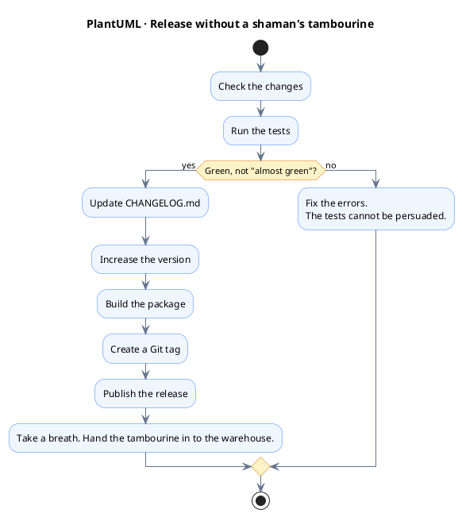
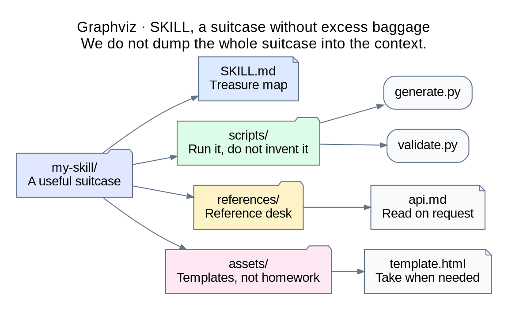
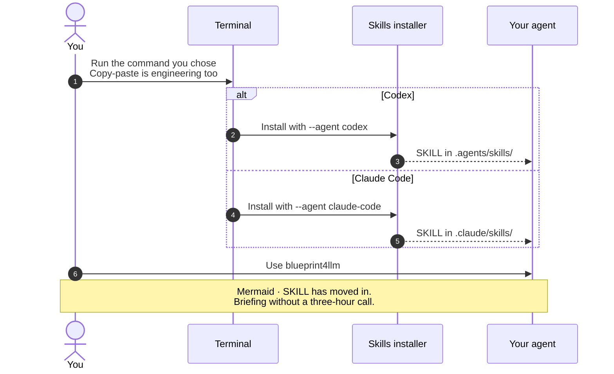

# I Thought SKILLs Were a Waste of Tokens Until I Wrote My Own

I'll be honest, I didn't understand why LLM agents need SKILLs. MCP was clear to me: it's a useful thing that lets you give an LLM access to a database or to Figma. The only downside is that, to avoid spending too many tokens, it's better not to connect 30 MCP servers at once. And in general, it's better to turn off the unnecessary ones and connect only those that are really needed for the task. In this light, SKILLs seemed like useless overhead to me, eating tokens like crazy. On TikTok, I often saw tales along the lines of: connect this SKILL, or a whole bunch of them, and happiness is yours. My first thought was, if I connect them all, my subscription limits will run out not by lunchtime, but already in the morning.

```excalidraw
{
  "type": "excalidraw", "version": 2,
  "elements": [
    {"strokeColor": "#17324d", "backgroundColor": "transparent", "fillStyle": "solid", "strokeWidth": 2, "strokeStyle": "solid", "roughness": 0, "opacity": 100, "groupIds": [], "roundness": null, "isDeleted": false, "id": "title", "type": "text", "x": 20, "y": 16, "width": 800, "height": 36, "text": "Excalidraw · Skeptic's panic", "fontSize": 25, "fontFamily": 2, "textAlign": "center", "lineHeight": 1.3},
    {"strokeColor": "#334155", "backgroundColor": "#edf5ff", "fillStyle": "solid", "strokeWidth": 2, "strokeStyle": "solid", "roughness": 0, "opacity": 100, "groupIds": [], "roundness": null, "isDeleted": false, "id": "start", "type": "rectangle", "x": 20, "y": 85, "width": 220, "height": 155},
    {"strokeColor": "#334155", "backgroundColor": "#fff6db", "fillStyle": "solid", "strokeWidth": 2, "strokeStyle": "solid", "roughness": 0, "opacity": 100, "groupIds": [], "roundness": null, "isDeleted": false, "id": "tokens", "type": "rectangle", "x": 310, "y": 85, "width": 220, "height": 155},
    {"strokeColor": "#334155", "backgroundColor": "#ffe8eb", "fillStyle": "solid", "strokeWidth": 2, "strokeStyle": "solid", "roughness": 0, "opacity": 100, "groupIds": [], "roundness": null, "isDeleted": false, "id": "limit", "type": "rectangle", "x": 600, "y": 85, "width": 220, "height": 155},
    {"strokeColor": "#334155", "backgroundColor": "transparent", "fillStyle": "solid", "strokeWidth": 2, "strokeStyle": "solid", "roughness": 0, "opacity": 100, "groupIds": [], "roundness": null, "isDeleted": false, "id": "t1", "type": "text", "x": 30, "y": 103, "width": 200, "height": 30, "text": "08:00", "fontSize": 24, "fontFamily": 2, "textAlign": "center", "lineHeight": 1.3},
    {"strokeColor": "#334155", "backgroundColor": "transparent", "fillStyle": "solid", "strokeWidth": 2, "strokeStyle": "solid", "roughness": 0, "opacity": 100, "groupIds": [], "roundness": null, "isDeleted": false, "id": "b1", "type": "text", "x": 30, "y": 148, "width": 200, "height": 75, "text": "\"I will connect everything.\nHappiness, wholesale!\"", "fontSize": 18, "fontFamily": 2, "textAlign": "center", "lineHeight": 1.3},
    {"strokeColor": "#334155", "backgroundColor": "transparent", "fillStyle": "solid", "strokeWidth": 2, "strokeStyle": "solid", "roughness": 0, "opacity": 100, "groupIds": [], "roundness": null, "isDeleted": false, "id": "t2", "type": "text", "x": 320, "y": 103, "width": 200, "height": 30, "text": "08:05", "fontSize": 24, "fontFamily": 2, "textAlign": "center", "lineHeight": 1.3},
    {"strokeColor": "#334155", "backgroundColor": "transparent", "fillStyle": "solid", "strokeWidth": 2, "strokeStyle": "solid", "roughness": 0, "opacity": 100, "groupIds": [], "roundness": null, "isDeleted": false, "id": "b2", "type": "text", "x": 320, "y": 148, "width": 200, "height": 75, "text": "Tokens:\n\"Breakfast is served!\"", "fontSize": 18, "fontFamily": 2, "textAlign": "center", "lineHeight": 1.3},
    {"strokeColor": "#334155", "backgroundColor": "transparent", "fillStyle": "solid", "strokeWidth": 2, "strokeStyle": "solid", "roughness": 0, "opacity": 100, "groupIds": [], "roundness": null, "isDeleted": false, "id": "t3", "type": "text", "x": 610, "y": 103, "width": 200, "height": 30, "text": "08:06", "fontSize": 24, "fontFamily": 2, "textAlign": "center", "lineHeight": 1.3},
    {"strokeColor": "#334155", "backgroundColor": "transparent", "fillStyle": "solid", "strokeWidth": 2, "strokeStyle": "solid", "roughness": 0, "opacity": 100, "groupIds": [], "roundness": null, "isDeleted": false, "id": "b3", "type": "text", "x": 610, "y": 148, "width": 200, "height": 75, "text": "Limit:\n\"I have already eaten.\"", "fontSize": 18, "fontFamily": 2, "textAlign": "center", "lineHeight": 1.3},
    {"strokeColor": "#334155", "backgroundColor": "transparent", "fillStyle": "solid", "strokeWidth": 2, "strokeStyle": "solid", "roughness": 0, "opacity": 100, "groupIds": [], "roundness": null, "isDeleted": false, "id": "a1", "type": "arrow", "x": 247, "y": 164, "width": 55, "height": 0, "points": [[0, 0], [55, 0]], "startArrowhead": null, "endArrowhead": "triangle", "elbowed": false},
    {"strokeColor": "#334155", "backgroundColor": "transparent", "fillStyle": "solid", "strokeWidth": 2, "strokeStyle": "solid", "roughness": 0, "opacity": 100, "groupIds": [], "roundness": null, "isDeleted": false, "id": "a2", "type": "arrow", "x": 537, "y": 164, "width": 55, "height": 0, "points": [[0, 0], [55, 0]], "startArrowhead": null, "endArrowhead": "triangle", "elbowed": false},
    {"strokeColor": "#64748b", "backgroundColor": "transparent", "fillStyle": "solid", "strokeWidth": 2, "strokeStyle": "solid", "roughness": 0, "opacity": 100, "groupIds": [], "roundness": null, "isDeleted": false, "id": "note", "type": "text", "x": 20, "y": 267, "width": 800, "height": 58, "text": "Author's fear before meeting SKILLs.\nIn the next paragraph, tokens will file an appeal.", "fontSize": 18, "fontFamily": 2, "textAlign": "center", "lineHeight": 1.3}
  ],
  "appState": {"viewBackgroundColor": "#ffffff"}, "files": {}
}
```

So why are SKILLs useful and needed after all? Well, first, compared to MCP, SKILLs do not inflate the context: each connected SKILL adds not tens of thousands of tokens, but one or two hundred. Since only the name and description of a SKILL go into the context at first, you can add 30 of your own SKILLs without much pain. When it becomes necessary to use a SKILL, the LLM agent will load its description on its own, if it understands from the task context that this is needed, or the user can simply tell it to use this SKILL for the job.

```vega-lite
{
  "$schema": "https://vega.github.io/schema/vega-lite/v6.json",
  "title": {
    "text": "Vega-Lite, first business cards, then suitcases",
    "subtitle": [
      "An illustration of the estimate from the paragraph: 100-200 tokens for a SKILL name and description.",
      "Full instructions wait for their task, the suitcases are still in the cloakroom."
    ],
    "anchor": "start",
    "fontSize": 22,
    "subtitleFontSize": 12
  },
  "description": "An illustrative estimate of the initial context: 1, 10, and 30 SKILLs, assuming 100-200 tokens for the name and description of one SKILL.",
  "width": 520,
  "height": 200,
  "data": {
    "values": [
      {
        "skills": "1 SKILL",
        "min": 100,
        "max": 200,
        "range": "100-200"
      },
      {
        "skills": "10 SKILLs",
        "min": 1000,
        "max": 2000,
        "range": "1 000-2 000"
      },
      {
        "skills": "30 SKILLs",
        "min": 3000,
        "max": 6000,
        "range": "3 000-6 000"
      }
    ]
  },
  "encoding": {
    "y": {
      "field": "skills",
      "type": "ordinal",
      "title": null,
      "sort": [
        "1 SKILL",
        "10 SKILLs",
        "30 SKILLs"
      ],
      "axis": {
        "labelFontSize": 14
      }
    },
    "x": {
      "field": "min",
      "type": "quantitative",
      "title": "Tokens in the initial context",
      "scale": {
        "domain": [
          0,
          7500
        ]
      },
      "axis": {
        "tickCount": 4
      }
    }
  },
  "layer": [
    {
      "mark": {
        "type": "rule",
        "strokeWidth": 18,
        "color": "#60a5fa"
      },
      "encoding": {
        "x2": {
          "field": "max"
        }
      }
    },
    {
      "mark": {
        "type": "point",
        "filled": true,
        "size": 70,
        "color": "#1e40af"
      }
    },
    {
      "mark": {
        "type": "point",
        "filled": true,
        "size": 70,
        "color": "#1e40af"
      },
      "encoding": {
        "x": {
          "field": "max",
          "type": "quantitative"
        }
      }
    },
    {
      "mark": {
        "type": "text",
        "align": "left",
        "dx": 12,
        "fontSize": 14,
        "color": "#17324d"
      },
      "encoding": {
        "x": {
          "field": "max",
          "type": "quantitative"
        },
        "text": {
          "field": "range"
        }
      }
    }
  ],
  "config": {
    "font": "sans-serif",
    "axis": {
      "labelFontSize": 12,
      "titleFontSize": 13,
      "gridColor": "#e2e8f0"
    },
    "view": {
      "stroke": null
    }
  }
}
```

Secondly, LLM models are trained on the most popular and well-known things. For example, everybody knows that an LLM can work with Git without any problems or write a program in Python. But if you developed a program yourself, or your work requires some little-known tool or technology, then a SKILL is simply irreplaceable. It is enough to create a SKILL.md file and describe how to work with this program or technology. This makes life easier for the LLM: while doing your tasks, it will not have to search the internet for documentation and wander around websites to understand how to use it. And especially if there is nothing on the internet, because your program is closed to public access.

```d2
direction: right
agent: "LLM agent\nKnows Git" {
  width: 120
  height: 100
  style.fill: "#eaf2ff"
  style.font-size: 16
}
guide: "D2 · SKILL.md\nTranslator\nfrom corporate speak" {
  label.near: center-center
  width: 200
  height: 120
  style.fill: "#dcfce7"
  style.font-size: 16
}
tool: "Our tool\nSearch engine\nhas no idea" {
  label.near: center-center
  width: 130
  height: 120
  style.fill: "#fef3c7"
  style.font-size: 16
}
agent -> guide
guide -> tool
```

Thirdly, an LLM model usually does not know how your development process is organized. For example, an agent knows how to use Git, run tests, build a project, and create releases. You do not need to teach it these things. But it does not know how releases are usually made in your company. A Skill can describe the sequence of actions: check the changes, run tests, update CHANGELOG.md, increase the version, build a package, create a Git tag, and publish a release. So, a Skill helps the agent learn not a technology, but a specific business process.



Fourthly, a SKILL is not just an instruction, but a whole set of tools. Besides SKILL.md, you can put ready-made scripts, documentation, templates, and other files into it. And the most interesting thing is, these files are not loaded into the context automatically. The agent reads them only when there is a need, and can simply run the ready-made scripts without spending tokens on generating code. So, a SKILL lets you combine instructions, documentation, and executable code in one package without inflating the LLM context. For example, the structure can look like this:

```
my-skill/
├── SKILL.md
├── scripts/
│   ├── generate.py
│   └── validate.py
├── references/
│   └── api.md
└── assets/
    └── template.html
```



The funniest thing is, I started to appreciate SKILLs exactly when I wrote my own program, blueprint4llm. The idea for creating it came after I asked an LLM agent to generate a plan.md file describing a task. Usually it produces a huge wall of text, which you have to read slowly and with sadness. I wanted to make the text shorter and add more flowcharts, tables, diagrams, and user interface prototypes. As we know, in .md (Markdown) files the only visualization tools available are tables and Mermaid diagrams. There are no charts, plots, histograms, full UML diagrams, or UI prototypes. In the end, with blueprint4llm, I added support for formats such as PlantUML, draw.io, Pencil, Balsamiq, Graphviz, Figma, OpenAPI, Excalidraw, Vega-Lite, ECharts, and D2 to .md files.

```balsamiq
{
  "mockup": {
    "version": "1.0",
    "measuredW": "800",
    "measuredH": "430",
    "controls": {
      "control": [
        { "ID": "canvas", "typeID": "Rectangle", "x": "0", "y": "0", "w": "800", "h": "430", "zOrder": "0", "properties": { "color": "#ffffff" } },
        { "ID": "title", "typeID": "Title", "x": "22", "y": "15", "w": "754", "h": "34", "zOrder": "1", "properties": { "text": "Balsamiq · plan.md: a wall of text in retirement", "size": "24", "bold": "true" } },
        { "ID": "subtitle", "typeID": "Label", "x": "22", "y": "53", "w": "754", "h": "24", "zOrder": "2", "properties": { "text": "The ideas are the same. The reader now has a chance to finish before lunch.", "size": "14" } },
        { "ID": "source", "typeID": "Rectangle", "x": "22", "y": "94", "w": "240", "h": "264", "zOrder": "3", "properties": { "color": "#f1f5f9" } },
        { "ID": "source-title", "typeID": "Label", "x": "38", "y": "110", "w": "210", "h": "26", "zOrder": "4", "properties": { "text": "Before: a novel in 40 volumes", "size": "16", "bold": "true" } },
        { "ID": "source-body", "typeID": "Paragraph", "x": "38", "y": "152", "w": "208", "h": "178", "zOrder": "5", "properties": { "text": "First, it is necessary to describe...\nNext, it is necessary to take into account...\nThen it is extremely important...\nBesides, it is worth...\nWe should also not forget...\nTo be continued in volume 2.", "size": "14" } },
        { "ID": "result", "typeID": "Rectangle", "x": "282", "y": "94", "w": "496", "h": "264", "zOrder": "6", "properties": { "color": "#eff6ff" } },
        { "ID": "result-title", "typeID": "Label", "x": "300", "y": "110", "w": "460", "h": "26", "zOrder": "7", "properties": { "text": "After: blueprint4llm shows the idea", "size": "16", "bold": "true" } },
        { "ID": "flow", "typeID": "Rectangle", "x": "300", "y": "150", "w": "220", "h": "78", "zOrder": "8", "properties": { "text": "Flowchart\nRequest → Check → Done", "color": "#dbeafe", "size": "13" } },
        { "ID": "ui", "typeID": "Rectangle", "x": "536", "y": "150", "w": "224", "h": "78", "zOrder": "9", "properties": { "text": "Screen prototype\n[ Now the idea is visible! ]", "color": "#dcfce7", "size": "13" } },
        { "ID": "chart", "typeID": "Rectangle", "x": "300", "y": "244", "w": "220", "h": "92", "zOrder": "10", "properties": { "text": "Charts and graphs\nThe numbers went out for a walk", "color": "#fef3c7", "size": "13" } },
        { "ID": "uml", "typeID": "Rectangle", "x": "536", "y": "244", "w": "224", "h": "92", "zOrder": "11", "properties": { "text": "UML and architecture\nWho is friends with whom", "color": "#ede9fe", "size": "13" } },
        { "ID": "footer", "typeID": "Label", "x": "22", "y": "378", "w": "754", "h": "26", "zOrder": "12", "properties": { "text": "Markdown keeps the meaning. Visualizations save our eyes.", "size": "15", "bold": "true" } }
      ]
    }
  }
}
```

With the blueprint4llm SKILL connected, you will get plan.md not as a kilometer-long text, but as flowcharts, prototypes, charts, and so on. By the way, blueprint4llm does not have to be used only for creating plan.md. For example, I used this SKILL to add an illustration to every paragraph of the article and make it more fun to read. This SKILL is also useful when you ask an agent to put together a full dossier on some company, technology, or person and format the resulting result.md file with blueprint4llm. You can then convert it to HTML or PDF, or ask the agent to show it right away in a browser with charts.

```drawio direction=TB
{
  "version": "26.0",
  "pages": [{
    "id": "uses",
    "name": "From task to picture",
    "cells": [
      {"id": "root", "type": "layer", "label": "From task to picture"},
      {"id": "task", "type": "node", "parent": "root", "label": "draw.io · Task\nNo kilometer of text, please"},
      {"id": "agent", "type": "node", "parent": "root", "label": "Agent + SKILL blueprint4llm\nInstructions for reader rescue"},
      {"id": "plan", "type": "node", "parent": "root", "label": "plan.md\nA plan without a wallpaper roll"},
      {"id": "article", "type": "node", "parent": "root", "label": "article.ru.md\nThe paragraph spoke, the diagram showed"},
      {"id": "dossier", "type": "node", "parent": "root", "label": "result.md\nDossier, everything is visible, no spy needed"},
      {"id": "cli", "type": "node", "parent": "root", "label": "blueprint4llm CLI\nRenders Markdown without an LLM call"},
      {"id": "view", "type": "node", "parent": "root", "label": "Browser · HTML · PDF\nThe eyes have returned from vacation"},
      {"id": "e1", "type": "edge", "parent": "root", "source": "task", "target": "agent"},
      {"id": "e2", "type": "edge", "parent": "root", "source": "agent", "target": "plan"},
      {"id": "e3", "type": "edge", "parent": "root", "source": "agent", "target": "article"},
      {"id": "e4", "type": "edge", "parent": "root", "source": "agent", "target": "dossier"},
      {"id": "e5", "type": "edge", "parent": "root", "source": "plan", "target": "cli"},
      {"id": "e6", "type": "edge", "parent": "root", "source": "article", "target": "cli"},
      {"id": "e7", "type": "edge", "parent": "root", "source": "dossier", "target": "cli"},
      {"id": "e8", "type": "edge", "parent": "root", "source": "cli", "target": "view"}
    ]
  }]
}
```

This is how you can install the blueprint4llm SKILL.

```
# Codex
npx skills add evgenyigumnov/blueprint4llm --skill blueprint4llm --agent codex

# Claude Code
npx skills add evgenyigumnov/blueprint4llm --skill blueprint4llm --agent claude-code
```



If you are interested in looking at the source code of blueprint4llm, the tool that generates all this beauty, or sending a pull request, welcome: https://github.com/evgenyigumnov/blueprint4llm

```pencil
{
  "version": "2.21",
  "children": [
    {
      "id": "contribution-poster",
      "type": "frame",
      "width": 760,
      "height": 393,
      "layout": "none",
      "clip": true,
      "fill": "#F8FAFC",
      "children": [
        {
          "id": "header",
          "type": "rectangle",
          "x": 0,
          "y": 0,
          "width": 760,
          "height": 92,
          "fill": "#172554",
          "stroke": "#172554",
          "strokeWidth": 1,
          "cornerRadius": 0
        },
        {
          "id": "title",
          "type": "text",
          "x": 28,
          "y": 16,
          "width": 704,
          "height": 32,
          "content": "Pencil · Welcome to the source code",
          "fontSize": 25,
          "fontWeight": "700",
          "fill": "#FFFFFF",
          "textAlign": "left",
          "textAlignVertical": "top"
        },
        {
          "id": "repo",
          "type": "text",
          "x": 28,
          "y": 57,
          "width": 704,
          "height": 24,
          "content": "github.com/evgenyigumnov/blueprint4llm",
          "fontSize": 17,
          "fontWeight": "400",
          "fill": "#BFDBFE",
          "textAlign": "left",
          "textAlignVertical": "top"
        },
        {
          "id": "welcome",
          "type": "text",
          "x": 28,
          "y": 113,
          "width": 704,
          "height": 32,
          "content": "Come and have a look. PRs are welcome. Slippers are optional.",
          "fontSize": 18,
          "fontWeight": "400",
          "fill": "#334155",
          "textAlign": "left",
          "textAlignVertical": "top"
        },
        {
          "id": "read-card",
          "type": "rectangle",
          "x": 28,
          "y": 165,
          "width": 228,
          "height": 142,
          "fill": "#EFF6FF",
          "stroke": "#CBD5E1",
          "strokeWidth": 1,
          "cornerRadius": 12
        },
        {
          "id": "read-title",
          "type": "text",
          "x": 43,
          "y": 182,
          "width": 198,
          "height": 25,
          "content": "LOOK AROUND",
          "fontSize": 15,
          "fontWeight": "700",
          "fill": "#172554",
          "textAlign": "left",
          "textAlignVertical": "top"
        },
        {
          "id": "read-desc",
          "type": "text",
          "x": 43,
          "y": 223,
          "width": 198,
          "height": 34,
          "content": "README and source code",
          "fontSize": 13,
          "fontWeight": "400",
          "fill": "#475569",
          "textAlign": "left",
          "textAlignVertical": "top"
        },
        {
          "id": "read-joke",
          "type": "text",
          "x": 43,
          "y": 270,
          "width": 198,
          "height": 22,
          "content": "Under the hood?",
          "fontSize": 13,
          "fontWeight": "400",
          "fill": "#334155",
          "textAlign": "left",
          "textAlignVertical": "top"
        },
        {
          "id": "fork-card",
          "type": "rectangle",
          "x": 266,
          "y": 165,
          "width": 228,
          "height": 142,
          "fill": "#FFF7ED",
          "stroke": "#CBD5E1",
          "strokeWidth": 1,
          "cornerRadius": 12
        },
        {
          "id": "fork-title",
          "type": "text",
          "x": 281,
          "y": 182,
          "width": 198,
          "height": 25,
          "content": "TRY IT",
          "fontSize": 15,
          "fontWeight": "700",
          "fill": "#172554",
          "textAlign": "left",
          "textAlignVertical": "top"
        },
        {
          "id": "fork-desc",
          "type": "text",
          "x": 281,
          "y": 223,
          "width": 198,
          "height": 34,
          "content": "Your own idea in your own copy",
          "fontSize": 13,
          "fontWeight": "400",
          "fill": "#475569",
          "textAlign": "left",
          "textAlignVertical": "top"
        },
        {
          "id": "fork-joke",
          "type": "text",
          "x": 281,
          "y": 270,
          "width": 198,
          "height": 22,
          "content": "What if we try this?",
          "fontSize": 13,
          "fontWeight": "400",
          "fill": "#334155",
          "textAlign": "left",
          "textAlignVertical": "top"
        },
        {
          "id": "pr-card",
          "type": "rectangle",
          "x": 504,
          "y": 165,
          "width": 228,
          "height": 142,
          "fill": "#F0FDF4",
          "stroke": "#CBD5E1",
          "strokeWidth": 1,
          "cornerRadius": 12
        },
        {
          "id": "pr-title",
          "type": "text",
          "x": 519,
          "y": 182,
          "width": 198,
          "height": 25,
          "content": "CONTRIBUTE",
          "fontSize": 15,
          "fontWeight": "700",
          "fill": "#172554",
          "textAlign": "left",
          "textAlignVertical": "top"
        },
        {
          "id": "pr-desc",
          "type": "text",
          "x": 519,
          "y": 223,
          "width": 198,
          "height": 34,
          "content": "Pull request to the repository",
          "fontSize": 13,
          "fontWeight": "400",
          "fill": "#475569",
          "textAlign": "left",
          "textAlignVertical": "top"
        },
        {
          "id": "pr-joke",
          "type": "text",
          "x": 519,
          "y": 270,
          "width": 198,
          "height": 22,
          "content": "I brought something pretty",
          "fontSize": 13,
          "fontWeight": "400",
          "fill": "#334155",
          "textAlign": "left",
          "textAlignVertical": "top"
        },
        {
          "id": "footer",
          "type": "rectangle",
          "x": 28,
          "y": 328,
          "width": 704,
          "height": 43,
          "fill": "#DBEAFE",
          "stroke": "#DBEAFE",
          "strokeWidth": 1,
          "cornerRadius": 8
        },
        {
          "id": "footer-text",
          "type": "text",
          "x": 40,
          "y": 340,
          "width": 680,
          "height": 22,
          "content": "Diagram lovers club, curiosity gets you in.",
          "fontSize": 16,
          "fontWeight": "600",
          "fill": "#1E3A8A",
          "textAlign": "center",
          "textAlignVertical": "top"
        }
      ]
    }
  ]
}
```
