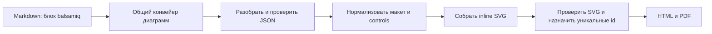

# План: импорт макетов Balsamiq

## Цель

Добавить локальный рендеринг JSON одного макета Balsamiq в SVG через fenced-блок Markdown. Макет должен компилироваться в HTML и PDF тем же конвейером, что Mermaid, PlantUML, Wiremark и Figma.

## Статус

| Этап                              | Состояние            | Результат                                                                                                                                                                                            |
| --------------------------------- | -------------------- | ---------------------------------------------------------------------------------------------------------------------------------------------------------------------------------------------------- |
| JSON одного mockup в fenced-блоке | Выполнен, 22.10.2026 | Парсер документированного формата `measuredW`/`measuredH`, SVG renderer, интеграция с HTML/PDF, диагностика, unit-тесты, пример и документация. `.bmpr` и `.bmml` остаются за пределами этого этапа. |

Проверки этапа: `npm run build`, `npm run typecheck`, `npm run lint`, `npm run format:check` и `npm test` — успешно; 39 файлов и 351 тест прошли. Версия пакета — `0.15.0`.

### Формат первой версии

Поддержать JSON отдельного wireframe со структурой `mockup.controls.control`, которую описывает документация Balsamiq Mockups 3. В Markdown использовать метку `balsamiq`:

```balsamiq
{
  "mockup": {
    "version": "1.0",
    "measuredW": "360",
    "measuredH": "640",
    "controls": {
      "control": [
        {
          "ID": "1",
          "typeID": "Button",
          "x": "24",
          "y": "80",
          "w": "312",
          "h": "48",
          "zOrder": "1",
          "properties": { "text": "Продолжить" }
        }
      ]
    }
  }
}
```

Это JSON одного макета, а не файл проекта `.bmpr`. Документация Mockups 3 указывает размеры `measuredW` и `measuredH` на корне `mockup`; поэтому рендерер читает эти поля, а также поля `mockupW`/`mockupH` из примеров совместимости. Если размеры корня отсутствуют, их можно получить из control `Canvas`. Сам `.bmpr` — проектный файл на SQLite с несколькими досками и ресурсами; поддержка его контейнера и выбора доски остаётся вне этого этапа. Старый `.bmml` — XML и также не входит в задачу. Максимальный размер canvas в Mockups 3 — 4056 × 4056 px. См. [описание экспорта](https://balsamiq.com/support/sharing/exporting/), [документацию JSON Mockups 3](https://balsamiq.com/assets/product/mockups3fordesktop/balsamiq-mockups-3-for-desktop-documentation.pdf) и [историю формата BMPR](https://balsamiq.com/learn/3-2/).

## Поток рендеринга



Рендерер работает офлайн. Он не читает произвольные файлы, не выполняет код из JSON и не загружает ресурсы из сети. Итоговый SVG проходит существующую SVG-проверку проекта.

## Поведение рендерера

1. Зарегистрировать `balsamiqRenderer` в `src/compiler.ts` с языком блока `balsamiq` и версией кэша.
2. Ограничить исходник размером, числом controls и глубиной JSON до его обработки.
3. Проверить корень `mockup`, массив `controls.control`, типы значений, конечные координаты и размеры. В JSON координаты часто записаны строками, поэтому парсер должен преобразовывать их в конечные числа.
4. Определить холст по документированным `measuredW`/`measuredH`; принимать `mockupW`/`mockupH` для совместимости и использовать control `Canvas` как фон и запасной источник размеров.
5. Отсортировать controls по `zOrder` и отрисовать их в порядке слоёв. Перенести координаты, размеры, видимый текст и базовые свойства типовых элементов.
6. Начать с распространённых элементов: Canvas, Label, Title, SubTitle, Paragraph, TextInput, TextArea, Button, CheckBox, RadioButton, ComboBox, List, Rectangle и Line. Зафиксировать реальные `typeID` по примерам экспорта.
7. Для неизвестного `typeID` завершать рендер с понятной диагностикой, содержащей тип и `ID` элемента. Не пропускать элемент молча.
8. Экранировать все строки для SVG. Не вставлять SVG/HTML, URL, стили или атрибуты напрямую из пользовательского JSON.
9. Возвращать SVG через общий кэш, SVG sanitizer и механизм scope ID. Ошибки JSON привязывать к строке fenced-блока, а при наличии позиции парсера — к строке и колонке внутри блока.

## Модули

| Файл                                   | Ответственность                                                            |
| -------------------------------------- | -------------------------------------------------------------------------- |
| `src/renderers/balsamiq.ts`            | Адаптер `DiagramRenderer`, лимит исходника и вызов парсера/рендерера       |
| `src/renderers/balsamiq-json.ts`       | Проверка структуры макета и нормализация полей controls                    |
| `src/renderers/balsamiq-json-tree.ts`  | Ограничение глубины, безопасное чтение JSON-дерева и точные позиции ошибок |
| `src/renderers/balsamiq-json-error.ts` | Позиция JSON-ошибки в строках и колонках исходника блока                   |
| `src/renderers/balsamiq-svg.ts`        | Рендер поддержанных controls в ограниченный SVG                            |
| `src/compiler.ts`                      | Регистрация renderer в HTML и check-конвейерах                             |
| `tests/balsamiq-json.test.ts`          | Структура, размеры, преобразование чисел, пределы и ошибки JSON            |
| `tests/balsamiq-svg.test.ts`           | Отрисовка controls, порядок слоёв и безопасное экранирование               |
| `tests/balsamiq.test.ts`               | Компиляция Markdown, кэш, диагностика и отсутствие сетевых вызовов         |
| `tests/cli.test.ts`                    | Проверка Balsamiq через `--check` без создания выходных файлов             |
| `tests/pdf.test.ts`                    | Сквозная печать текста Balsamiq в PDF                                      |
| `examples/blueprint-balsamiq.md`       | Рабочий JSON-пример и перечень поддержанных элементов                      |
| `README.md`                            | Синтаксис fenced-блока, область поддержки и ограничения                    |

Не добавлять зависимость для JSON или SVG. Если renderer вырастет за установленный размер файла, вынести геометрию и отдельные группы controls в небольшие модули.

## Целевой вид результата

Каждая Wiremark-диаграмма ниже показывает самостоятельный экран; это отдельные блоки, как и отдельные макеты в Markdown.

### Экран входа

```wireframe
Wireframe #balsamiq-login mobile padding=2 gap=2
  Stack column gap=2 padding=2
    Typography h4 "Вход"
    TextField "Электронная почта"
    TextField "Пароль"
    Button "Продолжить" contained
```

### Список проектов

```wireframe
Wireframe #balsamiq-projects landscape padding=2 gap=2
  AppBar dense
    Toolbar dense
      Typography h6 "Проекты"
  Stack column gap=2 padding=2
    Typography h4 "Последние макеты"
    Box 100% 72px solid padding=2
      Typography h6 "Личный кабинет"
    Box 100% 72px solid padding=2
      Typography h6 "Настройки профиля"
```

## Проверки и критерии готовности

- [x] Unit-тестами покрыть разбор, нормализацию, рендер controls, ошибки и ограничения.
- [x] Проверить пустой и неверный `controls.control`, размеры, `zOrder`, дубликаты ID, большие и глубоко вложенные JSON.
- [x] Проверить SVG нескольких элементов, порядок слоёв, XML escaping и неизвестный `typeID`.
- [x] Проверить HTML, PDF, CLI `--check`, Markdown-диагностику со строкой и колонкой, кэш и офлайн-рендеринг.
- [x] Повторно проверить Mermaid, PlantUML, Wiremark и Figma полным набором тестов.
- [x] Обновить README и добавить рабочий пример. После проверок увеличить minor-версию `package.json` до `0.15.0`.
- [x] Не коммитить изменения.

## Вне первой версии

- `.bmpr`: SQLite-файл проекта, несколько досок, assets и symbols.
- `.bmml`: устаревший XML-формат.
- Внешние изображения, custom assets, symbols, prototype links и точное воспроизведение всех Balsamiq skins.

После подтверждения рендеринга JSON можно отдельно спланировать `.bmpr`: чтение read-only, безопасное извлечение ресурсов и выбор доски через metadata блока, например `board=<id>`.
