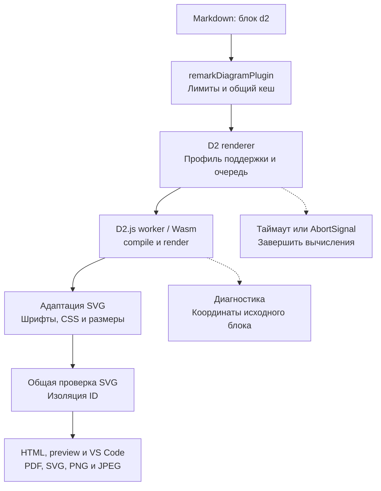

# План: поддержка D2

Статус: реализация завершена; локальная приемка пройдена 2026-10-23. Межплатформенные jobs macOS/Windows добавлены в GitHub Actions и ожидают запуска после публикации изменений.

## Результат и границы первой версии

Автор вставляет исходник D2 в блок `d2`. blueprint4llm локально создаёт статический SVG и использует его в HTML, браузерном preview, VS Code, PDF и экспорте одной диаграммы в SVG/PNG/JPEG. Установка Go, нативного D2 CLI и обращение к серверу рендера не нужны.

| Область      | Контракт первой версии                                                                                                                      |
| ------------ | ------------------------------------------------------------------------------------------------------------------------------------------- |
| Вход         | Один самостоятельный документ D2 на fence `d2`; без алиасов и загрузки `.d2` по пути или URL                                                |
| Диаграммы    | Узлы, связи, подписи, вложенные контейнеры, стили и классы; SQL tables, UML classes и sequence diagrams — с отдельными приёмочными fixtures |
| Раскладка    | `dagre` по умолчанию; `elk` через `vars.d2-config.layout-engine` после проверки выбранного пакета                                           |
| Направление  | Сохранять `direction` из D2; преобразование направления Mermaid не применять                                                                |
| Оформление   | Одна светлая статическая тема; исходные цвета и обычные текстовые подписи, включая кириллицу                                                |
| Настройки    | Нативный `vars.d2-config` с проверенным списком полей; metadata fence в первой версии не поддерживать                                       |
| Ресурсы      | Только текст текущего блока и локальные ресурсы самого пакета; без импортов других документов, изображений и внешних шрифтов                |
| За границами | Layers, scenarios, steps, анимация, TALA, sketch, Markdown/LaTeX-подписи, HTML, кликабельные ссылки и tooltips                              |

Это профиль интеграции, а не полная поддержка D2 CLI. Неподдерживаемые возможности отклонять с понятной диагностикой. Не пропускать их молча и не выбирать только корневой board из многостраничного документа. Новые экраны и элементы управления не требуются: диаграмма использует существующий контейнер и экспорт.

## Синтаксис первой версии

Пример обёрнут внешним Markdown-fence и показывает синтаксис самостоятельных D2-блоков, которые проверяются и рендерятся локально.

````markdown
```d2
direction: down

client: Клиент
backend: Сервис заказов {
  api: API заказов
  database: База данных {
    shape: cylinder
  }
  api -> database: Сохранить заказ
}

client -> backend.api: Создать заказ
```

```d2
vars: {
  d2-config: {
    layout-engine: elk
  }
}
direction: right

gateway: Шлюз
orders: Заказы
catalog: Каталог
gateway -> orders
gateway -> catalog
```
````

Пустой блок и блок без видимых объектов считаются ошибкой. Любые непустые metadata, например `d2 layout=elk`, отклоняются с подсказкой использовать `vars.d2-config`. В `d2-config` разрешены только `layout-engine` со значениями `dagre`/`elk` и `theme-id: 0`; остальные поля отклоняются. Значения по умолчанию задаёт адаптер.

Сам язык имеет импорты и композицию нескольких boards. Их наличие не означает поддержку в этой интеграции. [Импорты D2](https://d2lang.com/tour/imports/), [композиция D2](https://d2lang.com/tour/composition/).

## Подключение к текущей архитектуре



| Модуль                                                                                          | Изменение                                                                                                                         |
| ----------------------------------------------------------------------------------------------- | --------------------------------------------------------------------------------------------------------------------------------- |
| [types.ts](src/renderers/types.ts)                                                              | Реализовать `DiagramRenderer`: `name: 'd2'`, `languages: ['d2']`; результат — `DiagramResult`                                     |
| [compiler.ts](src/compiler.ts)                                                                  | Зарегистрировать `d2Renderer` в обоих списках: `compileMarkdown()` и `checkMarkdown()`                                            |
| [remark-diagrams.ts](src/plugins/remark-diagrams.ts)                                            | Использовать существующие лимиты, `bp-diagram--d2` и преобразование локальных координат в координаты Markdown                     |
| [cache.ts](src/renderers/cache.ts)                                                              | Переиспользовать кеш исходного SVG; добавить версии движка, профиль настроек, шрифты и адаптацию SVG в `cacheKey`                 |
| [concurrency-limiter.ts](src/renderers/concurrency-limiter.ts)                                  | Использовать лимит параллельности; отдельно обеспечить удаление отменённых задач из очереди — текущий `run()` не принимает signal |
| [parse-and-validate.ts](src/svg/parse-and-validate.ts)                                          | Сохранить общие ограничения активного содержимого, ссылок и CSS; не разрешать `foreignObject` ради D2                             |
| [scope-ids.ts](src/svg/scope-ids.ts)                                                            | Проверить ID и ссылки; отдельно решить изоляцию классов и CSS, которую префиксы ID сами по себе не обеспечивают                   |
| [image-export.ts](src/image-export.ts), [print-html.ts](src/print-html.ts)                      | Проверить экспорт, размеры и печать через общий SVG; PDF уже ограничивает высоту диаграммы 220 mm                                 |
| [server.ts](src/server.ts), [preview-controller.ts](vscode-extension/src/preview-controller.ts) | Проверить обновление и отмену устаревшей сборки через общий компилятор                                                            |

Реализованные новые модули:

| Модуль                            | Одна ответственность                                                |
| --------------------------------- | ------------------------------------------------------------------- |
| `src/renderers/d2.ts`             | Контракт renderer, размер входа, metadata, вызов runner и ключ кеша |
| `src/renderers/d2-runner.ts`      | Жизненный цикл движка, очередь, таймаут, отмена и очистка           |
| `src/renderers/d2-policy.ts`      | Проверка поддерживаемых конструкций и настроек по AST/графу движка  |
| `src/renderers/d2-svg.ts`         | Узкая адаптация SVG: шрифты, служебная оболочка, CSS и размеры      |
| `src/renderers/d2-diagnostics.ts` | Разбор сообщений движка и локальных координат                       |

Отдельный `d2-worker.ts` не добавлялся: `dispose()` выбранного пакета останавливает его worker. Runner вызывает очистку во всех исходах; это покрыто unit-тестами. Новые модули разделены по ответственности и соответствуют ограничению 300–500 строк из AGENTS.md.

## Выбор движка и проверка совместимости

Предпочтительный путь — официальный D2.js через Wasm. Документация основной ветки рекомендует `@d2lang/d2`; `@terrastruct/d2` сохранён для совместимости. Она описывает `compile()`, `render()` и `dispose()`, который завершает worker. Эти сведения нужно сверить с опубликованным артефактом, а не переносить из основной ветки без проверки. [Официальный D2.js](https://github.com/d2lang/d2/tree/master/d2js/js).

Для реализации закреплён `@d2lang/d2@0.1.34`. ESM/Wasm/worker проверены; фактический D2 render smoke прошёл на Node.js 22.13.0, а VS Code 1.101.0 extension host — на Node.js 22.15.1. MPL-2.0 и notices включены в поставку. [Пакет @d2lang/d2](https://www.npmjs.com/package/@d2lang/d2), [пакет совместимости](https://www.npmjs.com/package/@terrastruct/d2).

В основной ветке заявлены также TALA и дополнительные режимы. Первая версия интеграции ограничена проверенными `dagre` и `elk`; состав нативного CLI не определяет возможности выбранного npm-пакета. [Типы D2.js](https://github.com/d2lang/d2/blob/master/d2js/js/index.d.ts).

| Проверка этапа 1     | Результат                                                                                                                   |
| -------------------- | --------------------------------------------------------------------------------------------------------------------------- |
| Установка и лицензии | Проверено: `@d2lang/d2@0.1.34`; MPL-2.0 и notices входят в npm tarball и VSIX                                               |
| Жизненный цикл       | Unit-тесты подтверждают dispose/очистку при успехе, ошибке, таймауте, отмене и следующем запуске                            |
| Политика языка       | AST/profile проверяются до render; импорты, дополнительные boards и неподдерживаемые поля отклоняются                       |
| SVG                  | Dagre и ELK проходят общий валидатор после узкой адаптации CSS и font-face; fixtures покрывают SQL/UML/sequence и кириллицу |
| Производительность   | Node v22.23.3: cold 1395 ms; два параллельных render 1490 ms; 64 узла/128 связей 1567 ms; SVG 3–91 KiB                      |
| Память               | RSS процесса: 55 MiB до серии render и 266 MiB после неё; отдельный пик памяти Wasm не измерялся                            |
| Поставка             | Tarball установлен вне checkout; VSIX host/package smoke прошёл на Linux без D2 CLI, CDN и Go                               |

Spike подтвердил, что `dispose()` завершает worker. Runner вызывает его в `finally`; одних `Promise.race()` без остановки вычислений нет. Профиль языка и совместимость SVG проверены. Внешний worker, CLI fallback и удалённый сервис не добавлялись.

## Выполнение, лимиты и кеш

Создавать экземпляр D2 лениво на одно задание; освобождать в `finally`. Передавать исходник как единственный виртуальный файл с постоянным именем, например `index.d2`. Не предоставлять resolver к диску или сети. Импорты должны завершаться диагностикой; если движок разрешает их раньше проверки графа, виртуальная файловая система всё равно не должна содержать другие файлы. Текст вроде `@file` в строках и комментариях не считать импортом по регулярному выражению.

| Ресурс           | Зафиксированный предел                                                                                  |
| ---------------- | ------------------------------------------------------------------------------------------------------- |
| Markdown / блоки | Существующие 5 MiB на документ и 100 визуальных блоков                                                  |
| D2               | 256 KiB UTF-8, в том числе при прямом вызове renderer                                                   |
| Задание          | 30 секунд на инициализацию, compile, проверку профиля и render; ожидание очереди отменяется отдельно    |
| Параллельность   | Не более двух активных заданий D2 на процесс                                                            |
| SVG              | Не более 4 MiB UTF-8 и 8192 px по каждой стороне; конечные положительные размеры и корректный `viewBox` |
| Память           | Измерить Wasm на этапе 1; worker `resourceLimits` не считать полным ограничением памяти Wasm            |

Проверять размер результата до тяжёлого разбора SVG. Отмена до запуска, в очереди и в процессе должна освобождать ресурсы и позволять следующую сборку. Обрабатывать ошибку запуска, аварийный выход worker и одновременное наступление отмены/таймаута/ответа без двойного завершения Promise.

В кеше хранить SVG без `diagramId` и диагностику только с координатами блока. Путь Markdown и абсолютную строку подставляет общий plugin после чтения кеша. Не кешировать ошибки, таймауты и отменённые результаты. Проверить, что одинаковый блок, перемещённый по документу, получает правильные координаты и уникальные ID. Пул постоянных экземпляров отложить до измерений.

## SVG, шрифты и границы поддержки

D2 включает CSS в SVG; часть режимов подписей может потребовать HTML-содержимое. Текущий валидатор запрещает `foreignObject`, внешние `href` и нефрагментные CSS `url()`, включая встроенные font data URL. Поэтому совместимость обычного D2 SVG — обязательный результат spike, а не предположение. [Экспорт SVG в D2](https://d2lang.com/tour/exports/), [текст и специальные подписи](https://d2lang.com/tour/text/).

| Риск                         | Решение и проверка                                                                                                                                                         |
| ---------------------------- | -------------------------------------------------------------------------------------------------------------------------------------------------------------------------- |
| Встроенные `@font-face`      | Сначала проверить режим вывода без встроенных font data URL. Если его нет, адаптер может удалить только известные служебные font-face правила движка с помощью CSS-парсера |
| Различие метрик шрифтов      | Передать локальные Noto Sans движку для измерения, если API это поддерживает; согласовать итоговое семейство в SVG, HTML и экспорте, проверить кириллицу и переносы        |
| HTML/Markdown/LaTeX          | Отклонять неподдерживаемые подписи до render по структуре движка; не вырезать готовое содержимое с потерей смысла                                                          |
| Утечка CSS между блоками     | Изолировать селекторы служебного CSS в корневом SVG, включая классы и keyframes при их наличии; проверить два одинаковых D2 и соседний Mermaid                             |
| ID и фрагментные ссылки      | Использовать общий `scopeSvgIds`; проверить маркеры стрелок, clipPath, маски, `use` и ссылки из CSS                                                                        |
| XML-оболочка                 | Предпочесть `noXMLTag`, если оно доступно в выбранном API; иначе удалять только известную декларацию до общего разбора                                                     |
| Изображения, ссылки, события | Отклонять `icon`, image-объекты, `link`, tooltip и активное содержимое; не загружать ресурсы для последующей очистки                                                       |
| Исходные настройки           | Проверять `vars.d2-config` и итоговые render options; не позволять исходнику включать boards, анимацию или неподдержанный движок                                           |

Нельзя удалить все `<style>`: это может разрушить подписи, цвета и стрелки. Любую адаптацию ограничить известным выводом закреплённой версии и покрыть fixtures; неожиданный SVG отклонять. Не расширять общий список разрешённых ресурсов ради встроенных шрифтов D2. Самостоятельный экспорт SVG должен оставаться читаемым без CSS страницы; этот случай проверить отдельно от HTML.

## Диагностика

Renderer сохраняет строку и столбец относительно текста fence и передаёт ошибку адаптера с полями `line`/`column` в `remarkDiagramPlugin`. Unit-тесты покрывают базу координат движка, кириллицу, табы, несколько ошибок и локальные координаты. Если движок не даёт точную позицию, диагностика указывает начало fence.

Имя виртуального `index.d2` не должно подменять путь исходного Markdown. Успешные предупреждения возвращать через `DiagramWarning[]`, если API их предоставляет. Исключение renderer сейчас останавливает сборку; восстановление отдельных блоков и новый интерфейс ошибок остаются вне этой задачи.

## Этапы реализации

1. **[x] Подтвердить совместимость.** Проверены `@d2lang/d2@0.1.34`, лицензия, ESM/Wasm, Node.js 22.13.0, extension host VS Code 1.101.0, локальные Noto Sans, SVG-профиль, dagre/ELK и остановка worker. Ограничения языка и темы описаны выше.
2. **[x] Создать адаптер.** Добавлены runner, renderer, политика языка, диагностика и SVG-адаптация. Новые модули разделены по ответственности и покрыты unit-тестами; проверены Wasm-вызовы, очередь, таймаут, отмена и очистка.
3. **[x] Подключить конвейер.** D2 зарегистрирован в compile/check; проверены кеш, контейнер, SVG/PNG/JPEG/PDF export, browser preview, светлая/тёмная тема и VS Code preview.
4. **[x] Проверить поставку на Linux.** npm tarball установлен вне checkout; VSIX собран, установленный пакет содержит Wasm/worker/license и компилирует D2. GitHub Actions matrix для Linux/macOS/Windows с Node.js 22.13.0 добавлена в `.github/workflows/d2-smoke.yml`; Linux проверен в текущем окружении, jobs macOS/Windows ожидают запуска после публикации изменений.
5. **[x] Добавить примеры и документацию.** Создан `examples/blueprint-d2.md` с контейнерами, ELK, SQL table, UML class, sequence diagram и кириллицей. Обновлены README и `skills/blueprint4llm/SKILL.md`.
6. **[x] Принять локальный результат.** Пример осмотрен в HTML, browser preview, светлой и тёмной темах, PDF, PNG и SVG. Корневой пакет повышен до 0.22.0; VS Code extension — до 0.6.0; lockfile синхронизирован. Изменения не коммитились.

## Проверки и критерии готовности

| Уровень            | Обязательные сценарии                                                                                                                              |
| ------------------ | -------------------------------------------------------------------------------------------------------------------------------------------------- |
| Unit               | Каждая новая функция; metadata, профиль, настройки, диагностика, размеры, CSS/шрифты и ключ кеша                                                   |
| Движок             | Узлы, все направления связей, вложенные контейнеры, стили/классы, SQL/UML/sequence, обе раскладки, кириллица и длинные подписи                     |
| Ошибки             | Пустой блок, неверный D2, неизвестные настройки/движок, неподдерживаемые конструкции; пути и локальные координаты                                  |
| Изоляция           | Импорты и path traversal, URL, внешние изображения/шрифты, HTML, события, CSS-ресурсы; отсутствие вызовов диска/сети из пользовательского D2       |
| Жизненный цикл     | Таймаут, отмена до запуска/в очереди/во время рендера, авария, очистка listeners и worker, следующий успешный запуск                               |
| Компилятор         | Compile/check, fence в списке/цитате, смешанный документ, уникальность ID, отсутствие влияния CSS на страницу, работа кеша после перемещения блока |
| CLI и экспорт      | `--check` без файлов, HTML/PDF, одиночный SVG/PNG/JPEG; несколько визуальных блоков дают прежнюю ошибку одиночного экспорта                        |
| Preview и поставка | Обновление файла и unsaved buffer VS Code, отмена устаревшей сборки, tarball и VSIX вне checkout                                                   |

Общий кеш сохраняет возвращённые `DiagramResult`. Renderer D2 выбрасывает ошибки компиляции и не сохраняет их как успешный SVG; это поведение проверено тестами.

Команды приёмки реализации:

```bash
npm run build
npm run typecheck
npm run lint
npm run format:check
npm test
npm --prefix vscode-extension run build
xvfb-run -a npm --prefix vscode-extension test
node dist/cli.js examples/blueprint-d2.md --check
npm run test:d2-smoke
```

## Итог выполнения

Локальная реализация и приемка завершены. `npm run build`, `npm run typecheck`, `npm run lint`, `npm run format:check`, полный `npm test` (75 файлов, 690 тестов), сборка VS Code extension и `xvfb-run -a npm --prefix vscode-extension test` прошли. D2 example `--check` вернул 0 ошибок и 0 предупреждений; все заявленные формы подтверждены fixtures, SVG проходит общий валидатор, ошибки не сохраняются как успешный результат кеша.

Проверены standalone SVG/PNG/JPEG export и одностраничный A4 PDF с извлекаемыми подписями. Preview при ширине 800 px даёт диаграмме собственную горизонтальную прокрутку: у D2 figure `scrollWidth` 1522 px, `clientWidth` 752 px, крайнее `scrollLeft` 770 px. Широкая диаграмма в PDF печатается в альбомной ориентации; финальный вертикальный пример помещается на одну портретную страницу.

Установленный npm tarball проверен вне checkout на Node.js 22.23.3; отдельный render smoke на Node.js 22.13.0 прошёл. VSIX smoke прошёл на Linux с VS Code 1.101.0 / Node.js 22.15.1. Матрица macOS/Windows подготовлена, но её jobs не запускались из этой Linux-среды до публикации изменений.

Полные тесты и сборки завершились с кодом 0. Lint/format и CLI check не выдали предупреждений. VSIX упаковщик выдал advisory по количеству файлов (27 493; архив около 137 MiB), а VS Code test host — предупреждения своего окружения (`punycode` и API proposals); они не приводили к ошибкам smoke. Результат macOS/Windows и предупреждения упаковщика остаются единственными внешними пунктами для дополнительной приемки.
