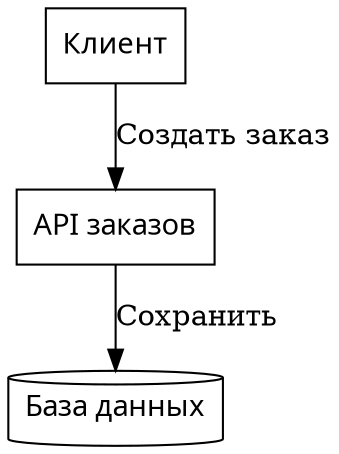
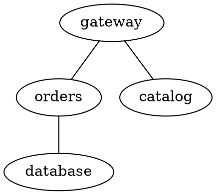
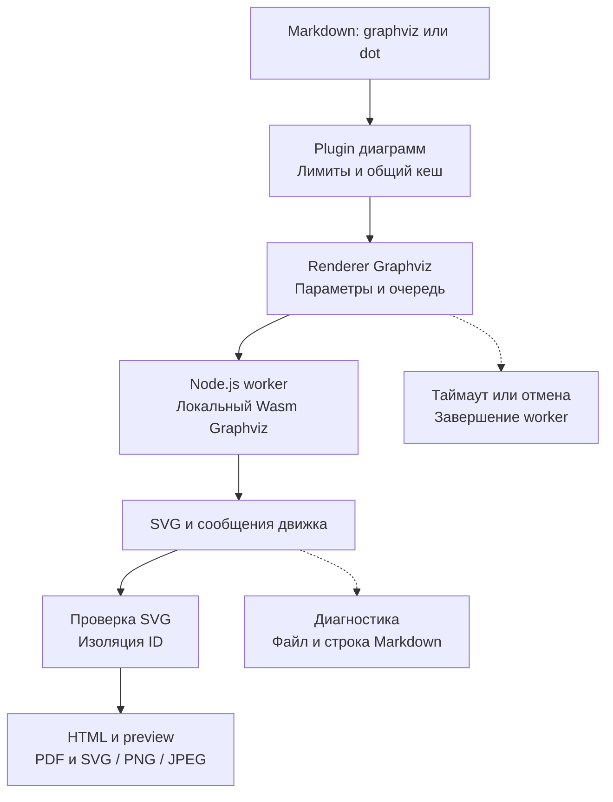

# План: поддержка Graphviz

Статус: реализация Graphviz завершена в версии 0.22.0. Этапы 1–4 выполнены; для выпуска добавлены проверки Linux/macOS/Windows. Сборка, typecheck, lint, форматирование, Graphviz-тесты, CLI-экспорт, PDF, npm tarball и VSIX проверены. Итоговый полный `npm test` пока не подтверждён: в полных прогонах на параллельно изменяемом общем дереве возникали разные сбои сторонних CLI/D2/print-тестов, а повторные одиночные проверки этих тестов прошли. Смотри отчёт в конце.

## Результат для пользователя

Автор вставляет DOT в блок `graphviz` или `dot`. Диаграмма рендерится локально в SVG и доступна в HTML, PDF, браузерном предпросмотре, VS Code и экспорте одной диаграммы в SVG/PNG/JPEG. Установка системного Graphviz и обращение к удалённому серверу не нужны.

| Решение первой версии | Граница поддержки                                                                                                                             |
| --------------------- | --------------------------------------------------------------------------------------------------------------------------------------------- |
| Вход                  | Один встроенный DOT-граф на блок; канонический fence `graphviz`, алиас `dot`                                                                  |
| Язык                  | `graph`, `digraph`, `strict`, подграфы и кластеры, атрибуты узлов и рёбер, порты, record- и HTML-like labels в пределах выбранной Wasm-сборки |
| Раскладка             | По умолчанию `dot`; необязательное `engine=<name>` из проверенного списка движков                                                             |
| Направление           | Сохранять исходный `rankdir`; не применять преобразование направления Mermaid                                                                 |
| Рендеринг             | Локальный `@viz-js/viz` в отдельном Node.js worker; статический SVG                                                                           |
| Файлы и сеть          | Не загружать картинки, шрифты, stylesheet или другие ресурсы из DOT; не читать `.dot` по пути или URL                                         |
| Интерфейс             | Использовать существующие контейнеры диаграмм и средства просмотра; отдельные элементы управления не нужны                                    |
| За пределами версии   | Редактор графов, анимация, Graphviz CLI, плагины, произвольные форматы вывода движка и несколько графов в одном блоке                         |

DOT определяет направленные и ненаправленные графы, атрибуты и подграфы. HTML-like labels относятся к синтаксису Graphviz и не дают права вставлять произвольный HTML в страницу. [Описание языка DOT](https://graphviz.org/doc/info/lang.html).

## Пример синтаксиса

Примеры заключены во внешний Markdown-fence, чтобы их можно было безопасно показывать как синтаксический пример.

````markdown



````

Неизвестные, повторные и пустые параметры metadata считать ошибкой. `engine` принимает только имена из списка, зафиксированного после проверки пакета. Базовые приёмочные движки — `dot` и `neato`; остальные включать только с fixtures. Атрибут `layout` внутри DOT может влиять на выбор раскладки: на этапе 1 проверить его приоритет относительно `engine`, затем документировать и тестировать фактическое поведение без скрытого переписывания DOT.

Пустой fence — ошибка. Корректный пустой `graph {}` или `digraph {}` — допустимый граф, если движок возвращает SVG с корректными размерами. Второй самостоятельный граф в одном fence отклонять; проверить, что движок не игнорирует остаток входа. Если API этого не гарантирует, добавить проверку границ документа с учётом строк, комментариев и HTML-like labels, а не подсчётом фигурных скобок.

## Подключение к текущему конвейеру



| Существующий модуль                                                                             | Изменение или повторное использование                                                                                                        |
| ----------------------------------------------------------------------------------------------- | -------------------------------------------------------------------------------------------------------------------------------------------- |
| [types.ts](src/renderers/types.ts)                                                              | Реализовать `DiagramRenderer`; возвращать `DiagramResult` с SVG и предупреждениями                                                           |
| [compiler.ts](src/compiler.ts)                                                                  | Добавить один `graphvizRenderer` в оба списка: `compileMarkdown()` и `checkMarkdown()`                                                       |
| [remark-diagrams.ts](src/plugins/remark-diagrams.ts)                                            | Использовать выбор по языку, лимиты и перевод локальных координат в Markdown; класс результата `bp-diagram--graphviz` для обоих fence        |
| [cache.ts](src/renderers/cache.ts)                                                              | Использовать общий кеш: он уже учитывает исходник и metadata; включить версию пакета, встроенного Graphviz и настройки renderer в `cacheKey` |
| [concurrency-limiter.ts](src/renderers/concurrency-limiter.ts)                                  | Ограничить число одновременно работающих workers; отдельно обеспечить отмену ожидающих заданий                                               |
| [parse-and-validate.ts](src/svg/parse-and-validate.ts), [scope-ids.ts](src/svg/scope-ids.ts)    | Сохранить общую проверку SVG и изоляцию пользовательских ID и ссылок                                                                         |
| [image-export.ts](src/image-export.ts), [print-html.ts](src/print-html.ts)                      | Проверить размеры, печать и экспорт через существующие механизмы                                                                             |
| [server.ts](src/server.ts), [preview-controller.ts](vscode-extension/src/preview-controller.ts) | Проверить обновление и отмену через общий компилятор                                                                                         |

Выделить новые модули по ответственности. Ориентировочная структура:

| Новый модуль                            | Ответственность                                                                 |
| --------------------------------------- | ------------------------------------------------------------------------------- |
| `src/renderers/graphviz.ts`             | Контракт renderer, metadata, лимиты и очередь                                   |
| `src/renderers/graphviz-worker.ts`      | Входная точка worker: инициализация Wasm, вызов движка, сериализуемый результат |
| `src/renderers/graphviz-runner.ts`      | Создание worker, таймаут, `AbortSignal`, завершение и очистка ресурсов          |
| `src/renderers/graphviz-diagnostics.ts` | Предупреждения и ошибки Graphviz, извлечение доступных координат                |
| `src/renderers/graphviz-svg.ts`         | Узкая нормализация служебной оболочки SVG и проверка размеров результата        |

Каждый модуль должен оставаться связным и укладываться в ограничения AGENTS.md. Не создавать отдельный renderer для алиаса `dot`.

## Движок и выполнение

Выбран пакет [`@viz-js/viz`](https://github.com/mdaines/viz-js) версии 3.31.0 с Graphviz 16.1.0. Его API предоставляет асинхронную инициализацию `instance()`, синхронный `render()` со статусом, выводом и сообщениями, а также сведения о версии Graphviz и доступных движках. Renderer запрашивает `format: 'svg_inline'`, сохраняет предупреждения успешного рендера и поддерживает проверенные `dot`, `neato`, `circo`, `fdp`, `osage`, `patchwork` и `twopi`. Ненаправленные `nop*` требуют готовых координат, а `sfdp` в этой Wasm-сборке не имеет triangulation library.

| Вариант                        | Решение                                                                                         |
| ------------------------------ | ----------------------------------------------------------------------------------------------- |
| `@viz-js/viz` в Node.js worker | Предпочтительный: локальный Wasm и возможность прервать синхронную раскладку извне              |
| Нативный `dot`                 | Не использовать в первой версии: добавляет системную установку и различия версий                |
| Graphviz в Chromium            | Резервный вариант только при подтверждённой несовместимости Node.js; потребует пересмотра плана |
| Удалённый Graphviz Server      | Не использовать: исходники должны обрабатываться локально                                       |

Инициализировать движок лениво, только при встрече поддерживаемого блока. Для первой версии создавать worker на рендер и завершать после получения результата; кешировать готовый SVG общим кешем. Пул постоянных workers отложить до измерений. Новый worker не должен наследовать несовместимые тестовые или загрузочные `execArgv`.

`Promise.race()` в основном потоке без `worker.terminate()` не останавливает синхронный Wasm. Таймаут и отмена должны завершать worker, дожидаться освобождения ресурсов и возвращать управление preview. Worker изолирует выполнение, но сам по себе не является границей доступа Node.js к файлам или сети: не добавлять движку такие мосты.

### Подтверждённые лимиты первой версии

| Ресурс                  | Правило первой версии                                                                                                        |
| ----------------------- | ---------------------------------------------------------------------------------------------------------------------------- |
| Markdown и число блоков | Существующие 5 MiB и 100 визуальных блоков                                                                                   |
| DOT                     | Существующий предел 256 KiB на блок; проверять также при прямом вызове renderer                                              |
| Время                   | 30 секунд на запуск worker, инициализацию Wasm и рендер; ожидание очереди отменяется отдельно                                |
| Параллельность          | Не более двух активных workers Graphviz на процесс                                                                           |
| SVG                     | Не более 4 MiB UTF-8 и 8192 px по каждой стороне после перевода единиц; проверять положительные конечные размеры и `viewBox` |
| Память                  | На этапе 1 измерить пики Wasm; не считать `resourceLimits` worker полным лимитом памяти WebAssembly                          |

Размер входа и таймаут не гарантируют жёсткий предел памяти. Если испытания плотных графов показывают неприемлемый рост памяти, до интеграции пересмотреть способ выполнения или ввести проверяемый бюджет структуры графа. Не объявлять неподтверждённые ограничения узлов и рёбер.

## SVG, ресурсы и диагностика

Проверенная сборка поддерживает `svg_inline`; renderer удаляет только комментарии `Generated by graphviz` и `Title/Pages`, затем вызывает общий SVG-валидатор. Он не вырезает опасные элементы для получения успешного результата. Размер проверяется до передачи SVG из worker и ещё раз до общего конвейера.

| Ситуация                                   | Ожидаемое поведение                                                                                  |
| ------------------------------------------ | ---------------------------------------------------------------------------------------------------- |
| Корректный DOT                             | SVG проходит `parseAndValidateSvg`, затем `scopeSvgIds`; используется общий контейнер диаграммы      |
| Предупреждение при успешной раскладке      | Сохранить SVG и добавить сообщение в `DiagramResult.warnings`                                        |
| Ошибка синтаксиса или `status: failure`    | Бросить ошибку renderer; текущий конвейер оформляет `DiagnosticError`, `--check` завершается кодом 1 |
| Есть строка в сообщении Graphviz           | Вернуть `line` относительно тела fence, начиная с 1; plugin переведёт её в строку Markdown           |
| Координат нет                              | Привязать сообщение к fence; не вычислять вымышленную строку или колонку                             |
| Таймаут, отмена, ошибка worker или Wasm    | Завершить worker; не кешировать неуспешный результат; следующий рендер должен работать               |
| Внешняя ссылка или активное SVG-содержимое | Отклонить результат существующим валидатором; не ослаблять его правила                               |
| Изображение или внешний ресурс из DOT      | Не загружать; сохранить предупреждение движка либо вернуть ошибку, если ресурс попал в SVG           |

Атрибуты `URL`/`href` могут создавать SVG-ссылки, а `image` задаёт изображение узла. Они требуют отдельных негативных fixtures: локальные пути, `file:`, HTTP(S), `data:`, `javascript:`, HTML-like ``, stylesheet и CSS-ссылки. Не передавать `images` или загрузчики ресурсов. [Ссылки Graphviz](https://graphviz.org/docs/attrs/URL/), [изображения Graphviz](https://graphviz.org/docs/attrs/image/).

Фрагментные ссылки разрешены только в рамках текущих правил общего SVG-конвейера. Проверить изоляцию одинаковых `id` в двух Graphviz-блоках и при соседстве с Mermaid и PlantUML. Исключение renderer сейчас прерывает компиляцию; восстановление после ошибок не входит в эту задачу и не зависит от реализации плана диагностики FEAT-05.

## Этапы реализации

### 1. Проверить пакет и зафиксировать решения

- [x] Проверить публикацию `@viz-js/viz`, Node.js, ESM и TypeScript-типы; закрепить версию `3.31.0`. Корневой lockfile не ведётся по правилам репозитория; lockfile расширения синхронизирован.
- [x] Проверить лицензии обёртки, встроенного Graphviz и компонентов; добавить `THIRD-PARTY-NOTICES.md` в npm и VSIX упаковку.
- [x] Выполнить spike в Node.js worker: проверить все доступные движки, синтаксические ошибки и предупреждения; оставить семь подтверждённых движков.
- [x] Проверить кластеры, порты, record- и HTML-like labels, кириллицу, длинные подписи, экранирование, пустой граф и второй граф в одном входе.
- [x] Проверить приоритет `layout`/`engine`, metadata, служебные комментарии SVG, `svg_inline` и единицы `pt`/`px`.
- [x] Проверить запуск, отмену, плотный граф, параллельность и отсутствие сетевых запросов из DOT. Начальная инициализация Wasm наблюдалась примерно при 75 MiB RSS и 22 MiB external memory; это замер запуска, а не жёсткий предел памяти.
- [x] Зафиксировать версии, список движков, Unicode-предупреждение и границы памяти в реализации, README и этом плане.

### 2. Добавить runner и renderer

- [x] Реализовать модули Graphviz, строгую проверку metadata и оба языка fence.
- [x] Добавить worker с типизированными сообщениями, обработкой `message`, `error`, неожиданного `exit` и ошибок инициализации.
- [x] Обеспечить таймаут, отмену до запуска, в очереди и во время рендера; закрывать ресурсы и удалять listeners во всех исходах.
- [x] Реализовать диагностику и минимальную нормализацию SVG; проверять лимиты до передачи большого результата в общий конвейер.
- [x] Задать стабильный `cacheKey`; не включать `diagramId`, путь исходника и абсолютные координаты в сырой SVG или кешируемые сообщения.

### 3. Подключить компилятор и поставку

- [x] Зарегистрировать renderer в `compileMarkdown()` и `checkMarkdown()`; сохранить общий путь обработки SVG и ID.
- [x] Проверить одиночный экспорт: `graphviz` и `dot` считаются визуальными блоками; несколько блоков дают существующую ошибку.
- [x] Проверить preview и packaged VS Code Extension Host; runner-тестом проверить отмену активной раскладки и успешный следующий рендер.
- [x] Установить `npm pack` tarball во временный consumer вне checkout; worker загрузил Wasm и вернул SVG.
- [x] Проверить VSIX и package smoke; packaged worker разрешается через `new URL(..., import.meta.url)` после установки.

### 4. Добавить тесты и пример

| Уровень          | Обязательные проверки                                                                                                                   |
| ---------------- | --------------------------------------------------------------------------------------------------------------------------------------- |
| Unit             | Каждая новая функция; metadata, диагностика, нормализация, размеры, версии ключа кеша                                                   |
| Worker/runner    | Реальный Wasm, отсутствие зависания основного потока, таймаут, отмена, очередь, авария worker, очистка ресурсов и повторный запуск      |
| Renderer         | Оба fence, направленный и ненаправленный граф, движки, кластеры, порты, HTML-like labels, кириллица, лимиты и предупреждения            |
| Компилятор       | `compileMarkdown` и `checkMarkdown`, точная строка Markdown, вложенные fence, общий кеш, уникальность ID, соседство с другими форматами |
| Безопасность SVG | Опасные ссылки, события, внешние ресурсы и пользовательские ID; общий валидатор продолжает отклонять небезопасный вывод                 |
| Экспорт          | HTML, SVG/PNG/JPEG, PDF с извлекаемыми кириллическими подписями; широкая диаграмма не обрезается в preview и вписывается при печати     |
| Поставка         | Установка tarball и VSIX, работа worker без checkout и внешнего `dot`; локальный smoke на Linux и CI matrix Linux/macOS/Windows         |

Добавить `examples/blueprint-graphviz.md` с направленным графом, кластером и ненаправленным примером. Каждый визуальный блок экспортировать отдельно и осмотреть целиком. Проверить общий документ в светлой и тёмной теме; сохранить читаемые подписи, стрелки и границы.

### 5. Документация и выпуск

- [x] Обновить README: оба fence, metadata, примеры, движки, лимиты, offline-режим и ограничения ссылок и ресурсов.
- [x] Обновить `skills/blueprint4llm/SKILL.md`: когда выбирать Graphviz, синтаксис и ограничения; не требовать нативный `dot`.
- [x] Выполнить `npm run build`, `npm run typecheck`, `npm run lint`, `npm run format:check`, Graphviz-тесты, CLI SVG/PNG/JPEG экспорт, PDF и VSIX smoke.
- [ ] Получить один полный успешный `npm test` для всего репозитория. В полных прогонах на параллельно изменяемом общем дереве возникали разные сбои CLI/D2/print; эти тесты прошли при одиночном повторе.
- [x] Повысить minor-версию `package.json` до `0.22.0` и синхронизировать lockfile расширения; корневой `package-lock.json` проектом не отслеживается.
- [x] Не коммитить изменения без прямого запроса пользователя.

## Критерии готовности

- [x] `graphviz` и `dot` рендерятся локально через общий конвейер; Linux проверен локально, Linux/macOS/Windows matrix добавлен в CI.
- [x] Точная версия движка и поддержанные возможности подтверждены fixtures и документацией.
- [x] Ошибки имеют путь Markdown и доступные координаты; предупреждения не теряются.
- [x] Таймаут и отмена останавливают вычисления, освобождают очередь и позволяют следующую сборку.
- [x] SVG проходит общий валидатор; ID изолированы, внешние ресурсы не загружаются.
- [ ] Один полный root test suite завершился без ошибок; все Graphviz, export, tarball и Linux VSIX smoke проверки прошли отдельно.

### Отчёт по завершению

| Проверка                                                                     | Результат                                                                                                                                                                                                                                                                    |
| ---------------------------------------------------------------------------- | ---------------------------------------------------------------------------------------------------------------------------------------------------------------------------------------------------------------------------------------------------------------------------- |
| `npm run build`, `npm run typecheck`, `npm run lint`, `npm run format:check` | Прошли.                                                                                                                                                                                                                                                                      |
| Graphviz unit, runner, renderer и compiler                                   | 60 из 60 тестов прошли; покрыты семь движков, оба fence, очередь, отмена и восстановление.                                                                                                                                                                                   |
| CLI и PDF                                                                    | SVG/PNG/JPEG export и PDF с извлекаемыми кириллическими Graphviz-подписями прошли.                                                                                                                                                                                           |
| npm tarball                                                                  | Установлен во временный consumer вне checkout; worker и Wasm отрендерили SVG.                                                                                                                                                                                                |
| VSIX smoke                                                                   | Linux Extension Host загрузил собранное расширение и скомпилировал Graphviz. `vsce` сообщил о размере 136.6 MiB и 27,493 файлах; Chrome не включён в пакет.                                                                                                                  |
| Пример и план                                                                | `--check` успешен. В Graphviz-примере есть ожидаемое предупреждение о fallback ширины не-ASCII символов; PNG обоих примеров осмотрены. Пример и полный live preview плана осмотрены в светлой и тёмной темах, включая нижнюю часть страницы; визуальных дефектов не найдено. |
| Полный `npm test`                                                            | Не подтверждён как зелёный: прогон дал 688/690, включая CLI SIGTERM и D2 PDF orientation. Оба теста проходят отдельно. В общей рабочей среде параллельно запускались другие полные Vitest suite; после них нужен один чистый полный прогон.                                  |
| Матрица платформ                                                             | Workflow настроен для Linux, macOS и Windows; локально выполнена Linux-проверка, macOS/Windows результаты появятся в CI.                                                                                                                                                     |

## Закрытые технические вопросы

| Вопрос                                                               | Решение                                                                                                                                               |
| -------------------------------------------------------------------- | ----------------------------------------------------------------------------------------------------------------------------------------------------- |
| Точная версия npm-пакета, версия Graphviz, лицензии и список движков | Закрыт: `@viz-js/viz` 3.31.0, Graphviz 16.1.0, notices сохранены, включены семь проверенных движков.                                                  |
| Приоритет `layout` и `engine`, обнаружение второго графа             | Закрыт: атрибут DOT `layout` имеет приоритет; scanner принимает один граф и отклоняет второй или постороннее содержимое после графа.                  |
| Метрики шрифтов Wasm относительно Noto Sans в HTML/PDF               | Не обещать совпадение с нативными метриками: Graphviz сообщает о fallback ширины для не-ASCII текста. Кириллица видна, но интервалы могут отличаться. |
| Достаточность лимитов памяти и стоимости запуска нового worker       | Жёсткий лимит памяти Wasm не подтверждён. Оставлен disposable worker, максимум два одновременных рендера; пул отложен до измерений реальных проектов. |
