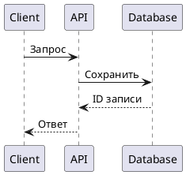
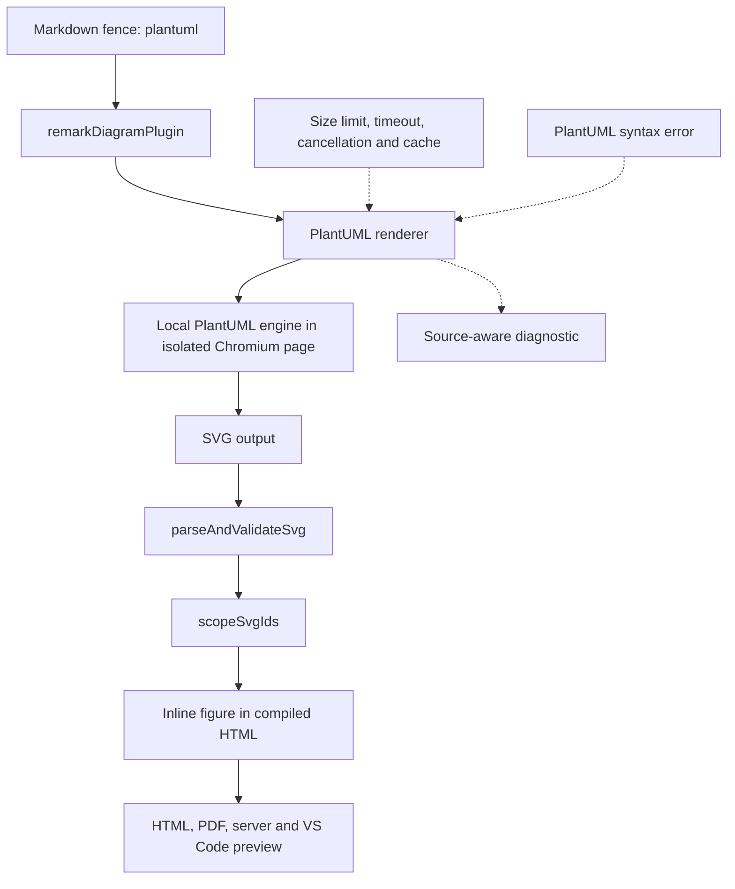

# План: поддержка PlantUML

## Результат для пользователя

Автор добавляет стандартный блок `plantuml` в Markdown. Диаграмма рендерится в SVG и попадает в HTML, PDF, локальный предпросмотр и предпросмотр расширения VS Code через общий компилятор.



## Прототип предпросмотра

Здесь показано, где окажется диаграмма в существующем предпросмотре. Новые элементы управления для PlantUML не нужны.

```balsamiq
{
  "mockup": {
    "measuredW": 1281,
    "measuredH": 821,
    "controls": {
      "control": [
        {
          "ID": "control-1",
          "typeID": "Rectangle",
          "x": 0,
          "y": 0,
          "w": 1280,
          "h": 820,
          "zOrder": 0,
          "properties": {
            "color": "#ffffff"
          }
        },
        {
          "ID": "control-2",
          "typeID": "Label",
          "x": 0,
          "y": 0,
          "w": 237,
          "h": 38,
          "zOrder": 1,
          "properties": {
            "text": "Blueprint preview",
            "size": 22,
            "bold": true
          }
        },
        {
          "ID": "control-3",
          "typeID": "Button",
          "x": 253,
          "y": 0,
          "w": 130,
          "h": 38,
          "zOrder": 2,
          "properties": {
            "text": "Download PDF",
            "bold": false
          }
        },
        {
          "ID": "control-4",
          "typeID": "Button",
          "x": 399,
          "y": 0,
          "w": 106,
          "h": 38,
          "zOrder": 3,
          "properties": {
            "text": "Dark mode",
            "bold": false
          }
        },
        {
          "ID": "control-5",
          "typeID": "Label",
          "x": 0,
          "y": 54,
          "w": 1280,
          "h": 68,
          "zOrder": 4,
          "properties": {
            "text": "Payment flow",
            "size": 40,
            "bold": true
          }
        },
        {
          "ID": "control-6",
          "typeID": "Label",
          "x": 0,
          "y": 138,
          "w": 1280,
          "h": 23,
          "zOrder": 5,
          "properties": {
            "text": "Sequence diagram",
            "size": 14
          }
        },
        {
          "ID": "control-7",
          "typeID": "Rectangle",
          "x": 0,
          "y": 177,
          "w": 1280,
          "h": 100,
          "zOrder": 6,
          "properties": {
            "color": "#ffffff"
          }
        },
        {
          "ID": "control-8",
          "typeID": "Label",
          "x": 16,
          "y": 193,
          "w": 1248,
          "h": 28,
          "zOrder": 7,
          "properties": {
            "text": "PlantUML",
            "size": 20,
            "bold": true
          }
        },
        {
          "ID": "control-9",
          "typeID": "Label",
          "x": 16,
          "y": 229,
          "w": 1248,
          "h": 23,
          "zOrder": 8,
          "properties": {
            "text": "Inline SVG diagram",
            "size": 14
          }
        }
      ]
    }
  }
}
```

## Поток рендеринга



## Предлагаемое решение

- Зарегистрировать новый renderer с `name: 'plantuml'` и единственным языком `plantuml`.
- Предпочтительный движок — официальный пакет [`@plantuml/core`](https://github.com/plantuml/plantuml/blob/master/PUBLISHING_NPM.md), проверенная версия — `1.2026.9` (MIT). Он поставляет локальный JavaScript/Wasm-движок и SVG API; использовать его в изолированной странице Puppeteer, уже имеющегося в проекте. Это сохраняет текущие требования к Node.js и Chrome и не отправляет исходники на удалённый сервер.
- Для API-проверки загрузить `viz-global.js` как обычный скрипт, затем вызвать `renderToString(lines, onSuccess, onError)` из PlantUML-модуля. Уточнить порядок загрузки и локальные пути ресурсов по документации зафиксированной версии.
- До добавления зависимости сделать небольшой технический spike: проверить импорт ресурсов пакета в Chromium, SVG-вывод, обработку ошибок и несколько нужных типов диаграмм. Зафиксировать конкретную версию и включить её в ключ кэша. Официальный пакет содержит свой графический backend, поэтому его нужно проверить на проектных системах Linux/macOS/Windows.
- Учесть ограничение официальной MIT-публикации: в ней исключён тип диаграмм Sudoku. Если нужна полная совместимость с ним, использовать вариант с Java CLI и включить Java в системные требования.
- Если интеграция `@plantuml/core` не проходит эти проверки, оценить CLI PlantUML как отдельный вариант. Официальный CLI выдаёт SVG, но требует Java; такой переход добавит системное требование и должен быть отражён в установке и README. Не переключаться на удалённый PlantUML Server: Markdown может содержать конфиденциальные схемы, а компиляция проекта сейчас локальная.
- MVP принимает один PlantUML-документ на fenced-блок с обычными `@start...` / `@end...` директивами. Несколько независимых диаграмм в одном блоке пока не поддерживать; для них использовать несколько блоков. Имена языков `puml` и `uml` не регистрировать без отдельной необходимости.
- Пакет не содержит деклараций TypeScript: для вызова API из renderer добавить внутренние типы или изолировать мост к странице Puppeteer.
- В MVP не разрешать сетевые запросы и произвольное чтение локальных файлов при рендеринге. Стандартные библиотеки вроде C4 не входят в npm-пакет, а локальный `!include` требует `PLANTUML_FILE_LOADER`; не устанавливать удалённый `PLANTUML_STDLIB_BASE`. Явно задать политику для `PLANTUML_FILE_LOADER` и `PLANTUML_STDLIB_LOADER`, блокировать внешние запросы страницы и описать ограничения включений в README.

## Этапы

### 1. Проверить движок

- Собрать минимальный spike с установленным `@plantuml/core`, Puppeteer-страницей и `renderToString`.
- Проверить class, sequence, component и activity диаграммы, длинные подписи, кириллицу, ошибочный синтаксис и несколько параллельных рендеров.
- Проверить, что полученный SVG принимается существующим валидатором и корректно отображается в HTML/PDF.
- По результатам уточнить требования к Graphviz/backend, локальным includes и ограничения по типам диаграмм. Если часть PlantUML-языка недоступна, явно зафиксировать это до реализации.

**Статус: выполнен 2026-10-21.** `@plantuml/core@1.2026.9` установлен отдельно от зависимостей проекта и проверен в Chromium, управляемом Puppeteer (`linux-155.0.8059.79`).

- Class, sequence, component и activity диаграммы отрендерились; SVG каждого типа прошёл `parseAndValidateSvg`. Кириллица сохранилась. Четыре независимые страницы успешно рендерили параллельно.
- Проверка HTML с проектным шаблоном подтвердила горизонтальную прокрутку длинной sequence-диаграммы: SVG имеет размер `2153 × 148 px`, область просмотра — `752 px` по ширине. PDF создался, `pdfjs-dist` извлёк из него кириллические подписи. Печатный стиль вписывает такой широкий SVG в ширину страницы и уменьшает его.
- Синтаксическая ошибка вернула SVG с текстом `Syntax Error?` и строкой PlantUML (`line 2`), но `renderToString` вызвал callback успеха. Renderer должен распознавать error SVG и превращать его в `DiagramError`, а не считать обычной диаграммой.
- Вызов `!include <C4/C4_Context>` не работает без локального `c4.min.js`; стандартные библиотеки не входят в пакет и подгружаются отдельно. Локальный `!include styles/common.puml` без `PLANTUML_FILE_LOADER` возвращает `cannot include`. `!includeurl` в проверенном режиме тоже вернул ошибочную SVG без сетевого запроса. При явно заданном удалённом `PLANTUML_STDLIB_BASE` движок попытался запросить внешний `c4.min.js`, поэтому renderer обязан не задавать такой адрес и блокировать внешние запросы.
- Архив пакета занимает около `2.4 MB` (распакованный размер — `7.22 MB`), Java и нативные бинарные зависимости не нужны. Проверка запуска выполнена на Linux; macOS и Windows этим spike не запускались. Пакет содержит JS/Wasm без платформенных бинарников, но реальные smoke-проверки этих систем следует включить в CI реализации.
- Набор диаграмм из spike проверил нужные для MVP типы. Он не подтверждает совместимость со всем языком PlantUML; Sudoku отсутствует в MIT-сборке согласно официальной публикации.

### 2. Добавить renderer

- Создать `src/renderers/plantuml.ts`, реализующий `DiagramRenderer`; добавить локальное описание безтипового API `@plantuml/core@1.2026.9`.
- Изолировать каждый рендер в отдельной странице браузера; закрывать страницу в `finally`. Ограничить одновременные рендеры общим `ConcurrencyLimiter`.
- Установить таймаут рендера, передавать `AbortSignal` и завершать работу страницы при отмене. Ограничение размера исходника оставить общим (`MAX_DIAGRAM_SOURCE_BYTES`), общий предел количества диаграмм — `MAX_DIAGRAM_BLOCKS`.
- Возвращать SVG через `DiagramResult`; распознавать PlantUML error SVG, извлекать локальную строку и переводить её в `DiagramError`, чтобы общий плагин добавил путь Markdown и строку fenced-блока.
- Запретить произвольные запросы страницы; не задавать удалённый `PLANTUML_STDLIB_BASE`, а для local/std-library loader явно задать deny-by-default политику.
- Добавить версию движка и параметры рендеринга в `cacheKey`, чтобы общий `DiagramRenderCache` повторно использовал результат в live preview.

**Статус: выполнен 2026-10-21.** Добавлен зафиксированный `@plantuml/core@1.2026.9` и renderer в `src/renderers/plantuml.ts`.

- Renderer обрабатывает только язык `plantuml`, ограничивает исходник 256 KiB и SVG 8192 px, использует общий `ConcurrencyLimiter` с пределом 2, таймаут 30 секунд и `AbortSignal`. Версия движка и параметры изоляции включены в `cacheKey`.
- Каждый вызов запускает собственную Chromium-страницу на loopback-странице с CSP. Interception разрешает только её документ и внутренние `blob:`/`data:` ресурсы; остальные запросы блокируются. `PLANTUML_FILE_LOADER` и `PLANTUML_STDLIB_LOADER` явно запрещают includes и подгрузку стандартных библиотек, `PLANTUML_STDLIB_BASE` удалён.
- Синтаксическая ошибка остаётся видимой как SVG и записывается в `DiagramResult.errors`; строка берётся из красного error-текста и локальной метки PlantUML. Ошибки запрещённых includes также попадают в диагностику.
- Unit-тесты покрывают sequence, class, component и activity, кириллицу, разбор синтаксической ошибки, обычный текст с похожей фразой, запрет обоих типов includes, лимит размера, предварительную и активную отмену, таймаут с закрытием страницы/браузера и параллельные рендеры.
- На момент завершения этапа 2 renderer ещё не был зарегистрирован в `src/compiler.ts`; подключение и проверка общего SVG-конвейера завершены на этапе 3.

### 3. Подключить к компилятору и защите SVG

- Добавить `plantumlRenderer` в список рендереров в `src/compiler.ts`. `remarkDiagramPlugin` уже выбирает renderer по языку fenced-блока.
- Пропускать результат через текущие `parseAndValidateSvg` и `scopeSvgIds`, как Mermaid и Balsamiq. Не ослаблять общий список разрешённых SVG-элементов.
- Убедиться, что PlantUML SVG помещается в `<figure class="bp-diagram bp-diagram--plantuml">` и остаётся внутри общего контейнера диаграмм. Не добавлять отдельную ветку для PDF, сервера или VS Code: они используют тот же скомпилированный HTML.

**Статус: выполнен 2026-10-21.** `plantumlRenderer` зарегистрирован в общем компиляторе. Интеграционная проверка компилирует PlantUML-блок в inline SVG внутри `<figure class="bp-diagram bp-diagram--plantuml">` и общего `bp-diagram-container`. SVG проходит существующую валидацию и изоляцию ID через `remarkDiagramPlugin`; отдельные ветки для HTML, PDF, сервера и VS Code не добавлялись.

### 4. Тесты, пример и документация

- Unit-тесты renderer: успешный вывод SVG, ошибки и строка источника, таймаут, отмена, превышение размера, повторное использование кэша и изоляция параллельных запусков.
- Тесты компилятора: распознавание `plantuml`, inline SVG и CSS-класс, сохранение исходного блока с ошибкой, совместная работа PlantUML с Mermaid/Balsamiq, уникальность SVG ID и отказ небезопасного SVG.
- Добавить короткий `examples/plantuml.md` или PlantUML-блок в существующий пример. Проверить его HTML- и PDF-вывод вместе с уже поддержанными рендерерами.
- Обновить README: синтаксис блока, пример, выбранный движок и его системные требования, ограничения includes, лимиты, offline-поведение и диагностику.
- После прохождения сборки и тестов увеличить версию `package.json` как изменение функциональности. Изменения не коммитить без отдельной просьбы.

**Статус: выполнен 2026-10-21.**

- Добавлены проверки кэша PlantUML и компилятора: ошибка синтаксиса остаётся видимой в SVG с привязкой к строке Markdown; PlantUML работает вместе с Mermaid и Balsamiq, а SVG ID остаются уникальными. Существующие тесты общего SVG-конвейера проверяют отказ небезопасной разметки.
- PDF-тест проверяет извлекаемые подписи PlantUML вместе с Mermaid и Balsamiq. Пример `examples/blueprint.md` дополнен PlantUML-диаграммой; его HTML и PDF пересобраны.
- README описывает синтаксис, локальный `@plantuml/core@1.2026.9` в Chromium без Java, offline-рендеринг, ограничения `!include`/сети и диагностику.
- Версия пакета повышена с `0.4.0` до `0.5.0`.
- `npm run build`, `npm test` (25 файлов, 143 теста), `npm run typecheck` и `npm run lint` прошли. Проверка Prettier для изменённых исходников, тестов и документации прошла; общий `npm run format:check` сообщает о форматировании в семи файлах: `dev-docs/plan-init.md`, примерах `blueprint-calculator` и `blueprint-feature`, сгенерированном `examples/blueprint.html` и `vscode-extension/README.md`.

## Критерии готовности

- `plantuml`-блоки рендерятся локально и одинаково проходят через HTML, PDF, серверный предпросмотр и VS Code.
- Ошибка PlantUML показывает исходный файл и строку блока, а при наличии данных движка — строку внутри диаграммы.
- SVG проходит общий валидатор, ID нескольких диаграмм не конфликтуют, сетевые обращения заблокированы.
- Общие лимиты, таймаут, отмена и кэш работают; тесты, сборка, lint и проверка форматирования проходят.

## Источники

- [PlantUML: публикация JavaScript/Wasm-движка `@plantuml/core`](https://github.com/plantuml/plantuml/blob/master/PUBLISHING_NPM.md)
- [PlantUML: генерация SVG](https://plantuml.com/svg)
- [PlantUML: CLI и локальный запуск](https://plantuml.com/command-line)
