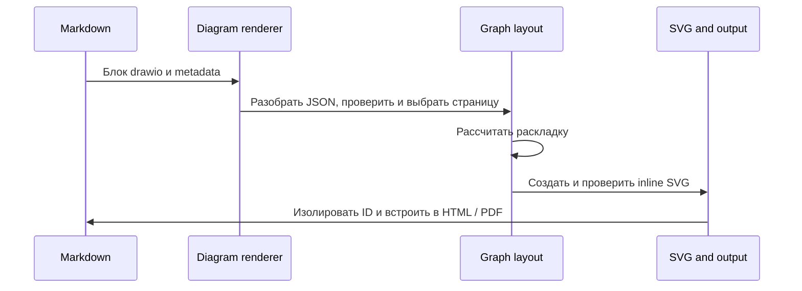

# План: поддержка draw.io JSON

## Цель

Добавить fenced-блок `drawio`. Он принимает JSON из **File → Export as → JSON** и вставляет диаграмму как проверенный inline SVG. Результат одинаково работает в HTML, `--serve`, VS Code preview и PDF, в том числе без сети.

## Формат и границы первой версии

Файл `.drawio` обычно содержит XML. В этом плане поддерживается именно JSON-экспорт draw.io: объект с `version` и массивом `pages`; страница содержит плоский массив `cells`. Ячейки имеют тип `layer`, `group`, `node` или `edge`; узлы и рёбра ссылаются на родителя и соседние ячейки по ID.

Структурный JSON передаёт подписи и связи, но не исходную геометрию и стили. Поэтому первая версия строит на их основе новую диаграмму с автоматической раскладкой. Она сохраняет структуру и подписи, но не обещает совпадение с исходным видом draw.io. Поле `data` с копией XML — необязательная настройка экспорта; чтение XML и точное воспроизведение стилей оставить отдельным этапом.

Источники: [экспорт JSON в draw.io](https://www.drawio.com/docs/manual/export/export-to-json/) и [структура JSON-экспорта](https://github.com/jgraph/drawio/wiki/Import-and-Export).

## Синтаксис Markdown

````markdown
```drawio page=page-1 direction=TB
{
  "version": "26.0",
  "pages": [
    {
      "id": "page-1",
      "name": "Сценарий",
      "cells": [
        { "id": "layer-1", "type": "layer" },
        { "id": "start", "type": "node", "parent": "layer-1", "label": "Старт" },
        { "id": "deploy", "type": "node", "parent": "layer-1", "label": "Релиз" },
        { "id": "edge-1", "type": "edge", "parent": "layer-1", "source": "start", "target": "deploy" }
      ]
    }
  ]
}
```
````

Если в JSON одна страница, её выбирают автоматически. Для нескольких страниц обязателен `page=<id>`. `direction=TB` задаёт раскладку сверху вниз; `direction=LR` — слева направо. Без параметра используется `TB`.

Поддержать оба имени языка: `drawio` и `draw.io`; в документации использовать `drawio`. Значение `label` показывать как обычный текст. Поле `html` не исполнять и не вставлять в SVG как разметку.

## Поток обработки



## Макет диаграммы в документе

Balsamiq показывает вид готовой диаграммы после рендеринга. В приложении блок SVG заменит карточки и стрелки макета.

```balsamiq
{
  "mockup": {
    "measuredW": 1281,
    "measuredH": 801,
    "controls": {
      "control": [
        {
          "ID": "control-1",
          "typeID": "Rectangle",
          "x": 0,
          "y": 0,
          "w": 1280,
          "h": 800,
          "zOrder": 0,
          "properties": {
            "color": "#ffffff"
          }
        },
        {
          "ID": "control-2",
          "typeID": "Label",
          "x": 24,
          "y": 24,
          "w": 38,
          "h": 23,
          "zOrder": 1,
          "properties": {
            "text": "План",
            "color": "#2563eb",
            "size": 14
          }
        },
        {
          "ID": "control-3",
          "typeID": "Label",
          "x": 88,
          "y": 24,
          "w": 140,
          "h": 23,
          "zOrder": 2,
          "properties": {
            "text": "Сценарий релиза",
            "color": "#2563eb",
            "size": 14
          }
        },
        {
          "ID": "control-4",
          "typeID": "Label",
          "x": 24,
          "y": 63,
          "w": 1232,
          "h": 34,
          "zOrder": 3,
          "properties": {
            "text": "Сценарий релиза",
            "size": 22,
            "bold": true
          }
        },
        {
          "ID": "control-5",
          "typeID": "Rectangle",
          "x": 24,
          "y": 113,
          "w": 1232,
          "h": 189,
          "zOrder": 4,
          "properties": {
            "color": "#ffffff"
          }
        },
        {
          "ID": "control-6",
          "typeID": "Label",
          "x": 36,
          "y": 113,
          "w": 1208,
          "h": 57,
          "zOrder": 5,
          "properties": {
            "text": "draw.io JSON",
            "size": 18,
            "bold": true
          }
        },
        {
          "ID": "control-7",
          "typeID": "Rectangle",
          "x": 40,
          "y": 186,
          "w": 160,
          "h": 100,
          "zOrder": 6,
          "properties": {
            "color": "#ffffff"
          }
        },
        {
          "ID": "control-8",
          "typeID": "Label",
          "x": 56,
          "y": 202,
          "w": 128,
          "h": 23,
          "zOrder": 7,
          "properties": {
            "text": "Старт",
            "size": 14
          }
        },
        {
          "ID": "control-9",
          "typeID": "Label",
          "x": 216,
          "y": 186,
          "w": 12,
          "h": 100,
          "zOrder": 8,
          "properties": {
            "text": "↓",
            "size": 20,
            "bold": true
          }
        },
        {
          "ID": "control-10",
          "typeID": "Rectangle",
          "x": 244,
          "y": 186,
          "w": 160,
          "h": 100,
          "zOrder": 9,
          "properties": {
            "color": "#ffffff"
          }
        },
        {
          "ID": "control-11",
          "typeID": "Label",
          "x": 260,
          "y": 202,
          "w": 128,
          "h": 23,
          "zOrder": 10,
          "properties": {
            "text": "Релиз",
            "size": 14
          }
        },
        {
          "ID": "control-12",
          "typeID": "Rectangle",
          "x": 24,
          "y": 318,
          "w": 70,
          "h": 29,
          "zOrder": 11,
          "properties": {
            "text": "2 узла",
            "color": "#f1f5f9"
          }
        },
        {
          "ID": "control-13",
          "typeID": "Rectangle",
          "x": 102,
          "y": 318,
          "w": 77,
          "h": 29,
          "zOrder": 12,
          "properties": {
            "text": "1 связь",
            "color": "#f1f5f9"
          }
        },
        {
          "ID": "control-14",
          "typeID": "Rectangle",
          "x": 187,
          "y": 318,
          "w": 183,
          "h": 29,
          "zOrder": 13,
          "properties": {
            "text": "SVG · доступно офлайн",
            "color": "#f1f5f9"
          }
        }
      ]
    }
  }
}
```

## Архитектура реализации

- Добавить `src/renderers/drawio-json.ts`: разбор JSON, валидация схемы, выбор страницы и нормализация ячеек в модель графа.
- Добавить `src/renderers/drawio-svg.ts`: преобразование модели в безопасный SVG. Использовать обычные SVG-фигуры; экранировать все подписи и атрибуты.
- Добавить `src/renderers/drawio-layout.ts` для вычисления размеров узлов, групп и рёбер. Использовать локальную зависимость [`@dagrejs/dagre`](https://github.com/dagrejs/dagre) для направленной раскладки и обработки циклов. Если зависимость не подходит сборке, заменить её на отдельный модуль раскладки с теми же входами и тестами.
- Добавить `src/renderers/drawio.ts`, реализующий `DiagramRenderer`; зарегистрировать его в обоих списках рендереров в `src/compiler.ts`, чтобы работали компиляция и `--check`.
- Переиспользовать общую проверку SVG, ограничение числа диаграмм, диагностики по исходному файлу и строке fenced-блока, а также кэш рендереров.

`node` отображать скруглённым прямоугольником с подписью. `group` отображать контейнером для дочерних ячеек. `layer` использовать только как родителя, без видимой рамки. `edge` отображать линией со стрелкой от `source` к `target`; при наличии метки ребра показывать её рядом с линией. Графовые циклы допустимы; циклы в ссылках `parent` — ошибка.

## Проверки и ограничения входа

- Ограничить один JSON-блок размером 1 MiB, страницу — 10 000 ячеек, документ — 100 страниц.
- Проверять корректный JSON, типы страниц и ячеек, непустые уникальные ID, ссылки `parent`/`source`/`target` и циклы родительских ссылок.
- Рёбра должны ссылаться на существующие узлы или группы. Нераспознанные типы, несколько страниц без `page`, неверный `direction` и превышение лимита должны давать точную диагностику на строке блока.
- Не читать URL и не выполнять HTML, JavaScript, стили или внешние изображения из JSON. SVG должен проходить существующий sanitizer без новых разрешённых активных элементов или внешних ресурсов.
- Ограничить размеры SVG и время раскладки; при переполнении завершать рендеринг диагностикой, а не создавать страницу с неуправляемой геометрией.

## Этапы

1. [x] Утвердить контракт `pages[].cells[]`, правила выбора страницы и параметры `page`/`direction`.
   - Контракт: страницы содержат плоские `cells[]` с типами `layer`, `group`, `node` и `edge`. Узлы и рёбра ссылаются на родителя; рёбра также ссылаются на узлы или группы. Для одной страницы выбор автоматический; для нескольких нужен `page=<id>`. Направление — `TB` по умолчанию или `LR`.
2. [x] Реализовать parser/validator и нормализованную модель графа. Добавить unit-тесты на корректные данные, ошибки схемы, ссылки, циклы родителей и выбор страницы.
   - Готово 2026-10-21: добавлен `src/renderers/drawio-json.ts` с лимитами входа, проверкой страниц и ячеек, ссылок и циклов родителей, выбором страницы и параметрами `page`/`direction`. Модель содержит только безопасные поля; `html` и XML в `data` не обрабатываются.
   - Добавлены тесты на корректный граф, схему, ссылки, циклы, выбор страницы и лимиты. `npm test` прошёл: 30 файлов, 243 теста. Также прошли сборка, typecheck и lint; форматирование изменённых файлов проверено.
   - `npm run format:check` сообщает о 10 других файлах репозитория. Версия пакета изменена с `0.9.5` на `0.10.0`.
3. [x] Реализовать раскладку и генерацию SVG. Добавить unit-тесты для дерева, ветвления, циклического графа, групп, меток рёбер, длинных подписей и безопасного экранирования.
   - Готово 2026-10-21: добавлены `drawio-rank.ts`, `drawio-layout.ts` и `drawio-svg.ts`. Локальная раскладка размещает группы и узлы по направлению `TB`/`LR`, сводит циклы в компоненты и строит стрелки с метками. Подписи экранируются; размеры SVG, вложенность групп и длина меток ограничены.
   - Тесты покрывают дерево, ветвление, цикл, группы, направление, длинные подписи и безопасный SVG. `npm test` прошёл: 32 файла, 250 тестов. Также прошли сборка, typecheck и lint. Общий `npm run format:check` сообщает о 10 ранее существовавших файлах; новые и изменённые файлы этапа отформатированы.
   - Версия пакета изменена с `0.10.0` на `0.11.0`.
4. [x] Подключить renderer к `compileMarkdown()` и `checkMarkdown()`. Добавить тесты на рендер вместе с Mermaid/PlantUML/Balsamiq, диагностики, кэш и повторную сборку предпросмотра.
   - Готово 2026-10-21: добавлен `src/renderers/drawio.ts` с языками `drawio` и `draw.io`; renderer зарегистрирован в обоих потоках компилятора. Общий pipeline проверяет SVG, присваивает уникальные ID и добавляет диагностики с файлом и строкой блока. Metadata входит в ключ кэша.
   - Добавлены тесты интеграции с Mermaid, PlantUML и Balsamiq, проверки `checkMarkdown()`, кэша по направлению, обновления `--serve`, PDF и VS Code host. Для расширения обновлён lock локального пакета до версии `0.12.0`.
5. [x] Добавить `examples/blueprint-draw.io.md` с рабочим образцом JSON. Обновить README: JSON-экспорт, параметры fenced-блока, автоперестроение, лимиты и отличия от исходного вида draw.io.
   - Готово 2026-10-21: добавлен рабочий пример с группой, узлами и рёбрами. README описывает JSON-экспорт, алиасы языка, параметры `page`/`direction`, автоматическое обновление preview, ограничения входа и то, что новая раскладка не сохраняет геометрию и стили исходника.
6. [x] Собрать проект и выполнить тесты, проверку типов, lint и форматирование. После успешной полной проверки увеличить версию `package.json` как для новой функции.
   - Готово 2026-10-21: `npm test` прошёл — 33 файла и 255 тестов, включая сборку. Прошли `npm run typecheck`, `npm run lint`, `npm run format:check` и `npm --prefix vscode-extension test` (VS Code host и smoke собранного VSIX). Версия увеличена с `0.11.0` до `0.12.0`; lock расширения синхронизирован с локальным пакетом.

## Критерии готовности

- Блоки `drawio` и `draw.io` из JSON-экспорта отображаются как inline SVG в HTML, preview, VS Code и PDF.
- Одностраничный JSON работает без параметров; для нескольких страниц можно выбрать страницу по ID.
- Диаграммы с узлами, группами, связями, циклами и подписями отображаются без сетевых запросов.
- Ошибки JSON и ссылки между ячейками указывают файл и строку блока; ввод не может добавить исполняемое содержимое или внешнюю загрузку.
- README и пример описывают, что структурный JSON не содержит геометрию и стили, поэтому результат имеет автоматическую раскладку.
- Существующие типы диаграмм и сборки продолжают работать.

## Риски

- JSON без копии XML не передаёт расположение, цвета, формы, шрифты и настройки стрелок. Для верного исходному файлу вида понадобится отдельная поддержка XML из поля `data` или формата `.drawio`.
- Диаграммы draw.io могут содержать связи без направления и нестандартные подписи. В JSON без стилей это нельзя надёжно восстановить; первая версия применяет стандартные прямоугольники и направленные стрелки.
- Большие графы с плотными связями могут создавать нечитаемую автоматическую раскладку. Лимиты и диагностика защищают сборку, но не заменяют ручную компоновку.
