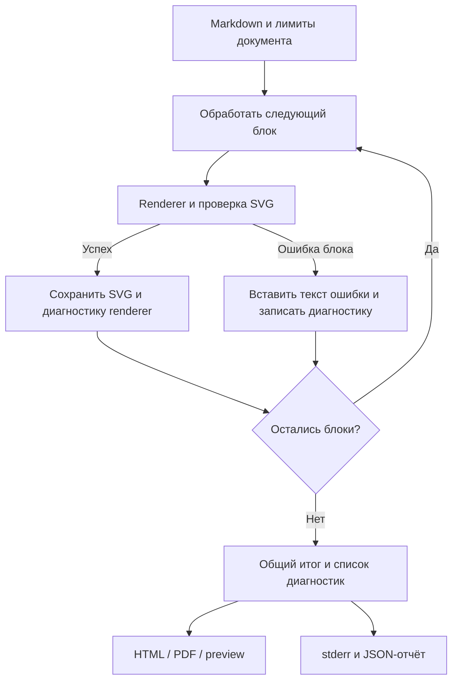

# FEAT-05: документ при ошибках схем и итог проверки

Статус: выполнена 2026-10-23, реализованы все 6 этапов. Источник: [FEAT-05 в очереди](plan-features-todo.md#feat-05-поведение-при-ошибках-диаграмм).

## Цель и границы

Человек читает весь доступный документ, даже если отдельные схемы сломаны. Агент получает все независимые ошибки за один запуск и JSON-отчёт с координатами исходника.

| Требование         | Результат первой версии                                                                                                                   |
| ------------------ | ----------------------------------------------------------------------------------------------------------------------------------------- |
| Доступный документ | Текст и исправные схемы остаются в исходном порядке; на месте сбоя виден полный текст ошибки                                              |
| Понятный итог      | CLI печатает итог в stderr; документ показывает счётчик только при включённой опции `--diagnostics-summary` / `includeDiagnosticsSummary` |
| Автоматизация      | `--check` собирает диагностику всех независимых блоков; `--report-json=<file>` сохраняет отчёт                                            |
| Код завершения     | `0` при отсутствии ошибок, включая случай только предупреждений; `1` при ошибках; `2` при неверных аргументах                             |
| Область изменений  | Компилятор, CLI, HTML/PDF, браузерный preview и существующий preview VS Code                                                              |

Масштабирование схем относится к FEAT-03. Переход из ошибки в редактор, новые панели VS Code и JSON endpoint preview в эту версию не входят. Ошибки изображений и других ресурсов документа сохраняют текущее фатальное поведение.

## Макеты интерфейса

Макеты показывают вариант с включённым итоговым счётчиком. В готовом продукте он скрыт по умолчанию и включается через `--diagnostics-summary`, `CompileOptions.includeDiagnosticsSummary` или настройку `blueprint4llm.preview.includeDiagnosticsSummary`. Сообщения и координаты приведены для примера. Переключатель темы и скачивание PDF уже существуют в браузерном preview.

### Браузер: две ошибки и одна исправная схема

```balsamiq
{
  "mockup": {
    "measuredW": 1101,
    "measuredH": 991,
    "controls": {
      "control": [
        {
          "ID": "control-1",
          "typeID": "Rectangle",
          "x": 0,
          "y": 0,
          "w": 1100,
          "h": 990,
          "zOrder": 0,
          "properties": {
            "color": "#ffffff"
          }
        },
        {
          "ID": "control-2",
          "typeID": "Label",
          "x": 24,
          "y": 24,
          "w": 360,
          "h": 38,
          "zOrder": 1,
          "properties": {
            "text": "Blueprint · Архитектура заказов",
            "size": 20,
            "bold": true
          }
        },
        {
          "ID": "control-3",
          "typeID": "Button",
          "x": 824,
          "y": 24,
          "w": 130,
          "h": 38,
          "zOrder": 2,
          "properties": {
            "text": "Download PDF",
            "bold": false
          }
        },
        {
          "ID": "control-4",
          "typeID": "Button",
          "x": 970,
          "y": 24,
          "w": 106,
          "h": 38,
          "zOrder": 3,
          "properties": {
            "text": "Dark mode",
            "bold": false
          }
        },
        {
          "ID": "control-5",
          "typeID": "Rectangle",
          "x": 24,
          "y": 78,
          "w": 1052,
          "h": 40,
          "zOrder": 4,
          "properties": {
            "text": "Проверка документа: ошибок 2 · предупреждений 0",
            "color": "#fee2e2",
            "size": 14
          }
        },
        {
          "ID": "control-6",
          "typeID": "Label",
          "x": 24,
          "y": 134,
          "w": 1052,
          "h": 20,
          "zOrder": 5,
          "properties": {
            "text": "Цель: принять заказ и отправить его в очередь.",
            "size": 14
          }
        },
        {
          "ID": "control-7",
          "typeID": "Label",
          "x": 24,
          "y": 170,
          "w": 1052,
          "h": 26,
          "zOrder": 6,
          "properties": {
            "text": "Приём заказа",
            "size": 18,
            "bold": true
          }
        },
        {
          "ID": "control-8",
          "typeID": "Rectangle",
          "x": 24,
          "y": 212,
          "w": 1040,
          "h": 160,
          "zOrder": 7,
          "properties": {
            "color": "#ffffff"
          }
        },
        {
          "ID": "control-9",
          "typeID": "Label",
          "x": 40,
          "y": 228,
          "w": 1008,
          "h": 23,
          "zOrder": 8,
          "properties": {
            "text": "Не удалось построить схему",
            "size": 16
          }
        },
        {
          "ID": "control-10",
          "typeID": "Label",
          "x": 40,
          "y": 259,
          "w": 1008,
          "h": 20,
          "zOrder": 9,
          "properties": {
            "text": "plan.md:12:4 · mermaid render failed",
            "size": 14
          }
        },
        {
          "ID": "control-11",
          "typeID": "Label",
          "x": 40,
          "y": 287,
          "w": 1008,
          "h": 20,
          "zOrder": 10,
          "properties": {
            "text": "Parse error: unexpected token",
            "size": 14
          }
        },
        {
          "ID": "control-12",
          "typeID": "Label",
          "x": 40,
          "y": 315,
          "w": 1008,
          "h": 20,
          "zOrder": 11,
          "properties": {
            "text": "Ожидался идентификатор узла после стрелки.",
            "size": 14
          }
        },
        {
          "ID": "control-13",
          "typeID": "Label",
          "x": 24,
          "y": 388,
          "w": 1052,
          "h": 20,
          "zOrder": 12,
          "properties": {
            "text": "Сервис проверяет запрос перед записью.",
            "size": 14
          }
        },
        {
          "ID": "control-14",
          "typeID": "Rectangle",
          "x": 24,
          "y": 424,
          "w": 1040,
          "h": 105,
          "zOrder": 13,
          "properties": {
            "text": "Исправная схема: API → Очередь → Обработчик",
            "color": "#f1f5f9"
          }
        },
        {
          "ID": "control-15",
          "typeID": "Label",
          "x": 24,
          "y": 545,
          "w": 1052,
          "h": 20,
          "zOrder": 14,
          "properties": {
            "text": "Обработчик сохраняет результат операции.",
            "size": 14
          }
        },
        {
          "ID": "control-16",
          "typeID": "Rectangle",
          "x": 24,
          "y": 581,
          "w": 1040,
          "h": 140,
          "zOrder": 15,
          "properties": {
            "color": "#ffffff"
          }
        },
        {
          "ID": "control-17",
          "typeID": "Label",
          "x": 40,
          "y": 597,
          "w": 1008,
          "h": 23,
          "zOrder": 16,
          "properties": {
            "text": "Не удалось построить макет",
            "size": 16
          }
        },
        {
          "ID": "control-18",
          "typeID": "Label",
          "x": 40,
          "y": 628,
          "w": 1008,
          "h": 20,
          "zOrder": 17,
          "properties": {
            "text": "plan.md:31:3 · balsamiq render failed",
            "size": 14
          }
        },
        {
          "ID": "control-19",
          "typeID": "Label",
          "x": 40,
          "y": 656,
          "w": 1008,
          "h": 20,
          "zOrder": 18,
          "properties": {
            "text": "unsupported typeID: UnknownControl",
            "size": 14
          }
        },
        {
          "ID": "control-20",
          "typeID": "Label",
          "x": 24,
          "y": 737,
          "w": 1052,
          "h": 20,
          "zOrder": 19,
          "properties": {
            "text": "Приёмка: повторный запрос не создаёт второй заказ.",
            "size": 14
          }
        },
        {
          "ID": "control-21",
          "typeID": "Label",
          "x": 24,
          "y": 773,
          "w": 1052,
          "h": 17,
          "zOrder": 20,
          "properties": {
            "text": "Исправьте исходник: предпросмотр обновится автоматически.",
            "size": 12
          }
        }
      ]
    }
  }
}
```

### VS Code: тот же документ рядом с исходником

```balsamiq
{
  "mockup": {
    "measuredW": 1201,
    "measuredH": 741,
    "controls": {
      "control": [
        {
          "ID": "control-1",
          "typeID": "Rectangle",
          "x": 0,
          "y": 0,
          "w": 1200,
          "h": 740,
          "zOrder": 0,
          "properties": {
            "color": "#ffffff"
          }
        },
        {
          "ID": "control-2",
          "typeID": "Label",
          "x": 24,
          "y": 24,
          "w": 1152,
          "h": 28,
          "zOrder": 1,
          "properties": {
            "text": "VS Code · plan.md | Blueprint Preview",
            "size": 20,
            "bold": true
          }
        },
        {
          "ID": "control-3",
          "typeID": "Rectangle",
          "x": 24,
          "y": 68,
          "w": 400,
          "h": 590,
          "zOrder": 2,
          "properties": {
            "color": "#ffffff"
          }
        },
        {
          "ID": "control-4",
          "typeID": "Label",
          "x": 36,
          "y": 68,
          "w": 376,
          "h": 57,
          "zOrder": 3,
          "properties": {
            "text": "plan.md",
            "size": 18,
            "bold": true
          }
        },
        {
          "ID": "control-5",
          "typeID": "Label",
          "x": 40,
          "y": 141,
          "w": 368,
          "h": 20,
          "zOrder": 4,
          "properties": {
            "text": "10  mermaid: блок приёма заказа",
            "size": 14
          }
        },
        {
          "ID": "control-6",
          "typeID": "Label",
          "x": 40,
          "y": 177,
          "w": 368,
          "h": 20,
          "zOrder": 5,
          "properties": {
            "text": "12  API --> неожиданный токен",
            "size": 14
          }
        },
        {
          "ID": "control-7",
          "typeID": "Label",
          "x": 40,
          "y": 213,
          "w": 368,
          "h": 20,
          "zOrder": 6,
          "properties": {
            "text": "20  drawio: исправная схема",
            "size": 14
          }
        },
        {
          "ID": "control-8",
          "typeID": "Label",
          "x": 40,
          "y": 249,
          "w": 368,
          "h": 20,
          "zOrder": 7,
          "properties": {
            "text": "29  balsamiq: макет",
            "size": 14
          }
        },
        {
          "ID": "control-9",
          "typeID": "Label",
          "x": 40,
          "y": 285,
          "w": 368,
          "h": 20,
          "zOrder": 8,
          "properties": {
            "text": "31  Unknown",
            "size": 14
          }
        },
        {
          "ID": "control-10",
          "typeID": "Label",
          "x": 40,
          "y": 321,
          "w": 368,
          "h": 17,
          "zOrder": 9,
          "properties": {
            "text": "Исправление запускает новую проверку.",
            "size": 12
          }
        },
        {
          "ID": "control-11",
          "typeID": "Rectangle",
          "x": 448,
          "y": 68,
          "w": 725,
          "h": 590,
          "zOrder": 10,
          "properties": {
            "color": "#ffffff"
          }
        },
        {
          "ID": "control-12",
          "typeID": "Label",
          "x": 464,
          "y": 84,
          "w": 693,
          "h": 26,
          "zOrder": 11,
          "properties": {
            "text": "Архитектура заказов",
            "size": 18,
            "bold": true
          }
        },
        {
          "ID": "control-13",
          "typeID": "Rectangle",
          "x": 464,
          "y": 126,
          "w": 693,
          "h": 40,
          "zOrder": 12,
          "properties": {
            "text": "Ошибок 2 · предупреждений 0",
            "color": "#fee2e2",
            "size": 14
          }
        },
        {
          "ID": "control-14",
          "typeID": "Label",
          "x": 464,
          "y": 182,
          "w": 693,
          "h": 20,
          "zOrder": 13,
          "properties": {
            "text": "Цель: принять заказ.",
            "size": 14
          }
        },
        {
          "ID": "control-15",
          "typeID": "Rectangle",
          "x": 464,
          "y": 218,
          "w": 693,
          "h": 40,
          "zOrder": 14,
          "properties": {
            "text": "plan.md:12:4 · mermaid render failed",
            "color": "#fee2e2",
            "size": 14
          }
        },
        {
          "ID": "control-16",
          "typeID": "Label",
          "x": 464,
          "y": 274,
          "w": 693,
          "h": 20,
          "zOrder": 15,
          "properties": {
            "text": "Parse error: unexpected token",
            "size": 14
          }
        },
        {
          "ID": "control-17",
          "typeID": "Label",
          "x": 464,
          "y": 310,
          "w": 693,
          "h": 20,
          "zOrder": 16,
          "properties": {
            "text": "Текст между схемами сохранён.",
            "size": 14
          }
        },
        {
          "ID": "control-18",
          "typeID": "Rectangle",
          "x": 464,
          "y": 346,
          "w": 665,
          "h": 85,
          "zOrder": 17,
          "properties": {
            "text": "API → Очередь → Обработчик",
            "color": "#f1f5f9"
          }
        },
        {
          "ID": "control-19",
          "typeID": "Rectangle",
          "x": 464,
          "y": 447,
          "w": 693,
          "h": 40,
          "zOrder": 18,
          "properties": {
            "text": "plan.md:31:3 · balsamiq render failed",
            "color": "#fee2e2",
            "size": 14
          }
        },
        {
          "ID": "control-20",
          "typeID": "Label",
          "x": 464,
          "y": 503,
          "w": 693,
          "h": 20,
          "zOrder": 19,
          "properties": {
            "text": "unsupported typeID: UnknownControl",
            "size": 14
          }
        },
        {
          "ID": "control-21",
          "typeID": "Label",
          "x": 464,
          "y": 539,
          "w": 693,
          "h": 20,
          "zOrder": 20,
          "properties": {
            "text": "Приёмка: повторного заказа нет.",
            "size": 14
          }
        }
      ]
    }
  }
}
```

### После исправления исходника

```balsamiq
{
  "mockup": {
    "measuredW": 1101,
    "measuredH": 621,
    "controls": {
      "control": [
        {
          "ID": "control-1",
          "typeID": "Rectangle",
          "x": 0,
          "y": 0,
          "w": 1100,
          "h": 620,
          "zOrder": 0,
          "properties": {
            "color": "#ffffff"
          }
        },
        {
          "ID": "control-2",
          "typeID": "Label",
          "x": 24,
          "y": 24,
          "w": 360,
          "h": 38,
          "zOrder": 1,
          "properties": {
            "text": "Blueprint · Архитектура заказов",
            "size": 20,
            "bold": true
          }
        },
        {
          "ID": "control-3",
          "typeID": "Button",
          "x": 824,
          "y": 24,
          "w": 130,
          "h": 38,
          "zOrder": 2,
          "properties": {
            "text": "Download PDF",
            "bold": false
          }
        },
        {
          "ID": "control-4",
          "typeID": "Button",
          "x": 970,
          "y": 24,
          "w": 106,
          "h": 38,
          "zOrder": 3,
          "properties": {
            "text": "Dark mode",
            "bold": false
          }
        },
        {
          "ID": "control-5",
          "typeID": "Rectangle",
          "x": 24,
          "y": 78,
          "w": 1052,
          "h": 40,
          "zOrder": 4,
          "properties": {
            "text": "Проверка документа: ошибок 0 · предупреждений 0",
            "color": "#eaf2ff",
            "size": 14
          }
        },
        {
          "ID": "control-6",
          "typeID": "Label",
          "x": 24,
          "y": 134,
          "w": 1052,
          "h": 20,
          "zOrder": 5,
          "properties": {
            "text": "Цель: принять заказ и отправить его в очередь.",
            "size": 14
          }
        },
        {
          "ID": "control-7",
          "typeID": "Rectangle",
          "x": 24,
          "y": 170,
          "w": 1040,
          "h": 90,
          "zOrder": 6,
          "properties": {
            "text": "Исправленная схема приёма заказа",
            "color": "#f1f5f9"
          }
        },
        {
          "ID": "control-8",
          "typeID": "Label",
          "x": 24,
          "y": 276,
          "w": 1052,
          "h": 20,
          "zOrder": 7,
          "properties": {
            "text": "Сервис проверяет запрос перед записью.",
            "size": 14
          }
        },
        {
          "ID": "control-9",
          "typeID": "Rectangle",
          "x": 24,
          "y": 312,
          "w": 1040,
          "h": 90,
          "zOrder": 8,
          "properties": {
            "text": "API → Очередь → Обработчик",
            "color": "#f1f5f9"
          }
        },
        {
          "ID": "control-10",
          "typeID": "Label",
          "x": 24,
          "y": 418,
          "w": 1052,
          "h": 20,
          "zOrder": 9,
          "properties": {
            "text": "Обработчик сохраняет результат операции.",
            "size": 14
          }
        },
        {
          "ID": "control-11",
          "typeID": "Rectangle",
          "x": 24,
          "y": 454,
          "w": 1040,
          "h": 90,
          "zOrder": 10,
          "properties": {
            "text": "Исправленный макет оформления заказа",
            "color": "#f1f5f9"
          }
        },
        {
          "ID": "control-12",
          "typeID": "Label",
          "x": 24,
          "y": 560,
          "w": 1052,
          "h": 20,
          "zOrder": 11,
          "properties": {
            "text": "Приёмка: повторный запрос не создаёт второй заказ.",
            "size": 14
          }
        }
      ]
    }
  }
}
```

В VS Code после исправления исчезают обе ошибки и обновляются схемы. Экспорт PDF из браузера и расширения включает текущий документ и те же встроенные сообщения. При включённом счётчике после исправления отображается `0/0`; при выключенном документ не содержит общего счётчика. При наличии только предупреждений документ остаётся доступным.

## Исходное состояние до FEAT-05

| Место                                                                  | Текущее поведение до реализации                                                                                     | Требуемое изменение                                                       |
| ---------------------------------------------------------------------- | ------------------------------------------------------------------------------------------------------------------- | ------------------------------------------------------------------------- |
| [compiler.ts](src/compiler.ts)                                         | `compileMarkdown()` и `checkMarkdown()` собирают строковые `warnings` и `errors`; общие ошибки выбрасываются наружу | Добавить структурированную диагностику и общий подсчёт                    |
| [remark-diagrams.ts](src/plugins/remark-diagrams.ts)                   | `result.errors` собираются; исключение renderer или проверки SVG останавливает цикл                                 | Изолировать сбои блоков и вставлять сообщения на их месте                 |
| [errors.ts](src/errors.ts)                                             | `DiagnosticError` хранит файл, строку и столбец                                                                     | Использовать координаты при создании записей отчёта                       |
| [cli.ts](src/cli.ts), [args.ts](src/args.ts)                           | `--check` возвращает `1` для `errors`; экспорт после записи возвращает `0` даже с `compiled.errors`                 | Унифицировать итог и код завершения, добавить JSON-отчёт                  |
| [server.ts](src/server.ts), [http.ts](src/server/http.ts)              | Результат с `errors` доступен; исключение показывает общую страницу ошибки                                          | Передавать частично собранный документ в существующий preview и PDF cache |
| [preview-controller.ts](vscode-extension/src/preview-controller.ts)    | Результат с `errors` уже показывается; исключение заменяет документ страницей ошибки                                | Сохранить обновления, отмену старых сборок и экспорт текущего результата  |
| [cache.ts](src/renderers/cache.ts), [types.ts](src/renderers/types.ts) | Кеш хранит raw SVG и относительные координаты; выброшенные ошибки не кешируются                                     | Формировать координаты Markdown после чтения кеша                         |

PlantUML уже умеет возвращать безопасный SVG с изображением синтаксической ошибки и `result.errors`. Этот SVG сохраняется; подробная текстовая диагностика добавляется рядом. Ошибка renderer и исключение renderer должны одинаково влиять на итог.

## Поток обработки



| Класс события                                                                                                 | Поведение                                                                                                |
| ------------------------------------------------------------------------------------------------------------- | -------------------------------------------------------------------------------------------------------- |
| Синтаксис, timeout renderer, неподдерживаемые данные, превышение лимита одного блока, небезопасный SVG        | Записать ошибку блока, показать безопасный текст и продолжить следующие блоки                            |
| Безопасный `result.svg` вместе с `result.errors`                                                              | Сохранить SVG, добавить сообщения рядом; каждую диагностику посчитать один раз                           |
| `AbortSignal` отменён                                                                                         | Немедленно прервать обработку; не превращать отмену в ошибку схемы и не публиковать устаревший результат |
| Нельзя прочитать Markdown, превышен общий лимит Markdown/числа схем, ошибка ресурса или общая ошибка pipeline | Остановить сборку; сохранить диагностику уровня документа в отчёт, если он запрошен                      |
| Не удалось создать PDF или записать результат                                                                 | Вернуть `1`, сообщить ошибку экспорта; не заявлять, что файл сохранён                                    |

## Контракт диагностики и совместимость API

Добавить `src/diagnostics.ts` с типом `BlueprintDiagnostic`, подсчётом и форматированием. Добавить `diagnostics` к `CompiledBlueprint` и `MarkdownCheckResult`. Тип и итог экспортировать через [index.ts](src/index.ts). Поле сделать необязательным для совместимости существующих объектов и compiler injection; штатный компилятор всегда его заполняет.

| Поле диагностики        | Значение                                                                                                                                                      |
| ----------------------- | ------------------------------------------------------------------------------------------------------------------------------------------------------------- |
| `severity`              | `error` или `warning`                                                                                                                                         |
| `code`                  | Стабильный код: `diagram.render`, `diagram.limit`, `diagram.svg`, `document.read`, `document.compile`, `output.render`, `output.write` или `renderer.warning` |
| `scope`                 | `diagram`, `document` или `output`                                                                                                                            |
| `sourceFile`            | Путь исходного Markdown                                                                                                                                       |
| `line`, `column`        | Координаты Markdown с единицы; отсутствуют, если определить позицию нельзя                                                                                    |
| `diagramId`, `renderer` | Заполняются для диаграммы; ID соответствует `bp-diagram-NNN`                                                                                                  |
| `message`               | Полное многострочное сообщение без повторного префикса пути                                                                                                   |

`warnings: string[]` и `errors?: string[]` сохранить как представление тех же записей для существующих потребителей. Нельзя получать координаты JSON разбором этих строк. В CLI и preview использовать структурированные записи, а при их отсутствии — старые массивы; не выводить и не считать оба представления одновременно.

Для ошибок без локальной позиции использовать начало fence. Для ошибок с локальной строкой сохранить существующее сопоставление строк renderer с Markdown, включая вложенные fences и ограничение позиции границами блока. Список упорядочивать по исходному порядку блоков. Предупреждения одного блока сохраняют порядок renderer.

### JSON-отчёт

Новая опция `--report-json=<file>` доступна с `--check` и одноразовым экспортом. При `--check` она создаёт только отчёт; HTML/PDF и каталог assets не создаются. С `--serve` опция несовместима: ошибка аргументов и код `2`. Вывод в stdout остаётся текущим: пути сохранённых документов или строка `OK`.

```json
{
  "schemaVersion": 1,
  "sourceFile": "/project/plan.md",
  "status": "error",
  "summary": { "errors": 2, "warnings": 0 },
  "diagnostics": [
    {
      "severity": "error",
      "code": "diagram.render",
      "scope": "diagram",
      "sourceFile": "/project/plan.md",
      "line": 12,
      "column": 4,
      "diagramId": "bp-diagram-001",
      "renderer": "mermaid",
      "message": "Parse error: unexpected token\nОжидался идентификатор узла после стрелки."
    },
    {
      "severity": "error",
      "code": "diagram.render",
      "scope": "diagram",
      "sourceFile": "/project/plan.md",
      "line": 31,
      "column": 3,
      "diagramId": "bp-diagram-003",
      "renderer": "balsamiq",
      "message": "unsupported typeID: UnknownControl"
    }
  ],
  "outputs": { "html": "/project/plan.html" }
}
```

| Ситуация                         | Договорённость                                                                                                                       |
| -------------------------------- | ------------------------------------------------------------------------------------------------------------------------------------ |
| Успех или только предупреждения  | `status: "ok"`; отчёт сохраняется и при пустом списке диагностик                                                                     |
| Схемы сломаны, HTML/PDF сохранён | `status: "error"`; `outputs` содержит фактически сохранённый файл; CLI возвращает `1` после записи                                   |
| Фатальный сбой                   | Добавить диагностику уровня документа/экспорта; `outputs` содержит только результат текущего запуска, который действительно сохранён |
| Запись отчёта                    | UTF-8 JSON, завершающий перевод строки, атомарная запись через существующий `writeSingleOutput()`                                    |
| Коллизия путей                   | До сборки отклонить путь отчёта, совпадающий с исходником или результатом, в том числе через symlink                                 |
| Отчёт записать нельзя            | Сообщить это в stderr и вернуть `1`; уже сохранённый документ остаётся доступным                                                     |

JSON содержит сериализуемые поля диагностики. `cause`, stack trace, токены, временные URL Figma и исходный текст блока в отчёт не включать. Сохранить существующее скрытие секретов в сообщениях renderer.

## Изменения и порядок реализации

| Этап                           | Файлы                                                                                                                        | Результат                                                                                                  |
| ------------------------------ | ---------------------------------------------------------------------------------------------------------------------------- | ---------------------------------------------------------------------------------------------------------- |
| ✓ 1. Общая модель              | `src/diagnostics.ts`, `src/errors.ts`, `src/index.ts`                                                                        | Типизированные записи, координаты, подсчёт и совместимые строковые поля                                    |
| ✓ 2. Изоляция ошибок           | `src/plugins/remark-diagrams.ts`, `src/plugins/diagram-diagnostics.ts`, `src/compiler.ts`                                    | Сбои отдельных схем изолированы; отмена сохраняет семантику; check использует тот же проход без HTML       |
| ✓ 3. Отображение               | `src/template.ts`, `src/diagnostics-html.ts`                                                                                 | Безопасные карточки остаются возле схем; общий счётчик отключён по умолчанию и включается отдельной опцией |
| ✓ 4. CLI и JSON-отчёт          | `src/args.ts`, `src/cli.ts`, `src/diagnostic-report.ts`                                                                      | Структурированный stderr, коды выхода, атомарный JSON и сохранение HTML/PDF при ошибках схем               |
| ✓ 5. Browser и VS Code preview | `src/server.ts`, `src/server/http.ts`, `src/server/html.ts`, `vscode-extension/src/preview-controller.ts`, `webview-html.ts` | Частичный документ доступен; PDF соответствует preview; VS Code поддерживает настройку счётчика и темы     |
| ✓ 6. Документация              | `README.md`, `vscode-extension/README.md`, `examples/blueprint-diagnostics.md`, `plan-features-todo.md`                      | CLI, API, настройки, ошибки и пример описаны; FEAT-05 закрыта в очереди                                    |

### Журнал реализации

- 2026-10-23 — завершён шаг 1 «Общая модель»: добавлены типы `BlueprintDiagnostic` и стабильные коды, подсчёт по severity и форматирование совместимых строк; компилятор и `checkMarkdown()` заполняют `diagnostics`, сохраняя `warnings`/`errors`; `DiagnosticError` преобразуется в запись без разбора форматированной строки. Добавлены модульные тесты модели и координат renderer-диагностик.
- 2026-10-23 — завершены шаги 2–3: каждый блок обрабатывается изолированно, успешные SVG и документ сохраняются, ошибки и предупреждения показываются безопасными карточками на месте схемы; отменённые сборки не публикуются. Общий счётчик в HTML/PDF отключён по умолчанию по требованию пользователя; `--diagnostics-summary`, API `includeDiagnosticsSummary` и настройка VS Code включают его явно.
- 2026-10-23 — завершён шаг 4: CLI собирает все диагностики, возвращает `0/1/2` по контракту, сохраняет HTML/PDF при ошибках схем, не затирает старые изображения при ошибке и создаёт атомарный JSON-отчёт с проверкой коллизий путей.
- 2026-10-23 — завершён шаг 5: browser preview и VS Code сохраняют частичный документ, логируют структурированные записи без дублирования, экспортируют ту же версию в PDF и обновляются после исправления. Добавлены цвета, перенос длинного текста и поведение для light/dark/high contrast тем.
- 2026-10-23 — завершён шаг 6: обновлены README, инструкция расширения и очередь задач; добавлен `examples/blueprint-diagnostics.md` с двумя независимыми ошибками и исправной схемой между ними. Корневой пакет повышен до `0.20.0`.

Сообщения реализованы как HAST text nodes, а не строки HTML. Для диагностики заданы `white-space: pre-wrap` и `overflow-wrap: anywhere`; длинные сообщения переходят на следующие страницы PDF. Оформление использует переменные темы, а severity обозначен текстом и границами.

Для SVG/PNG/JPEG сохранено требование ровно одного блока. Если он содержит ошибку, CLI возвращает `1` и не создаёт новое изображение; ранее записанный файл не меняется. JSON-отчёт при этом доступен. HTML/PDF документы сохраняются при ошибках схем.

Новые модули разделить по ответственности. Держать code-файлы в пределах 300–500 строк и покрыть каждую добавленную функцию unit-тестами. Новые runtime-зависимости для этой задачи не требуются.

## Проверки и приёмка

Основная fixture: текст до первой схемы → сломанная Mermaid → текст → исправная draw.io JSON → текст → сломанный Balsamiq → заключительный текст. Две ошибки должны иметь разные ID и позиции.

| Проверка                | Тесты и подтверждённое поведение                                                                                                                                                                               |
| ----------------------- | -------------------------------------------------------------------------------------------------------------------------------------------------------------------------------------------------------------- |
| Сбор всех ошибок        | `tests/remark-diagrams.test.ts`, `tests/compiler.test.ts`, `tests/diagram-limits.test.ts`: обе ошибки найдены, исправный SVG и весь текст доступны в исходном порядке                                          |
| Типы и форматирование   | Новый `tests/diagnostics.test.ts`: пустой список, warning/error, многострочный текст, координаты; старые поля не удваивают счётчики                                                                            |
| SVG и PlantUML          | `tests/svg.test.ts`, `tests/plantuml.test.ts`: небезопасный SVG не попадает в документ; безопасный error-SVG и текст доступны, ошибка посчитана один раз                                                       |
| Кеш и отмена            | `tests/diagram-cache.test.ts`, `tests/server.test.ts`: перенос fence меняет координаты; сбой не ломает кеш исправной схемы; отменённая сборка не публикуется                                                   |
| HTML/PDF                | Новый `tests/diagnostics-html.test.ts`, `tests/template.test.ts`, `tests/pdf.test.ts`: экранирование, многострочные и длинные сообщения, полный текст после ошибок и на следующих страницах                    |
| CLI                     | `tests/cli-diagnostics.test.ts`, `tests/cli.test.ts`, `tests/cli-integration.test.ts`: HTML/PDF существуют при коде `1`; stderr содержит обе ошибки и итог; warning-only даёт `0`; неверные аргументы дают `2` |
| JSON и аргументы        | Новый `tests/diagnostic-report.test.ts`, `tests/args.test.ts`: схема отчёта, успешный/ошибочный запуск, фатальный сбой, коллизии путей, недоступный файл отчёта, `--check` без документов                      |
| Preview и PDF           | `tests/server.test.ts`, `vscode-extension/test/suite/preview-controller.test.ts`, `webview-html.test.ts`, `pdf-export.test.ts`: частичный документ и PDF текущей версии доступны; после исправления ошибок нет |
| Изображение одной схемы | `tests/image-export.test.ts`, `tests/cli.test.ts`: ошибка даёт `1`, новый SVG/PNG/JPEG не создаётся, старый файл сохраняется                                                                                   |

Устаревшие ожидания кода `0` при `compiled.errors` обновлены на `1`, при этом тесты подтверждают запись HTML. Тесты фатальных ошибок сохранены; прежние ожидания остановки обработки на ошибке отдельной диаграммы заменены проверками продолжения.

Ручная приёмка выполнена 2026-10-23: `plan-feat-05-diagnostics.md --check` прошёл без диагностик; все три Balsamiq макета и Mermaid flowchart экспортированы отдельно и осмотрены. Полный браузерный plan-preview осмотрен в светлой и тёмной темах. Fixture с ошибками проверен в браузере: при настройке по умолчанию в документе нет общего счётчика, при явном включении показывается `2/0`; в обоих случаях видны две карточки, исправный SVG draw.io и завершающий текст. PDF fixture содержит оба сообщения и заключительный текст на трёх страницах. HTML VS Code preview осмотрен для light/dark/high contrast цветовых переменных; Extension Development Host проверил включение настройки.

```bash
npm run build
npm run typecheck
npm run lint
npm run format:check
npm test
npm --prefix vscode-extension run build
# Для headless Linux:
xvfb-run -a npm --prefix vscode-extension test
```

Реализация завершена. `npm run build`, `npm run typecheck`, `npm run lint`, `npm run format:check` и `npm test` прошли; core-набор: 51 файл, 469 тестов. `xvfb-run -a npm test` из `vscode-extension/` прошёл, включая упаковку и smoke-проверку VSIX; host-тест запускался на VS Code 1.101.0 и Node.js 22.15.1. Тестовый VS Code выводит предупреждения API от трёх посторонних установленных расширений (Live Share и Python); ошибок расширения в host/package проверках нет. Корневой пакет повышен до `0.20.0`. В `plan-features-todo.md` FEAT-05 отмечена выполненной. Документ хранит требования, макеты и фактический журнал реализации.
