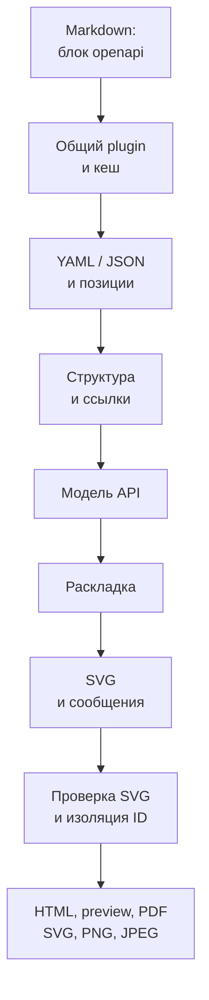
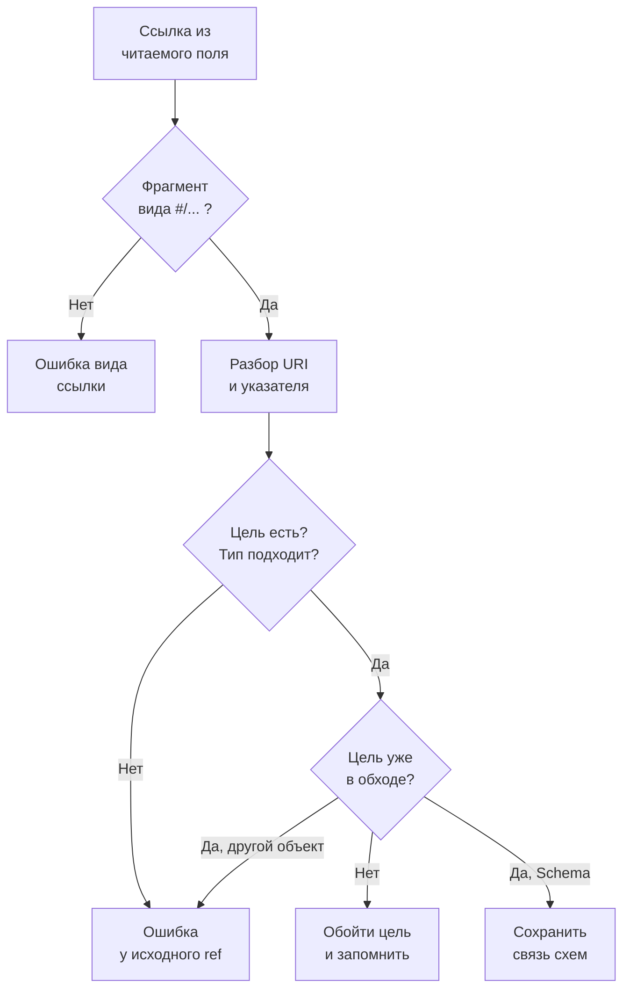

# FMT-03: OpenAPI YAML/JSON в техническом плане

Статус: реализован 2026-10-23; все семь этапов завершены. Ограничения, реализация и проверки зафиксированы ниже.

## Цель и границы

Автор вставляет существующий контракт в блок `openapi`. Читатель видит методы, параметры, ответы и модели рядом с архитектурой. Рендеринг работает локально через существующий SVG-конвейер.

| Решение первой версии | Граница поддержки                                                                                                               |
| --------------------- | ------------------------------------------------------------------------------------------------------------------------------- |
| Версия контракта      | Только `openapi: 3.1.1`; другие версии отклонять с указанием поддерживаемой версии                                              |
| Вход                  | Один встроенный YAML 1.2 или JSON-документ на блок `openapi`; обычные блоки `yaml` и `json` сохраняют подсветку кода            |
| Выход                 | Статическая сводка API в SVG: заголовок, операции, параметры, тела запросов, ответы, модели                                     |
| Ссылки                | Внутренние `$ref` с JSON Pointer в том же документе; внешние файлы, URL и именованные anchors не поддерживаются                 |
| Среды                 | HTML, браузерный preview, VS Code, PDF и существующий экспорт одной схемы в SVG/PNG/JPEG                                        |
| Проверка              | Проверять структуру читаемых полей и разрешение ссылок; полная валидация OpenAPI и проверка HTTP-данных по JSON Schema отложены |
| Интерфейс             | Использовать существующие средства просмотра; новые кнопки, панели и интерактивные запросы к API не нужны                       |

Это выбранное подмножество формата, а не заявление о полной поддержке OpenAPI 3.1.1. Расширение диапазона версий потребует отдельных fixtures и правил совместимости.

## Что должен увидеть читатель

Ниже показаны операции и модели, которые статический SVG выводит для небольшого контракта. Полный контракт находится в [примере OpenAPI](examples/blueprint-openapi.md).

**Orders API · 1.0.0 · OpenAPI 3.1.1**

| Операция                            | Параметры и запрос                            | Ответы                                                  |
| ----------------------------------- | --------------------------------------------- | ------------------------------------------------------- |
| `GET /orders/{id}` · Получить заказ | `id`: path, string, обязательный              | `200`: application/json → Order; `404`: заказ не найден |
| `POST /orders` · Создать заказ      | Тело обязательно: application/json → NewOrder | `201`: application/json → Order                         |

| Модель   | Свойство   | Тип             | Обязательно |
| -------- | ---------- | --------------- | ----------- |
| Order    | id         | string          | Да          |
| Order    | status     | enum: new, paid | Да          |
| NewOrder | customerId | string          | Да          |

SVG размещает операции и модели вертикально. Для каждой операции он показывает полный путь и HTTP-метод. Подписи переносятся по ширине, высота строк зависит от содержимого. Обязательность, `deprecated` и тип параметра обозначаются текстом. Описания выводятся как экранированный текст.

SVG сохраняет порядок путей, операций и моделей из исходника. JSON и YAML с одинаковым порядком полей дают одинаковый SVG. Inline-схемы выводятся рядом с запросом или ответом; именованные модели выводятся один раз, ссылки показывают имя и указатель цели.

Большой контракт доступен целиком в HTML с существующей прокруткой. Текущий [print-html.ts](src/print-html.ts) ограничивает высоту одной схемы до 220 mm и масштабирует её в PDF. В первой версии PDF гарантированно проверять на небольшой fixture; большие контракты могут стать мелкими. Многостраничную печать одного OpenAPI-блока отложить и описать это ограничение в README.

## Подключение к текущему коду



| Существующий модуль                                                                          | Использование и изменение                                                                                               |
| -------------------------------------------------------------------------------------------- | ----------------------------------------------------------------------------------------------------------------------- |
| [types.ts](src/renderers/types.ts)                                                           | Реализовать существующий `DiagramRenderer`; возвращать `DiagramResult` без расширения общего API                        |
| [compiler.ts](src/compiler.ts)                                                               | Добавить `openapiRenderer` в оба списка: `compileMarkdown()` и `checkMarkdown()`                                        |
| [remark-diagrams.ts](src/plugins/remark-diagrams.ts)                                         | Сохранить общий лимит блока, преобразование координат, контейнер `bp-diagram--openapi`, проверку SVG и обработку ошибок |
| [cache.ts](src/renderers/cache.ts)                                                           | Кешировать SVG и относительные позиции предупреждений; включить версию парсера и правила раскладки в `cacheKey`         |
| [parse-and-validate.ts](src/svg/parse-and-validate.ts), [scope-ids.ts](src/svg/scope-ids.ts) | Использовать общую проверку и изоляцию ID; не вводить обход для нового формата                                          |
| [image-export.ts](src/image-export.ts), [server.ts](src/server.ts)                           | Использовать существующие экспорт и обновление preview; проверить их новым контрактом                                   |

FMT-03 можно реализовать до FEAT-05: ошибки нового renderer выбрасываются через существующий контракт. Пока FEAT-05 не реализована, исключение останавливает сборку. После её реализации тот же сбой будет показан на месте блока. JSON-отчёт и продолжение обработки описаны отдельно в [плане FEAT-05](plan-feat-05-diagnostics.md).

## Разбор документа и модель данных

Добавить прямую runtime-зависимость `yaml` ветки 2.x. При реализации выбрать конкретную версию по её официальной документации и включить её в идентификатор кеша. Транзитивную установку не считать контрактом зависимости.

Для YAML использовать `parseDocument()` с YAML 1.2, проверкой уникальности ключей и `LineCounter`. Для JSON сначала проверять грамматику через `JSON.parse()`, затем получать позиции и дубли ключей тем же YAML AST-парсером. Это исключает комментарии и trailing comma; опция YAML `schema: 'json'` сама по себе не заменяет проверку JSON-грамматики. Не допускать, чтобы ошибочный JSON незаметно принимался как YAML: источник с первым значимым символом `{` или `[` считать JSON. Это правило означает, что YAML в flow-стиле на верхнем уровне не поддерживается.

До преобразования AST в объекты проверить глубину, число узлов и строковые ключи. Отклонять YAML aliases, merge keys, пользовательские tags, несколько документов и несовместимые с JSON значения `.nan`/`.inf`. Проверку aliases выполнить до `toJS()` и дополнительно установить `maxAliasCount: 0`. Хранить словари в `Map` или объектах без прототипа и обходить только собственные поля.

Парсер возвращает исходное дерево и индекс `JSON Pointer → локальная строка/столбец`. Модель рендеринга содержит `ApiDocument`, `ApiOperation`, `ApiParameter`, `ApiResponse`, `ApiSchema` и ссылки между ними. Каждый элемент сохраняет исходный указатель; координаты всего Markdown назначает существующий plugin.

| Область                 | Что читать и показывать                                                                                                                                                |
| ----------------------- | ---------------------------------------------------------------------------------------------------------------------------------------------------------------------- |
| Корень                  | `info.title`, `info.version`, описание; требуется `paths` или `components`; пустой `paths` допустим                                                                    |
| Операции                | Восемь методов: get, put, post, delete, options, head, patch, trace; путь, summary/description, operationId, tags, deprecated                                          |
| Параметры               | path, query, header, cookie; имя, обязательность, schema либо content; параметры операции заменяют общие параметры пути по паре `(in, name)`                           |
| Тело запроса            | required, описание, все media types и схемы; внутренние ссылки на `components.requestBodies`                                                                           |
| Ответы                  | Код, диапазон `2XX` или default, описание, media types, схемы и заголовки; внутренние ссылки на responses и headers                                                    |
| Модели                  | Boolean schemas; type, включая массив типов с null; properties, required, items, enum, format, additionalProperties, description, readOnly/writeOnly                   |
| Композиция              | allOf, oneOf и anyOf как явные списки вариантов; не сливать свойства и не вычислять результат валидации                                                                |
| Повторное использование | `components.schemas`, parameters, requestBodies, responses, headers и pathItems; схемы с циклическими ссылками сохранять как граф                                      |
| Остальные возможности   | security, callbacks, webhooks, примеры, servers и прочие неотображаемые разделы отмечать предупреждением с указателем; краткое «Не показано: …» добавлять в сводку SVG |

Проверять типы читаемых полей, обязательные `info.title`/`info.version`, описание ответа и `required: true` для path-параметров. Конфликтующие дубли параметров одного уровня отклонять. Не представлять этот набор проверок как полноценный валидатор спецификации.

## Внутренние `$ref`



| Правило                   | Реализация                                                                                                                                                                                                           |
| ------------------------- | -------------------------------------------------------------------------------------------------------------------------------------------------------------------------------------------------------------------- |
| Разрешение                | Поддержать `#/...`: percent-decoding фрагмента, затем JSON Pointer с `~1` → `/` и `~0` → `~`; обрабатывать массивы и пустые сегменты; неверное кодирование отклонять                                                 |
| Проверка цели             | Проверять существование и ожидаемый вид объекта; совпадения имени модели недостаточно; не использовать обход цепочки прототипов                                                                                      |
| Схемы                     | Не выполнять глубокую подстановку; хранить рёбра графа по указателю цели. Прямые и взаимные рекурсивные модели должны завершаться без зацикливания                                                                   |
| Цепочки Reference Object  | Использовать memoization и множество текущего обхода; цикл без Schema Object считать ошибкой; повторная ссылка не является циклом сама по себе                                                                       |
| Соседние поля             | Различать Reference Object и Schema Object. У первого учитывать summary/description, другие соседние поля игнорировать с предупреждением; у Schema Object сохранять `$ref` и соседние ограничения вместе             |
| Path Item                 | Поддержать внутреннюю ссылку на Path Item; сочетание `$ref` с локальными операциями/параметрами отклонять как неподдерживаемое объединение                                                                           |
| Другие правила разрешения | В схемах отклонять `$id`, `$anchor`, `$dynamicRef` и `$dynamicAnchor`; для `$schema` и корневого `jsonSchemaDialect` разрешать только стандартный диалект OAS 3.1. Фрагмент `#` без указателя пока не поддерживается |
| Внешние ресурсы           | Для относительного пути, `file:`, HTTP(S) и прочих URI вернуть понятную ошибку; не читать файл и не отправлять запрос                                                                                                |

Обходить `$ref` в поддерживаемых объектах и schema-позициях. Строку с именем `$ref` внутри `example`, `enum`, описания или `x-*` не считать ссылкой. У неизвестного schema keyword показывать предупреждение о неполном представлении; не применять к нему собственные правила разрешения.

## Диагностика и ограничения

Ошибка renderer содержит сообщение, JSON Pointer и локальные `line`/`column` с единицы. `remarkDiagramPlugin` добавляет файл и переносит позицию в Markdown. Предупреждения передавать через `DiagramResult.warnings` с такими же относительными координатами. При перемещении блока кеш не должен сохранять старую строку документа.

| Сбой                              | Ожидаемая диагностика                                                                     |
| --------------------------------- | ----------------------------------------------------------------------------------------- |
| Ошибка YAML/JSON или повтор ключа | Причина парсера и точная позиция внутри блока                                             |
| Другая версия                     | `unsupported OpenAPI version: 3.0.3; supported: 3.1.1` у поля openapi                     |
| Нет цели                          | `unresolved $ref: #/components/schemas/Order` у исходного `$ref`                          |
| Ошибочный тип цели                | Указатель ссылки и ожидаемый вид объекта, например Parameter Object                       |
| Внешняя ссылка                    | `external $ref is not supported; embed the referenced object in this block`               |
| Превышен предел                   | Название предела, фактическое значение и максимум; не обрезать операции, модели или текст |

| Ресурс   | Начальный предел                                                                              |
| -------- | --------------------------------------------------------------------------------------------- |
| Исходник | 256 KiB UTF-8 на блок: существующий общий предел без override                                 |
| Дерево   | 10 000 узлов AST и глубина 64; считать до преобразования и повторно ограничивать обход модели |
| Контракт | 200 операций, 500 именованных схем, 2 000 ссылок, 5 000 строк раскладки                       |
| SVG      | 4 MiB, ширина до 1 200 px, высота до 16 384 px; проверять до публикации                       |
| Документ | Существующие 5 MiB Markdown и 100 блоков; действует первый достигнутый предел                 |
| Отмена   | Проверять `AbortSignal` до разбора и между этапами; устаревший результат не публиковать       |

Пределы — проектные решения для первой версии. Проверить граничные значения тестами. Для длинных строк вычислять перенос до формирования SVG; если вся раскладка не помещается, завершать блок диагностикой. SVG должен содержать title, обычные text/tspan и базовые фигуры; исходный HTML, внешние шрифты и изображения не нужны.

## Порядок реализации

Все этапы реализованы. Модули разделены по разбору, ссылкам, модели, SVG-раскладке и интеграции.

| Шаг             | Модули                                                                                          | Проверяемый результат                                                    | Статус   |
| --------------- | ----------------------------------------------------------------------------------------------- | ------------------------------------------------------------------------ | -------- |
| 1. Парсер       | `openapi-source.ts`, `openapi-error.ts`, `openapi-types.ts`                                     | YAML/JSON, индекс позиций, ограничения, понятная синтаксическая ошибка   | Завершён |
| 2. Ссылки       | `openapi-refs.ts`                                                                               | JSON Pointer, типы целей, цепочки и циклы, внешние ссылки без I/O        | Завершён |
| 3. Нормализация | `openapi-model.ts`, `openapi-model-content.ts`, `openapi-model-context.ts`, `openapi-schema.ts` | Параметры, запросы/ответы, модели, композиции и предупреждения           | Завершён |
| 4. Изображение  | `openapi-layout.ts`, `openapi-svg.ts`                                                           | Детерминированный SVG с переносами, полными подписями и проверкой границ | Завершён |
| 5. Интеграция   | `openapi.ts`, оба списка в `src/compiler.ts`, общий plugin, cache и export                      | `openapi` распознаётся в `compileMarkdown()` и `checkMarkdown()`         | Завершён |
| 6. Документация | `README.md`, пример, skill, `vscode-extension/package.json`                                     | Fence, версия, подмножество, диагностика, PDF и runtime-зависимость YAML | Завершён |
| 7. Завершение   | Тесты, примеры, preview/VS Code/PDF, версия и этот план                                         | Критерии приёмки проверены; FMT-03 отмечен выполненным                   | Завершён |

Этап 1 принимает YAML 1.2 и строгий JSON. Он отклоняет дубли ключей, неподдерживаемые версии, aliases, merge keys, custom tags, несколько документов, нестроковые ключи и значения `.nan`/`.inf`. До преобразования AST в `Map` проверяются 256 KiB, 10 000 узлов и глубина 64. Парсер также строит индекс JSON Pointer к исходным позициям. Добавлена прямая зависимость `yaml@2.9.1`.

Этап 2 разрешает только локальные JSON Pointer. Он проверяет процентное кодирование, `~0`/`~1`, массивы, пустые сегменты и ожидаемый тип цели. Циклы схем сохраняются как связи; циклы Reference Object завершаются диагностикой. Внешние URI не читаются и не запрашиваются.

Этап 3 строит модель восьми HTTP-методов, объединяет параметры пути и операции по `(in, name)`, читает тела запросов, ответы, заголовки и схемы. Рекурсивные модели сохраняются как граф. Непоказанные поля создают предупреждения с указателем и позицией; схема не объявляется полноценным валидатором OpenAPI.

Этап 4 строит детерминированный SVG шириной до 1 200 px и высотой до 16 384 px. Текст экранируется и переносится, длинные токены разбиваются без обрезки. Проверяются пределы 5 000 строк и 4 MiB.

Этап 5 зарегистрировал `openapiRenderer` в обоих списках компилятора. Общий plugin выполняет лимит источника, кеширование, преобразование координат, проверку SVG и изоляцию ID. Ошибки сохраняют файл, строку, колонку и JSON Pointer; предупреждения остаются привязаны к блоку при повторном использовании кеша. `vscode-extension/package.json` также объявляет `yaml@2.9.1`, чтобы runtime-парсер попадал в установленный VSIX.

Этап 6 добавил пример Orders API, описание ограничений и пример для навыка. Обычные блоки `yaml` и `json` продолжают отображаться как код. HTML и preview показывают весь SVG; в PDF большая диаграмма может уменьшаться до высоты 220 mm и не делится на страницы.

Этап 7 добавил тесты парсера, ссылок, модели, раскладки, SVG и общего renderer. VS Code host test проверяет рендеринг `openapi`, обновление preview при изменении контракта и передачу результата OpenAPI в PDF-export; package smoke запускается на собранном VSIX. Версия пакета увеличена до `0.17.0` после успешных проверок.

Разделять код по этим обязанностям и соблюдать предел 300–500 строк на code-файл. Покрыть каждую добавленную функцию unit-тестами. Общий реестр renderer выделять только при необходимости; обязательное изменение здесь — оба существующих списка.

## Тесты и критерии приёмки

Основные fixtures: эквивалентные YAML и JSON для Orders API с двумя операциями, path-параметром, телом запроса, двумя моделями и `$ref` на общий ответ. Отдельная fixture содержит рекурсивную модель Category. Ошибочные контракты хранить отдельно от успешного демонстрационного примера.

| Набор тестов                                            | Обязательные сценарии                                                                                                                                                                                                        |
| ------------------------------------------------------- | ---------------------------------------------------------------------------------------------------------------------------------------------------------------------------------------------------------------------------- |
| `tests/openapi-source.test.ts`, `openapi-error.test.ts` | Эквивалентность JSON/YAML; дубли; trailing comma и комментарии в JSON; неверная версия; CRLF; кириллица; позиции; aliases/tags; несколько документов; каждый предел на границе и за ней                                      |
| `tests/openapi-refs.test.ts`                            | Цепочка и повтор ссылок; escaped/percent-encoded указатели; пустой сегмент; индекс массива; отсутствующая цель; неверный тип; собственные поля; Schema-цикл и цикл Reference Object; отсутствие файловых и сетевых обращений |
| `tests/openapi-model.test.ts`, `openapi-schema.test.ts` | Все восемь методов; override `(in, name)`; media types; response headers; `2XX` и default; nullable-типы и boolean schema; композиции; соседние поля `$ref`; неподдерживаемые поля и dialect                                 |
| `tests/openapi-layout.test.ts`, `openapi-svg.test.ts`   | Полный текст, длинные пути без пробелов, переносы и конечная строка; порядок; детерминизм; лимит SVG; экранирование; совпадение viewBox с границами содержимого                                                              |
| `tests/openapi-renderer.test.ts`                        | `compileMarkdown()` и `checkMarkdown()` узнают fence; обычный yaml/json остаётся кодом; смешанный документ; уникальные ID; кеш и перенос блока; AbortSignal                                                                  |
| Существующие CLI/export/server tests                    | `--check` без выходных файлов; ошибка с файлом и строкой, код `1`; HTML/PDF; SVG/PNG/JPEG ровно одного блока; обновление после исправления контракта                                                                         |
| VS Code tests                                           | `vscode-extension/test/suite/preview-controller.test.ts` и `pdf-export.test.ts`: новый fence рендерится, правка буфера обновляет документ и PDF                                                                              |

Отдельные тесты подтверждают, что неизвестные `$ref` внутри enum/example/x-* не запускают resolver, а `$id`, `$anchor`, `$dynamicRef` и `$dynamicAnchor` дают явную ошибку ограничения.

Ручная приёмка выполнена на `examples/blueprint-openapi.md`: проверены `--check`, PNG, HTML, PDF и локальный preview; на PNG видны обе операции, ссылки и последняя модель с нижней границей. PDF содержит одну страницу, текст первой операции и последней модели извлекается. VS Code host smoke test компилирует блок `openapi` в preview workflow. Отдельный большой контракт с 30 операциями экспортирован в HTML и PDF: последний endpoint и последняя схема присутствуют в обоих документах. PDF остаётся одной страницей, поэтому большой SVG масштабируется целиком. FEAT-03 для этой приёмки не требовался.

```bash
npm run build
npm run typecheck
npm run lint
npm run format:check
npm test
npm --prefix vscode-extension run build
xvfb-run -a npm --prefix vscode-extension test
node dist/cli.js examples/blueprint-openapi.md --check
```

Проверки завершены 2026-10-23: `npm run build`, `npm run typecheck`, `npm run lint`, `npm run format:check` и `npm test` завершились успешно; полный набор содержит 48 файлов и 439 тестов. Сборка расширения VS Code и `xvfb-run -a npm --prefix vscode-extension test` прошли, включая host smoke test и package smoke test. CLI `--check` прошёл для демонстрационного и планового Markdown. SVG, PNG, JPEG и PDF для примера экспортированы; PNG и диаграммы плана визуально проверены. Большой контракт проверен по наличию последней операции и модели в HTML/PDF. После успешных проверок версия пакета повышена до `0.17.0` по `AGENTS.md`; FMT-03 и все семь этапов завершены.

Во время упаковки VS Code `vsce` предупредил, что пакет включает много файлов из `node_modules`; тест завершился успешно. Установка локальной зависимости расширения также вывела npm audit с 9 уязвимостями (3 low, 6 high). Эти сообщения относятся к существующему дереву зависимостей и не повлияли на сборку или тесты.

## Источники для реализации

- Текущая архитектура: [README](README.md), исходники и тесты, перечисленные выше.
- [OpenAPI 3.1.1](https://spec.openapis.org/oas/v3.1.1.html): фиксированная версия, объекты, ссылки и правила Schema Object.
- [RFC 6901, URI fragment representation](https://www.rfc-editor.org/rfc/rfc6901#section-6): JSON Pointer во фрагменте URI.
- [yaml 2.x](https://eemeli.org/yaml/v2/): AST, позиции, уникальные ключи и ограничения aliases.
