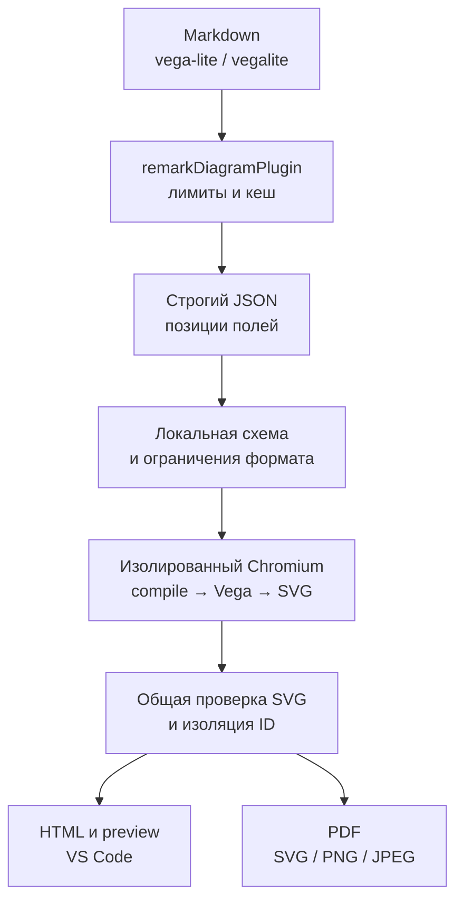
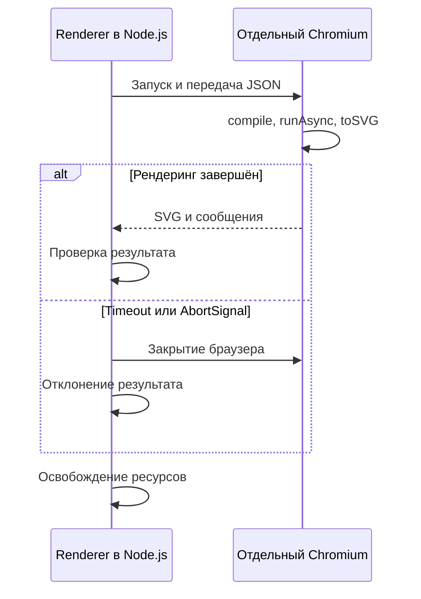

# Vega-Lite в Markdown-планах

Статус: реализация всех этапов завершена и проверена 2026-10-23. Результаты сборки, тестов, CLI и упаковки записаны в разделе «Фактический результат проверок».

## Цель и границы первой версии

Автор описывает график вместе с данными внутри Markdown. Читатель видит диаграмму с осями, подписями и легендой рядом с архитектурой и требованиями. Одна спецификация даёт одинаковое статическое изображение во всех средах проекта.

| Решение         | Граница поддержки                                                                                                        |
| --------------- | ------------------------------------------------------------------------------------------------------------------------ |
| Fence           | Канонический `vega-lite`; короткий alias `vegalite`. Обычный `json` сохраняет подсветку кода                             |
| Вход            | Один строгий JSON-объект; комментарии, trailing comma, дубли ключей, YAML и ссылки на файлы отклонять                    |
| Версия          | Vega-Lite 6; `$schema` необязателен. Без него применять локальную схему установленной версии                             |
| Данные          | Встроенные массивы объектов в `data.values` и корневом `datasets`; именованные источники должны разрешаться внутри блока |
| Выход           | Статический SVG через официальный компилятор Vega-Lite и runtime Vega                                                    |
| Среды           | HTML, браузерный preview, VS Code, PDF и экспорт одного блока в SVG/PNG/JPEG                                             |
| Взаимодействие  | Без редактора, Vega-Embed, панелей действий, выбора точек, zoom, streaming и элементов ввода                             |
| Внешние ресурсы | Без загрузки URL, локальных файлов, изображений, внешних шрифтов и схем во время рендеринга                              |

Это подмножество Vega-Lite 6 с явно описанными ограничениями. Формат низкого уровня Vega и fence `vega` в эту задачу не входят. Новые экраны и команды не требуются: используется существующий просмотр документа.

## Сценарий и пример входа

1. Вставить спецификацию и небольшую таблицу данных в блок `vega-lite`.
2. Выполнить `blueprint4llm plan.md --check`.
3. Открыть preview или экспортировать документ. При ошибке исправить поле по координатам из диагностики.

Ниже показан поддерживаемый синтаксис из `examples/blueprint-vega-lite.md`.

````markdown
```vega-lite
{
  "$schema": "https://vega.github.io/schema/vega-lite/v6.json",
  "title": "Задержка API по окружениям",
  "description": "Сравнение p95 задержки в миллисекундах",
  "width": 480,
  "height": 240,
  "data": {
    "values": [
      { "environment": "Dev", "latency": 85 },
      { "environment": "Stage", "latency": 120 },
      { "environment": "Prod", "latency": 95 }
    ]
  },
  "mark": "bar",
  "encoding": {
    "x": { "field": "environment", "type": "nominal", "title": "Окружение" },
    "y": { "field": "latency", "type": "quantitative", "title": "p95, мс" },
    "color": { "field": "environment", "type": "nominal", "legend": null }
  }
}
```
````

Читатель должен увидеть три столбца: Dev — 85, Stage — 120, Prod — 95. Заголовок, обе оси и крайние подписи должны помещаться в SVG. Это основной fixture для CLI, preview, VS Code и экспорта.

## Подключение к текущему конвейеру



| Существующий модуль                                                                            | Что использовать или изменить                                                                                                      |
| ---------------------------------------------------------------------------------------------- | ---------------------------------------------------------------------------------------------------------------------------------- |
| [types.ts](src/renderers/types.ts)                                                             | Реализовать `DiagramRenderer`: `name: 'vega-lite'`, оба alias, `cacheKey`, `render()`; сохранить `DiagramResult`                   |
| [compiler.ts](src/compiler.ts)                                                                 | Зарегистрировать `vegaLiteRenderer` в обоих списках: `compileMarkdown()` и `checkMarkdown()`                                       |
| [remark-diagrams.ts](src/plugins/remark-diagrams.ts)                                           | Использовать текущий предел 256 KiB, координаты Markdown и контейнер `bp-diagram--vega-lite`; не добавлять второй путь вставки SVG |
| [cache.ts](src/renderers/cache.ts)                                                             | Кешировать SVG с относительными позициями сообщений; хранить результат до изоляции ID                                              |
| [parse-and-validate.ts](src/svg/parse-and-validate.ts), [scope-ids.ts](src/svg/scope-ids.ts)   | Проверять SVG и изолировать `clipPath`, gradients и ссылки между повторяющимися блоками                                            |
| [plantuml-page.ts](src/renderers/plantuml-page.ts), [chrome-sandbox.ts](src/chrome-sandbox.ts) | Использовать существующий подход к запуску Chrome, локальной странице, запрету запросов и закрытию ресурсов                        |
| [image-export.ts](src/image-export.ts), [print-html.ts](src/print-html.ts)                     | Использовать текущие экспорт и печать; проверить размеры, шрифты, цвета и отсутствие обрезки                                       |
| [server/html.ts](src/server/html.ts), [webview-html.ts](vscode-extension/src/webview-html.ts)  | Исключить Vega-Lite из инверсии цветов в тёмной теме; у графиков цвет может кодировать данные                                      |

Исключение нового renderer обрабатывает существующий plugin и останавливает текущую сборку. Предупреждение сохраняет изображение. Продолжение документа после ошибок и JSON-диагностика не являются зависимостью этой задачи; они описаны отдельно в [FEAT-05](plan-feat-05-diagnostics.md).

## Зависимости и способ рендеринга

Добавить прямые runtime-зависимости `vega-lite`, `vega` и `ajv`. Исходная совместимая пара на дату подготовки плана: `vega-lite@6.5.0` и `vega@6.4.0`; первая требует Vega `^6.4.0` и Node.js ≥22. Проверить метаданные опубликованных пакетов перед установкой, закрепить конкретные версии и выполнить smoke-проверку сборок. Основание: [package.json Vega-Lite](https://github.com/vega/vega-lite/blob/v6.5.0/package.json) и [package.json Vega](https://github.com/vega/vega/blob/v6.4.0/packages/vega/package.json).

Выбрать браузерный рендеринг через уже установленный Puppeteer. Он даёт браузерное измерение текста и не требует добавлять нативный `canvas`. Не запускать `vl2svg` через глобальный CLI или `npx`: зависимости должны поставляться с пакетом и VSIX.

| Шаг        | Действие                                                                                                                                                                                                                                                   |
| ---------- | ---------------------------------------------------------------------------------------------------------------------------------------------------------------------------------------------------------------------------------------------------------- |
| Подготовка | Лениво прочитать браузерные сборки `build/vega.min.js` и `build/vega-lite.min.js` из установленных пакетов. Получать каталог через разрешённые package exports, например путь к экспортируемой JSON Schema; не полагаться на доступность закрытого subpath |
| Валидация  | Загрузить `vega-lite/vega-lite-schema.json` локально, скомпилировать совместимым Ajv один раз. Запретить получение `$ref` по сети; параметры Ajv и версию включить в правила renderer                                                                      |
| Страница   | Создать отдельный Browser/Page и локальную служебную страницу для одного рендера; установить перехват запросов до навигации                                                                                                                                |
| Компиляция | Передать JSON как аргумент `page.evaluate()`. Вызвать `vegaLite.compile(spec, { logger }).spec` внутри страницы                                                                                                                                            |
| Вычисление | Вызвать `vega.parse()` и создать `vega.View` с `renderer: 'svg'`, logger и запрещающим loader уже в конструкторе; выполнить `runAsync()`                                                                                                                   |
| Результат  | Получить `view.toSVG()`, проверить размер и границы, вернуть SVG и сообщения в `DiagramResult`                                                                                                                                                             |
| Завершение | В нормальном ходе вызвать `view.finalize()` в `finally`. При любом исходе закрыть страницу, браузер, локальный сервер и таймер                                                                                                                             |

`compile()` и собственный logger описаны в [официальном API компилятора](https://vega.github.io/vega-lite/usage/compile.html). Жизненный цикл `View`, экспорт SVG и установка loader до начала загрузок описаны в [Vega View API](https://vega.github.io/vega/docs/api/view/).

Маршрут реализован на официальном компиляторе Vega-Lite и runtime Vega в Chromium. Проверены локальные browser bundles и схема, SVG без сетевой загрузки, а также рендер из установленного npm-архива. Нативный `canvas` не добавлялся; собственные шкалы и раскладка не реализовывались.

## Поддерживаемые возможности

| Область             | Правила первой версии                                                                                                                                                                                          |
| ------------------- | -------------------------------------------------------------------------------------------------------------------------------------------------------------------------------------------------------------- |
| Спецификация        | Одиночный график, `layer`, `hconcat`, `vconcat`, `concat`, `facet`, `repeat`; сохранять правила наследования `data`, `encoding` и `resolve` официального компилятора                                           |
| Marks               | `bar`, `line`, `point`, `circle`, `square`, `area`, `rect`, `rule`, `tick`, `text`, `arc`, `trail`; составные `boxplot`, `errorbar`, `errorband`                                                               |
| Кодирование         | Количественные, порядковые, номинальные и временные поля; оси, шкалы, сортировка, legend, color, size, shape, text, aggregation и binning                                                                      |
| Преобразования      | Разрешить `filter`, `calculate`, `aggregate`, `joinaggregate`, `bin`, `timeUnit`, `stack`, `fold`, `lookup`; для lookup разрешать только встроенный источник. Остальные transforms отклонять с именем операции |
| Выражения           | Строки выражений обрабатывает только официальный Vega parser/runtime; не использовать `eval` над JSON или самописную замену выражений                                                                          |
| Данные              | Массивы объектов; пустой массив допустим. Разрешать `data: null`, наследование и графики без источника, если они допустимы по схеме. Проверять все именованные ссылки, включая lookup                          |
| Время               | Для переносимых результатов рекомендовать ISO 8601 с явным смещением и UTC-шкалы; служебной странице задать UTC и фиксированную locale. Не переписывать явно заданные настройки автора                         |
| Параметры           | Разрешать переменные с постоянным `value`. `select`, `bind` и параметры с `expr` отклонять, чтобы не показывать непредсказуемый снимок интерактивного состояния                                                |
| Tooltip             | Принимать, но выдавать одно предупреждение на блок: статический экспорт не предоставляет интерактивную подсказку                                                                                               |
| Внешние возможности | Отклонять `data.url`, `mark: 'image'`, `href`, генераторы данных, географические marks/projection и старое `selection`. Не удалять их молча                                                                    |
| Метаданные          | `title`, `description`, `usermeta` допускаются по схеме; пользовательские строки остаются текстом                                                                                                              |

Композиции и свойства описаны в [Vega-Lite View Specification](https://vega.github.io/vega-lite/docs/spec.html), встроенные наборы — в [Data](https://vega.github.io/vega-lite/docs/data.html), параметры — в [Parameters](https://vega.github.io/vega-lite/docs/parameter.html). Ограничения таблицы выше — решения проекта, а не ограничения самого Vega-Lite.

Проверять именно поля грамматики: `url` внутри строки данных может быть обычным значением. Не отклонять документ поиском имён ключей по всему JSON. Обходить вложенные спецификации, `config`, определения marks и источники lookup с учётом контекста. Неизвестное поле спецификации диагностировать через схему.

При наличии `$schema` принимать только `https://vega.github.io/schema/vega-lite/v6.json`. Другой major или произвольный URL отклонять с указанием поддерживаемого значения. URL служит идентификатором: рендерер всегда использует локальную схему закреплённого пакета. По умолчанию задавать `width: 480` и `height: 300` для единичного view без размеров; сохранять числовые размеры и допустимый `{ "step": ... }`. `width/height: 'container'` и автоматический resize отклонять, поскольку у статического SVG нет контейнера пользователя.

Белый фон и семейство `sans-serif` задать как defaults. Разрешать статические цвета и фон автора, но отклонять CSS `url(...)` и внешние ресурсы. Прозрачность сохранять, если она задана явно. В browser preview и VS Code не инвертировать SVG Vega-Lite; для прозрачных графиков оставить светлую подложку контейнера. Проверить читаемость заголовка, текста, легенды и нижней оси в обеих темах.

## Разбор JSON и диагностика

Использовать существующий `jsonc-parser` в строгом режиме: `disallowComments: true`, `allowTrailingComma: false`, `allowEmptyContent: false`. До рекурсивного разбора ограничить глубину scanner-проходом. Проверить дубли ключей и конечность чисел, затем построить индекс `JSON Pointer → позиция` по AST. Словари обрабатывать через собственные поля и `Map`; не сливать пользовательский JSON с объектами конфигурации без проверки.

Ошибки парсера, Ajv и ограничений формата должны содержать `line`/`column` с единицы относительно тела fence. Преобразовать `instancePath` Ajv в позицию AST; для отсутствующего свойства использовать родительский объект. Убрать шум альтернатив `anyOf`: выводить ограниченный набор наиболее конкретных ошибок. Если компилятор или runtime не сообщает позицию, привязать сообщение к началу блока и прямо не обещать точность до поля.

| Случай                     | Ожидаемая диагностика                                                                        |
| -------------------------- | -------------------------------------------------------------------------------------------- |
| Ошибка JSON                | `invalid Vega-Lite JSON: ...` с локальной строкой и столбцом                                 |
| Несовместимая схема        | `unsupported Vega-Lite schema; expected .../v6.json` у `$schema`                             |
| Неверное поле              | JSON Pointer, ожидаемый тип/вариант и координаты соответствующего поля                       |
| Внешние данные             | `external data is not supported; use data.values or datasets` у `data.url`                   |
| Неразрешённое имя          | `unknown dataset: ...` у `data.name`                                                         |
| Интерактивный параметр     | `interactive parameters are not supported in static export` у `select` или `bind`            |
| Превышение лимита          | Имя ресурса, фактическое значение и предел; данные и подписи не обрезать                     |
| Предупреждение компилятора | Сохранить через локальный logger в `DiagramResult.warnings`; глобальный console не подменять |
| Ошибка runtime             | Исключение или `logger.error` завершает блок ошибкой; не возвращать успешный пустой SVG      |

Ограничить количество и длину сообщений, например 100 сообщений по 2 KiB, с одним итоговым сообщением о пропусках. Не включать весь JSON в ошибку. Общий plugin добавляет имя файла и координаты Markdown; renderer не должен добавлять их второй раз.

## Изоляция, лимиты и отмена

Браузерный runtime Vega по умолчанию генерирует функции для выражений. Для первой версии разрешить `unsafe-eval` только в отдельной служебной странице вместе с локально внедрёнными библиотеками. Не менять CSP экспортированного HTML или VS Code webview. Вариант с `vega-interpreter` и AST описан в [официальной документации](https://vega.github.io/vega/usage/interpreter/); его можно рассмотреть отдельно, если потребуется убрать `unsafe-eval` и из служебной страницы.

В служебной странице запретить `connect-src`, внешние scripts, images, fonts, frames и workers. Разрешить только точную первоначальную навигацию к локальной странице; последующие запросы блокировать, включая `file:`, `http:`, `https:` и `data:`. Отдельно передавать запрещающий Vega loader в конструктор View. Запоминать попытку загрузки как ошибку блока: runtime может перехватить отказ и продолжить вычисление. Исходник передавать аргументом evaluate, без вставки в `<script>` или HTML.



| Ресурс                | Начальный предел                                                                                      |
| --------------------- | ----------------------------------------------------------------------------------------------------- |
| Вход                  | Общие 256 KiB UTF-8 на блок, 5 MiB Markdown и 100 визуальных блоков                                   |
| JSON                  | Глубина 64 и 50 000 узлов AST, включая значения данных                                                |
| Данные                | 10 000 исходных строк суммарно по `values` и `datasets`; один dataset учитывать один раз              |
| Структура графика     | 100 view после раскрытия facet/repeat и 100 transforms; считать вложенные структуры                   |
| Вычисленный результат | До 50 000 записей в одном вычисленном наборе и 50 000 элементов scenegraph; проверять до сериализации |
| SVG                   | До 4 MiB, положительные конечные размеры до 4 096 px по каждой стороне, до 16 млн пикселей            |
| Время                 | 30 секунд на запуск, компиляцию, вычисление и получение SVG; таймер находится в Node.js               |
| Параллельность        | Не более двух одновременных рендеров через существующий `ConcurrencyLimiter`                          |

Это проектные пределы, которые нужно проверить граничными fixtures. Вспомогательные datasets Vega тоже включать в контроль результата. Исходные и выходные пределы не дают строгого ограничения пикового потребления памяти Chromium; не заявлять такую гарантию. Таймер Node.js должен закрывать отдельный браузер даже при заблокированном event loop страницы. `Promise.race()` без остановки вычислений недостаточен.

Проверять `AbortSignal` до постановки в очередь, после получения слота и между асинхронными этапами. Обработчик abort должен прерывать текущий браузер; результат отменённого рендера не публиковать и не кешировать. На успешном пути проверять возвращаемый SVG до добавления в кеш, затем сохранять общие проверку и изоляцию ID в plugin.

`cacheKey` включает версии Vega-Lite, Vega, Ajv, ревизию локальной схемы/политики, defaults размеров, locale и timezone. Не включать `diagramId` в исходный SVG: ID изолируются общим plugin отдельно при каждом использовании. Никаких TTL или watcher для внешних данных не требуется, поскольку все данные находятся в fence.

## Модули и порядок реализации

| Шаг                      | Модули                                                                                                                                      | Проверяемый результат                                                                               | Статус    |
| ------------------------ | ------------------------------------------------------------------------------------------------------------------------------------------- | --------------------------------------------------------------------------------------------------- | --------- |
| 1. Технический прототип  | `vega-lite-assets.ts`, `vega-lite-page.ts`, зависимости в `package.json`                                                                    | Локальные сборки и схема доступны; небольшой график даёт валидный SVG без сети и нативного canvas   | Выполнено |
| 2. Разбор и позиции      | `vega-lite-source.ts`, `vega-lite-error.ts`                                                                                                 | Строгий JSON, scanner-предел глубины, дубли, индекс позиций и ошибки с координатами                 | Выполнено |
| 3. Границы формата       | `vega-lite-schema.ts`, `vega-lite-policy.ts`, `vega-lite-data.ts`, `vega-lite-style.ts`                                                     | Локальная схема, поддерживаемые поля, вложенные источники, параметры и лимиты до запуска Chrome     | Выполнено |
| 4. Жизненный цикл        | `vega-lite-page.ts`                                                                                                                         | Compile/run/export, локальные logger, запрещающий loader, timeout, abort и освобождение ресурсов    | Выполнено |
| 5. Адаптер               | `vega-lite.ts`, оба списка `src/compiler.ts`                                                                                                | Оба alias, `DiagramResult`, кеш, SVG-проверка и существующая диагностика                            | Выполнено |
| 6. Среды вывода          | `src/server/html.ts`, `vscode-extension/src/webview-html.ts`, `tests/vega-lite-renderer.test.ts`, тесты VS Code                             | Preview, VS Code, PDF и изображения; цвета сохраняются при смене темы                               | Выполнено |
| 7. Документация и выпуск | `README.md`, `skills/blueprint4llm/SKILL.md`, `examples/blueprint-vega-lite.md`, `vscode-extension/README.md`, package manifests и lockfile | Пример, ограничения и команды проверены; npm-пакет и VSIX содержат runtime assets и локальную схему | Выполнено |

Каждый модуль имеет одну ответственность. Удерживать кодовые файлы в пределах 300–500 строк; делить по функции. Все добавленные функции покрыть unit-тестами. Не менять общие API и не рефакторить остальные renderer без необходимости.

## Проверки и критерии готовности

| Уровень           | Обязательные сценарии                                                                                                                                                                              |
| ----------------- | -------------------------------------------------------------------------------------------------------------------------------------------------------------------------------------------------- |
| JSON и схема      | Корректный объект; пустой/повреждённый JSON; массив в корне; комментарии, trailing comma, дубли, переполнение числа; глубина и размер; схема v6, другой major и URL; координаты CRLF/Unicode       |
| Политика          | Все marks и композиции из таблицы; наследование data; datasets и inline lookup; пустые данные; неразрешённое имя; запрещённые возможности во вложенном слое; поле `url` в обычных данных допустимо |
| Изображение       | Bar из примера, line с UTC-датами, scatter с legend, stacked/aggregate, layer, facet/repeat, text и составные marks; проверить оси, данные и размеры, а не только наличие `<svg>`                  |
| Диагностика       | Parser/Ajv → точное поле; compiler warning → предупреждение; logger.error → ошибка; fallback без координат; сообщения не выводятся в глобальный console и не смешиваются между рендерами           |
| Изоляция          | Внешние источники в data и lookup, image/href, CSS URL; вредоносные строки в title/text; срабатывание loader и перехвата запросов; проверка SVG не ослаблена                                       |
| Ресурсы           | Все пределы на границе и сверх неё; timeout во время синхронного compile/dataflow; abort до очереди, при запуске и при вычислении; после отказа следующий рендер работает                          |
| Кеш               | Повторный график не запускает Chrome; разные версии/политика меняют ключ; предупреждения получают новые координаты; повторные clipPath/gradient ID изолированы; отмена не оставляет запись         |
| CLI и API         | `checkMarkdown()` и `compileMarkdown()` узнают оба alias; обычный json остаётся кодом; `--check` не пишет файлы; ошибки дают exit code 1                                                           |
| Экспорт           | HTML открывается без сети; PDF содержит подписи; SVG/PNG/JPEG показывают один полный график; ноль/два визуальных блока отклоняются общим экспортом                                                 |
| Preview и VS Code | Изменение значения обновляет столбец; исправление ошибки возвращает график; устаревшая сборка не публикуется; обе темы сохраняют цвета и читаемость                                                |
| Упаковка          | `npm pack` и установленный пакет рендерят fixture; VSIX содержит browser bundles и JSON Schema, работает в минимальной поддерживаемой версии VS Code                                               |

Использовать реальные библиотеки в интеграционных тестах и моки только для отдельных сбоев запуска/закрытия. Визуально проверить все демонстрационные графики целиком, включая нижнюю ось и легенду. Для числовой семантики проверять результат transforms и значения marks; не ограничиваться снимком случайных SVG ID. Одинаковость SVG между разными версиями Chrome и ОС побайтно не обещать.

### Фактический результат проверок

- `npm run build`, `npm run typecheck`, `npm run lint`, `npm run format:check` — выполнены успешно.
- `npm test` — все 55 файлов и 518 тестов прошли.
- `npm --prefix vscode-extension run build` — выполнена успешно.
- `xvfb-run -a npm --prefix vscode-extension test` — Development Host и packaged VSIX smoke прошли на VS Code 1.101.0; пакет рендерит Vega-Lite и содержит browser bundles и локальную схему.
- Установленный из `npm pack` архив `blueprint4llm@0.21.0` скомпилировал Vega-Lite fixture в SVG.
- `examples/blueprint-vega-lite.md` прошёл CLI `--check`, `--serve` и экспорт SVG, PNG, JPEG и PDF. PNG визуально проверен целиком: заголовок, оси и три столбца видны.
- VS Code 1.101.0 вывел предупреждения об устаревших API proposals и Node.js `punycode`; `vsce` сообщил о количестве файлов в расширении и предложил bundle. Все тестовые процессы завершились с кодом 0.
- Основная версия повышена с `0.20.0` до `0.21.0`; версия расширения — с `0.4.0` до `0.5.0`. `vscode-extension/package-lock.json` синхронизирован с версиями и runtime-зависимостями.

Изменения оставлены без commit.

Критерий завершения выполнен: пример проходит локальную проверку, показывает данные и подписи в CLI, preview, VS Code, PDF и экспортах изображений, работает без сетевых источников и прерывает рендер по отмене или таймауту. Ограничения первой версии задокументированы и проверены тестами.
