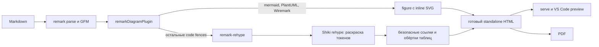

# План: подсветка обычных блоков кода

## Цель

Добавить подсветку синтаксиса для обычных fenced-блоков Markdown. Mermaid, PlantUML и Wiremark должны продолжать преобразовываться в диаграммы, а JSON, TypeScript и другие примеры кода — оставаться доступными и читабельными в HTML, предпросмотре и PDF.

## Что есть сейчас

- В `src/compiler.ts` единый pipeline преобразует Markdown в HTML. Диаграммы обрабатываются `remarkDiagramPlugin` до перехода в HAST/HTML; распознанные блоки заменяются SVG.
- Остальные fenced-блоки проходят через `remark-rehype` как `<pre><code class="language-…">` с экранированным исходным текстом. В `src/template.ts` есть общее оформление `<pre>` и `<code>`, но нет раскраски токенов.
- Предпросмотр использует результат `compileMarkdown()`, а PDF строится из того же HTML. Значит, подсветку нужно выполнить при компиляции, до выдачи результата, без браузерного JavaScript и CDN.
- README описывает обычные блоки как подсвечиваемый HTML-код. После реализации нужно проверить и уточнить это описание по фактическому поведению.

## Решение

Подключить официальный rehype-плагин Shiki (`@shikijs/rehype`) к HTML-части pipeline. Подсвечивать блоки на сервере при компиляции и встраивать готовые токены в HTML. Для подсветки использовать пару светлой и тёмной тем: обычный HTML и PDF сохраняют светлый вариант, а переключатель темы в локальном предпросмотре меняет цвета кода вместе с остальной страницей.

Плагин разместить после `remarkRehype` и до `rehypeStringify`. В этом месте он видит обычные `<pre><code>`; диаграммы уже заменены на `<figure>` с SVG и не должны попасть под подсветку. Текущие обработчики безопасных ссылок и таблиц сохраняются в pipeline.

Для fenced-блоков язык берётся из info string после открывающих обратных кавычек, например `json`, `ts`, `typescript`, `bash`, `sql` или `html`. Если язык не указан или Shiki не знает метку языка, сборка должна оставить содержимое экранированным обычным кодом и продолжить работу. Inline-код, PlantUML, Mermaid и Wiremark эта функция не меняет.

В `src/template.ts` добавить стили для цветов Shiki и фоновой поверхности. Цвета переключать по уже используемому предпросмотром атрибуту `data-bp-theme="dark"`. Стили должны оставаться внутри документа, чтобы результат работал офлайн, при открытии HTML напрямую и при печати в PDF. Для PDF оставить светлую тему по умолчанию.

Официальная документация: [интеграция Shiki с rehype](https://shiki.style/packages/rehype), [установка и HTML-вывод Shiki](https://shiki.style/guide/install), [темы Shiki](https://shiki.style/themes).

## Как проходит обработка



## Макет предпросмотра кода

Wiremark показывает отдельный экран предпросмотра: подпись языка, кодовый блок и короткое пояснение. Макет демонстрирует результат для пользователя; реальные цвета токенов формирует Shiki.

```wireframe
Wireframe #code-highlight-preview landscape
  Stack column gap=2 padding=3
    Breadcrumbs
      Link "Планы"
      Link "Подсветка кода"
    Typography h4 "Пример TypeScript"
    Alert "Язык блока указан как ts. Цвета помогают быстро различать ключевые слова, строки и значения." severity=info
    Card
      CardHeader title="Проверка конфигурации" subheader="typescript"
      CardContent
        Stack column gap=1
          Typography body2 "const config = {"
          Typography body2 "  format: 'html',"
          Typography body2 "  highlight: true,"
          Typography body2 "};"
          Typography body2 "export function isReady(): boolean {"
          Typography body2 "  return config.highlight;"
          Typography body2 "}"
```

## План реализации

- [x] Добавить совместимую с текущей ESM-сборкой версию `@shikijs/rehype` в runtime-зависимости и обновить lockfile. Зафиксировать версии в соответствии с принятой в проекте практикой.
- [x] Подключить Shiki после `remarkRehype` в `src/compiler.ts`. Выбрать светлую и тёмную темы; ограничить обработку обычными code-блоками. Проверить поведение для отсутствующей и неизвестной метки языка: в обоих случаях исходный код остаётся видимым и экранированным.
- [x] Добавить стили Shiki в `src/template.ts`: сохранить текущие размеры, отступы и горизонтальную прокрутку `<pre>`, задать читаемый фон и переключение цветов через `data-bp-theme`. Убедиться, что PDF получает светлые цвета и не теряет контраст при печати.
- [x] Добавить unit-тесты pipeline: JSON и TypeScript получают токены; текст кода сохраняется; `<`, `>` и кавычки остаются безопасно экранированными; неизвестная и пустая метка языка не прерывает компиляцию; inline-код не меняется.
- [x] Добавить регрессионную проверку совместной компиляции: Mermaid, PlantUML и Wiremark остаются SVG, когда в документе есть подсвечиваемый блок кода, и не получают разметку Shiki. Уточнить README, добавить PlantUML в `examples/blueprint-highlight.md` и подтвердить, что каталог `examples` входит в npm-пакет.
- [x] Проверить предпросмотр в светлой и тёмной темах и PDF. Если подсветка длинных блоков заметно замедляет сборку, отдельно определить и задокументировать разумное ограничение размера кода; не менять существующий лимит Markdown без измерения.

Выполненный этап подключает подсветку в компиляторе и задаёт офлайн-палитры Shiki для светлой, тёмной и печатной тем. Грамматики загружаются по мере необходимости; неизвестные и пустые метки сохраняют исходный экранированный код. Добавлены unit-тесты для токенизации, сохранения текста и безопасного fallback.

Регрессионный этап завершён: добавлена проверка совместной обработки подсвечиваемого TypeScript-блока и трёх видов диаграмм; README описывает offline-подсветку и fallback; демонстрационный пример включает Mermaid, PlantUML и Wiremark. В `package.json` каталог `examples` уже указан среди публикуемых файлов и проверен через `npm pack --dry-run`.

Финальная проверка выполнена на `examples/blueprint-highlight.md` в Chromium: в светлой и тёмной темах меняются фон страницы, фон кодового блока и цвет токенов; четыре обычных блока подсвечены, три диаграммы остаются SVG. PDF состоит из четырёх страниц A4, сохраняет светлую палитру и читаемый текст.

Замер на Node 22.23.3 показал, что подсветка одного блока TypeScript размером 128 КиБ добавляет около 0,52 с, а блока 1 МиБ — около 3,63 с по сравнению с обычным кодовым блоком. Поэтому установлен предел подсветки 64 КиБ UTF-8 на один fenced-блок. Блок в 60 КиБ подсветился за 249 мс против 10 мс без подсветки; блоки 128 КиБ и 1 МиБ остались целиком экранированным текстом без измеримого дополнительного времени. Общий лимит Markdown 5 МиБ не менялся.

## Демонстрационный пример

Файл `examples/blueprint-highlight.md` создаётся вместе с этим планом. Он показывает блоки JSON, TypeScript, Bash и YAML, блок без языковой метки, а также Mermaid- и Wiremark-блоки для проверки сосуществования подсветки с уже поддерживаемыми диаграммами.

## Критерии готовности

- Обычные fenced-блоки с известным языком размером до 64 КиБ UTF-8 получают видимую подсветку и остаются читаемыми в standalone HTML и PDF; более крупные блоки выводятся полностью без подсветки.
- Подсветка работает без сетевых запросов и клиентского JavaScript.
- Светлая/тёмная тема предпросмотра меняет палитру кода согласованно с темой страницы.
- Код без языковой метки и код с неподдерживаемой меткой не ломают компиляцию и выводятся как обычный экранированный текст.
- Mermaid, PlantUML и Wiremark остаются диаграммами, а inline-код сохраняет прежнее оформление.
- Тесты и сборка проходят без ошибок и предупреждений. После этого увеличить версию `package.json` в соответствии с правилами проекта.
