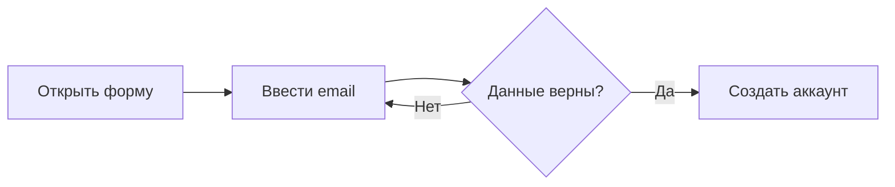
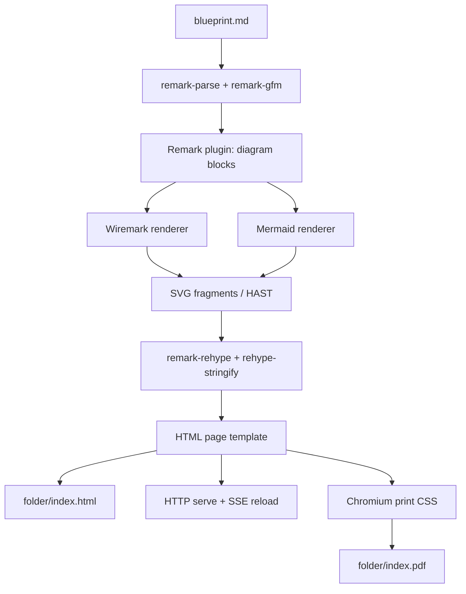

# Blueprint4LLM — техническое задание и план реализации

> **Задача для кодинг-агента:** создать работающий CLI-проект `blueprint4llm`, который преобразует Markdown-документ с Mermaid-диаграммами и Wiremark-макетами в готовые **HTML и/или PDF**. Реализовать проект, тесты и документацию, а не ограничиваться прототипом или псевдокодом. Работать по этапам ниже, запускать проверки после каждого этапа.

## 1. Назначение

`blueprint4llm` — генератор читаемых **software blueprints**: коротких технических документов с текстом, таблицами, UML/flow-диаграммами и макетами интерфейсов. Исходный файл — обычный Markdown, удобный для человека, Git и LLM. Результат — HTML для браузера и/или PDF для распространения и печати. HTML можно просматривать с автоматическим обновлением во время редактирования.

Основные зависимости:

- [remark / unified](https://github.com/remarkjs/remark) — разбор Markdown и система плагинов.
- [@wiremark/core](https://github.com/Blackburn-Labs/wiremark) — преобразование Wiremark DSL в SVG.
- [Mermaid](https://github.com/mermaid-js/mermaid) — диаграммы; для серверного SVG-рендеринга использовать официальный [@mermaid-js/mermaid-cli](https://github.com/mermaid-js/mermaid-cli).

**Главное требование:** к моменту отдачи или записи HTML все Mermaid и Wiremark-блоки уже заменены **встроенными SVG-элементами** (`<svg>...</svg>`), а не исходным кодом диаграмм, ссылками на `.svg` или браузерными плейсхолдерами. PDF строится из **того же уже отрендеренного HTML** через Chromium в режиме печати и содержит текст, таблицы и обе разновидности диаграмм. Для просмотра готовых HTML/PDF не нужны Mermaid.js, Wiremark, доступ к интернету или клиентский рендерер.

## 2. CLI: два основных режима, три формата экспорта

### 2.1. Генерация на диск

```bash
blueprint4llm blueprint.md --out=folder
blueprint4llm blueprint.md --out=folder --format=pdf
blueprint4llm blueprint.md --out=folder --format=both
```

`--format` принимает `html`, `pdf` или `both`, по умолчанию — `html` (обратная совместимость). Создаваемые файлы:

| Команда                            | Результат                                                                    |
| ---------------------------------- | ---------------------------------------------------------------------------- |
| `--out=folder` или `--format=html` | `folder/index.html` и при необходимости `folder/assets/`                     |
| `--out=folder --format=pdf`        | `folder/index.pdf`                                                           |
| `--out=folder --format=both`       | `folder/index.html`, `folder/index.pdf` и при необходимости `folder/assets/` |

Название `index.pdf` фиксированное, независимо от имени исходного Markdown. Не переименовывать его в `<имя исходника>.pdf` без изменения требований и тестов.

Ожидаемое поведение:

1. Прочитать `blueprint.md` как UTF-8.
2. Преобразовать Markdown и все поддерживаемые диаграммы в общий HTML AST/HTML. Для PDF использовать этот же результат с печатными стилями.
3. Создать директорию `folder`, если она отсутствует.
4. При `html`/`both` сохранить `folder/index.html` (полный HTML5-документ, не HTML-фрагмент).
5. При `pdf`/`both` сохранить `folder/index.pdf` — корректный многостраничный PDF с векторными SVG там, где Chromium позволяет их сохранить.
6. Для HTML скопировать локальные картинки из Markdown в `folder/assets/` с переписанными относительными путями. Для PDF встроить локальные картинки в рендеримую страницу так, чтобы браузер для печати не зависел от относительных файлов/HTTP. SVG диаграмм **не** сохранять отдельными файлами.
7. Вывести абсолютные пути ко **всем запрошенным** файлам и завершиться с кодом `0`.
8. При ошибке синтаксиса диаграммы, чтения, PDF-рендеринга или записи вывести диагностику и завершиться с ненулевым кодом. Не выдавать частичный результат за успешную сборку.

HTML должен открываться локально через `file://` и показывать текст, таблицы и обе разновидности SVG без подключения к интернету. PDF должен открываться в обычном PDF-viewer без доступа к сети, а текст и ссылки должны оставаться доступными для выделения/поиска. Внешние изображения по абсолютным HTTP(S)-ссылкам остаются внешними **в HTML**, но для PDF они по умолчанию запрещены: сообщить, что картинку нужно сохранить локально, а не молча создавать неполный PDF.

### 2.2. Локальный сервер с предпросмотром

```bash
blueprint4llm blueprint.md --serve --port=8080
```

Ожидаемое поведение:

1. Выполнить первоначальный рендер **в памяти**.
2. Запустить HTTP-сервер по адресу `127.0.0.1:8080` (по умолчанию порт `8080`).
3. `GET /` отдаёт полноценный HTML с уже встроенными SVG.
4. `GET /document.pdf` по запросу создаёт PDF из текущей **успешной** сборки и отдаёт с `Content-Type: application/pdf` и безопасным `Content-Disposition: attachment; filename="index.pdf"`; в предпросмотре добавить обычную ссылку «Download PDF». PDF не пересобирать на каждое нажатие клавиши — генерировать по запросу и кэшировать для неизменённой версии документа.
5. Отслеживать изменения `blueprint.md` и используемых локальных изображений (например, через `chokidar`). При сохранении Markdown автоматически перестраивать документ.
6. Автоматически обновлять открытую вкладку через Server-Sent Events (SSE) и небольшой клиентский скрипт, добавляемый **только в режиме `--serve`**.
7. При ошибке новой сборки сервер не падает: браузер получает понятную страницу/панель ошибки с именем файла, номером строки и сообщением. После исправления файла предпросмотр восстанавливается автоматически. PDF не должен выдаваться под видом актуальной версии, если актуальная сборка ошибочна.
8. Завершаться по `Ctrl+C`, закрывая HTTP-сервер, watcher, PDF-браузер и порождённые процессы.

Порт занят — вывести понятную ошибку и завершиться с ненулевым кодом. Не открывать браузер автоматически, если пользователь явно не просил этого.

### 2.3. Аргументы и валидация

```text
blueprint4llm <input.md> --out=<directory> [--format=html|pdf|both]
blueprint4llm <input.md> --serve [--port=<1..65535>]
blueprint4llm --help
blueprint4llm --version
```

- `--out` и `--serve` взаимоисключающие; один из них обязателен.
- `--format` действует только с `--out`, значение по умолчанию `html`; `--format` с `--serve` — ошибка использования. В `--serve` PDF доступен через `GET /document.pdf`.
- `--port` действует только с `--serve`, иначе ошибка использования.
- При неверных аргументах показывать usage, код завершения `2`.
- При ошибке чтения/рендеринга/записи — код `1`.
- Пути могут быть относительными или абсолютными, содержать пробелы и Unicode.
- Любые дополнительные опции за пределами этого контракта — только после MVP.

## 3. Формат входного Markdown

Поддерживать обычный Markdown/CommonMark и GitHub Flavored Markdown: заголовки, абзацы, списки, ссылки, картинки, таблицы, чекбоксы, fenced code blocks, inline code и цитаты.

Для диаграмм использовать fenced code blocks:

### Mermaid

````markdown
## Регистрация


````

### Wiremark

В **Blackburn-Labs/wiremark** канонический идентификатор блока — `wireframe`, а не `wiremark`. Для удобства проекта принимать **оба** написания: `wireframe` и `wiremark`.

````markdown
## Экран входа

```wireframe
Wireframe #login mobile
  Stack column gap=2 padding=2
    Typography h4 "Sign in"
    TextField "Email"
    TextField "Password"
    Button "Sign in" contained to=#dashboard
```
````

Проверить конкретную Wiremark-конструкцию на установленной версии `@wiremark/core`; если атрибут, используемый в примере, не поддерживается, исправить пример и зафиксировать проверенный синтаксис в `examples/blueprint.md`. **Не путать Blackburn-Labs/wiremark с одноимёнными проектами других авторов.**

### Остальные языки

Любые другие fenced blocks (`rust`, `typescript`, `json`, `bash`, без языка и т. д.) должны остаться обычными экранированными HTML-блоками кода. Определять тип диаграммы **строго по языковому идентификатору**, без эвристики по содержимому.

Не пытаться интерпретировать диаграммы, находящиеся внутри inline code, цитируемых литералов или других Markdown-конструкций, не являющихся fenced code blocks.

## 4. Технологический стек

| Часть              | Решение                                                 |
| ------------------ | ------------------------------------------------------- |
| Язык               | TypeScript, strict mode                                 |
| Runtime            | Node.js `>=22.13.0`, ESM                                |
| Пакетный менеджер  | npm, commit `package-lock.json`                         |
| Markdown parser    | `unified` + `remark-parse` + `remark-gfm`               |
| HTML AST           | `remark-rehype`, `hast-util-from-html`                  |
| HTML serialization | `rehype-stringify`                                      |
| Wiremark           | `@wiremark/core` (`render`)                             |
| Mermaid SVG        | `@mermaid-js/mermaid-cli`, локальный Chromium/Puppeteer |
| PDF                | `puppeteer` + Chromium, `page.pdf()` с печатными CSS    |
| CLI arguments      | `commander` или эквивалент с типизированной валидацией  |
| Web server         | Node.js `node:http` (достаточно для MVP)                |
| Watching           | `chokidar`                                              |
| Tests              | `vitest` + HTTP/integration tests                       |
| Formatting / lint  | Prettier + ESLint, TypeScript `tsc --noEmit`            |

Зависимости фиксировать в lockfile; не полагаться на глобально установленный `mmdc`. Исполняемый файл Mermaid CLI запускать из зависимостей проекта. Выбрать совместимые актуальные версии и проверить их реальные API перед реализацией. Допускается эквивалентный пакет для конкретной функции, но не замена remark на другой Markdown-движок.

## 5. Архитектура



Здесь Mermaid используется только для иллюстрации архитектуры самого проекта; внутри реализации диаграммы рендерятся до HTML-сериализации.

### 5.1. Модули

1. `cli` — аргументы, help, выбор режима, exit codes.
2. `compiler` — принимает Markdown, возвращает полный HTML и диагностику.
3. `plugins/remark-diagrams` — находит fenced blocks, вызывает нужный SVG-renderer, заменяет mdast-узлы на HAST-представление диаграммы.
4. `renderers/wiremark` — тонкая обёртка над `@wiremark/core`.
5. `renderers/mermaid` — тонкая обёртка над Mermaid CLI с управлением временными файлами и дочерними процессами.
6. `svg` — проверка SVG, нормализация/обработка ID и безопасное превращение SVG в HAST.
7. `template` — `<!doctype html>`, `<head>`, встроенные CSS-стили, layout.
8. `assets` — поиск и копирование локальных изображений, переписывание ссылок.
9. `pdf` — подготовка автономной HTML-страницы для печати, Chromium/Puppeteer, настройки листа и сохранение PDF.
10. `build` — сохранение результата без повреждения предыдущей успешной сборки.
11. `server` — HTTP, SSE, watcher, инкрементальные перестройки, PDF download и остановка.

Рендереры не должны знать о CLI, сервере, структуре Markdown или формате экспорта. Преобразования Markdown и рендеринг диаграмм должны быть доступны также программно для будущих интеграций. HTML и PDF **не должны запускать два отдельных прохода парсинга Markdown и рендеринга Mermaid/Wiremark**: оба формата строятся из одного результата компиляции.

### 5.2. Контракт плагинных рендереров

Предлагаемый внутренний интерфейс:

```ts
export interface DiagramResult {
  svg: string;
  warnings: string[];
}

export interface DiagramRenderer {
  readonly languages: readonly string[];
  render(
    source: string,
    context: {
      diagramId: string;
      sourceFile: string;
      line: number;
      signal?: AbortSignal;
    },
  ): Promise<DiagramResult>;
}
```

Реализовать `wiremarkRenderer` (`wireframe`, `wiremark`) и `mermaidRenderer` (`mermaid`). Регистрация через массив рендереров в `.use(remarkDiagramPlugin, { renderers })`, чтобы позже можно было добавить PlantUML или другой формат, не меняя `compiler`.

Важные правила:

- Рендеринг может быть асинхронным; remark-плагин должен корректно ожидать завершения каждого рендерера.
- Сохранять естественный порядок узлов документа при замене блоков, даже если задачи рендеринга выполняются параллельно.
- Ошибки связывать с исходной позицией code block (`node.position.start.line` / `column`).
- Не использовать регулярные выражения для поиска fenced blocks в исходном Markdown: обходить mdast-дерево.
- Назначать каждой диаграмме стабильный в пределах документа уникальный ID, например `bp-diagram-001`.

### 5.3. Рекомендуемый pipeline

```ts
const processor = unified()
  .use(remarkParse)
  .use(remarkGfm)
  .use(remarkDiagramPlugin, { renderers })
  .use(remarkRehype)
  .use(rehypeStringify);
```

Это **схема**, а не готовый исходник: дописать импорты, типы и конфигурацию обработки изображений.

В `remarkDiagramPlugin` для каждого подходящего `code`-узла:

1. Получить `node.lang` и `node.value`.
2. Выбрать рендерер по точному языку (для aliases — таблица соответствий).
3. Вызвать `renderer.render(...)` и получить SVG.
4. Проверить, что это корректный SVG-фрагмент с корневым `<svg>`.
5. Преобразовать SVG в HAST, например `fromHtml(svg, { fragment: true })`, и выделить собственно SVG-узел.
6. Создать обёртку `<figure class="bp-diagram bp-diagram--mermaid|wiremark">` с HAST-дочерним узлом `<svg>`; использовать поддерживаемые `node.data.hName`, `hProperties`, `hChildren` или явный `remark-rehype` handler.
7. Передать дерево в обычный HTML-serializer.

**Не** вставлять SVG в Markdown как сырой HTML с глобальными `allowDangerousHtml: true` / `rehype-raw`. Это ненужно и создаёт опасную цепочку для произвольного HTML из входного Markdown. Проверить, что `hast-util-from-html` корректно сохраняет пространства имён SVG, `viewBox`, `<defs>`, `<style>` и внутренние ссылки.

## 6. Интеграция Wiremark

У `@wiremark/core` имеется API:

```ts
import { render } from '@wiremark/core';

const { svg, diagnostics } = render(source);
```

Требования:

- Передавать внутрь `render` **только содержимое fenced block**, без маркеров тройных кавычек и идентификатора языка.
- Не переписывать парсер, layout или SVG-рендерер Wiremark; использовать готовый пакет.
- Критические ошибки (`WiremarkError` и другие ошибки рендера) преобразовывать в ошибку компиляции с позицией блока.
- Некритические `diagnostics` отображать как предупреждения в CLI; сам блок при этом может успешно рендериться.
- По умолчанию светлая тема `render(source, { theme: 'light' })`. Переключатель темы в MVP не требуется.
- Проверить рендер отдельного кадра и нескольких Wireframe-кадров одним блоком, если версия библиотеки их поддерживает.
- Проверить отсутствие конфликтов SVG IDs между несколькими Wiremark-блоками.

## 7. Интеграция Mermaid

**Важно:** `mermaid.render(...)` ориентирован на DOM в браузере. Нельзя предполагать, что обычный вызов `mermaid.render(...)` из Node.js без DOM создаст SVG. Для первой работающей версии использовать официальный `@mermaid-js/mermaid-cli` (`mmdc`), который запускает headless Chromium/Puppeteer.

Рекомендованный MVP-алгоритм для каждого блока:

1. Создать уникальный временный каталог через `fs.mkdtemp` в системной temp-директории.
2. Сохранить содержимое блока в `diagram.mmd`.
3. Запустить локальный `mmdc` как дочерний процесс **без shell** с аргументами `-i diagram.mmd -o diagram.svg -c config.json`.
4. Дождаться завершения с тайм-аутом (например, 30 секунд на диаграмму), прочитать SVG в UTF-8.
5. Преобразовать его в HAST и вставить в итоговый документ.
6. В `finally` удалить **только этот созданный временный каталог**.

Конфиг Mermaid: `securityLevel: 'strict'`, `htmlLabels: false`, фиксированная светлая тема, без внешних icon packs и произвольных пользовательских scripts. Проверить конфигурацию на реальной установленной версии.

Для Mermaid CLI выбрать один из двух способов: вызов локального bin через `spawn`/`execFile` (предпочтительно, поскольку это стабильный CLI-контракт) или Node API `run`, если он подходит. Учесть, что официальный проект предупреждает: Node API Mermaid CLI не покрыт гарантиями SemVer.

Ограничить количество параллельных Chromium-рендеров, например до `2`. Дать понятную ошибку, если Chromium недоступен, и описать в README способ установки браузера (`npx puppeteer browsers install chrome` или документированный поддерживаемый механизм для выбранных версий).

**Оптимизация после рабочего MVP:** один долгоживущий headless Chromium или другой совместимый renderer, чтобы избежать старта браузера на каждый блок. Это не должно блокировать первую поставку.

## 8. SVG: корректность, изоляция, безопасность

Все SVG вставляются **inline**. Следует учесть следующие нюансы:

1. **Уникальные IDs.** В нескольких диаграммах могут повторяться `id="..."`. Для каждого SVG использовать уникальный префикс и согласованно переписывать определения и ссылки: `id`, `url(#id)`, `href="#id"`, `xlink:href="#id"`, а также внутренние CSS-селекторы/ссылки, если они встречаются. Не применять наивный `replaceAll`, который повреждает текст диаграммы. Написать отдельные тесты на `<defs>`, marker arrows и два одинаковых блока.
2. **Разметка.** Корректно сохранять `viewBox`, размеры, `<defs>`, gradients, `<marker>`, `<style>`, линии и надписи. SVG должен реально отображаться после HTML-сериализации.
3. **Безопасность.** Входной Markdown считать недоверенным. Обычный сырой HTML в Markdown экранировать/не исполнять. При обработке SVG не допускать `<script>`, обработчиков событий (`onload`, `onclick`, …), внешних ссылок `href` / `url(...)`, `<foreignObject>` и активного внешнего содержимого. Использовать белый список элементов/атрибутов или проверенную очистку SVG, не разрушающую легитимные диаграммы. Для SVG-стилей запретить внешние `@import` и внешние `url(...)`; разрешить нужные внутренние `url(#...)`. При сомнении отклонять SVG с диагностикой, а не пропускать опасный узел.
4. **Ограничения.** Разумный лимит входного `.md` (например, 5 MiB), количества диаграмм (например, 100), длины отдельной диаграммы и времени рендера. При превышении — объяснимая ошибка.
5. **Стабильность.** Одинаковый документ при той же версии зависимостей должен генерировать функционально одинаковый HTML; не включать случайные временные пути, системные timestamps или локальные абсолютные пути в результат.

Проверить не только наличие строки `<svg>`, но и визуальную корректность рендера на реальных примерах. Если безопасная SVG-политика несовместима с определённым типом Mermaid-диаграмм, задокументировать ограничение и добавить regression test.

## 9. HTML и стили

Генерировать полноценный HTML5:

- `<!doctype html>`, `<html lang="...">`, `<meta charset="utf-8">`, `viewport`, `<title>`.
- Заголовок документа: первое Markdown `# ...`; при отсутствии — имя входного файла без расширения.
- Аккуратная типографика, отступы, ограниченная ширина текстовой колонки, читаемые таблицы и блоки кода.
- Диаграммы на белом/нейтральном фоне, с возможностью горизонтального скролла для широких схем; не обрезать большие SVG.
- Inline CSS в `<style>` для автономности `index.html`; не тянуть CSS framework, web fonts или JavaScript с CDN.
- Для `img` и SVG задавать адаптивное поведение, не искажая пропорции.
- Доступность: осмысленные подписи `figure` / `aria-label`, например по типу и порядковому номеру диаграммы; не выдумывать семантическое описание, которого нет в источнике.
- Разделять экранные стили (`@media screen`) и печатные (`@media print`); печатный вариант используется и для PDF.

Не добавлять редактор, боковую панель, авторизацию или графический конструктор. На этом этапе это **просмотрщик документа**, а не IDE.

## 10. Генерация PDF

### 10.1. Принцип работы

**PDF — не второй независимый Markdown-рендерер.** Сначала всегда выполняется общая цепочка `remark → Mermaid/Wiremark SVG → HAST → HTML`. Затем для PDF подготавливается вариант той же страницы с `@media print` и локальными изображениями, встроенными в документ. Chromium печатает эту страницу в PDF через `puppeteer.page.pdf()`.

Это гарантирует, что текст, таблицы, подписи, диаграммы и порядок блоков совпадают в HTML и PDF. Не использовать Markdown→PDF пакеты, которые заново парсят `.md`, и не конвертировать весь HTML в одно растровое изображение.

Рекомендуемый программный контракт:

```ts
export interface CompiledBlueprint {
  html: string;
  title: string;
  // Данные локальных ресурсов, необходимые для печатного HTML.
  assets: Array<{ originalUrl: string; bytes: Uint8Array; mimeType: string }>;
  warnings: string[];
}

export async function renderPdf(
  compiled: CompiledBlueprint,
  options?: { signal?: AbortSignal },
): Promise<Uint8Array>;
```

Пример настроек Puppeteer после загрузки print-ready HTML:

```ts
await page.emulateMediaType('print');
const pdf = await page.pdf({
  format: 'A4',
  printBackground: true,
  preferCSSPageSize: false,
  waitForFonts: true,
  displayHeaderFooter: true,
  headerTemplate: '<span></span>',
  footerTemplate:
    '<div style="font-size:9px;width:100%;text-align:center;color:#666"><span class="pageNumber"></span> / <span class="totalPages"></span></div>',
  margin: { top: '15mm', bottom: '18mm', left: '15mm', right: '15mm' },
});
```

В MVP **единственный источник размеров листа и полей — параметры `page.pdf()`**: не задавать конкурирующие `size` и `margin` в CSS `@page`. `preferCSSPageSize: false` сохраняет приоритет PDF-параметров. `page.pdf()` возвращает байты; запись в файл реализовать отдельно и безопасно.

### 10.2. Вёрстка печатного документа

- Формат по умолчанию **A4, портретная ориентация**; поля 15 мм слева/справа/сверху и 18 мм снизу для нумерации страниц. В MVP не вводить дополнительные CLI-опции размеров.
- Нумерация страниц внизу: `N / M`, без даты, временных путей или URL.
- Название и заголовки должны печататься без обрезания; не отрывать заголовок от первого абзаца, использовать `break-after: avoid`, для строк — `orphans`/`widows` по возможности.
- Для диаграмм и обычных изображений использовать `break-inside: avoid`; для крупных блоков предусмотреть **уменьшение с сохранением пропорций до печатной области листа**. Если диаграмма всё ещё слишком велика, выдавать предупреждение о масштабировании и проверять читаемость — нельзя молча обрезать её или печатать только верхнюю часть.
- Таблицы не должны выходить за границы A4: переносить длинный текст, повторять `<thead>` на следующих страницах, не терять строки. Сверхширокие таблицы адаптировать или предупреждать, но не обрезать справа.
- Кодовые блоки переносить по строкам либо безопасно разрывать между страницами, сохраняя весь текст. Горизонтальный скролл не существует в PDF.
- SVG должны иметь корректный `viewBox` и видимый масштаб. Не заменять их PNG без технической необходимости: по возможности сохранить векторность линий и текста.
- Ссылки должны остаться кликабельными; текст должен копироваться и находиться поиском.
- Корректно отображать Unicode и кириллицу. Добавить в репозиторий подходящий лицензированный шрифт с кириллическим набором символов (например, Noto Sans), указывать лицензию и подгружать его локально/inline; дождаться завершения загрузки шрифтов до печати.
- Фоновые цвета, подсветка блоков и отступы должны соответствовать печатным стилям (`printBackground: true`; при необходимости `print-color-adjust: exact`).

### 10.3. Загрузка ресурсов и изоляция Chromium

1. Для PDF генерировать автономный print-ready HTML: локальные картинки превращать в `data:` URL с корректным MIME, CSS и шрифты делать встроенными, Mermaid/Wiremark уже встроены как SVG. При этом ограничения размера файлов из раздела безопасности сохраняются.
2. Не использовать относительные `file://` ссылки и не запускать временный публичный HTTP-сервер ради PDF: после `page.setContent(printHtml)` все ресурсы должны быть уже доступны внутри документа.
3. Заблокировать исходящие HTTP(S)-запросы из страницы PDF (request interception / browser context). Если PDF содержит внешний ``, удалённый CSS или шрифт — завершиться диагностикой с URL или исходной строкой, а не пытаться скачивать его.
4. Отключить пользовательские сценарии JavaScript; HTML уже полностью отрендерен. Не подключать live reload в PDF-страницу.
5. Дождаться `document.fonts.ready` и завершения декодирования изображений (`img.decode()` там, где поддерживается). Для SVG проверять наличие/размеры элементов до `page.pdf()`.
6. Установить тайм-аут на подготовку/печать (например, 60 секунд для документа в рамках MVP) и закрывать `page`/`browser` в `finally`, в том числе после ошибок/прерывания.
7. Использовать **одну совместимую управляемую установку Chromium** для Mermaid CLI и Puppeteer PDF настолько, насколько это возможно; при несовпадении способов обнаружения браузера явно документировать конфигурацию. Не полагаться на глобально установленный Chrome без проверки.

### 10.4. Нормы качества PDF

- `index.pdf` начинается с корректного PDF-заголовка, открывается стандартными PDF-viewer и содержит минимум одну страницу.
- На страницах присутствуют Mermaid и Wiremark, без пустых прямоугольников и обрезанных краёв.
- Русский и английский текст извлекается инструментом вроде `pdftotext`; текст не превращён в единую картинку.
- В многостраничном документе нумерация согласована, нет пустых листов из-за неудачных CSS-разрывов.
- Заголовки, таблицы и диаграммы сохраняют логический порядок. Отличия цвета/шрифтов от HTML допустимы только ради печатной читабельности.

## 11. Локальные assets

- Поддерживать обычный Markdown `` и аналогичные относительные ссылки.
- На сборке копировать необходимые файлы в `assets/`, сохраняя расширение, но устраняя конфликты имён (например, по хэшу содержимого/пути).
- Проверять существование файлов; отсутствующий файл — ошибка сборки, а не молчаливо сломанная картинка.
- Не разрешать чтение через `..`, symlink и иные способы за пределами корневого каталога Markdown-проекта без явной настройки (в MVP такой настройки нет).
- Абсолютные `http://` и `https://` ссылки не скачивать, оставлять в HTML. `javascript:`, `file:` и неподдерживаемые URL-схемы блокировать.
- Для PDF локальные изображения встраивать в print-ready HTML как `data:` URI (с ограничением размера); внешние HTTP(S) изображения в PDF не поддерживать в MVP и выдавать ошибку с понятным указанием, какую ссылку сделать локальной.
- В server-mode раздавать только разрешённые assets, не превращать `--serve` в просмотрщик всей файловой системы.
- В server-mode обновлять документ/вкладку при изменении используемого локального asset.

## 12. Сборка и производительность

При запуске `--out`:

1. Полностью отрендерить документ и подготовить assets до замены любого выходного файла.
2. При `--format=pdf` строить PDF без обязательной записи `index.html` на диск. При `--format=both` использовать один и тот же скомпилированный документ для двух форматов.
3. Сначала успешно сформировать все запрошенные результаты во временных файлах **внутри output directory**, затем заменить целевые `index.html`/`index.pdf` атомарным переименованием, где платформа это позволяет. Если рендер PDF упал до стадии публикации, ранее успешно созданные файлы остаются нетронутыми. Учитывать, что транзакционная атомарность замены **нескольких** файлов платформой не гарантируется: описать безопасный порядок обновления.
4. Не удалять файлы пользователя в существующей выходной директории. Управлять только собственными `index.html`, `index.pdf` и asset-файлами; не выполнять рекурсивную очистку output directory.

Кэшировать рендер диаграммы по хэшу из: тип рендерера, исходный текст, конфигурация рендера, версия пакета. В режиме `--serve` повторно использовать SVG неизменённых диаграмм; при падении или правке одного блока не перерисовывать остальные без необходимости. Для MVP достаточно кэша в памяти, без дисковой БД.

Избегать гонок при быстром редактировании: использовать debounce (порядка 150–300 мс) и generation counter / `AbortController`, чтобы более старая сборка не перезаписала новую. Ограничивать число одновременно работающих Mermaid-процессов. Для `GET /document.pdf` кэшировать PDF-байты по версии скомпилированного документа и ресурсам; параллельные запросы одной версии должны ждать один `Promise`, а не запускать несколько Chromium-процессов.

## 13. HTTP-сервер

Минимальный набор маршрутов:

| Маршрут                      | Назначение                                                    |
| ---------------------------- | ------------------------------------------------------------- |
| `GET /`                      | Текущий отрендеренный HTML                                    |
| `GET /document.pdf`          | Сгенерированный из текущей успешной версии PDF для скачивания |
| `GET /assets/<name>`         | Разрешённые локальные изображения                             |
| `GET /_blueprint4llm/events` | SSE-подписка на событие `reload`                              |
| Остальные                    | `404 Not Found`                                               |

SSE добавляется только в server-mode. При успешной перестройке отправлять `reload`; в клиенте это вызывает `location.reload()`. При ошибочной перестройке тоже обновлять отображение на страницу с диагностикой или показывать встроенную ошибку. Предусмотреть реконнект SSE, heartbeat и очистку клиентов при shutdown. Не писать код первоначальных диаграмм в браузере для последующей отрисовки. В `GET /document.pdf` при незавершённой/ошибочной актуальной сборке вернуть информативный `503`/`422`, а не устаревший PDF или ошибку `200`.

Привязка к `127.0.0.1`, а не к `0.0.0.0`, важна: это инструмент локальной разработки, не публичный сервис.

## 14. Структура репозитория

```text
blueprint4llm/
├── package.json
├── package-lock.json
├── tsconfig.json
├── README.md
├── plan.md
├── src/
│   ├── index.ts                  # программный API
│   ├── cli.ts                    # bin blueprint4llm
│   ├── compiler.ts
│   ├── plugins/
│   │   └── remark-diagrams.ts
│   ├── renderers/
│   │   ├── types.ts
│   │   ├── wiremark.ts
│   │   └── mermaid.ts
│   ├── svg/
│   │   ├── parse-and-validate.ts
│   │   └── scope-ids.ts
│   ├── template.ts
│   ├── pdf.ts
│   ├── print-html.ts
│   ├── assets.ts
│   ├── build.ts
│   └── server.ts
├── examples/
│   ├── blueprint.md
│   └── images/
└── tests/
    ├── compiler.test.ts
    ├── wiremark.test.ts
    ├── mermaid.test.ts
    ├── svg.test.ts
    ├── pdf.test.ts
    ├── cli.test.ts
    └── server.test.ts
```

Названия файлов допустимо немного скорректировать, но слои CLI / compiler / remark plugin / два renderers / SVG safety / server должны быть отделены.

## 15. Пошаговый план разработки

### Этап A — минимальный работающий CLI

- [x] Инициализировать TypeScript ESM-проект, npm `bin` с именем `blueprint4llm`, сборку и scripts (`build`, `test`, `lint`, `typecheck`).
- [x] Подключить remark-parse, remark-gfm, remark-rehype, rehype-stringify.
- [x] Реализовать обычный Markdown → полноценный HTML с inline CSS.
- [x] Реализовать парсинг/валидацию `--out`, `--format`, `--serve`, `--port`, `--help`, `--version`.
- [x] Проверить `blueprint4llm blueprint.md --out=folder` для Markdown без диаграмм.

Результат этапа A: реализованы компиляция CommonMark/GFM в автономный HTML5, inline CSS, безопасное экранирование сырого HTML, формирование заголовка и языка документа, атомарная запись `index.html` и валидация CLI. Добавлены unit-тесты CLI, компилятора, шаблона, диагностики и записи файлов. Проверки: `npm run typecheck`, `npm run build`, `npm run lint`, `npm run format:check`, `npm test` — успешно; 39 тестов пройдены. Собранный CLI проверен командами `--help`, `--version` и end-to-end HTML-сборкой. PDF и `--serve` пока сообщают, что их реализация появится на этапах E и F.

### Этап B — Wiremark

- [x] Реализовать обобщённый remark plugin для fenced code blocks.
- [x] Подключить `@wiremark/core`; поддержать точные языковые идентификаторы `wireframe` и `wiremark`.
- [x] Переносить проверенный SVG в HAST без включения глобального unsafe HTML.
- [x] Передавать warnings и ошибки с номерами строк Markdown.
- [x] Написать тесты для одного и нескольких Wiremark-блоков.

Результат этапа B: добавлен общий remark-плагин, который обходит mdast-дерево и заменяет Wiremark fences на `<figure>` со встроенным SVG. Renderer использует официальный `@wiremark/core` Blackburn-Labs; проверен пример `Wireframe #login mobile` с `Stack`, `Typography`, полями и кнопкой. Поддержаны `wireframe` и `wiremark`; другие языки остаются обычными блоками кода. SVG разбирается через `hast-util-from-html`, проверяется наличие одного корневого `<svg>` и сериализуется через обычный HAST pipeline без `allowDangerousHtml`. Каждая диаграмма получает стабильный ID, внутренние SVG ID и ссылки на них изолируются между блоками. Предупреждения и ошибки Wiremark локализуются до строки исходного Markdown. Добавлены unit/integration-тесты renderer, алиасов, нескольких блоков, warnings/errors и SVG ID. Проверки `npm test` (45 тестов), `npm run typecheck`, `npm run build`, `npm run lint`, `npm run format:check` и CLI-сборка HTML с Wiremark прошли. Также проверено, что ошибка синтаксиса даёт CLI-код `1` с номером строки и не публикует частичный `index.html`.

### Этап C — Mermaid

- [x] Подключить официальный Mermaid CLI и проверить фактический запуск Chromium в CI/локально.
- [x] Реализовать безопасный temp lifecycle, тайм-ауты, ограничение конкурентности.
- [x] Поддержать `mermaid` в общем remark plugin.
- [x] Проверить и при необходимости ужесточить SVG-проверки для Mermaid; общие разбор и изоляция IDs уже добавлены в этапе B.
- [x] Протестировать `flowchart`, `sequenceDiagram`, `classDiagram` и минимум одну из `stateDiagram` / `erDiagram`.

Результат этапа C: подключён официальный `@mermaid-js/mermaid-cli` 12.0.0 и согласованный `puppeteer` 25.14.0; минимальная версия Node.js повышена до 22.13.0 согласно требованиям Mermaid CLI. Версии и исправление KaTeX зафиксированы в package-lock.json, `npm audit` сообщает 0 уязвимостей. Новый renderer запускает локальный `mmdc` через `node` без shell, сохраняет каждый блок в уникальном каталоге `mkdtemp` и удаляет только его в `finally`; установлен тайм-аут 30 секунд, принудительное завершение дерева процессов и общий FIFO-лимитер на два параллельных запуска. Ограничен размер одного Mermaid-блока (256 KiB). Конфигурация использует светлую тему, `securityLevel: strict`, `htmlLabels: false`, не подключает icon packs и не встраивает шрифты с внешними ссылками. Chromium sandbox включён по умолчанию; в контейнерах, где ОС запрещает sandbox, его отключение доступно только явным `BLUEPRINT4LLM_DISABLE_CHROME_SANDBOX=1`. Mermaid подключён к общему remark plugin, ошибки получают позицию fenced-блока. SVG-проверки дополнены запретом активных элементов, event handlers, внешних `href`, CSS `@import` и внешних `url()`, а ID-ссылки и CSS-селекторы диаграмм изолируются. На реальном Chromium проверены `flowchart`, `sequenceDiagram`, `classDiagram`, `stateDiagram-v2`, `erDiagram`, повторяющиеся диаграммы, очистка временных файлов, невалидный синтаксис и тайм-аут дочернего процесса. Также прошла сборка через `node dist/cli.js` с генерацией встроенного SVG. Итоговые проверки: `npm test` (59 тестов), `npm run build`, `npm run typecheck`, `npm run lint`, `npm run format:check`, `npm audit`.

### Этап D — assets и автономный HTML

- [x] Обработать локальные Markdown-изображения и URL-пути.
- [x] Проверить открытие `index.html` через `file://` без интернета.
- [x] Проверить отсутствие любых script/CDN-зависимостей в статическом HTML.
- [x] Добавить адаптивный CSS для узких экранов и широких схем.

Результат этапа D: добавлен remark-проход для Markdown-изображений. Относительные локальные пути разрешаются от каталога исходного Markdown, URL-декодируются, проверяются на выход за каталог проекта и symlink-обход; отсутствующие файлы, абсолютные пути и схемы `javascript:`, `data:`, `file:` получают диагностику с позицией в Markdown. HTTP(S)-картинки остаются внешними и не скачиваются. Локальные файлы копируются в `assets/` под стабильными SHA-256-именами с сохранением расширений; файлы публикуются до `index.html`, существующие пользовательские assets не перезаписываются. HTML ссылается на относительные пути и открывается через `file://`. Проверка в Chromium с запрещёнными HTTP(S)-запросами подтвердила загрузку локального SVG-изображения, наличие inline Mermaid/Wiremark SVG и отсутствие скриптов, внешних stylesheet и сетевых запросов. Ширина Mermaid SVG берётся из `viewBox`, поэтому широкие диаграммы можно прокручивать на узком экране. Добавлены тесты URL-валидации, копирования assets, диагностики, автономности и Mermaid-размеров. Проверки: `npm test` (72 теста), `npm run build`, `npm run typecheck`, `npm run lint`, `npm run format:check` — успешно.

### Этап E — PDF-экспорт

- [x] Подключить Puppeteer и согласовать браузерную установку/версию с Mermaid CLI.
- [x] Подготовить автономную print-ready HTML-страницу из того же результата `compiler`.
- [x] Добавить `@media print`, A4, поля, номера страниц, подходящий кириллический шрифт.
- [x] Реализовать `renderPdf()` и создание `folder/index.pdf` в режимах `pdf` и `both`.
- [x] Проверить запрет внешних сетевых ресурсов при печати и корректную обработку локальных изображений.
- [x] Не допускать обрезанных диаграмм, разорванных маленьких `figure` и сверхшироких таблиц; протестировать большой документ на несколько страниц.
- [x] Добавить тесты PDF на валидность, извлечение текста, наличие обоих SVG-типов, кириллицу, нумерацию и читаемость.

Результат этапа E: PDF формируется Puppeteer 25.14.0 из автономной версии HTML, созданной тем же `compileMarkdown`; Mermaid CLI 12.0.0 и PDF используют одну зафиксированную установку Puppeteer и Chromium (`npx puppeteer browsers install chrome`). Для печати локальные картинки встраиваются как `data:` URI, внешние изображения отклоняются с инструкцией сохранить их рядом с Markdown, а все исходящие HTTP(S)-запросы Chromium блокируются. Добавлены локальные Noto Sans Regular/Bold с лицензией SIL OFL 1.1, печатные стили с масштабированием диаграмм до 220 мм, переносом содержимого таблиц и кода, повторением заголовка таблицы и нумерацией страниц. Размер A4 и поля задаются параметрами `page.pdf()`. `renderPdf()` доступен через программный API, ограничен тайм-аутом 60 секунд, ожидает шрифты и декодирование изображений, проверяет размеры SVG и закрывает страницу/браузер при завершении или ошибке. CLI поддерживает PDF-only и `both`; при ошибке подготовки PDF прежние выходные файлы сохраняются, а `both` использует одну компиляцию Markdown.

Добавлены тесты print HTML и PDF: валидность PDF, извлечение кириллического и английского текста, таблиц и подписей Mermaid/Wiremark, многостраничная раскладка A4, номера страниц, локальная SVG-картинка, отклонение внешней картинки, отмена по `AbortSignal`, PDF-only и `both`, сохранение прежних результатов при ошибке. Интеграционный PDF на шесть страниц проверен через PDF.js; дополнительный CLI smoke test с Mermaid и Wiremark визуально проверен по PNG-рендеру страниц через Poppler. Проверки `npm run typecheck`, `npm run build`, `npm run lint`, `npm run format:check` и `npm test` прошли (80 тестов). Тестовые сценарии в этом ограниченном Linux-контейнере явно включают `BLUEPRINT4LLM_DISABLE_CHROME_SANDBOX=1`; при обычном запуске CLI Chromium sandbox остаётся включён. `npm pack --dry-run` подтвердил, что оба шрифта и файл лицензии включены в опубликованный пакет.

### Этап F — сервер с live reload и PDF download

- [x] Реализовать `GET /`, assets и SSE endpoint.
- [x] Добавить `GET /document.pdf`, ссылку для скачивания и кэш PDF по успешной версии.
- [x] Подключить watcher и debounce.
- [x] Выдавать диагностику при ошибке исходника без падения процесса.
- [x] Кэшировать неизменившиеся диаграммы.
- [x] Корректно завершать watcher, сервер, Chromium/Puppeteer и дочерние процессы по `SIGINT`/`SIGTERM`.

Результат этапа F: режим `--serve` запускает сервер только на `127.0.0.1`; `GET /` отдаёт компилированный HTML со ссылкой Download PDF и клиентом SSE, добавленными только для предпросмотра. SSE поддерживает heartbeat, автоматическое переподключение и проверку версии при подключении, чтобы не пропустить перезагрузку между запросом страницы и подпиской. `GET /assets/<name>` выдаёт только изображения из allowlist текущей успешной компиляции, остальные пути возвращают `404`. PDF создаётся по запросу из той же версии `compileMarkdown`, параллельные запросы ждут один рендер, успешные байты кэшируются по SHA-256 HTML и assets. Во время новой сборки или после ошибки PDF не раздаётся как актуальный: сервер отвечает `503` или `422`.

Подключён `chokidar@5` и debounce 200 мс для Markdown и используемых локальных изображений, в том числе отсутствующих ссылок, чтобы предпросмотр восстанавливался после создания файла. Generation counter и `AbortController` отбрасывают устаревшие результаты; для успешных Mermaid/Wiremark SVG работает ограниченный LRU-кэш на 500 элементов и 32 MiB. Ошибка чтения или компиляции показывает экранированную диагностическую страницу, сервер остаётся доступен и автоматически восстанавливается после исправления. `SIGINT`/`SIGTERM` закрывают watcher, HTTP/SSE, отменяют PDF/Puppeteer и завершают дерево дочерних процессов Mermaid.

Добавлены HTTP-тесты маршрутов, allowlist assets, SSE-перезагрузки и восстановления после ошибки, PDF-кэша, отказа от устаревшего PDF, портов и остановки; тесты кэша диаграмм, слежения за отсутствующими assets и отмены процесса. Проверки `npm run build`, `npm run typecheck`, `npm run lint`, `npm run format:check` и `npm test` прошли (93 теста). CLI smoke test подтвердил запуск `--serve` и корректное завершение по `SIGINT` и `SIGTERM`.

### Этап G — качество и поставка

- [x] Проверить edge cases и защиту от XSS, path traversal, ID collision.
- [x] Написать интеграционные тесты на оба CLI-режима и все три формата экспорта.
- [x] Добавить `examples/blueprint.md` с обычным Markdown, таблицей, Wiremark и несколькими Mermaid-диаграммами.
- [x] Добавить README с установкой, требованиями Chromium/Puppeteer, примерами HTML/PDF/both/serve, ограничениями и программным API.
- [x] Убедиться, что `npm ci && npm run build && npm test && npm run typecheck && npm run lint` проходят на чистом окружении с документированными браузерными зависимостями.

Результат этапа G: добавлены README с установкой Puppeteer Chrome, CLI-примерами, ограничениями и API, а также включённый в npm-пакет `examples/blueprint.md` с GFM-таблицей, чекбоксами, двумя Mermaid-блоками и Wiremark. Безопасность усилена удалением небезопасных схем Markdown-ссылок, проверкой CSS escapes/comments при валидации SVG и уникализацией повторных ID внутри одной диаграммы; traversal-проверка дополнена percent-encoded `..`. Добавлены пределы в 100 диаграмм и 256 KiB на блок с диагностикой по строке. Новые интеграционные тесты запускают собранный CLI как отдельный процесс и проверяют HTML/PDF/both, предпросмотр и скачивание PDF; также проверяются CSS/XSS, traversal, ID collision и пределы диаграмм. После чистого `npm ci` прошли `npm run build`, `npm test` (99 тестов), `npm run typecheck`, `npm run lint` и `npm run format:check`; `npm ci` сообщил 0 уязвимостей. Все три формата проверены на `examples/blueprint.md`, npm bin проверен через `npm link` и `--version`, `npm pack --dry-run` проверил состав пакета. Для CLI smoke-тестов в этом ограниченном Linux-контейнере явно задан `BLUEPRINT4LLM_DISABLE_CHROME_SANDBOX=1`; README документирует эту настройку и сохраняет включённый sandbox по умолчанию.

## 16. Обязательные тесты и критерии приёмки

1. **Одна сборка, два SVG.** Markdown с одним `mermaid` и одним `wireframe` создаёт `index.html` с двумя настоящими `<svg>` и соответствующими графическими элементами, а не `<pre><code>` с исходниками.
2. **Markdown GFM.** Таблицы, чекбоксы, заголовки, русские символы и обычные кодовые блоки выглядят правильно.
3. **Много диаграмм.** Два одинаковых Mermaid-блока и два одинаковых Wiremark-блока отображаются независимо; у SVG не конфликтуют IDs и стрелки/градиенты.
4. **Нет runtime-rendering.** Статический HTML открывается без JavaScript, без интернета, без отдельно загружаемых SVG и без Mermaid/Wiremark-библиотек в браузере.
5. **Ошибки.** Синтаксически неверная диаграмма приводит к содержательной диагностике вида `blueprint.md:12:1: Mermaid render failed: ...` и ненулевому коду в `--out`.
6. **Без потери файла.** Неуспешная повторная сборка не повреждает ранее успешно сгенерированный `index.html`.
7. **Serve/reload.** Изменение `blueprint.md` автоматически меняет HTML в браузере без перезапуска CLI. Ошибка не убивает сервер; после исправления всё восстанавливается.
8. **CLI.** `--help` и `--version` работают; конфликтующие параметры, отсутствующий файл, неверный порт и занятый порт дают ожидаемую ошибку и exit code.
9. **Assets.** Локальные PNG/SVG/JPEG копируются и доступны; недопустимые схемы ссылок и выход за разрешённый root блокируются.
10. **Безопасность.** Входной HTML `<script>`, SVG event handlers и внешние SVG references не превращаются в исполняемый код; отдельные тесты на XSS и обход путей.
11. **Чистая установка.** Проект запускается после `npm ci` и документированной установки Chromium на Linux, без глобальных npm-пакетов.
12. **Визуальный smoke test.** Через Playwright/Puppeteer открыть сгенерированный HTML, убедиться, что видимые SVG имеют ненулевые габариты, читаемые подписи и не перекрывают соседние блоки. Зафиксировать screenshot регрессионного примера в тестовых артефактах, но не требовать абсолютного pixel-perfect соответствия между системами.
13. **PDF only.** `blueprint4llm examples/blueprint.md --out=./dist-preview --format=pdf` создаёт `index.pdf`, но не требует `index.html`; PDF открывается и содержит обе разновидности диаграмм.
14. **Both.** `--format=both` создаёт `index.html` и `index.pdf`, диаграммы и содержимое совпадают по смыслу и порядку; рендереры диаграмм вызываются за одну сборку, а не отдельно на каждый формат.
15. **PDF text.** `pdftotext` извлекает русские заголовки, таблицы и английские подписи; PDF не является картинкой всей страницы.
16. **PDF layout.** На A4 в документе минимум из трёх страниц схемы не обрезаны, небольшие диаграммы не разорваны, таблицы остаются в полях и присутствует корректная нумерация страниц. Проверить глазами рендер страниц в PNG в интеграционном/визуальном тесте.
17. **PDF assets.** Локальные картинки видны в PDF; удалённый HTTP(S)-ресурс даёт понятную ошибку. При генерации PDF Chromium не совершает сетевых запросов.
18. **PDF failures.** При ошибке печати/Chromium процесс завершает `--out` с ненулевым кодом, а ранее созданные успешные файлы не повреждены. Тайм-аут закрывает браузер.
19. **Serve PDF.** `GET /document.pdf` возвращает `application/pdf` с `index.pdf`, после правки Markdown выдаётся обновлённый PDF, а ошибочная сборка не раздаёт устаревшую копию.
20. **Совместимость CLI.** Исходная команда без `--format` продолжает создавать только HTML, `--format=invalid` и `--serve --format=pdf` завершаются с кодом `2`.

### Команды итоговой проверки

```bash
npm ci
npm run build
npm run typecheck
npm run lint
npm test

node dist/cli.js examples/blueprint.md --out=./dist-preview
node dist/cli.js examples/blueprint.md --out=./dist-preview --format=pdf
node dist/cli.js examples/blueprint.md --out=./dist-preview --format=both
node dist/cli.js examples/blueprint.md --serve --port=8080
```

Также проверить команду `blueprint4llm` через npm `bin` (например, `npm link` в тестовой среде или вызов из `node_modules/.bin`). Конкретную структуру `dist` согласовать с выбранным build tool; если путь другого вида, обновить примеры и тесты.

## 17. Что НЕ входит в MVP

- Графическое редактирование Wiremark и Mermaid.
- PNG экспорт всего документа и экспорт в DOCX/EPUB (PDF **входит** в MVP).
- Отдельный движок Markdown→PDF, независимо от HTML-пайплайна.
- Настройка формата бумаги, ориентации и колонтитулов через CLI — в MVP фиксирован A4 с номерами страниц.
- Сборка многостраничного сайта, поиск, оглавление и sidebar.
- Развёртывание на публичный сервер или облачный хостинг.
- Плагины для Obsidian, VS Code и других редакторов.
- Выполнение пользовательского JavaScript или произвольного HTML в Markdown.
- Прямое изменение исходного `.md` через браузер.

## 18. Definition of Done

Проект закончен, только когда **оба основных режима** запускаются описанными командами, `--out` умеет делать **HTML, PDF и оба формата за одну сборку**, статический `index.html` содержит inline SVG из обоих DSL, `index.pdf` корректно отображает те же диаграммы и текст на страницах A4, сервер автоматически обновляется и позволяет скачать PDF, ошибки локализованы по строкам, все обязательные тесты проходят, и README позволяет другому разработчику повторить результат с чистой установки.

Если обнаружится несовместимость актуальной версии сторонней библиотеки, исправить интеграционный слой, зафиксировать версию в lockfile, обновить документацию и тесты. **Не заменять полноценный SVG-рендеринг на вывод исходного кода диаграммы или клиентскую отрисовку. Не заменять PDF на скриншоты HTML-страниц, склеенные в изображения.**

## 19. Источники API

- [remark: Markdown → HTML с unified/remark-rehype](https://github.com/remarkjs/remark)
- [remark-rehype: преобразование mdast → hast и предупреждения о сыром HTML](https://github.com/remarkjs/remark-rehype)
- [Wiremark, Blackburn-Labs: официальный синтаксис `wireframe`](https://github.com/Blackburn-Labs/wiremark)
- [Wiremark Core: пакет `@wiremark/core`](https://www.npmjs.com/package/@wiremark/core)
- [Mermaid CLI: генерация SVG и Node API](https://github.com/mermaid-js/mermaid-cli)
- [Mermaid: использование `mermaid.render` и конфигурация](https://mermaid.js.org/config/usage.html)
- [hast-util-from-html: разбор SVG в HAST](https://github.com/syntax-tree/hast-util-from-html)
- [Puppeteer: Page.pdf()](https://pptr.dev/api/puppeteer.page.pdf)
- [Puppeteer: параметры PDFOptions](https://pptr.dev/api/puppeteer.pdfoptions)
- [Chromium: печать и `break-inside: avoid`](https://developer.chrome.com/blog/chrome-108-beta/)
