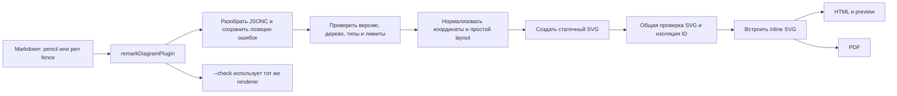

# План: поддержка Pencil `.pen`

## Цель и границы

Добавить рендеринг документов Pencil (`.pen`, формат pen.dev) из fenced-блока Markdown. Блок преобразуется в безопасный inline SVG и работает в HTML, PDF, `--serve`, предпросмотре VS Code и `--check`.

В первой версии блок содержит один встроенный документ JSONC. Внешние файлы `.pen`, импорты, картинки, ссылки на Pencil и выполнение `script` не поддерживаются. Рендеринг работает локально и не обращается к сети.

## Этапы реализации

| Этап                                      | Содержание                                                                                | Статус |
| ----------------------------------------- | ----------------------------------------------------------------------------------------- | ------ |
| 1. Разбор и проверка схемы                | JSONC-комментарии, версия схемы, дерево узлов, свойства, лимиты и позиции ошибок          | Готово |
| 2. Layout                                 | Абсолютные координаты, вложенность, горизонтальный и вертикальный layout, границы рисунка | Готово |
| 3. SVG                                    | Поддержанные фигуры и текст, безопасные атрибуты, clipping и изоляция ID                  | Готово |
| 4. Интеграция                             | Fences `pencil`/`pen`, compile/check, диагностика Markdown и общий кэш                    | Готово |
| 5. Документация и проверка полной функции | Пример, README и интеграционные проверки всего потока                                     | Готово |

### Этап 1. Разбор и проверка схемы — готово

- Добавлен JSONC-парсер. Комментарии разрешены, trailing commas запрещены.
- Зафиксирована проверяемая версия схемы `2.21`.
- Проверяются обязательные поля, типы узлов, уникальность ID, допустимые свойства и значения.
- Добавлены лимиты размера, числа узлов и глубины. Ошибки содержат строку и столбец внутри JSONC.
- Добавлены unit-тесты. Сборка, typecheck, lint, форматирование и все 279 тестов проходят.
- Версия пакета увеличена до `0.13.0`.

### Этап 2. Layout — готово

- Добавлен `pencil-layout.ts`: корневые координаты абсолютные, координаты вложенных узлов относительные.
- Для `layout: none` сохраняются `x` и `y` детей. В горизонтальном и вертикальном layout дети идут в порядке документа, а их `x` и `y` игнорируются.
- Поддержаны `gap`, все варианты `padding`, `justifyContent` и `alignItems`. Размер контейнера без заданных `width` или `height` вычисляется по детям.
- Геометрические узлы требуют явные `width` и `height`, чтобы layout мог вычислить их границы.
- У `frame` без `layout` используется горизонтальный layout; у `group` — абсолютное размещение.
- Узлы с `enabled: false` и их потомки исключаются. Границы рисунка включают вложенность и отрицательные координаты корневых узлов.
- Размеры и координаты ограничены 16 384 px на сторону. Добавлены unit-тесты в `tests/pencil-layout.test.ts`.
- Проверки прошли: сборка, typecheck, lint, форматирование и все 289 тестов.

### Этап 3. SVG — готово

- Добавлен локальный SVG-рендерер для `frame`, `group`, `rectangle`, `ellipse`, `polygon`, `path` и `text`.
- Добавлены однотонные заливки и обводки, прозрачность, rotation, скругления углов и clipping у `frame`.
- Поддержаны path `geometry` с необязательным `viewBox`, выравнивание и перенос текста.
- Текст и атрибуты экранируются. Renderer не создаёт HTML, скрипты, ссылки или сетевые ресурсы.
- SVG получает `viewBox` по границам рисунка с учётом поворота и stroke. Общий pipeline проверяет SVG и изолирует ID.
- SVG ограничен 4 MiB и 16 384 px на сторону. Многоугольник ограничен 256 сторонами, текст — 10 000 строк.
- Добавлены проверки фигур, стилей, clipping, текста, SVG-экранирования, лимитов и отказа для неподдерживаемых свойств.
- Перенос текста по ширине использует оценку ширины символов; она может отличаться от pen.dev.

### Этап 4. Интеграция — готово

- Добавлен `pencilRenderer` для fences `pencil` и `pen` в `compileMarkdown()` и `checkMarkdown()`.
- Ключ общего in-memory cache включает версию renderer и схему `2.21`.
- Диагностики JSONC содержат исходный Markdown-файл, строку и столбец.
- Проверены HTML, `checkMarkdown()`, CLI `--check`, повторные блоки без конфликтов ID и обработка неподдерживаемых данных.
- Проверен `--serve`: preview показывает SVG и обновляется после изменения Markdown.

### Этап 5. Документация и полная проверка — готово

- Добавлен [`examples/blueprint-pencil.md`](examples/blueprint-pencil.md) и обновлён README.
- PDF-тест проверяет извлечение текста из SVG. VS Code host и packaged VSIX smoke проверяют загрузку Pencil renderer.
- Версия пакета увеличена до `0.14.0`.
- `npm test`: 36 файлов, 311 тестов. `npm run typecheck`, `npm run lint`, `npm run format:check` и сборка прошли.
- `npm --prefix vscode-extension test` прошёл для VS Code host и packaged VSIX. VS Code сообщил об отсутствующих API proposals у установленных сторонних расширений, предупреждении Node.js `punycode` и размере пакета VSIX.

Канонический язык блока — `pencil`; `pen` принимается как алиас:

````markdown
```pencil
{
  "version": "2.21",
  "children": [
    {
      "id": "profile",
      "type": "frame",
      "x": 0,
      "y": 0,
      "width": 320,
      "height": 240,
      "layout": "vertical",
      "gap": 12,
      "padding": 20,
      "fill": "#FFFFFF",
      "children": [
        {
          "id": "title",
          "type": "text",
          "content": "Профиль",
          "width": 280,
          "height": 36,
          "fontSize": 24,
          "fontWeight": "600",
          "fill": "#202124"
        },
        {
          "id": "save",
          "type": "rectangle",
          "width": 280,
          "height": 48,
          "cornerRadius": 8,
          "fill": "#315DEB"
        }
      ]
    }
  ]
}
```
````

`version`, `children`, `id` и `type` проверяются до рендеринга. Для совместимости фиксируется набор проверенных версий схемы; неизвестная версия даёт понятную ошибку. Формат Pencil — живой и может меняться, поэтому схема должна быть изолирована от SVG-рендера. См. [официальное описание `.pen`](https://docs.pencil.dev/for-developers/the-pen-format).

## UI-пример результата

Это один пример дизайна, который может находиться в `.pen`-документе. В HTML его рисунок заменит SVG, созданный рендерером.

```balsamiq
{
  "mockup": {
    "measuredW": 376,
    "measuredH": 813,
    "controls": {
      "control": [
        {
          "ID": "control-1",
          "typeID": "Rectangle",
          "x": 0,
          "y": 0,
          "w": 375,
          "h": 812,
          "zOrder": 0,
          "properties": {
            "color": "#ffffff"
          }
        },
        {
          "ID": "control-2",
          "typeID": "Rectangle",
          "x": 16,
          "y": 16,
          "w": 343,
          "h": 34,
          "zOrder": 1,
          "properties": {
            "color": "#ffffff"
          }
        },
        {
          "ID": "control-3",
          "typeID": "Label",
          "x": 20,
          "y": 20,
          "w": 74,
          "h": 26,
          "zOrder": 2,
          "properties": {
            "text": "Профиль",
            "size": 18,
            "bold": true
          }
        },
        {
          "ID": "control-4",
          "typeID": "Label",
          "x": 32,
          "y": 82,
          "w": 311,
          "h": 18,
          "zOrder": 3,
          "properties": {
            "text": "Имя",
            "size": 12
          }
        },
        {
          "ID": "control-5",
          "typeID": "TextInput",
          "x": 32,
          "y": 102,
          "w": 311,
          "h": 36,
          "zOrder": 4,
          "properties": {
            "text": "Анна Иванова"
          }
        },
        {
          "ID": "control-6",
          "typeID": "Label",
          "x": 32,
          "y": 154,
          "w": 311,
          "h": 18,
          "zOrder": 5,
          "properties": {
            "text": "Электронная почта",
            "size": 12
          }
        },
        {
          "ID": "control-7",
          "typeID": "TextInput",
          "x": 32,
          "y": 174,
          "w": 311,
          "h": 36,
          "zOrder": 6,
          "properties": {
            "text": "anna@example.com"
          }
        },
        {
          "ID": "control-8",
          "typeID": "Button",
          "x": 32,
          "y": 226,
          "w": 106,
          "h": 38,
          "zOrder": 7,
          "properties": {
            "text": "Сохранить",
            "bold": true
          }
        }
      ]
    }
  }
}
```

## Поддерживаемая подмножина

| Поддержать в первой версии                                                                               | Явно отклонять с диагностикой                                    |
| -------------------------------------------------------------------------------------------------------- | ---------------------------------------------------------------- |
| Контейнеры `frame` и `group`                                                                             | `script`, `browser`, импорты и `ref`/переопределения компонентов |
| `rectangle`, `ellipse`, `polygon`, `path`, `text`                                                        | Внешние изображения, shader и mesh-gradient fills                |
| Абсолютные координаты; layout `none`, `horizontal`, `vertical` с размерами, padding, gap и выравниванием | Темы и переменные `$name`                                        |
| Однотонная заливка, обводка, opacity, rotation, скругление, clip у frame                                 | Эффекты, blend modes и остальные неизвестные типы узлов          |
| Текст: содержимое, семейство, размер, вес, стиль, выравнивание и перенос по ширине                       | Свойства, которые меняют вид и ещё не поддерживаются             |

Поддерживаемая подмножина должна давать полезный статичный макет. Видимые неподдерживаемые свойства нельзя молча терять: ошибка называет ID узла и свойство. `enabled: false` не рендерится. Полный набор типов и свойства Pencil описаны в [TypeScript-схеме формата](https://docs.pencil.dev/for-developers/the-pen-format#typescript-schema).

## Поток обработки



## Устройство в проекте

- `pencil.ts` — адаптер `DiagramRenderer`; `pencil-json.ts` — JSONC; `pencil-schema.ts` и `pencil-properties.ts` — схема и проверка дерева.
- `pencil-json-error.ts` и `pencil-property-path.ts` — ошибки и позиции; `pencil-layout.ts` — координаты и границы.
- `pencil-svg.ts`, `pencil-svg-text.ts`, `pencil-svg-bounds.ts` и `pencil-svg-utils.ts` — генерация SVG, текста, `viewBox` и безопасных значений.
- `pencil-property-paint.ts` проверяет однотонные заливки и обводки. Исходник JSONC ограничен 1 MiB, документ — 10 000 узлами и глубиной 100.
- Общий pipeline вызывает `parseAndValidateSvg()` и `scopeSvgIds()`. Внешний кэш с TTL не используется.

## Готовность

- [x] `pencil` и `pen` рендерятся в standalone HTML и PDF; `--serve`, VS Code preview и `--check` используют общий renderer.
- [x] SVG проходит общую проверку безопасности проекта и не требует сети.
- [x] Ошибки и неподдерживаемые свойства указывают Markdown-блок и причину.
- [x] Пример в `examples` и README описывают один контракт.
