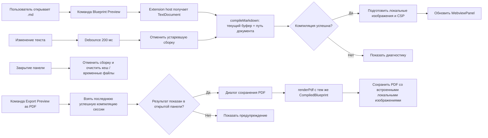

# План расширения blueprint4llm для Visual Studio Code

> В этом плане «VS Studio» означает Visual Studio Code (VS Code), настольную версию. Расширение открывает предпросмотр Markdown рядом с редактором и использует существующий рендерер `blueprint4llm`.

## Цель и границы

Пользователь открывает `.md`-файл, запускает команду **Blueprint: Open Preview to the Side** и видит тот же документ, что создаёт `blueprint4llm`: Markdown, локальные изображения, Mermaid и Balsamiq. Предпросмотр обновляется при редактировании, в том числе до сохранения файла.

Первая версия предназначена для настольного VS Code и файлов `.md` на диске. Она не заменяет текстовый редактор, не редактирует Markdown визуально и не публикуется в Marketplace в рамках реализации самого расширения.

## Что уже есть в проекте

| Возможность                                               | Текущая точка входа                                                     |
| --------------------------------------------------------- | ----------------------------------------------------------------------- |
| Компиляция текста Markdown в полный HTML-документ         | `compileMarkdown()` в `src/compiler.ts`                                 |
| Mermaid и Balsamiq в SVG                                  | `src/renderers/mermaid.ts`, `src/renderers/balsamiq.ts`                 |
| Проверка ссылок и SVG, безопасное экранирование HTML      | `src/plugins/remark-safe-links.ts`, `src/svg/` и `src/compiler.ts`      |
| Сбор локальных изображений в результат компиляции         | `src/assets.ts`; `CompiledBlueprint.assets` содержит байты и метаданные |
| Повторная сборка и просмотр сохранённого файла в браузере | `startPreviewServer()` в `src/server.ts`                                |
| Экспорт в PDF                                             | `renderPdf()` в `src/pdf.ts`                                            |

Для предпросмотра внутри редактора следует вызывать `compileMarkdown()` напрямую с текстом из `TextDocument.getText()`. `startPreviewServer()` читает файл с диска, поэтому не увидит несохранённые изменения без доработки своего контракта.

## Выбор UI и способа интеграции

Сделать расширение в отдельном пакете `vscode-extension/`, не смешивая его зависимости и manifest с CLI. Использовать `WebviewPanel`, открываемую в соседней колонке, и переиспользовать HTML, созданный компилятором.

Встроенный Markdown Preview VS Code расширяется через `markdown-it` plugins. `blueprint4llm` использует `remark`/`unified`, собственную обработку изображений и асинхронный рендеринг Mermaid. Webview сохраняет существующее поведение проекта без переноса конвейера на другой парсер. Подробнее: [Markdown Extension API](https://code.visualstudio.com/api/extension-guides/markdown-extension) и [Webview API](https://code.visualstudio.com/api/extension-guides/webview).

Для статической страницы предпросмотра отключить JavaScript в Webview. Сформировать Content Security Policy, разрешить только необходимые стили и изображения, задать узкий `localResourceRoots`. Локальные изображения из `CompiledBlueprint.assets` записывать в отдельную временную папку расширения, URL `assets/<outputName>` заменять на `webview.asWebviewUri(...)`, папку ограничить корнем ресурсов Webview и удалять после закрытия панели. Внешние HTTP(S)-изображения разрешать политикой CSP, как в текущем HTML-рендерере.

Для кеширования Mermaid добавить публичный экспорт `DiagramRenderCache` из корневого API либо небольшой публичный preview-session API. Кешировать только результаты диаграмм между пересборками одного документа.

## Основной экран

Редактор остаётся стандартным редактором VS Code; расширение показывает справа результат компиляции. Каждая Balsamiq-диаграмма ниже описывает один отдельный экранный макет.

````balsamiq
{
  "mockup": {
    "measuredW": 1281,
    "measuredH": 801,
    "controls": {
      "control": [
        {
          "ID": "control-1",
          "typeID": "Rectangle",
          "x": 0,
          "y": 0,
          "w": 1280,
          "h": 800,
          "zOrder": 0,
          "properties": {
            "color": "#ffffff"
          }
        },
        {
          "ID": "control-2",
          "typeID": "Rectangle",
          "x": 16,
          "y": 16,
          "w": 430,
          "h": 332,
          "zOrder": 1,
          "properties": {
            "color": "#ffffff"
          }
        },
        {
          "ID": "control-3",
          "typeID": "Label",
          "x": 28,
          "y": 16,
          "w": 406,
          "h": 40,
          "zOrder": 2,
          "properties": {
            "text": "Редактор Markdown",
            "size": 18,
            "bold": true
          }
        },
        {
          "ID": "control-4",
          "typeID": "Label",
          "x": 32,
          "y": 72,
          "w": 398,
          "h": 17,
          "zOrder": 3,
          "properties": {
            "text": "blueprint.md · Markdown",
            "size": 12
          }
        },
        {
          "ID": "control-5",
          "typeID": "Label",
          "x": 32,
          "y": 97,
          "w": 398,
          "h": 23,
          "zOrder": 4,
          "properties": {
            "text": "# Blueprint: обработка заявки",
            "size": 14
          }
        },
        {
          "ID": "control-6",
          "typeID": "Label",
          "x": 32,
          "y": 128,
          "w": 398,
          "h": 20,
          "zOrder": 5,
          "properties": {
            "text": "## Компоненты",
            "size": 14
          }
        },
        {
          "ID": "control-7",
          "typeID": "Label",
          "x": 32,
          "y": 156,
          "w": 398,
          "h": 20,
          "zOrder": 6,
          "properties": {
            "text": "| API | Проверяет и сохраняет заявку |",
            "size": 14
          }
        },
        {
          "ID": "control-8",
          "typeID": "Label",
          "x": 32,
          "y": 184,
          "w": 398,
          "h": 20,
          "zOrder": 7,
          "properties": {
            "text": "## Поток обработки",
            "size": 14
          }
        },
        {
          "ID": "control-9",
          "typeID": "Label",
          "x": 32,
          "y": 212,
          "w": 398,
          "h": 20,
          "zOrder": 8,
          "properties": {
            "text": "```mermaid · flowchart LR · User → API → Queue```",
            "size": 14
          }
        },
        {
          "ID": "control-10",
          "typeID": "Label",
          "x": 32,
          "y": 240,
          "w": 398,
          "h": 17,
          "zOrder": 9,
          "properties": {
            "text": "Изменения в редакторе сразу попадают в предпросмотр",
            "size": 12
          }
        },
        {
          "ID": "control-11",
          "typeID": "Rectangle",
          "x": 462,
          "y": 16,
          "w": 534,
          "h": 332,
          "zOrder": 10,
          "properties": {
            "color": "#ffffff"
          }
        },
        {
          "ID": "control-12",
          "typeID": "Label",
          "x": 474,
          "y": 16,
          "w": 510,
          "h": 40,
          "zOrder": 11,
          "properties": {
            "text": "Blueprint Preview",
            "size": 18,
            "bold": true
          }
        },
        {
          "ID": "control-13",
          "typeID": "Label",
          "x": 478,
          "y": 72,
          "w": 502,
          "h": 17,
          "zOrder": 12,
          "properties": {
            "text": "Автообновление · Последняя сборка успешна",
            "size": 12
          }
        },
        {
          "ID": "control-14",
          "typeID": "Label",
          "x": 478,
          "y": 97,
          "w": 502,
          "h": 45,
          "zOrder": 13,
          "properties": {
            "text": "Blueprint: обработка заявки",
            "size": 28,
            "bold": true
          }
        },
        {
          "ID": "control-15",
          "typeID": "Label",
          "x": 478,
          "y": 150,
          "w": 502,
          "h": 34,
          "zOrder": 14,
          "properties": {
            "text": "Компоненты",
            "size": 22,
            "bold": true
          }
        },
        {
          "ID": "control-16",
          "typeID": "Rectangle",
          "x": 478,
          "y": 192,
          "w": 251,
          "h": 35,
          "zOrder": 15,
          "properties": {
            "text": "Компонент",
            "bold": true,
            "size": 14
          }
        },
        {
          "ID": "control-17",
          "typeID": "Rectangle",
          "x": 729,
          "y": 192,
          "w": 251,
          "h": 35,
          "zOrder": 16,
          "properties": {
            "text": "Ответственность",
            "bold": true,
            "size": 14
          }
        },
        {
          "ID": "control-18",
          "typeID": "Rectangle",
          "x": 478,
          "y": 227,
          "w": 251,
          "h": 35,
          "zOrder": 17,
          "properties": {
            "text": "API",
            "bold": false,
            "size": 14
          }
        },
        {
          "ID": "control-19",
          "typeID": "Rectangle",
          "x": 729,
          "y": 227,
          "w": 251,
          "h": 35,
          "zOrder": 18,
          "properties": {
            "text": "Проверяет и сохраняет заявку",
            "bold": false,
            "size": 14
          }
        },
        {
          "ID": "control-20",
          "typeID": "Label",
          "x": 478,
          "y": 270,
          "w": 502,
          "h": 34,
          "zOrder": 19,
          "properties": {
            "text": "Поток обработки",
            "size": 22,
            "bold": true
          }
        },
        {
          "ID": "control-21",
          "typeID": "Label",
          "x": 478,
          "y": 312,
          "w": 502,
          "h": 20,
          "zOrder": 20,
          "properties": {
            "text": "Скомпилированная диаграмма Mermaid / Balsamiq",
            "size": 14
          }
        }
      ]
    }
  }
}
````

## Экран ошибки сборки

При ошибке компиляции оставить панель открытой и показать диагностику с путём к файлу и строкой, если они доступны. После исправления документа автоматически вернуть нормальный предпросмотр.

````balsamiq
{
  "mockup": {
    "measuredW": 1281,
    "measuredH": 801,
    "controls": {
      "control": [
        {
          "ID": "control-1",
          "typeID": "Rectangle",
          "x": 0,
          "y": 0,
          "w": 1280,
          "h": 800,
          "zOrder": 0,
          "properties": {
            "color": "#ffffff"
          }
        },
        {
          "ID": "control-2",
          "typeID": "Label",
          "x": 24,
          "y": 24,
          "w": 1232,
          "h": 45,
          "zOrder": 1,
          "properties": {
            "text": "Не удалось построить предпросмотр",
            "size": 28,
            "bold": true
          }
        },
        {
          "ID": "control-3",
          "typeID": "Rectangle",
          "x": 24,
          "y": 85,
          "w": 1232,
          "h": 40,
          "zOrder": 2,
          "properties": {
            "text": "blueprint.md:18: Mermaid: ошибка синтаксиса",
            "color": "#fee2e2",
            "size": 14
          }
        },
        {
          "ID": "control-4",
          "typeID": "Label",
          "x": 24,
          "y": 141,
          "w": 1232,
          "h": 20,
          "zOrder": 3,
          "properties": {
            "text": "Исправьте блок диаграммы. Предпросмотр обновится после следующего изменения.",
            "size": 14
          }
        },
        {
          "ID": "control-5",
          "typeID": "Rectangle",
          "x": 24,
          "y": 177,
          "w": 1232,
          "h": 148,
          "zOrder": 4,
          "properties": {
            "color": "#ffffff"
          }
        },
        {
          "ID": "control-6",
          "typeID": "Label",
          "x": 36,
          "y": 177,
          "w": 1208,
          "h": 40,
          "zOrder": 5,
          "properties": {
            "text": "Диагностика",
            "size": 18,
            "bold": true
          }
        },
        {
          "ID": "control-7",
          "typeID": "Label",
          "x": 40,
          "y": 233,
          "w": 1200,
          "h": 20,
          "zOrder": 6,
          "properties": {
            "text": "```mermaid",
            "size": 14
          }
        },
        {
          "ID": "control-8",
          "typeID": "Label",
          "x": 40,
          "y": 261,
          "w": 1200,
          "h": 20,
          "zOrder": 7,
          "properties": {
            "text": "flowchart LR",
            "size": 14
          }
        },
        {
          "ID": "control-9",
          "typeID": "Label",
          "x": 40,
          "y": 289,
          "w": 1200,
          "h": 20,
          "zOrder": 8,
          "properties": {
            "text": "A -->",
            "size": 14
          }
        }
      ]
    }
  }
}
````

## Поток данных и обновления



## Структура пакета расширения

```text
vscode-extension/
├── package.json                 # VS Code manifest, команды, меню, настройки
├── tsconfig.json
├── src/
│   ├── extension.ts             # регистрация команды и VS Code подписок
│   ├── preview-controller.ts    # сессии по документам, debounce, отмена и кеш
│   ├── webview-html.ts          # CSP, URL локальных ресурсов и экран ошибки
│   └── diagnostics.ts           # преобразование ошибок в UI / Output Channel
└── test/
    ├── preview-controller.test.ts
    └── webview-html.test.ts
```

Зависимость от `blueprint4llm` подключить как локальный пакет монорепозитория для разработки и как production dependency при сборке VSIX. Сборка расширения должна включать все необходимые runtime-пакеты Mermaid/Balsamiq, но исключать `vscode` API из бандла. Перед выбором bundler проверить, что Mermaid CLI и Puppeteer находят собственные файлы и Chrome после упаковки.

## Команды и настройки расширения

| ID / настройка                     | Назначение                                                      |
| ---------------------------------- | --------------------------------------------------------------- |
| `blueprint4llm.openPreview`        | Открыть или сфокусировать предпросмотр активного Markdown-файла |
| `blueprint4llm.exportPdf`          | Экспортировать текущий результат предпросмотра в PDF; этап 4    |
| `blueprint4llm.preview.debounceMs` | Задержка перед пересборкой, по умолчанию около 200 мс           |

## Проверки и тесты

- Unit-тесты контроллера: debounce, изоляция документов, отмена старой сборки, порядок завершения сборок и закрытие панели.
- Unit-тесты HTML-адаптера: CSP, URL локальных ресурсов, отсутствие исполняемых скриптов, безопасная обработка диагностического текста.
- Тесты VS Code API: команда доступна только для Markdown, повторный вызов не создаёт лишнюю панель, изменения несохранённого документа обновляют её.
- Ручная проверка в Extension Development Host: обычный Markdown, Mermaid, Balsamiq, локальные изображения, ошибочная диаграмма, тёмная и high contrast темы, закрытие и повторное открытие панели.
- Проверка release artifact: собрать VSIX и установить его в чистый профиль VS Code, проверить диагностику отсутствующего Chrome и работу с установленным Chrome.
- Существующие `npm test`, `npm run build`, `npm run typecheck`, `npm run lint` и `npm run format:check` должны оставаться зелёными; проверки расширения добавить отдельными скриптами в `vscode-extension/package.json`.

## Критерии готовности первой версии

- Команда открывает предпросмотр активного `.md` справа от редактора.
- Изменение текста обновляет панель без сохранения файла и не приводит к отображению устаревшего результата.
- Mermaid и Balsamiq выглядят так же, как в HTML, собранном CLI/API.
- Локальные изображения доступны только через разрешённые Webview URI; сырой HTML из Markdown не исполняется.
- Ошибки показывают понятное сообщение и не закрывают панель; после исправления показывается актуальный результат.
- Закрытие панели освобождает её подписки, кеш и временные файлы.
- VSIX работает в заявленных версиях VS Code и документирует установку Chrome, необходимого Mermaid renderer.

## Ссылки

- [Исходный код и README blueprint4llm](README.md)
- [VS Code: Markdown Extension API](https://code.visualstudio.com/api/extension-guides/markdown-extension)
- [VS Code: Webview API и рекомендации по CSP](https://code.visualstudio.com/api/extension-guides/webview)
- [Balsamiq Mockups 3 JSON](../examples/blueprint-balsamiq.md)

## Этапы реализации

### 1. Проверка runtime и упаковки — выполнено 2026-10-21

- [x] Создан отдельный минимальный пакет `vscode-extension/` с manifest, TypeScript-сборкой, Extension Development Host smoke-тестом и VSIX smoke-тестом. Локальная зависимость `file:..` устанавливается как копия через `.npmrc` (`install-links=true`), поэтому VSIX не зависит от symlink на каталог репозитория.
- [x] Нижняя граница VS Code установлена на `1.101.0` (`engines.vscode: ^1.101.0`). В release notes версии 1.101 указано, что Node.js extension host обновлён до `22.15.1`; минимальное требование проекта и Mermaid CLI — Node.js `>=22.13.0`, Puppeteer 25 требует `>=22.12.0`. Проверено фактическим запуском VS Code 1.101.0: Extension Development Host сообщает Node.js `22.15.1`.
- [x] Поддерживаемая граница платформ выбрана по пересечению требований VS Code и Chrome for Testing из Puppeteer: Windows x64, macOS x64/arm64, Linux x64/arm64 на совместимых дистрибутивах. Windows arm64 исключён: Puppeteer не предлагает там загрузку Chrome for Testing. На этой машине Extension Development Host и VSIX проверены только на Linux x64; остальные платформы зафиксированы по опубликованным требованиям, но отдельно здесь не запускались. Источники: [Node.js в VS Code 1.101](https://code.visualstudio.com/updates/v1_101), [требования Puppeteer](https://pptr.dev/guides/system-requirements), [платформы VS Code](https://code.visualstudio.com/Docs/supporting/requirements).
- [x] Собран VSIX размером 88.59 MiB. Тест распаковывает архив во временную папку, запускает именно этот пакет в Extension Development Host, проверяет импорт `blueprint4llm`, разрешение Mermaid CLI и Puppeteer и рендерит Mermaid в SVG. Отдельные проверки подтверждают отсутствие Chrome binary и npm-пакета `vscode` в VSIX.
- [x] Chrome остаётся внешним браузером в кеше Puppeteer. Smoke-тест с пустым `PUPPETEER_CACHE_DIR` проверяет, что ошибка содержит команду `npx puppeteer browsers install chrome`; эта инструкция также добавлена в `vscode-extension/README.md`.
- [x] VSCE сообщает advisory о большом production dependency tree (22 842 файла, 7 332 JavaScript-файла) и рекомендует bundling. Зафиксирован unbundled вариант с runtime-зависимостями: smoke-тест подтверждает работу Mermaid CLI/Puppeteer из VSIX. Размер артефакта — 88.59 MiB; сокращение пакета перед публикацией в Marketplace оставлено за границами этого этапа.
- [x] Проверки этапа: `xvfb-run -a npm test --prefix vscode-extension` (Extension Development Host и упакованный VSIX), корневые `npm test` (129/129), `npm run build`, `npm run typecheck` и `npm run lint` прошли. В `tests/cli.test.ts` фиксированная версия `0.1.0` заменена сравнением с версией корневого `package.json`. Изменённые файлы проходят Prettier; общий `npm run format:check` пока указывает на шесть ранее неформатированных файлов в `dev-docs/` и `examples/`, не затронутых этим этапом.

### 2. Контроллер предпросмотра — выполнено 2026-10-21

- [x] Зарегистрирована команда `blueprint4llm.openPreview` в Command Palette, заголовке и контекстном меню редактора Markdown. Команда работает с файловыми `.md`; повторный вызов фокусирует существующую панель этого документа. Настройка `blueprint4llm.preview.debounceMs` задаёт задержку обновления (200 мс по умолчанию, диапазон 0–2000 мс).
- [x] Создаётся отдельная `WebviewPanel` рядом с редактором для каждого URI. Компиляция получает актуальный несохранённый текст через `TextDocument.getText()` и использует общий `DiagramRenderCache` с новым публичным экспортом из корневого API.
- [x] События `workspace.onDidChangeTextDocument` фильтруются по открытым документам. Повторные события объединяются debounce; новая правка сразу отменяет текущую компиляцию через `AbortController`. Поколение сборки проверяется перед показом результата, поэтому поздний результат старой сборки не заменяет новый.
- [x] Предупреждения и ошибки Mermaid/Balsamiq отправляются в Output Channel; ошибка компиляции показывается в Webview с путём и позицией, если они доступны. Сообщения диагностики экранируются.
- [x] Локальные изображения записываются в отдельные каталоги поколений предпросмотра и доступны Webview через `asWebviewUri`. Для Webview отключены скрипты, а CSP разрешает только встроенные стили и изображения из ресурсов Webview, data URI и HTTP(S).
- [x] При закрытии панели отменяется сборка, очищается кеш, снимается обработчик закрытия и удаляется каталог изображений; при деактивации расширения закрываются все сессии.
- [x] Добавлены тесты контроллера на debounce, повторное открытие и изоляцию документов, общую и независимую работу кешей, отмену и игнорирование устаревшей сборки, закрытие панели и диагностики. Проверки Webview покрывают CSP, замену URL изображений, stale-ресурсы и экранирование ошибок; Extension Development Host проверяет команду и повторное использование панели.
- [x] Проверки: корневой `npm test` (129/129), `npm run typecheck`, `npm run lint`, `xvfb-run -a npm test --prefix vscode-extension` (host и VSIX smoke) прошли. Все изменённые исходники и документация проходят Prettier; общий `npm run format:check` по-прежнему сообщает о шести ранее неформатированных файлах в `dev-docs/` и `examples/`, не затронутых этапом. Версии корневого пакета и расширения повышены до `0.2.0`.

### 3. HTML для Webview — выполнено 2026-10-21

- [x] Переиспользуется `CompiledBlueprint.html`; Webview не запускает HTTP-сервер.
- [x] URL локальных изображений заменяются на Webview-URI файлов из каталога ресурсов предпросмотра; туда записываются только `CompiledBlueprint.assets` текущей сборки.
- [x] CSP задаётся до содержимого документа: скрипты и соединения запрещены; разрешены встроенные стили, Webview-URI, data URI и HTTP(S)-изображения.
- [x] Сохраняется семантика компилятора: CommonMark/GFM, безопасные ссылки, экранирование raw HTML, inline SVG диаграмм и таблицы.
- [x] Ошибка компиляции отображается отдельной страницей диагностики с экранированным текстом.
- [x] Светлая, тёмная и high contrast темы VS Code применяются через классы `body` Webview и CSS-переменные редактора: цвета текста, фона, ссылок, кода и границ соответствуют активной теме. Диаграммы инвертируются в тёмных темах, ссылки получают видимый focus outline.
- [x] Страница ошибки использует те же цвета VS Code и заметную контрастную границу.
- [x] Unit-тесты Webview проверяют CSS для всех трёх классов темы, используемые цветовые переменные, адаптацию диаграмм и тему страницы диагностики.
- [x] Проверки: `xvfb-run -a npm test --prefix vscode-extension` (Extension Development Host и VSIX smoke), корневые `npm test` (129/129), `npm run build`, `npm run typecheck`, `npm run lint` прошли. Изменённые файлы проходят Prettier. Общий `npm run format:check` по-прежнему сообщает о шести ранее неформатированных файлах в `dev-docs/` и `examples/`, не затронутых этапом.

### 4. Экспорт предпросмотра в PDF — выполнено 2026-10-21

- [x] Добавлена команда `blueprint4llm.exportPdf` (**Blueprint: Export Preview as PDF**) в Command Palette, заголовок и контекстное меню Markdown-редактора.
- [x] Команда использует последнюю успешную компиляцию открытой панели. При отсутствии готового результата показывает предупреждение; отмена диалога сохранения не запускает рендер.
- [x] Путь по умолчанию — PDF рядом с исходным `.md`; расширение `.pdf` добавляется при необходимости. Запись выполняется через файловую систему VS Code.
- [x] Для рендеринга вызывается существующий `renderPdf()` с тем же объектом `CompiledBlueprint`, который показан в Webview. Локальные изображения встраиваются в PDF; генерация выполняется через установленный Puppeteer Chrome. Ошибки рендеринга и записи показываются пользователю и попадают в Output Channel.
- [x] Добавлены unit-тесты на жизненный цикл экспортируемой компиляции, использование того же результата, путь сохранения и отмену диалога. Extension Development Host проверяет регистрацию команды; VSIX smoke проверяет загрузку упакованного расширения.
- [x] README расширения описывает экспорт. Версия расширения повышена до `0.4.0`.
- [x] Проверки: корневые `npm test` (129/129), `npm run typecheck`, `npm run lint`, сборка расширения и `xvfb-run -a npm test --prefix vscode-extension` (Extension Development Host и VSIX smoke) прошли. VSCE вывел прежний advisory о размере production dependency tree; упакованный VSIX прошёл smoke-тест.
- Дополнительную настройку внешних изображений не добавлял: план предусматривает её только по обратной связи. VS Code Web, Codespaces и удалённые файловые системы оставлены для отдельной работы, как указано в плане.
