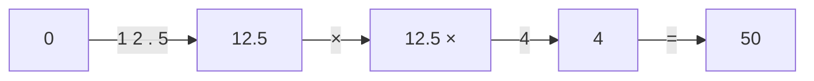
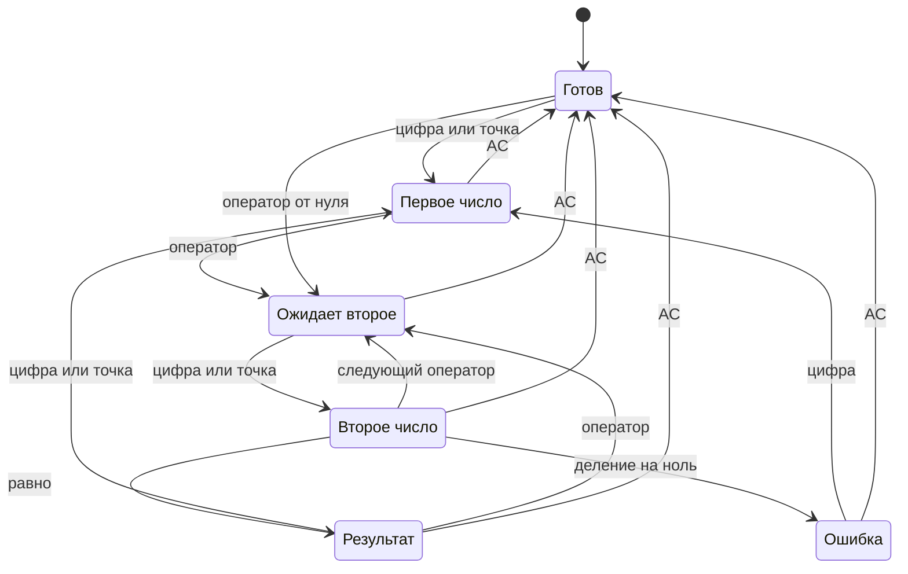
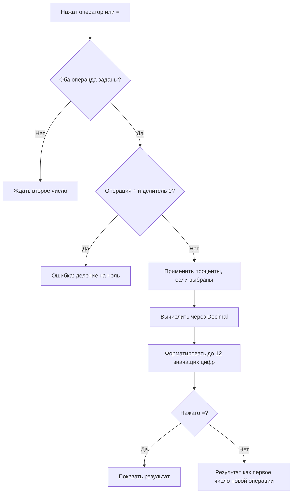
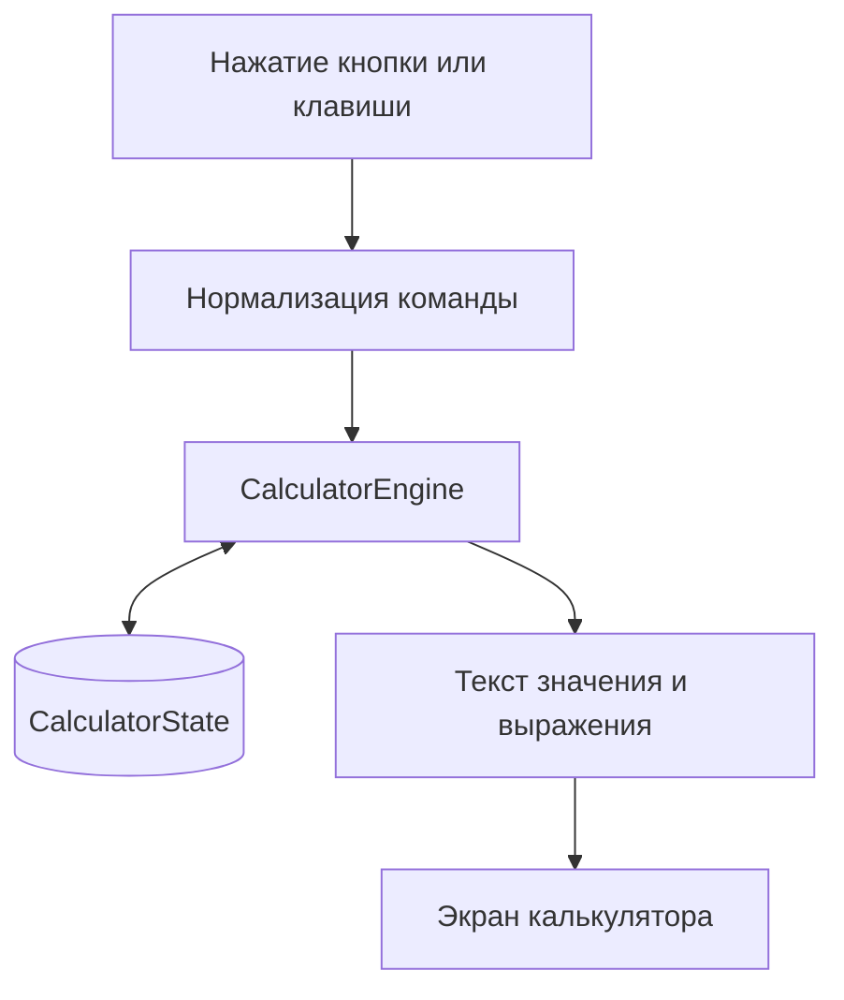

# Blueprint: Калькулятор

> Простой калькулятор для браузера: четыре арифметические операции, проценты, смена знака и редактирование ввода. Ниже несколько самостоятельных экранов, показывающих состояния калькулятора.

## 1. Экраны интерфейса

Ниже показаны шесть самостоятельных UI-диаграмм. В каждой есть собственная верхняя панель, дисплей и клавиатура, поэтому любой экран можно просматривать и рендерить отдельно.

### Готов к вводу

```wireframe
Wireframe #calculator-idle mobile padding=2 gap=2
  AppBar dense
    Toolbar dense
      Typography h6 "Калькулятор"
  Box 100% 130px solid padding=2
    Typography caption right "Готов к вводу"
    Typography h2 right "0"
  Divider
  Grid cols=4 gap=1
    Button "AC" outlined
    Button "±" outlined
    Button "%" outlined
    Button "÷" contained
    Button "7" outlined
    Button "8" outlined
    Button "9" outlined
    Button "×" contained
    Button "4" outlined
    Button "5" outlined
    Button "6" outlined
    Button "−" contained
    Button "1" outlined
    Button "2" outlined
    Button "3" outlined
    Button "+" contained
    Button "⌫" outlined
    Button "0" outlined
    Button "." outlined
    Button "=" contained
```

### Введено первое число

```wireframe
Wireframe #calculator-first-input mobile padding=2 gap=2
  AppBar dense
    Toolbar dense
      Typography h6 "Калькулятор"
  Box 100% 130px solid padding=2
    Typography caption right "Первое число"
    Typography h2 right "12.5"
  Divider
  Grid cols=4 gap=1
    Button "AC" outlined
    Button "±" outlined
    Button "%" outlined
    Button "÷" contained
    Button "7" outlined
    Button "8" outlined
    Button "9" outlined
    Button "×" contained
    Button "4" outlined
    Button "5" outlined
    Button "6" outlined
    Button "−" contained
    Button "1" outlined
    Button "2" outlined
    Button "3" outlined
    Button "+" contained
    Button "⌫" outlined
    Button "0" outlined
    Button "." outlined
    Button "=" contained
```

### Выбран оператор

```wireframe
Wireframe #calculator-operator-selected mobile padding=2 gap=2
  AppBar dense
    Toolbar dense
      Typography h6 "Калькулятор"
  Box 100% 130px solid padding=2
    Typography caption right "12.5 ×"
    Typography h2 right "12.5"
  Divider
  Grid cols=4 gap=1
    Button "AC" outlined
    Button "±" outlined
    Button "%" outlined
    Button "÷" contained
    Button "7" outlined
    Button "8" outlined
    Button "9" outlined
    Button "×" contained
    Button "4" outlined
    Button "5" outlined
    Button "6" outlined
    Button "−" contained
    Button "1" outlined
    Button "2" outlined
    Button "3" outlined
    Button "+" contained
    Button "⌫" outlined
    Button "0" outlined
    Button "." outlined
    Button "=" contained
```

### Введено второе число

```wireframe
Wireframe #calculator-second-input mobile padding=2 gap=2
  AppBar dense
    Toolbar dense
      Typography h6 "Калькулятор"
  Box 100% 130px solid padding=2
    Typography caption right "12.5 ×"
    Typography h2 right "4"
  Divider
  Grid cols=4 gap=1
    Button "AC" outlined
    Button "±" outlined
    Button "%" outlined
    Button "÷" contained
    Button "7" outlined
    Button "8" outlined
    Button "9" outlined
    Button "×" contained
    Button "4" outlined
    Button "5" outlined
    Button "6" outlined
    Button "−" contained
    Button "1" outlined
    Button "2" outlined
    Button "3" outlined
    Button "+" contained
    Button "⌫" outlined
    Button "0" outlined
    Button "." outlined
    Button "=" contained
```

### Результат

```wireframe
Wireframe #calculator-result mobile padding=2 gap=2
  AppBar dense
    Toolbar dense
      Typography h6 "Калькулятор"
  Box 100% 130px solid padding=2
    Typography caption right "12.5 × 4 ="
    Typography h2 right "50"
  Divider
  Grid cols=4 gap=1
    Button "AC" outlined
    Button "±" outlined
    Button "%" outlined
    Button "÷" contained
    Button "7" outlined
    Button "8" outlined
    Button "9" outlined
    Button "×" contained
    Button "4" outlined
    Button "5" outlined
    Button "6" outlined
    Button "−" contained
    Button "1" outlined
    Button "2" outlined
    Button "3" outlined
    Button "+" contained
    Button "⌫" outlined
    Button "0" outlined
    Button "." outlined
    Button "=" contained
```

### Ошибка деления на ноль

```wireframe
Wireframe #calculator-error mobile padding=2 gap=2
  AppBar dense
    Toolbar dense
      Typography h6 "Калькулятор"
  Box 100% 130px solid padding=2
    Typography caption right "9 ÷ 0 ="
    Typography h3 right "Ошибка"
    Typography body2 right "Деление на ноль"
  Divider
  Grid cols=4 gap=1
    Button "AC" outlined
    Button "±" outlined
    Button "%" outlined
    Button "÷" contained
    Button "7" outlined
    Button "8" outlined
    Button "9" outlined
    Button "×" contained
    Button "4" outlined
    Button "5" outlined
    Button "6" outlined
    Button "−" contained
    Button "1" outlined
    Button "2" outlined
    Button "3" outlined
    Button "+" contained
    Button "⌫" outlined
    Button "0" outlined
    Button "." outlined
    Button "=" contained
```

### Пример использования



## 2. Как меняется состояние



Оператор без второго числа ещё не вычисляет результат. При вводе нового оператора после второго числа сначала вычисляется предыдущая операция: `2 + 3 ×` показывает `5 ×` (обычный последовательный калькулятор, **без приоритета операций**).

## 3. Правила нажатий

| Кнопка | Эффект | Пример |
|---|---|---|
| `0`–`9` | Дописывает цифру; начальный `0` заменяется | `0 → 7` |
| `.` | Добавляет десятичную точку не больше одной на число | `7 → 7.` |
| `+`, `−`, `×`, `÷` | Запоминает первое число и операцию; второй операнд вводится заново | `12 ×` |
| `=` | Вычисляет и показывает результат; повторное `=` повторяет последнюю операцию | `8 × 2 = = → 32` |
| `±` | Меняет знак текущего числа | `12 → -12` |
| `%` | Преобразует текущий ввод по правилам ниже | `50% → 0.5` |
| `⌫` | Удаляет последний символ текущего ввода; пустой ввод становится `0` | `123 → 12` |
| `AC` | Сбрасывает операнды, операцию, повторение `=` и ошибку | `0` |

**Проценты:**

- Без операции: `50 % = 0.5`.
- Сложение и вычитание: `200 + 10 % = 220`; `200 − 10 % = 180` (процент от первого числа).
- Умножение и деление: `200 × 10 % = 20`; `200 ÷ 10 % = 2000` (второй операнд делится на 100).

**Числовой формат:** десятичная арифметика без ошибок бинарного `float`; результат на экране — до 12 значащих цифр, без незначащих конечных нулей. Промежуточные вычисления сохраняют точность. Очень большие или очень маленькие результаты показываются в научной нотации.

## 4. Как выполняется вычисление



## 5. События и данные



Состояние: `entry` (строка ввода), `leftOperand` (Decimal или null), `operator` (`+`, `−`, `×`, `÷` или null), `phase` (состояние диаграммы), `lastOperation` (для повторного `=`), `percentApplied` (признак процента), `error` (или null). Логика вычисления отделена от отображения.

## 6. Управление с клавиатуры

| Клавиатура | Кнопка UI |
|---|---|
| `0`–`9`, `.` | Цифры, точка |
| `+`, `-`, `*`, `/` | `+`, `−`, `×`, `÷` |
| `Enter`, `=` | `=` |
| `Backspace` | `⌫` |
| `Escape`, `Delete` | `AC` |
| `%` | `%` |

## 7. Минимальные сценарии проверки

| Ввод | Ожидаемый экран |
|---|---|
| `12.5 × 4 =` | `50` |
| `0.1 + 0.2 =` | `0.3` |
| `9 ÷ 0 =` | `Ошибка / Деление на ноль` |
| `12 ⌫` | `1` |
| `7 . 5 ±` | `-7.5` |
| `2 + 3 × 4 =` | `20` (последовательное вычисление) |
| `8 × 2 = =` | `32` |
| `200 + 10 % =` | `220` |
| `12 AC` | `0`, операция очищена |

## 8. Границы первой версии

- Одна адаптивная страница; на широком экране калькулятор расположен по центру, максимальная ширина — около 400 px. Мобильный прототип выше — основной.
- Управление мышью, касанием и клавиатурой. Все кнопки одинаковой высоты, результат визуально выделен.
- Без истории, памяти `M+`, скобок, функций научного калькулятора, сети, авторизации и хранения данных.
- Реализация считается готовой, когда все сценарии из раздела 7 проходят автоматически, а UI соответствует Wiremark-прототипу.

---

Формат UI: [Wiremark / инструкция для LLM](https://docs.wiremark.dev/wiremark-llm.md). Формат схем: [Mermaid](https://mermaid.js.org/).

