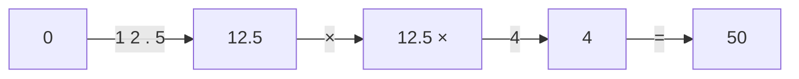
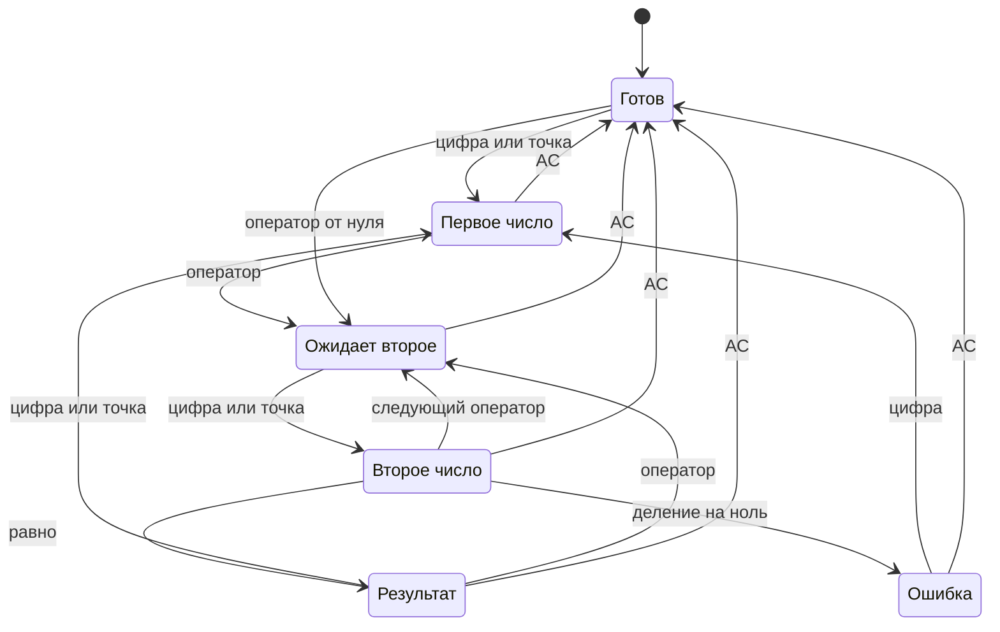
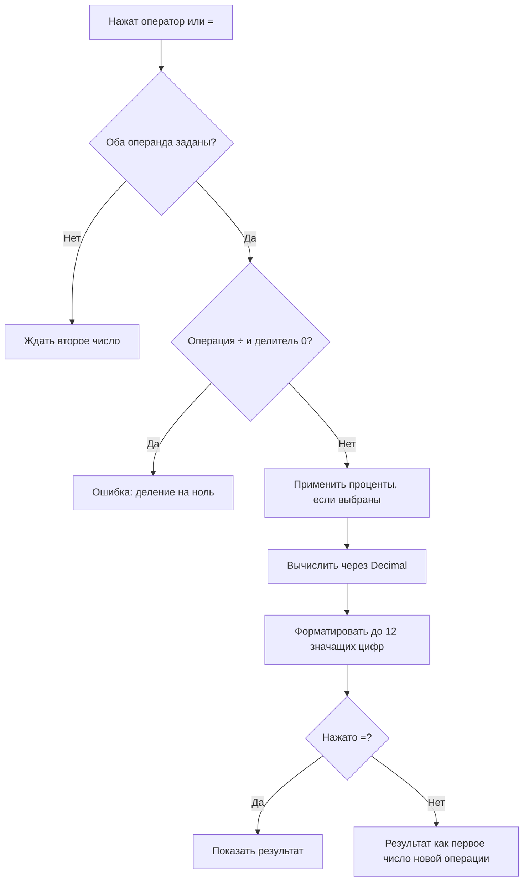
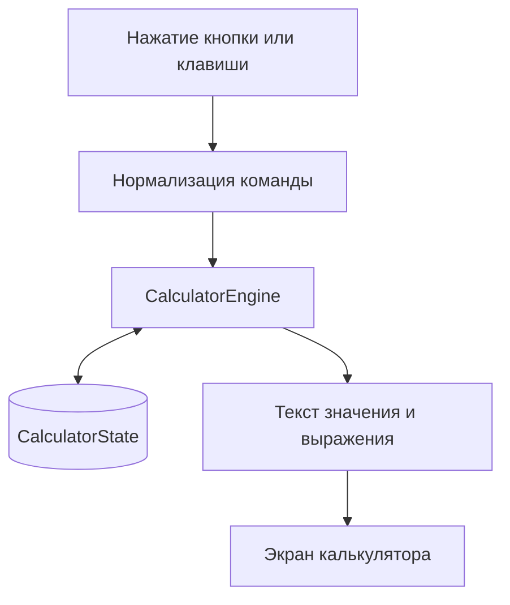

# Blueprint: Калькулятор

> Простой калькулятор для браузера: четыре арифметические операции, проценты, смена знака и редактирование ввода. Ниже несколько самостоятельных экранов, показывающих состояния калькулятора.

## 1. Экраны интерфейса

Ниже показаны шесть самостоятельных UI-диаграмм. В каждой есть собственная верхняя панель, дисплей и клавиатура, поэтому любой экран можно просматривать и рендерить отдельно.

### Готов к вводу

```balsamiq
{
  "mockup": {
    "measuredW": 376,
    "measuredH": 813,
    "controls": {
      "control": [
        {
          "ID": "control-1",
          "typeID": "Rectangle",
          "x": 0,
          "y": 0,
          "w": 375,
          "h": 812,
          "zOrder": 0,
          "properties": {
            "color": "#ffffff"
          }
        },
        {
          "ID": "control-2",
          "typeID": "Rectangle",
          "x": 16,
          "y": 16,
          "w": 343,
          "h": 34,
          "zOrder": 1,
          "properties": {
            "color": "#ffffff"
          }
        },
        {
          "ID": "control-3",
          "typeID": "Label",
          "x": 20,
          "y": 20,
          "w": 115,
          "h": 26,
          "zOrder": 2,
          "properties": {
            "text": "Калькулятор",
            "size": 18,
            "bold": true
          }
        },
        {
          "ID": "control-4",
          "typeID": "Rectangle",
          "x": 16,
          "y": 66,
          "w": 343,
          "h": 130,
          "zOrder": 3,
          "properties": {
            "color": "#ffffff"
          }
        },
        {
          "ID": "control-5",
          "typeID": "Label",
          "x": 32,
          "y": 82,
          "w": 311,
          "h": 17,
          "zOrder": 4,
          "properties": {
            "text": "Готов к вводу",
            "size": 12,
            "align": "right"
          }
        },
        {
          "ID": "control-6",
          "typeID": "Label",
          "x": 32,
          "y": 99,
          "w": 311,
          "h": 56,
          "zOrder": 5,
          "properties": {
            "text": "0",
            "size": 34,
            "bold": true,
            "align": "right"
          }
        },
        {
          "ID": "control-7",
          "typeID": "Button",
          "x": 16,
          "y": 237,
          "w": 79.8,
          "h": 38,
          "zOrder": 6,
          "properties": {
            "text": "AC",
            "bold": false
          }
        },
        {
          "ID": "control-8",
          "typeID": "Button",
          "x": 103.8,
          "y": 237,
          "w": 79.8,
          "h": 38,
          "zOrder": 7,
          "properties": {
            "text": "±",
            "bold": false
          }
        },
        {
          "ID": "control-9",
          "typeID": "Button",
          "x": 191.5,
          "y": 237,
          "w": 79.8,
          "h": 38,
          "zOrder": 8,
          "properties": {
            "text": "%",
            "bold": false
          }
        },
        {
          "ID": "control-10",
          "typeID": "Button",
          "x": 279.3,
          "y": 237,
          "w": 79.8,
          "h": 38,
          "zOrder": 9,
          "properties": {
            "text": "÷",
            "bold": true
          }
        },
        {
          "ID": "control-11",
          "typeID": "Button",
          "x": 16,
          "y": 283,
          "w": 79.8,
          "h": 38,
          "zOrder": 10,
          "properties": {
            "text": "7",
            "bold": false
          }
        },
        {
          "ID": "control-12",
          "typeID": "Button",
          "x": 103.8,
          "y": 283,
          "w": 79.8,
          "h": 38,
          "zOrder": 11,
          "properties": {
            "text": "8",
            "bold": false
          }
        },
        {
          "ID": "control-13",
          "typeID": "Button",
          "x": 191.5,
          "y": 283,
          "w": 79.8,
          "h": 38,
          "zOrder": 12,
          "properties": {
            "text": "9",
            "bold": false
          }
        },
        {
          "ID": "control-14",
          "typeID": "Button",
          "x": 279.3,
          "y": 283,
          "w": 79.8,
          "h": 38,
          "zOrder": 13,
          "properties": {
            "text": "×",
            "bold": true
          }
        },
        {
          "ID": "control-15",
          "typeID": "Button",
          "x": 16,
          "y": 329,
          "w": 79.8,
          "h": 38,
          "zOrder": 14,
          "properties": {
            "text": "4",
            "bold": false
          }
        },
        {
          "ID": "control-16",
          "typeID": "Button",
          "x": 103.8,
          "y": 329,
          "w": 79.8,
          "h": 38,
          "zOrder": 15,
          "properties": {
            "text": "5",
            "bold": false
          }
        },
        {
          "ID": "control-17",
          "typeID": "Button",
          "x": 191.5,
          "y": 329,
          "w": 79.8,
          "h": 38,
          "zOrder": 16,
          "properties": {
            "text": "6",
            "bold": false
          }
        },
        {
          "ID": "control-18",
          "typeID": "Button",
          "x": 279.3,
          "y": 329,
          "w": 79.8,
          "h": 38,
          "zOrder": 17,
          "properties": {
            "text": "−",
            "bold": true
          }
        },
        {
          "ID": "control-19",
          "typeID": "Button",
          "x": 16,
          "y": 375,
          "w": 79.8,
          "h": 38,
          "zOrder": 18,
          "properties": {
            "text": "1",
            "bold": false
          }
        },
        {
          "ID": "control-20",
          "typeID": "Button",
          "x": 103.8,
          "y": 375,
          "w": 79.8,
          "h": 38,
          "zOrder": 19,
          "properties": {
            "text": "2",
            "bold": false
          }
        },
        {
          "ID": "control-21",
          "typeID": "Button",
          "x": 191.5,
          "y": 375,
          "w": 79.8,
          "h": 38,
          "zOrder": 20,
          "properties": {
            "text": "3",
            "bold": false
          }
        },
        {
          "ID": "control-22",
          "typeID": "Button",
          "x": 279.3,
          "y": 375,
          "w": 79.8,
          "h": 38,
          "zOrder": 21,
          "properties": {
            "text": "+",
            "bold": true
          }
        },
        {
          "ID": "control-23",
          "typeID": "Button",
          "x": 16,
          "y": 421,
          "w": 79.8,
          "h": 38,
          "zOrder": 22,
          "properties": {
            "text": "⌫",
            "bold": false
          }
        },
        {
          "ID": "control-24",
          "typeID": "Button",
          "x": 103.8,
          "y": 421,
          "w": 79.8,
          "h": 38,
          "zOrder": 23,
          "properties": {
            "text": "0",
            "bold": false
          }
        },
        {
          "ID": "control-25",
          "typeID": "Button",
          "x": 191.5,
          "y": 421,
          "w": 79.8,
          "h": 38,
          "zOrder": 24,
          "properties": {
            "text": ".",
            "bold": false
          }
        },
        {
          "ID": "control-26",
          "typeID": "Button",
          "x": 279.3,
          "y": 421,
          "w": 79.8,
          "h": 38,
          "zOrder": 25,
          "properties": {
            "text": "=",
            "bold": true
          }
        }
      ]
    }
  }
}
```

### Введено первое число

```balsamiq
{
  "mockup": {
    "measuredW": 376,
    "measuredH": 813,
    "controls": {
      "control": [
        {
          "ID": "control-1",
          "typeID": "Rectangle",
          "x": 0,
          "y": 0,
          "w": 375,
          "h": 812,
          "zOrder": 0,
          "properties": {
            "color": "#ffffff"
          }
        },
        {
          "ID": "control-2",
          "typeID": "Rectangle",
          "x": 16,
          "y": 16,
          "w": 343,
          "h": 34,
          "zOrder": 1,
          "properties": {
            "color": "#ffffff"
          }
        },
        {
          "ID": "control-3",
          "typeID": "Label",
          "x": 20,
          "y": 20,
          "w": 115,
          "h": 26,
          "zOrder": 2,
          "properties": {
            "text": "Калькулятор",
            "size": 18,
            "bold": true
          }
        },
        {
          "ID": "control-4",
          "typeID": "Rectangle",
          "x": 16,
          "y": 66,
          "w": 343,
          "h": 130,
          "zOrder": 3,
          "properties": {
            "color": "#ffffff"
          }
        },
        {
          "ID": "control-5",
          "typeID": "Label",
          "x": 32,
          "y": 82,
          "w": 311,
          "h": 17,
          "zOrder": 4,
          "properties": {
            "text": "Первое число",
            "size": 12,
            "align": "right"
          }
        },
        {
          "ID": "control-6",
          "typeID": "Label",
          "x": 32,
          "y": 99,
          "w": 311,
          "h": 56,
          "zOrder": 5,
          "properties": {
            "text": "12.5",
            "size": 34,
            "bold": true,
            "align": "right"
          }
        },
        {
          "ID": "control-7",
          "typeID": "Button",
          "x": 16,
          "y": 237,
          "w": 79.8,
          "h": 38,
          "zOrder": 6,
          "properties": {
            "text": "AC",
            "bold": false
          }
        },
        {
          "ID": "control-8",
          "typeID": "Button",
          "x": 103.8,
          "y": 237,
          "w": 79.8,
          "h": 38,
          "zOrder": 7,
          "properties": {
            "text": "±",
            "bold": false
          }
        },
        {
          "ID": "control-9",
          "typeID": "Button",
          "x": 191.5,
          "y": 237,
          "w": 79.8,
          "h": 38,
          "zOrder": 8,
          "properties": {
            "text": "%",
            "bold": false
          }
        },
        {
          "ID": "control-10",
          "typeID": "Button",
          "x": 279.3,
          "y": 237,
          "w": 79.8,
          "h": 38,
          "zOrder": 9,
          "properties": {
            "text": "÷",
            "bold": true
          }
        },
        {
          "ID": "control-11",
          "typeID": "Button",
          "x": 16,
          "y": 283,
          "w": 79.8,
          "h": 38,
          "zOrder": 10,
          "properties": {
            "text": "7",
            "bold": false
          }
        },
        {
          "ID": "control-12",
          "typeID": "Button",
          "x": 103.8,
          "y": 283,
          "w": 79.8,
          "h": 38,
          "zOrder": 11,
          "properties": {
            "text": "8",
            "bold": false
          }
        },
        {
          "ID": "control-13",
          "typeID": "Button",
          "x": 191.5,
          "y": 283,
          "w": 79.8,
          "h": 38,
          "zOrder": 12,
          "properties": {
            "text": "9",
            "bold": false
          }
        },
        {
          "ID": "control-14",
          "typeID": "Button",
          "x": 279.3,
          "y": 283,
          "w": 79.8,
          "h": 38,
          "zOrder": 13,
          "properties": {
            "text": "×",
            "bold": true
          }
        },
        {
          "ID": "control-15",
          "typeID": "Button",
          "x": 16,
          "y": 329,
          "w": 79.8,
          "h": 38,
          "zOrder": 14,
          "properties": {
            "text": "4",
            "bold": false
          }
        },
        {
          "ID": "control-16",
          "typeID": "Button",
          "x": 103.8,
          "y": 329,
          "w": 79.8,
          "h": 38,
          "zOrder": 15,
          "properties": {
            "text": "5",
            "bold": false
          }
        },
        {
          "ID": "control-17",
          "typeID": "Button",
          "x": 191.5,
          "y": 329,
          "w": 79.8,
          "h": 38,
          "zOrder": 16,
          "properties": {
            "text": "6",
            "bold": false
          }
        },
        {
          "ID": "control-18",
          "typeID": "Button",
          "x": 279.3,
          "y": 329,
          "w": 79.8,
          "h": 38,
          "zOrder": 17,
          "properties": {
            "text": "−",
            "bold": true
          }
        },
        {
          "ID": "control-19",
          "typeID": "Button",
          "x": 16,
          "y": 375,
          "w": 79.8,
          "h": 38,
          "zOrder": 18,
          "properties": {
            "text": "1",
            "bold": false
          }
        },
        {
          "ID": "control-20",
          "typeID": "Button",
          "x": 103.8,
          "y": 375,
          "w": 79.8,
          "h": 38,
          "zOrder": 19,
          "properties": {
            "text": "2",
            "bold": false
          }
        },
        {
          "ID": "control-21",
          "typeID": "Button",
          "x": 191.5,
          "y": 375,
          "w": 79.8,
          "h": 38,
          "zOrder": 20,
          "properties": {
            "text": "3",
            "bold": false
          }
        },
        {
          "ID": "control-22",
          "typeID": "Button",
          "x": 279.3,
          "y": 375,
          "w": 79.8,
          "h": 38,
          "zOrder": 21,
          "properties": {
            "text": "+",
            "bold": true
          }
        },
        {
          "ID": "control-23",
          "typeID": "Button",
          "x": 16,
          "y": 421,
          "w": 79.8,
          "h": 38,
          "zOrder": 22,
          "properties": {
            "text": "⌫",
            "bold": false
          }
        },
        {
          "ID": "control-24",
          "typeID": "Button",
          "x": 103.8,
          "y": 421,
          "w": 79.8,
          "h": 38,
          "zOrder": 23,
          "properties": {
            "text": "0",
            "bold": false
          }
        },
        {
          "ID": "control-25",
          "typeID": "Button",
          "x": 191.5,
          "y": 421,
          "w": 79.8,
          "h": 38,
          "zOrder": 24,
          "properties": {
            "text": ".",
            "bold": false
          }
        },
        {
          "ID": "control-26",
          "typeID": "Button",
          "x": 279.3,
          "y": 421,
          "w": 79.8,
          "h": 38,
          "zOrder": 25,
          "properties": {
            "text": "=",
            "bold": true
          }
        }
      ]
    }
  }
}
```

### Выбран оператор

```balsamiq
{
  "mockup": {
    "measuredW": 376,
    "measuredH": 813,
    "controls": {
      "control": [
        {
          "ID": "control-1",
          "typeID": "Rectangle",
          "x": 0,
          "y": 0,
          "w": 375,
          "h": 812,
          "zOrder": 0,
          "properties": {
            "color": "#ffffff"
          }
        },
        {
          "ID": "control-2",
          "typeID": "Rectangle",
          "x": 16,
          "y": 16,
          "w": 343,
          "h": 34,
          "zOrder": 1,
          "properties": {
            "color": "#ffffff"
          }
        },
        {
          "ID": "control-3",
          "typeID": "Label",
          "x": 20,
          "y": 20,
          "w": 115,
          "h": 26,
          "zOrder": 2,
          "properties": {
            "text": "Калькулятор",
            "size": 18,
            "bold": true
          }
        },
        {
          "ID": "control-4",
          "typeID": "Rectangle",
          "x": 16,
          "y": 66,
          "w": 343,
          "h": 130,
          "zOrder": 3,
          "properties": {
            "color": "#ffffff"
          }
        },
        {
          "ID": "control-5",
          "typeID": "Label",
          "x": 32,
          "y": 82,
          "w": 311,
          "h": 17,
          "zOrder": 4,
          "properties": {
            "text": "12.5 ×",
            "size": 12,
            "align": "right"
          }
        },
        {
          "ID": "control-6",
          "typeID": "Label",
          "x": 32,
          "y": 99,
          "w": 311,
          "h": 56,
          "zOrder": 5,
          "properties": {
            "text": "12.5",
            "size": 34,
            "bold": true,
            "align": "right"
          }
        },
        {
          "ID": "control-7",
          "typeID": "Button",
          "x": 16,
          "y": 237,
          "w": 79.8,
          "h": 38,
          "zOrder": 6,
          "properties": {
            "text": "AC",
            "bold": false
          }
        },
        {
          "ID": "control-8",
          "typeID": "Button",
          "x": 103.8,
          "y": 237,
          "w": 79.8,
          "h": 38,
          "zOrder": 7,
          "properties": {
            "text": "±",
            "bold": false
          }
        },
        {
          "ID": "control-9",
          "typeID": "Button",
          "x": 191.5,
          "y": 237,
          "w": 79.8,
          "h": 38,
          "zOrder": 8,
          "properties": {
            "text": "%",
            "bold": false
          }
        },
        {
          "ID": "control-10",
          "typeID": "Button",
          "x": 279.3,
          "y": 237,
          "w": 79.8,
          "h": 38,
          "zOrder": 9,
          "properties": {
            "text": "÷",
            "bold": true
          }
        },
        {
          "ID": "control-11",
          "typeID": "Button",
          "x": 16,
          "y": 283,
          "w": 79.8,
          "h": 38,
          "zOrder": 10,
          "properties": {
            "text": "7",
            "bold": false
          }
        },
        {
          "ID": "control-12",
          "typeID": "Button",
          "x": 103.8,
          "y": 283,
          "w": 79.8,
          "h": 38,
          "zOrder": 11,
          "properties": {
            "text": "8",
            "bold": false
          }
        },
        {
          "ID": "control-13",
          "typeID": "Button",
          "x": 191.5,
          "y": 283,
          "w": 79.8,
          "h": 38,
          "zOrder": 12,
          "properties": {
            "text": "9",
            "bold": false
          }
        },
        {
          "ID": "control-14",
          "typeID": "Button",
          "x": 279.3,
          "y": 283,
          "w": 79.8,
          "h": 38,
          "zOrder": 13,
          "properties": {
            "text": "×",
            "bold": true
          }
        },
        {
          "ID": "control-15",
          "typeID": "Button",
          "x": 16,
          "y": 329,
          "w": 79.8,
          "h": 38,
          "zOrder": 14,
          "properties": {
            "text": "4",
            "bold": false
          }
        },
        {
          "ID": "control-16",
          "typeID": "Button",
          "x": 103.8,
          "y": 329,
          "w": 79.8,
          "h": 38,
          "zOrder": 15,
          "properties": {
            "text": "5",
            "bold": false
          }
        },
        {
          "ID": "control-17",
          "typeID": "Button",
          "x": 191.5,
          "y": 329,
          "w": 79.8,
          "h": 38,
          "zOrder": 16,
          "properties": {
            "text": "6",
            "bold": false
          }
        },
        {
          "ID": "control-18",
          "typeID": "Button",
          "x": 279.3,
          "y": 329,
          "w": 79.8,
          "h": 38,
          "zOrder": 17,
          "properties": {
            "text": "−",
            "bold": true
          }
        },
        {
          "ID": "control-19",
          "typeID": "Button",
          "x": 16,
          "y": 375,
          "w": 79.8,
          "h": 38,
          "zOrder": 18,
          "properties": {
            "text": "1",
            "bold": false
          }
        },
        {
          "ID": "control-20",
          "typeID": "Button",
          "x": 103.8,
          "y": 375,
          "w": 79.8,
          "h": 38,
          "zOrder": 19,
          "properties": {
            "text": "2",
            "bold": false
          }
        },
        {
          "ID": "control-21",
          "typeID": "Button",
          "x": 191.5,
          "y": 375,
          "w": 79.8,
          "h": 38,
          "zOrder": 20,
          "properties": {
            "text": "3",
            "bold": false
          }
        },
        {
          "ID": "control-22",
          "typeID": "Button",
          "x": 279.3,
          "y": 375,
          "w": 79.8,
          "h": 38,
          "zOrder": 21,
          "properties": {
            "text": "+",
            "bold": true
          }
        },
        {
          "ID": "control-23",
          "typeID": "Button",
          "x": 16,
          "y": 421,
          "w": 79.8,
          "h": 38,
          "zOrder": 22,
          "properties": {
            "text": "⌫",
            "bold": false
          }
        },
        {
          "ID": "control-24",
          "typeID": "Button",
          "x": 103.8,
          "y": 421,
          "w": 79.8,
          "h": 38,
          "zOrder": 23,
          "properties": {
            "text": "0",
            "bold": false
          }
        },
        {
          "ID": "control-25",
          "typeID": "Button",
          "x": 191.5,
          "y": 421,
          "w": 79.8,
          "h": 38,
          "zOrder": 24,
          "properties": {
            "text": ".",
            "bold": false
          }
        },
        {
          "ID": "control-26",
          "typeID": "Button",
          "x": 279.3,
          "y": 421,
          "w": 79.8,
          "h": 38,
          "zOrder": 25,
          "properties": {
            "text": "=",
            "bold": true
          }
        }
      ]
    }
  }
}
```

### Введено второе число

```balsamiq
{
  "mockup": {
    "measuredW": 376,
    "measuredH": 813,
    "controls": {
      "control": [
        {
          "ID": "control-1",
          "typeID": "Rectangle",
          "x": 0,
          "y": 0,
          "w": 375,
          "h": 812,
          "zOrder": 0,
          "properties": {
            "color": "#ffffff"
          }
        },
        {
          "ID": "control-2",
          "typeID": "Rectangle",
          "x": 16,
          "y": 16,
          "w": 343,
          "h": 34,
          "zOrder": 1,
          "properties": {
            "color": "#ffffff"
          }
        },
        {
          "ID": "control-3",
          "typeID": "Label",
          "x": 20,
          "y": 20,
          "w": 115,
          "h": 26,
          "zOrder": 2,
          "properties": {
            "text": "Калькулятор",
            "size": 18,
            "bold": true
          }
        },
        {
          "ID": "control-4",
          "typeID": "Rectangle",
          "x": 16,
          "y": 66,
          "w": 343,
          "h": 130,
          "zOrder": 3,
          "properties": {
            "color": "#ffffff"
          }
        },
        {
          "ID": "control-5",
          "typeID": "Label",
          "x": 32,
          "y": 82,
          "w": 311,
          "h": 17,
          "zOrder": 4,
          "properties": {
            "text": "12.5 ×",
            "size": 12,
            "align": "right"
          }
        },
        {
          "ID": "control-6",
          "typeID": "Label",
          "x": 32,
          "y": 99,
          "w": 311,
          "h": 56,
          "zOrder": 5,
          "properties": {
            "text": "4",
            "size": 34,
            "bold": true,
            "align": "right"
          }
        },
        {
          "ID": "control-7",
          "typeID": "Button",
          "x": 16,
          "y": 237,
          "w": 79.8,
          "h": 38,
          "zOrder": 6,
          "properties": {
            "text": "AC",
            "bold": false
          }
        },
        {
          "ID": "control-8",
          "typeID": "Button",
          "x": 103.8,
          "y": 237,
          "w": 79.8,
          "h": 38,
          "zOrder": 7,
          "properties": {
            "text": "±",
            "bold": false
          }
        },
        {
          "ID": "control-9",
          "typeID": "Button",
          "x": 191.5,
          "y": 237,
          "w": 79.8,
          "h": 38,
          "zOrder": 8,
          "properties": {
            "text": "%",
            "bold": false
          }
        },
        {
          "ID": "control-10",
          "typeID": "Button",
          "x": 279.3,
          "y": 237,
          "w": 79.8,
          "h": 38,
          "zOrder": 9,
          "properties": {
            "text": "÷",
            "bold": true
          }
        },
        {
          "ID": "control-11",
          "typeID": "Button",
          "x": 16,
          "y": 283,
          "w": 79.8,
          "h": 38,
          "zOrder": 10,
          "properties": {
            "text": "7",
            "bold": false
          }
        },
        {
          "ID": "control-12",
          "typeID": "Button",
          "x": 103.8,
          "y": 283,
          "w": 79.8,
          "h": 38,
          "zOrder": 11,
          "properties": {
            "text": "8",
            "bold": false
          }
        },
        {
          "ID": "control-13",
          "typeID": "Button",
          "x": 191.5,
          "y": 283,
          "w": 79.8,
          "h": 38,
          "zOrder": 12,
          "properties": {
            "text": "9",
            "bold": false
          }
        },
        {
          "ID": "control-14",
          "typeID": "Button",
          "x": 279.3,
          "y": 283,
          "w": 79.8,
          "h": 38,
          "zOrder": 13,
          "properties": {
            "text": "×",
            "bold": true
          }
        },
        {
          "ID": "control-15",
          "typeID": "Button",
          "x": 16,
          "y": 329,
          "w": 79.8,
          "h": 38,
          "zOrder": 14,
          "properties": {
            "text": "4",
            "bold": false
          }
        },
        {
          "ID": "control-16",
          "typeID": "Button",
          "x": 103.8,
          "y": 329,
          "w": 79.8,
          "h": 38,
          "zOrder": 15,
          "properties": {
            "text": "5",
            "bold": false
          }
        },
        {
          "ID": "control-17",
          "typeID": "Button",
          "x": 191.5,
          "y": 329,
          "w": 79.8,
          "h": 38,
          "zOrder": 16,
          "properties": {
            "text": "6",
            "bold": false
          }
        },
        {
          "ID": "control-18",
          "typeID": "Button",
          "x": 279.3,
          "y": 329,
          "w": 79.8,
          "h": 38,
          "zOrder": 17,
          "properties": {
            "text": "−",
            "bold": true
          }
        },
        {
          "ID": "control-19",
          "typeID": "Button",
          "x": 16,
          "y": 375,
          "w": 79.8,
          "h": 38,
          "zOrder": 18,
          "properties": {
            "text": "1",
            "bold": false
          }
        },
        {
          "ID": "control-20",
          "typeID": "Button",
          "x": 103.8,
          "y": 375,
          "w": 79.8,
          "h": 38,
          "zOrder": 19,
          "properties": {
            "text": "2",
            "bold": false
          }
        },
        {
          "ID": "control-21",
          "typeID": "Button",
          "x": 191.5,
          "y": 375,
          "w": 79.8,
          "h": 38,
          "zOrder": 20,
          "properties": {
            "text": "3",
            "bold": false
          }
        },
        {
          "ID": "control-22",
          "typeID": "Button",
          "x": 279.3,
          "y": 375,
          "w": 79.8,
          "h": 38,
          "zOrder": 21,
          "properties": {
            "text": "+",
            "bold": true
          }
        },
        {
          "ID": "control-23",
          "typeID": "Button",
          "x": 16,
          "y": 421,
          "w": 79.8,
          "h": 38,
          "zOrder": 22,
          "properties": {
            "text": "⌫",
            "bold": false
          }
        },
        {
          "ID": "control-24",
          "typeID": "Button",
          "x": 103.8,
          "y": 421,
          "w": 79.8,
          "h": 38,
          "zOrder": 23,
          "properties": {
            "text": "0",
            "bold": false
          }
        },
        {
          "ID": "control-25",
          "typeID": "Button",
          "x": 191.5,
          "y": 421,
          "w": 79.8,
          "h": 38,
          "zOrder": 24,
          "properties": {
            "text": ".",
            "bold": false
          }
        },
        {
          "ID": "control-26",
          "typeID": "Button",
          "x": 279.3,
          "y": 421,
          "w": 79.8,
          "h": 38,
          "zOrder": 25,
          "properties": {
            "text": "=",
            "bold": true
          }
        }
      ]
    }
  }
}
```

### Результат

```balsamiq
{
  "mockup": {
    "measuredW": 376,
    "measuredH": 813,
    "controls": {
      "control": [
        {
          "ID": "control-1",
          "typeID": "Rectangle",
          "x": 0,
          "y": 0,
          "w": 375,
          "h": 812,
          "zOrder": 0,
          "properties": {
            "color": "#ffffff"
          }
        },
        {
          "ID": "control-2",
          "typeID": "Rectangle",
          "x": 16,
          "y": 16,
          "w": 343,
          "h": 34,
          "zOrder": 1,
          "properties": {
            "color": "#ffffff"
          }
        },
        {
          "ID": "control-3",
          "typeID": "Label",
          "x": 20,
          "y": 20,
          "w": 115,
          "h": 26,
          "zOrder": 2,
          "properties": {
            "text": "Калькулятор",
            "size": 18,
            "bold": true
          }
        },
        {
          "ID": "control-4",
          "typeID": "Rectangle",
          "x": 16,
          "y": 66,
          "w": 343,
          "h": 130,
          "zOrder": 3,
          "properties": {
            "color": "#ffffff"
          }
        },
        {
          "ID": "control-5",
          "typeID": "Label",
          "x": 32,
          "y": 82,
          "w": 311,
          "h": 17,
          "zOrder": 4,
          "properties": {
            "text": "12.5 × 4 =",
            "size": 12,
            "align": "right"
          }
        },
        {
          "ID": "control-6",
          "typeID": "Label",
          "x": 32,
          "y": 99,
          "w": 311,
          "h": 56,
          "zOrder": 5,
          "properties": {
            "text": "50",
            "size": 34,
            "bold": true,
            "align": "right"
          }
        },
        {
          "ID": "control-7",
          "typeID": "Button",
          "x": 16,
          "y": 237,
          "w": 79.8,
          "h": 38,
          "zOrder": 6,
          "properties": {
            "text": "AC",
            "bold": false
          }
        },
        {
          "ID": "control-8",
          "typeID": "Button",
          "x": 103.8,
          "y": 237,
          "w": 79.8,
          "h": 38,
          "zOrder": 7,
          "properties": {
            "text": "±",
            "bold": false
          }
        },
        {
          "ID": "control-9",
          "typeID": "Button",
          "x": 191.5,
          "y": 237,
          "w": 79.8,
          "h": 38,
          "zOrder": 8,
          "properties": {
            "text": "%",
            "bold": false
          }
        },
        {
          "ID": "control-10",
          "typeID": "Button",
          "x": 279.3,
          "y": 237,
          "w": 79.8,
          "h": 38,
          "zOrder": 9,
          "properties": {
            "text": "÷",
            "bold": true
          }
        },
        {
          "ID": "control-11",
          "typeID": "Button",
          "x": 16,
          "y": 283,
          "w": 79.8,
          "h": 38,
          "zOrder": 10,
          "properties": {
            "text": "7",
            "bold": false
          }
        },
        {
          "ID": "control-12",
          "typeID": "Button",
          "x": 103.8,
          "y": 283,
          "w": 79.8,
          "h": 38,
          "zOrder": 11,
          "properties": {
            "text": "8",
            "bold": false
          }
        },
        {
          "ID": "control-13",
          "typeID": "Button",
          "x": 191.5,
          "y": 283,
          "w": 79.8,
          "h": 38,
          "zOrder": 12,
          "properties": {
            "text": "9",
            "bold": false
          }
        },
        {
          "ID": "control-14",
          "typeID": "Button",
          "x": 279.3,
          "y": 283,
          "w": 79.8,
          "h": 38,
          "zOrder": 13,
          "properties": {
            "text": "×",
            "bold": true
          }
        },
        {
          "ID": "control-15",
          "typeID": "Button",
          "x": 16,
          "y": 329,
          "w": 79.8,
          "h": 38,
          "zOrder": 14,
          "properties": {
            "text": "4",
            "bold": false
          }
        },
        {
          "ID": "control-16",
          "typeID": "Button",
          "x": 103.8,
          "y": 329,
          "w": 79.8,
          "h": 38,
          "zOrder": 15,
          "properties": {
            "text": "5",
            "bold": false
          }
        },
        {
          "ID": "control-17",
          "typeID": "Button",
          "x": 191.5,
          "y": 329,
          "w": 79.8,
          "h": 38,
          "zOrder": 16,
          "properties": {
            "text": "6",
            "bold": false
          }
        },
        {
          "ID": "control-18",
          "typeID": "Button",
          "x": 279.3,
          "y": 329,
          "w": 79.8,
          "h": 38,
          "zOrder": 17,
          "properties": {
            "text": "−",
            "bold": true
          }
        },
        {
          "ID": "control-19",
          "typeID": "Button",
          "x": 16,
          "y": 375,
          "w": 79.8,
          "h": 38,
          "zOrder": 18,
          "properties": {
            "text": "1",
            "bold": false
          }
        },
        {
          "ID": "control-20",
          "typeID": "Button",
          "x": 103.8,
          "y": 375,
          "w": 79.8,
          "h": 38,
          "zOrder": 19,
          "properties": {
            "text": "2",
            "bold": false
          }
        },
        {
          "ID": "control-21",
          "typeID": "Button",
          "x": 191.5,
          "y": 375,
          "w": 79.8,
          "h": 38,
          "zOrder": 20,
          "properties": {
            "text": "3",
            "bold": false
          }
        },
        {
          "ID": "control-22",
          "typeID": "Button",
          "x": 279.3,
          "y": 375,
          "w": 79.8,
          "h": 38,
          "zOrder": 21,
          "properties": {
            "text": "+",
            "bold": true
          }
        },
        {
          "ID": "control-23",
          "typeID": "Button",
          "x": 16,
          "y": 421,
          "w": 79.8,
          "h": 38,
          "zOrder": 22,
          "properties": {
            "text": "⌫",
            "bold": false
          }
        },
        {
          "ID": "control-24",
          "typeID": "Button",
          "x": 103.8,
          "y": 421,
          "w": 79.8,
          "h": 38,
          "zOrder": 23,
          "properties": {
            "text": "0",
            "bold": false
          }
        },
        {
          "ID": "control-25",
          "typeID": "Button",
          "x": 191.5,
          "y": 421,
          "w": 79.8,
          "h": 38,
          "zOrder": 24,
          "properties": {
            "text": ".",
            "bold": false
          }
        },
        {
          "ID": "control-26",
          "typeID": "Button",
          "x": 279.3,
          "y": 421,
          "w": 79.8,
          "h": 38,
          "zOrder": 25,
          "properties": {
            "text": "=",
            "bold": true
          }
        }
      ]
    }
  }
}
```

### Ошибка деления на ноль

```balsamiq
{
  "mockup": {
    "measuredW": 376,
    "measuredH": 813,
    "controls": {
      "control": [
        {
          "ID": "control-1",
          "typeID": "Rectangle",
          "x": 0,
          "y": 0,
          "w": 375,
          "h": 812,
          "zOrder": 0,
          "properties": {
            "color": "#ffffff"
          }
        },
        {
          "ID": "control-2",
          "typeID": "Rectangle",
          "x": 16,
          "y": 16,
          "w": 343,
          "h": 34,
          "zOrder": 1,
          "properties": {
            "color": "#ffffff"
          }
        },
        {
          "ID": "control-3",
          "typeID": "Label",
          "x": 20,
          "y": 20,
          "w": 115,
          "h": 26,
          "zOrder": 2,
          "properties": {
            "text": "Калькулятор",
            "size": 18,
            "bold": true
          }
        },
        {
          "ID": "control-4",
          "typeID": "Rectangle",
          "x": 16,
          "y": 66,
          "w": 343,
          "h": 130,
          "zOrder": 3,
          "properties": {
            "color": "#ffffff"
          }
        },
        {
          "ID": "control-5",
          "typeID": "Label",
          "x": 32,
          "y": 82,
          "w": 311,
          "h": 17,
          "zOrder": 4,
          "properties": {
            "text": "9 ÷ 0 =",
            "size": 12,
            "align": "right"
          }
        },
        {
          "ID": "control-6",
          "typeID": "Label",
          "x": 32,
          "y": 99,
          "w": 311,
          "h": 45,
          "zOrder": 5,
          "properties": {
            "text": "Ошибка",
            "size": 28,
            "bold": true,
            "align": "right"
          }
        },
        {
          "ID": "control-7",
          "typeID": "Label",
          "x": 32,
          "y": 144,
          "w": 311,
          "h": 20,
          "zOrder": 6,
          "properties": {
            "text": "Деление на ноль",
            "size": 14,
            "align": "right"
          }
        },
        {
          "ID": "control-8",
          "typeID": "Button",
          "x": 16,
          "y": 237,
          "w": 79.8,
          "h": 38,
          "zOrder": 7,
          "properties": {
            "text": "AC",
            "bold": false
          }
        },
        {
          "ID": "control-9",
          "typeID": "Button",
          "x": 103.8,
          "y": 237,
          "w": 79.8,
          "h": 38,
          "zOrder": 8,
          "properties": {
            "text": "±",
            "bold": false
          }
        },
        {
          "ID": "control-10",
          "typeID": "Button",
          "x": 191.5,
          "y": 237,
          "w": 79.8,
          "h": 38,
          "zOrder": 9,
          "properties": {
            "text": "%",
            "bold": false
          }
        },
        {
          "ID": "control-11",
          "typeID": "Button",
          "x": 279.3,
          "y": 237,
          "w": 79.8,
          "h": 38,
          "zOrder": 10,
          "properties": {
            "text": "÷",
            "bold": true
          }
        },
        {
          "ID": "control-12",
          "typeID": "Button",
          "x": 16,
          "y": 283,
          "w": 79.8,
          "h": 38,
          "zOrder": 11,
          "properties": {
            "text": "7",
            "bold": false
          }
        },
        {
          "ID": "control-13",
          "typeID": "Button",
          "x": 103.8,
          "y": 283,
          "w": 79.8,
          "h": 38,
          "zOrder": 12,
          "properties": {
            "text": "8",
            "bold": false
          }
        },
        {
          "ID": "control-14",
          "typeID": "Button",
          "x": 191.5,
          "y": 283,
          "w": 79.8,
          "h": 38,
          "zOrder": 13,
          "properties": {
            "text": "9",
            "bold": false
          }
        },
        {
          "ID": "control-15",
          "typeID": "Button",
          "x": 279.3,
          "y": 283,
          "w": 79.8,
          "h": 38,
          "zOrder": 14,
          "properties": {
            "text": "×",
            "bold": true
          }
        },
        {
          "ID": "control-16",
          "typeID": "Button",
          "x": 16,
          "y": 329,
          "w": 79.8,
          "h": 38,
          "zOrder": 15,
          "properties": {
            "text": "4",
            "bold": false
          }
        },
        {
          "ID": "control-17",
          "typeID": "Button",
          "x": 103.8,
          "y": 329,
          "w": 79.8,
          "h": 38,
          "zOrder": 16,
          "properties": {
            "text": "5",
            "bold": false
          }
        },
        {
          "ID": "control-18",
          "typeID": "Button",
          "x": 191.5,
          "y": 329,
          "w": 79.8,
          "h": 38,
          "zOrder": 17,
          "properties": {
            "text": "6",
            "bold": false
          }
        },
        {
          "ID": "control-19",
          "typeID": "Button",
          "x": 279.3,
          "y": 329,
          "w": 79.8,
          "h": 38,
          "zOrder": 18,
          "properties": {
            "text": "−",
            "bold": true
          }
        },
        {
          "ID": "control-20",
          "typeID": "Button",
          "x": 16,
          "y": 375,
          "w": 79.8,
          "h": 38,
          "zOrder": 19,
          "properties": {
            "text": "1",
            "bold": false
          }
        },
        {
          "ID": "control-21",
          "typeID": "Button",
          "x": 103.8,
          "y": 375,
          "w": 79.8,
          "h": 38,
          "zOrder": 20,
          "properties": {
            "text": "2",
            "bold": false
          }
        },
        {
          "ID": "control-22",
          "typeID": "Button",
          "x": 191.5,
          "y": 375,
          "w": 79.8,
          "h": 38,
          "zOrder": 21,
          "properties": {
            "text": "3",
            "bold": false
          }
        },
        {
          "ID": "control-23",
          "typeID": "Button",
          "x": 279.3,
          "y": 375,
          "w": 79.8,
          "h": 38,
          "zOrder": 22,
          "properties": {
            "text": "+",
            "bold": true
          }
        },
        {
          "ID": "control-24",
          "typeID": "Button",
          "x": 16,
          "y": 421,
          "w": 79.8,
          "h": 38,
          "zOrder": 23,
          "properties": {
            "text": "⌫",
            "bold": false
          }
        },
        {
          "ID": "control-25",
          "typeID": "Button",
          "x": 103.8,
          "y": 421,
          "w": 79.8,
          "h": 38,
          "zOrder": 24,
          "properties": {
            "text": "0",
            "bold": false
          }
        },
        {
          "ID": "control-26",
          "typeID": "Button",
          "x": 191.5,
          "y": 421,
          "w": 79.8,
          "h": 38,
          "zOrder": 25,
          "properties": {
            "text": ".",
            "bold": false
          }
        },
        {
          "ID": "control-27",
          "typeID": "Button",
          "x": 279.3,
          "y": 421,
          "w": 79.8,
          "h": 38,
          "zOrder": 26,
          "properties": {
            "text": "=",
            "bold": true
          }
        }
      ]
    }
  }
}
```

### Пример использования



## 2. Как меняется состояние



Оператор без второго числа ещё не вычисляет результат. При вводе нового оператора после второго числа сначала вычисляется предыдущая операция: `2 + 3 ×` показывает `5 ×` (обычный последовательный калькулятор, **без приоритета операций**).

## 3. Правила нажатий

| Кнопка             | Эффект                                                                       | Пример           |
| ------------------ | ---------------------------------------------------------------------------- | ---------------- |
| `0`–`9`            | Дописывает цифру; начальный `0` заменяется                                   | `0 → 7`          |
| `.`                | Добавляет десятичную точку не больше одной на число                          | `7 → 7.`         |
| `+`, `−`, `×`, `÷` | Запоминает первое число и операцию; второй операнд вводится заново           | `12 ×`           |
| `=`                | Вычисляет и показывает результат; повторное `=` повторяет последнюю операцию | `8 × 2 = = → 32` |
| `±`                | Меняет знак текущего числа                                                   | `12 → -12`       |
| `%`                | Преобразует текущий ввод по правилам ниже                                    | `50% → 0.5`      |
| `⌫`                | Удаляет последний символ текущего ввода; пустой ввод становится `0`          | `123 → 12`       |
| `AC`               | Сбрасывает операнды, операцию, повторение `=` и ошибку                       | `0`              |

**Проценты:**

- Без операции: `50 % = 0.5`.
- Сложение и вычитание: `200 + 10 % = 220`; `200 − 10 % = 180` (процент от первого числа).
- Умножение и деление: `200 × 10 % = 20`; `200 ÷ 10 % = 2000` (второй операнд делится на 100).

**Числовой формат:** десятичная арифметика без ошибок бинарного `float`; результат на экране — до 12 значащих цифр, без незначащих конечных нулей. Промежуточные вычисления сохраняют точность. Очень большие или очень маленькие результаты показываются в научной нотации.

## 4. Как выполняется вычисление



## 5. События и данные



Состояние: `entry` (строка ввода), `leftOperand` (Decimal или null), `operator` (`+`, `−`, `×`, `÷` или null), `phase` (состояние диаграммы), `lastOperation` (для повторного `=`), `percentApplied` (признак процента), `error` (или null). Логика вычисления отделена от отображения.

## 6. Управление с клавиатуры

| Клавиатура         | Кнопка UI          |
| ------------------ | ------------------ |
| `0`–`9`, `.`       | Цифры, точка       |
| `+`, `-`, `*`, `/` | `+`, `−`, `×`, `÷` |
| `Enter`, `=`       | `=`                |
| `Backspace`        | `⌫`                |
| `Escape`, `Delete` | `AC`               |
| `%`                | `%`                |

## 7. Минимальные сценарии проверки

| Ввод           | Ожидаемый экран                    |
| -------------- | ---------------------------------- |
| `12.5 × 4 =`   | `50`                               |
| `0.1 + 0.2 =`  | `0.3`                              |
| `9 ÷ 0 =`      | `Ошибка / Деление на ноль`         |
| `12 ⌫`         | `1`                                |
| `7 . 5 ±`      | `-7.5`                             |
| `2 + 3 × 4 =`  | `20` (последовательное вычисление) |
| `8 × 2 = =`    | `32`                               |
| `200 + 10 % =` | `220`                              |
| `12 AC`        | `0`, операция очищена              |

## 8. Границы первой версии

- Одна адаптивная страница; на широком экране калькулятор расположен по центру, максимальная ширина — около 400 px. Мобильный прототип выше — основной.
- Управление мышью, касанием и клавиатурой. Все кнопки одинаковой высоты, результат визуально выделен.
- Без истории, памяти `M+`, скобок, функций научного калькулятора, сети, авторизации и хранения данных.
- Реализация считается готовой, когда все сценарии из раздела 7 проходят автоматически, а UI соответствует Balsamiq-прототипу.

---

Формат UI: [Balsamiq Mockups 3 JSON](./blueprint-balsamiq.md). Формат схем: [Mermaid](https://mermaid.js.org/).
