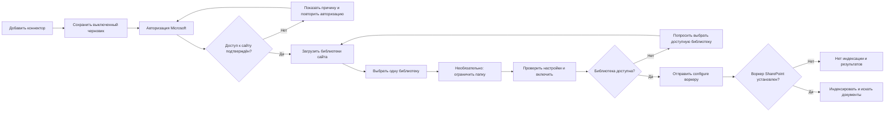
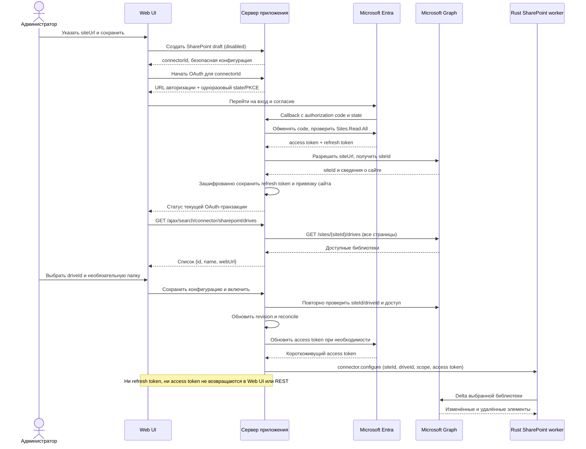
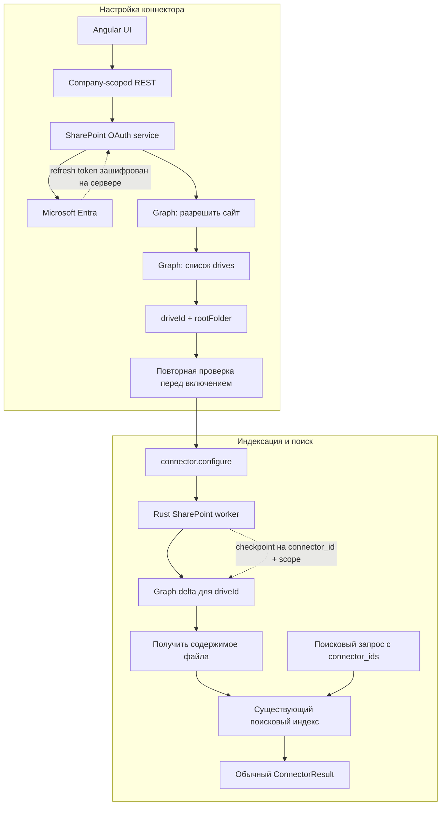
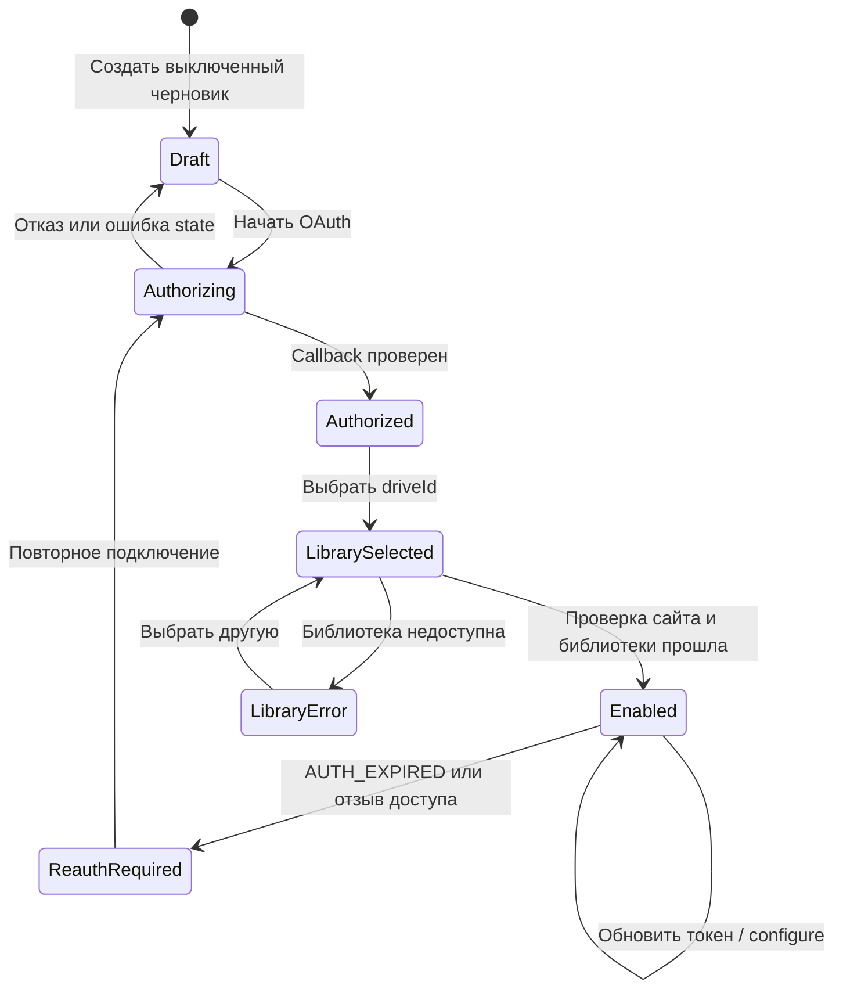
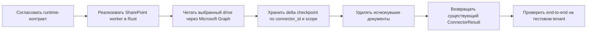

# SharePoint Search Connector — визуальный план

> Визуальная версия плана из `plan.sharepoint.md`. В ней основной сценарий показан как UI-прототипы и диаграммы; короткие пояснения фиксируют контракт и оставшиеся работы.

## Состояние по исходному плану

| Сервер и OAuth                       | Web UI                              | Rust-воркер SharePoint            | Проверка с Microsoft tenant     |
| ------------------------------------ | ----------------------------------- | --------------------------------- | ------------------------------- |
| ✅ Реализованы по сводке и разделу B | ✅ Реализован по сводке и разделу C | ⏳ Отдельная реализация ещё нужна | ⏳ Live-проверка не выполнялась |

Пока нет воркера, полноценная индексация и поиск документов SharePoint не заработают. Статус `ONLINE` в прототипе — целевое состояние полного сценария после подключения воркера.

> **Сверка статуса.** В сводке и пунктах B.5–B.8 сказано, что OAuth, Graph-доступ и проверка выбранной библиотеки реализованы. В пунктах A.1–A.2 остались формулировки о незавершённой Graph-проверке. Здесь за основу взят более поздний статус из сводки и раздела B; перед следующим релизом стоит сверить эти два пункта с кодом.

## Путь администратора



## UI-прототипы

Ниже каждый экран показан отдельной диаграммой Balsamiq, поэтому его можно читать и рендерить независимо. Формат: [Balsamiq Mockups 3 JSON](./blueprint-balsamiq.md).

```balsamiq
{
  "mockup": {
    "measuredW": 1281,
    "measuredH": 801,
    "controls": {
      "control": [
        {
          "ID": "control-1",
          "typeID": "Rectangle",
          "x": 0,
          "y": 0,
          "w": 1280,
          "h": 800,
          "zOrder": 0,
          "properties": {
            "color": "#ffffff"
          }
        },
        {
          "ID": "control-2",
          "typeID": "Label",
          "x": 24,
          "y": 24,
          "w": 84,
          "h": 23,
          "zOrder": 1,
          "properties": {
            "text": "Настройки",
            "color": "#2563eb",
            "size": 14
          }
        },
        {
          "ID": "control-3",
          "typeID": "Label",
          "x": 134,
          "y": 24,
          "w": 47,
          "h": 23,
          "zOrder": 2,
          "properties": {
            "text": "Поиск",
            "color": "#2563eb",
            "size": 14
          }
        },
        {
          "ID": "control-4",
          "typeID": "Label",
          "x": 207,
          "y": 24,
          "w": 93,
          "h": 23,
          "zOrder": 3,
          "properties": {
            "text": "Коннекторы",
            "color": "#2563eb",
            "size": 14
          }
        },
        {
          "ID": "control-5",
          "typeID": "Label",
          "x": 24,
          "y": 63,
          "w": 279,
          "h": 38,
          "zOrder": 4,
          "properties": {
            "text": "Поисковые коннекторы",
            "size": 22,
            "bold": true
          }
        },
        {
          "ID": "control-6",
          "typeID": "Button",
          "x": 1077,
          "y": 63,
          "w": 179,
          "h": 38,
          "zOrder": 5,
          "properties": {
            "text": "Добавить коннектор",
            "bold": true
          }
        },
        {
          "ID": "control-7",
          "typeID": "Rectangle",
          "x": 24,
          "y": 117,
          "w": 1232,
          "h": 40,
          "zOrder": 6,
          "properties": {
            "text": "SharePoint — один сайт и одна библиотека на коннектор.",
            "color": "#eaf2ff",
            "size": 14
          }
        },
        {
          "ID": "control-8",
          "typeID": "Rectangle",
          "x": 24,
          "y": 173,
          "w": 410.7,
          "h": 35,
          "zOrder": 7,
          "properties": {
            "text": "Коннектор",
            "bold": true,
            "size": 14
          }
        },
        {
          "ID": "control-9",
          "typeID": "Rectangle",
          "x": 434.7,
          "y": 173,
          "w": 410.7,
          "h": 35,
          "zOrder": 8,
          "properties": {
            "text": "Область",
            "bold": true,
            "size": 14
          }
        },
        {
          "ID": "control-10",
          "typeID": "Rectangle",
          "x": 845.3,
          "y": 173,
          "w": 410.7,
          "h": 35,
          "zOrder": 9,
          "properties": {
            "text": "Статус",
            "bold": true,
            "size": 14
          }
        },
        {
          "ID": "control-11",
          "typeID": "Rectangle",
          "x": 24,
          "y": 208,
          "w": 410.7,
          "h": 35,
          "zOrder": 10,
          "properties": {
            "text": "SharePoint — договоры",
            "bold": false,
            "size": 14
          }
        },
        {
          "ID": "control-12",
          "typeID": "Rectangle",
          "x": 434.7,
          "y": 208,
          "w": 410.7,
          "h": 35,
          "zOrder": 11,
          "properties": {
            "text": "Документы / Договоры",
            "bold": false,
            "size": 14
          }
        },
        {
          "ID": "control-13",
          "typeID": "Rectangle",
          "x": 845.3,
          "y": 208,
          "w": 410.7,
          "h": 35,
          "zOrder": 12,
          "properties": {
            "text": "ONLINE",
            "bold": false,
            "size": 14
          }
        },
        {
          "ID": "control-14",
          "typeID": "Rectangle",
          "x": 24,
          "y": 243,
          "w": 410.7,
          "h": 35,
          "zOrder": 13,
          "properties": {
            "text": "OneDrive — Отдел продаж",
            "bold": false,
            "size": 14
          }
        },
        {
          "ID": "control-15",
          "typeID": "Rectangle",
          "x": 434.7,
          "y": 243,
          "w": 410.7,
          "h": 35,
          "zOrder": 14,
          "properties": {
            "text": "Личный диск",
            "bold": false,
            "size": 14
          }
        },
        {
          "ID": "control-16",
          "typeID": "Rectangle",
          "x": 845.3,
          "y": 243,
          "w": 410.7,
          "h": 35,
          "zOrder": 15,
          "properties": {
            "text": "ONLINE",
            "bold": false,
            "size": 14
          }
        },
        {
          "ID": "control-17",
          "typeID": "Rectangle",
          "x": 24,
          "y": 278,
          "w": 410.7,
          "h": 35,
          "zOrder": 16,
          "properties": {
            "text": "Dropbox — Архив",
            "bold": false,
            "size": 14
          }
        },
        {
          "ID": "control-18",
          "typeID": "Rectangle",
          "x": 434.7,
          "y": 278,
          "w": 410.7,
          "h": 35,
          "zOrder": 17,
          "properties": {
            "text": "Архив",
            "bold": false,
            "size": 14
          }
        },
        {
          "ID": "control-19",
          "typeID": "Rectangle",
          "x": 845.3,
          "y": 278,
          "w": 410.7,
          "h": 35,
          "zOrder": 18,
          "properties": {
            "text": "PAUSED",
            "bold": false,
            "size": 14
          }
        },
        {
          "ID": "control-20",
          "typeID": "Rectangle",
          "x": 24,
          "y": 329,
          "w": 1232,
          "h": 100,
          "zOrder": 19,
          "properties": {
            "color": "#ffffff"
          }
        },
        {
          "ID": "control-21",
          "typeID": "Label",
          "x": 36,
          "y": 329,
          "w": 1208,
          "h": 40,
          "zOrder": 20,
          "properties": {
            "text": "Подключение SharePoint",
            "size": 18,
            "bold": true
          }
        },
        {
          "ID": "control-22",
          "typeID": "Label",
          "x": 40,
          "y": 385,
          "w": 439,
          "h": 23,
          "zOrder": 21,
          "properties": {
            "text": "Учётная запись Microsoft требует повторной авторизации",
            "size": 14
          }
        },
        {
          "ID": "control-23",
          "typeID": "Label",
          "x": 1110,
          "y": 385,
          "w": 130,
          "h": 23,
          "zOrder": 22,
          "properties": {
            "text": "Переподключить",
            "color": "#2563eb",
            "size": 14
          }
        }
      ]
    }
  }
}
```

### Черновик коннектора

```balsamiq
{
  "mockup": {
    "measuredW": 1281,
    "measuredH": 801,
    "controls": {
      "control": [
        {
          "ID": "control-1",
          "typeID": "Rectangle",
          "x": 0,
          "y": 0,
          "w": 1280,
          "h": 800,
          "zOrder": 0,
          "properties": {
            "color": "#ffffff"
          }
        },
        {
          "ID": "control-2",
          "typeID": "Label",
          "x": 24,
          "y": 24,
          "w": 93,
          "h": 23,
          "zOrder": 1,
          "properties": {
            "text": "Коннекторы",
            "color": "#2563eb",
            "size": 14
          }
        },
        {
          "ID": "control-3",
          "typeID": "Label",
          "x": 143,
          "y": 24,
          "w": 149,
          "h": 23,
          "zOrder": 2,
          "properties": {
            "text": "Новый SharePoint",
            "color": "#2563eb",
            "size": 14
          }
        },
        {
          "ID": "control-4",
          "typeID": "Label",
          "x": 24,
          "y": 63,
          "w": 1232,
          "h": 34,
          "zOrder": 3,
          "properties": {
            "text": "Новый коннектор SharePoint",
            "size": 22,
            "bold": true
          }
        },
        {
          "ID": "control-5",
          "typeID": "Label",
          "x": 24,
          "y": 113,
          "w": 63,
          "h": 22,
          "zOrder": 4,
          "properties": {
            "text": "● Сайт",
            "size": 13,
            "bold": true
          }
        },
        {
          "ID": "control-6",
          "typeID": "Label",
          "x": 103,
          "y": 113,
          "w": 120,
          "h": 22,
          "zOrder": 5,
          "properties": {
            "text": "○ Авторизация",
            "size": 13
          }
        },
        {
          "ID": "control-7",
          "typeID": "Label",
          "x": 239,
          "y": 113,
          "w": 112,
          "h": 22,
          "zOrder": 6,
          "properties": {
            "text": "○ Библиотека",
            "size": 13
          }
        },
        {
          "ID": "control-8",
          "typeID": "Label",
          "x": 367,
          "y": 113,
          "w": 104,
          "h": 22,
          "zOrder": 7,
          "properties": {
            "text": "○ Настройки",
            "size": 13
          }
        },
        {
          "ID": "control-9",
          "typeID": "Rectangle",
          "x": 24,
          "y": 151,
          "w": 1232,
          "h": 277,
          "zOrder": 8,
          "properties": {
            "color": "#ffffff"
          }
        },
        {
          "ID": "control-10",
          "typeID": "Label",
          "x": 36,
          "y": 151,
          "w": 1208,
          "h": 40,
          "zOrder": 9,
          "properties": {
            "text": "1. Укажите сайт",
            "size": 18,
            "bold": true
          }
        },
        {
          "ID": "control-11",
          "typeID": "Label",
          "x": 40,
          "y": 207,
          "w": 1200,
          "h": 18,
          "zOrder": 10,
          "properties": {
            "text": "Название коннектора *",
            "size": 12
          }
        },
        {
          "ID": "control-12",
          "typeID": "TextInput",
          "x": 40,
          "y": 227,
          "w": 1200,
          "h": 36,
          "zOrder": 11,
          "properties": {
            "text": "SharePoint — договоры"
          }
        },
        {
          "ID": "control-13",
          "typeID": "Label",
          "x": 40,
          "y": 279,
          "w": 1200,
          "h": 18,
          "zOrder": 12,
          "properties": {
            "text": "URL сайта *",
            "size": 12
          }
        },
        {
          "ID": "control-14",
          "typeID": "TextInput",
          "x": 40,
          "y": 299,
          "w": 1200,
          "h": 36,
          "zOrder": 13,
          "properties": {
            "text": "https://contoso.sharepoint.com/sites/legal"
          }
        },
        {
          "ID": "control-15",
          "typeID": "Paragraph",
          "x": 40,
          "y": 337,
          "w": 1200,
          "h": 32,
          "zOrder": 14,
          "properties": {
            "text": "Сайт SharePoint Online, например /sites/legal или /teams/legal",
            "size": 11
          }
        },
        {
          "ID": "control-16",
          "typeID": "Rectangle",
          "x": 40,
          "y": 372,
          "w": 1200,
          "h": 40,
          "zOrder": 15,
          "properties": {
            "text": "Сначала сохраните выключенный черновик. Библиотека появится после авторизации.",
            "color": "#eaf2ff",
            "size": 14
          }
        },
        {
          "ID": "control-17",
          "typeID": "Button",
          "x": 24,
          "y": 444,
          "w": 81,
          "h": 38,
          "zOrder": 16,
          "properties": {
            "text": "Отмена",
            "bold": false
          }
        },
        {
          "ID": "control-18",
          "typeID": "Button",
          "x": 972,
          "y": 444,
          "w": 284,
          "h": 38,
          "zOrder": 17,
          "properties": {
            "text": "Сохранить черновик и продолжить",
            "bold": true
          }
        }
      ]
    }
  }
}
```

### Авторизация Microsoft

```balsamiq
{
  "mockup": {
    "measuredW": 1281,
    "measuredH": 801,
    "controls": {
      "control": [
        {
          "ID": "control-1",
          "typeID": "Rectangle",
          "x": 0,
          "y": 0,
          "w": 1280,
          "h": 800,
          "zOrder": 0,
          "properties": {
            "color": "#ffffff"
          }
        },
        {
          "ID": "control-2",
          "typeID": "Label",
          "x": 24,
          "y": 24,
          "w": 93,
          "h": 23,
          "zOrder": 1,
          "properties": {
            "text": "Коннекторы",
            "color": "#2563eb",
            "size": 14
          }
        },
        {
          "ID": "control-3",
          "typeID": "Label",
          "x": 143,
          "y": 24,
          "w": 186,
          "h": 23,
          "zOrder": 2,
          "properties": {
            "text": "Настройка SharePoint",
            "color": "#2563eb",
            "size": 14
          }
        },
        {
          "ID": "control-4",
          "typeID": "Label",
          "x": 355,
          "y": 24,
          "w": 103,
          "h": 23,
          "zOrder": 3,
          "properties": {
            "text": "Авторизация",
            "color": "#2563eb",
            "size": 14
          }
        },
        {
          "ID": "control-5",
          "typeID": "Label",
          "x": 24,
          "y": 63,
          "w": 1232,
          "h": 34,
          "zOrder": 4,
          "properties": {
            "text": "Подключите рабочую учётную запись",
            "size": 22,
            "bold": true
          }
        },
        {
          "ID": "control-6",
          "typeID": "Label",
          "x": 24,
          "y": 113,
          "w": 63,
          "h": 22,
          "zOrder": 5,
          "properties": {
            "text": "✓ Сайт",
            "size": 13,
            "bold": true
          }
        },
        {
          "ID": "control-7",
          "typeID": "Label",
          "x": 103,
          "y": 113,
          "w": 120,
          "h": 22,
          "zOrder": 6,
          "properties": {
            "text": "● Авторизация",
            "size": 13,
            "bold": true
          }
        },
        {
          "ID": "control-8",
          "typeID": "Label",
          "x": 239,
          "y": 113,
          "w": 112,
          "h": 22,
          "zOrder": 7,
          "properties": {
            "text": "○ Библиотека",
            "size": 13
          }
        },
        {
          "ID": "control-9",
          "typeID": "Label",
          "x": 367,
          "y": 113,
          "w": 104,
          "h": 22,
          "zOrder": 8,
          "properties": {
            "text": "○ Настройки",
            "size": 13
          }
        },
        {
          "ID": "control-10",
          "typeID": "Rectangle",
          "x": 24,
          "y": 151,
          "w": 1232,
          "h": 297,
          "zOrder": 9,
          "properties": {
            "color": "#ffffff"
          }
        },
        {
          "ID": "control-11",
          "typeID": "Label",
          "x": 36,
          "y": 151,
          "w": 1208,
          "h": 40,
          "zOrder": 10,
          "properties": {
            "text": "Доступ Microsoft",
            "size": 18,
            "bold": true
          }
        },
        {
          "ID": "control-12",
          "typeID": "Label",
          "x": 40,
          "y": 207,
          "w": 1200,
          "h": 23,
          "zOrder": 11,
          "properties": {
            "text": "Откройте страницу Microsoft для входа и согласия на Sites.Read.All.",
            "size": 14
          }
        },
        {
          "ID": "control-13",
          "typeID": "Label",
          "x": 40,
          "y": 246,
          "w": 1200,
          "h": 20,
          "zOrder": 12,
          "properties": {
            "text": "После возврата сервер проверит доступ к указанному сайту.",
            "size": 14
          }
        },
        {
          "ID": "control-14",
          "typeID": "Button",
          "x": 40,
          "y": 282,
          "w": 227,
          "h": 38,
          "zOrder": 13,
          "properties": {
            "text": "Авторизовать в Microsoft",
            "bold": true
          }
        },
        {
          "ID": "control-15",
          "typeID": "Rectangle",
          "x": 40,
          "y": 336,
          "w": 40,
          "h": 40,
          "zOrder": 14,
          "properties": {
            "text": "…",
            "color": "#eaf2ff"
          }
        },
        {
          "ID": "control-16",
          "typeID": "Rectangle",
          "x": 40,
          "y": 392,
          "w": 1200,
          "h": 40,
          "zOrder": 15,
          "properties": {
            "text": "Токены остаются на сервере. В браузер возвращается только результат авторизации.",
            "color": "#eaf2ff",
            "size": 14
          }
        },
        {
          "ID": "control-17",
          "typeID": "Label",
          "x": 24,
          "y": 464,
          "w": 195,
          "h": 23,
          "zOrder": 16,
          "properties": {
            "text": "Вернуться к черновику",
            "color": "#2563eb",
            "size": 14
          }
        }
      ]
    }
  }
}
```

### Выбор библиотеки

```balsamiq
{
  "mockup": {
    "measuredW": 1281,
    "measuredH": 801,
    "controls": {
      "control": [
        {
          "ID": "control-1",
          "typeID": "Rectangle",
          "x": 0,
          "y": 0,
          "w": 1280,
          "h": 800,
          "zOrder": 0,
          "properties": {
            "color": "#ffffff"
          }
        },
        {
          "ID": "control-2",
          "typeID": "Label",
          "x": 24,
          "y": 24,
          "w": 93,
          "h": 23,
          "zOrder": 1,
          "properties": {
            "text": "Коннекторы",
            "color": "#2563eb",
            "size": 14
          }
        },
        {
          "ID": "control-3",
          "typeID": "Label",
          "x": 143,
          "y": 24,
          "w": 149,
          "h": 23,
          "zOrder": 2,
          "properties": {
            "text": "Новый SharePoint",
            "color": "#2563eb",
            "size": 14
          }
        },
        {
          "ID": "control-4",
          "typeID": "Label",
          "x": 318,
          "y": 24,
          "w": 93,
          "h": 23,
          "zOrder": 3,
          "properties": {
            "text": "Библиотека",
            "color": "#2563eb",
            "size": 14
          }
        },
        {
          "ID": "control-5",
          "typeID": "Label",
          "x": 24,
          "y": 63,
          "w": 1232,
          "h": 34,
          "zOrder": 4,
          "properties": {
            "text": "Выберите библиотеку",
            "size": 22,
            "bold": true
          }
        },
        {
          "ID": "control-6",
          "typeID": "Label",
          "x": 24,
          "y": 113,
          "w": 63,
          "h": 22,
          "zOrder": 5,
          "properties": {
            "text": "✓ Сайт",
            "size": 13,
            "bold": true
          }
        },
        {
          "ID": "control-7",
          "typeID": "Label",
          "x": 103,
          "y": 113,
          "w": 120,
          "h": 22,
          "zOrder": 6,
          "properties": {
            "text": "✓ Авторизация",
            "size": 13,
            "bold": true
          }
        },
        {
          "ID": "control-8",
          "typeID": "Label",
          "x": 239,
          "y": 113,
          "w": 112,
          "h": 22,
          "zOrder": 7,
          "properties": {
            "text": "● Библиотека",
            "size": 13,
            "bold": true
          }
        },
        {
          "ID": "control-9",
          "typeID": "Label",
          "x": 367,
          "y": 113,
          "w": 104,
          "h": 22,
          "zOrder": 8,
          "properties": {
            "text": "○ Настройки",
            "size": 13
          }
        },
        {
          "ID": "control-10",
          "typeID": "Rectangle",
          "x": 24,
          "y": 151,
          "w": 1232,
          "h": 373,
          "zOrder": 9,
          "properties": {
            "color": "#ffffff"
          }
        },
        {
          "ID": "control-11",
          "typeID": "Label",
          "x": 36,
          "y": 151,
          "w": 1208,
          "h": 40,
          "zOrder": 10,
          "properties": {
            "text": "Сайт доступен",
            "size": 18,
            "bold": true
          }
        },
        {
          "ID": "control-12",
          "typeID": "Label",
          "x": 40,
          "y": 207,
          "w": 1200,
          "h": 20,
          "zOrder": 11,
          "properties": {
            "text": "https://contoso.sharepoint.com/sites/legal",
            "size": 14
          }
        },
        {
          "ID": "control-13",
          "typeID": "Label",
          "x": 40,
          "y": 235,
          "w": 1200,
          "h": 17,
          "zOrder": 12,
          "properties": {
            "text": "Библиотеки загружены с Microsoft Graph",
            "size": 12
          }
        },
        {
          "ID": "control-14",
          "typeID": "Label",
          "x": 40,
          "y": 260,
          "w": 1200,
          "h": 18,
          "zOrder": 13,
          "properties": {
            "text": "Библиотека документов",
            "size": 12
          }
        },
        {
          "ID": "control-15",
          "typeID": "ComboBox",
          "x": 40,
          "y": 280,
          "w": 1200,
          "h": 36,
          "zOrder": 14,
          "properties": {
            "text": "Документы"
          }
        },
        {
          "ID": "control-16",
          "typeID": "Rectangle",
          "x": 40,
          "y": 468,
          "w": 1200,
          "h": 40,
          "zOrder": 15,
          "properties": {
            "text": "В конфигурации сохраняется ID библиотеки, а не только её отображаемое имя.",
            "color": "#eaf2ff",
            "size": 14
          }
        },
        {
          "ID": "control-17",
          "typeID": "Button",
          "x": 24,
          "y": 540,
          "w": 73,
          "h": 38,
          "zOrder": 16,
          "properties": {
            "text": "Назад",
            "bold": false
          }
        },
        {
          "ID": "control-18",
          "typeID": "Button",
          "x": 1142,
          "y": 540,
          "w": 114,
          "h": 38,
          "zOrder": 17,
          "properties": {
            "text": "Продолжить",
            "bold": true
          }
        }
      ]
    }
  }
}
```

### Настройки индексации

```balsamiq
{
  "mockup": {
    "measuredW": 1281,
    "measuredH": 801,
    "controls": {
      "control": [
        {
          "ID": "control-1",
          "typeID": "Rectangle",
          "x": 0,
          "y": 0,
          "w": 1280,
          "h": 800,
          "zOrder": 0,
          "properties": {
            "color": "#ffffff"
          }
        },
        {
          "ID": "control-2",
          "typeID": "Label",
          "x": 24,
          "y": 24,
          "w": 93,
          "h": 23,
          "zOrder": 1,
          "properties": {
            "text": "Коннекторы",
            "color": "#2563eb",
            "size": 14
          }
        },
        {
          "ID": "control-3",
          "typeID": "Label",
          "x": 143,
          "y": 24,
          "w": 195,
          "h": 23,
          "zOrder": 2,
          "properties": {
            "text": "SharePoint — договоры",
            "color": "#2563eb",
            "size": 14
          }
        },
        {
          "ID": "control-4",
          "typeID": "Label",
          "x": 364,
          "y": 24,
          "w": 84,
          "h": 23,
          "zOrder": 3,
          "properties": {
            "text": "Настройки",
            "color": "#2563eb",
            "size": 14
          }
        },
        {
          "ID": "control-5",
          "typeID": "Label",
          "x": 24,
          "y": 63,
          "w": 1232,
          "h": 34,
          "zOrder": 4,
          "properties": {
            "text": "Область индексации",
            "size": 22,
            "bold": true
          }
        },
        {
          "ID": "control-6",
          "typeID": "Label",
          "x": 24,
          "y": 113,
          "w": 63,
          "h": 22,
          "zOrder": 5,
          "properties": {
            "text": "✓ Сайт",
            "size": 13,
            "bold": true
          }
        },
        {
          "ID": "control-7",
          "typeID": "Label",
          "x": 103,
          "y": 113,
          "w": 120,
          "h": 22,
          "zOrder": 6,
          "properties": {
            "text": "✓ Авторизация",
            "size": 13,
            "bold": true
          }
        },
        {
          "ID": "control-8",
          "typeID": "Label",
          "x": 239,
          "y": 113,
          "w": 112,
          "h": 22,
          "zOrder": 7,
          "properties": {
            "text": "✓ Библиотека",
            "size": 13,
            "bold": true
          }
        },
        {
          "ID": "control-9",
          "typeID": "Label",
          "x": 367,
          "y": 113,
          "w": 104,
          "h": 22,
          "zOrder": 8,
          "properties": {
            "text": "● Настройки",
            "size": 13,
            "bold": true
          }
        },
        {
          "ID": "control-10",
          "typeID": "Rectangle",
          "x": 24,
          "y": 151,
          "w": 420,
          "h": 328,
          "zOrder": 9,
          "properties": {
            "color": "#ffffff"
          }
        },
        {
          "ID": "control-11",
          "typeID": "Label",
          "x": 36,
          "y": 151,
          "w": 396,
          "h": 40,
          "zOrder": 10,
          "properties": {
            "text": "Источник",
            "size": 18,
            "bold": true
          }
        },
        {
          "ID": "control-12",
          "typeID": "Label",
          "x": 40,
          "y": 207,
          "w": 388,
          "h": 18,
          "zOrder": 11,
          "properties": {
            "text": "Сайт",
            "size": 12
          }
        },
        {
          "ID": "control-13",
          "typeID": "TextInput",
          "x": 40,
          "y": 227,
          "w": 388,
          "h": 36,
          "zOrder": 12,
          "properties": {
            "text": "https://contoso.sharepoint.com/sites/legal"
          }
        },
        {
          "ID": "control-14",
          "typeID": "Label",
          "x": 40,
          "y": 279,
          "w": 388,
          "h": 18,
          "zOrder": 13,
          "properties": {
            "text": "Библиотека",
            "size": 12
          }
        },
        {
          "ID": "control-15",
          "typeID": "TextInput",
          "x": 40,
          "y": 299,
          "w": 388,
          "h": 36,
          "zOrder": 14,
          "properties": {
            "text": "Документы · driveId сохранён"
          }
        },
        {
          "ID": "control-16",
          "typeID": "TextInput",
          "x": 40,
          "y": 351,
          "w": 388,
          "h": 40,
          "zOrder": 15,
          "properties": {
            "text": "Папка внутри библиотеки (необязательно)"
          }
        },
        {
          "ID": "control-17",
          "typeID": "Rectangle",
          "x": 40,
          "y": 423,
          "w": 388,
          "h": 40,
          "zOrder": 16,
          "properties": {
            "text": "Пустой путь или / означает всю библиотеку.",
            "color": "#eaf2ff",
            "size": 14
          }
        },
        {
          "ID": "control-18",
          "typeID": "Rectangle",
          "x": 460,
          "y": 151,
          "w": 428,
          "h": 328,
          "zOrder": 17,
          "properties": {
            "color": "#ffffff"
          }
        },
        {
          "ID": "control-19",
          "typeID": "Label",
          "x": 472,
          "y": 151,
          "w": 404,
          "h": 40,
          "zOrder": 18,
          "properties": {
            "text": "Индексация",
            "size": 18,
            "bold": true
          }
        },
        {
          "ID": "control-20",
          "typeID": "Label",
          "x": 476,
          "y": 207,
          "w": 396,
          "h": 18,
          "zOrder": 19,
          "properties": {
            "text": "Интервал опроса (сек.) *",
            "size": 12
          }
        },
        {
          "ID": "control-21",
          "typeID": "TextInput",
          "x": 476,
          "y": 227,
          "w": 396,
          "h": 36,
          "zOrder": 20,
          "properties": {
            "text": "300"
          }
        },
        {
          "ID": "control-22",
          "typeID": "Label",
          "x": 476,
          "y": 279,
          "w": 396,
          "h": 18,
          "zOrder": 21,
          "properties": {
            "text": "Максимальный размер файла (байт) *",
            "size": 12
          }
        },
        {
          "ID": "control-23",
          "typeID": "TextInput",
          "x": 476,
          "y": 299,
          "w": 396,
          "h": 36,
          "zOrder": 22,
          "properties": {
            "text": "52428800"
          }
        },
        {
          "ID": "control-24",
          "typeID": "CheckBox",
          "x": 476,
          "y": 352,
          "w": 18,
          "h": 18,
          "zOrder": 23,
          "properties": {
            "text": "",
            "checked": true
          }
        },
        {
          "ID": "control-25",
          "typeID": "Label",
          "x": 494,
          "y": 351,
          "w": 179,
          "h": 20,
          "zOrder": 24,
          "properties": {
            "text": "Включать скрытые файлы",
            "size": 14
          }
        },
        {
          "ID": "control-26",
          "typeID": "Rectangle",
          "x": 476,
          "y": 387,
          "w": 396,
          "h": 40,
          "zOrder": 25,
          "properties": {
            "text": "Значения проверяются сервером до включения.",
            "color": "#eaf2ff",
            "size": 14
          }
        },
        {
          "ID": "control-27",
          "typeID": "Button",
          "x": 24,
          "y": 495,
          "w": 211,
          "h": 38,
          "zOrder": 26,
          "properties": {
            "text": "Сохранить как черновик",
            "bold": false
          }
        },
        {
          "ID": "control-28",
          "typeID": "Button",
          "x": 1061,
          "y": 495,
          "w": 195,
          "h": 38,
          "zOrder": 27,
          "properties": {
            "text": "Проверить и включить",
            "bold": true
          }
        }
      ]
    }
  }
}
```

### Подключённый источник

```balsamiq
{
  "mockup": {
    "measuredW": 1281,
    "measuredH": 801,
    "controls": {
      "control": [
        {
          "ID": "control-1",
          "typeID": "Rectangle",
          "x": 0,
          "y": 0,
          "w": 1280,
          "h": 800,
          "zOrder": 0,
          "properties": {
            "color": "#ffffff"
          }
        },
        {
          "ID": "control-2",
          "typeID": "Label",
          "x": 24,
          "y": 24,
          "w": 93,
          "h": 23,
          "zOrder": 1,
          "properties": {
            "text": "Коннекторы",
            "color": "#2563eb",
            "size": 14
          }
        },
        {
          "ID": "control-3",
          "typeID": "Label",
          "x": 143,
          "y": 24,
          "w": 195,
          "h": 23,
          "zOrder": 2,
          "properties": {
            "text": "SharePoint — договоры",
            "color": "#2563eb",
            "size": 14
          }
        },
        {
          "ID": "control-4",
          "typeID": "Label",
          "x": 24,
          "y": 63,
          "w": 1232,
          "h": 34,
          "zOrder": 3,
          "properties": {
            "text": "SharePoint — договоры",
            "size": 22,
            "bold": true
          }
        },
        {
          "ID": "control-5",
          "typeID": "Rectangle",
          "x": 24,
          "y": 113,
          "w": 1232,
          "h": 40,
          "zOrder": 4,
          "properties": {
            "text": "ONLINE · доступ к сайту и библиотеке подтверждён",
            "color": "#eaf2ff",
            "size": 14
          }
        },
        {
          "ID": "control-6",
          "typeID": "Rectangle",
          "x": 24,
          "y": 169,
          "w": 1232,
          "h": 179,
          "zOrder": 5,
          "properties": {
            "color": "#ffffff"
          }
        },
        {
          "ID": "control-7",
          "typeID": "Label",
          "x": 36,
          "y": 169,
          "w": 1208,
          "h": 40,
          "zOrder": 6,
          "properties": {
            "text": "Область",
            "size": 18,
            "bold": true
          }
        },
        {
          "ID": "control-8",
          "typeID": "Label",
          "x": 40,
          "y": 225,
          "w": 1200,
          "h": 23,
          "zOrder": 7,
          "properties": {
            "text": "contoso.sharepoint.com/sites/legal",
            "size": 14
          }
        },
        {
          "ID": "control-9",
          "typeID": "Label",
          "x": 40,
          "y": 256,
          "w": 1200,
          "h": 23,
          "zOrder": 8,
          "properties": {
            "text": "Библиотека: Документы",
            "size": 14
          }
        },
        {
          "ID": "control-10",
          "typeID": "Label",
          "x": 40,
          "y": 287,
          "w": 1200,
          "h": 20,
          "zOrder": 9,
          "properties": {
            "text": "Папка: /Договоры/2026",
            "size": 14
          }
        },
        {
          "ID": "control-11",
          "typeID": "Label",
          "x": 40,
          "y": 315,
          "w": 1200,
          "h": 17,
          "zOrder": 10,
          "properties": {
            "text": "В runtime воркера передаются короткоживущий access token, siteId, driveId и scope.",
            "size": 12
          }
        },
        {
          "ID": "control-12",
          "typeID": "Button",
          "x": 24,
          "y": 364,
          "w": 138,
          "h": 38,
          "zOrder": 11,
          "properties": {
            "text": "Открыть поиск",
            "bold": true
          }
        },
        {
          "ID": "control-13",
          "typeID": "Label",
          "x": 940,
          "y": 371.5,
          "w": 316,
          "h": 23,
          "zOrder": 12,
          "properties": {
            "text": "Смоделировать истёкшую авторизацию",
            "color": "#2563eb",
            "size": 14
          }
        }
      ]
    }
  }
}
```

### Повторная авторизация

```balsamiq
{
  "mockup": {
    "measuredW": 1281,
    "measuredH": 801,
    "controls": {
      "control": [
        {
          "ID": "control-1",
          "typeID": "Rectangle",
          "x": 0,
          "y": 0,
          "w": 1280,
          "h": 800,
          "zOrder": 0,
          "properties": {
            "color": "#ffffff"
          }
        },
        {
          "ID": "control-2",
          "typeID": "Label",
          "x": 24,
          "y": 24,
          "w": 93,
          "h": 23,
          "zOrder": 1,
          "properties": {
            "text": "Коннекторы",
            "color": "#2563eb",
            "size": 14
          }
        },
        {
          "ID": "control-3",
          "typeID": "Label",
          "x": 143,
          "y": 24,
          "w": 195,
          "h": 23,
          "zOrder": 2,
          "properties": {
            "text": "SharePoint — договоры",
            "color": "#2563eb",
            "size": 14
          }
        },
        {
          "ID": "control-4",
          "typeID": "Label",
          "x": 24,
          "y": 63,
          "w": 1232,
          "h": 34,
          "zOrder": 3,
          "properties": {
            "text": "Нужно переподключить Microsoft",
            "size": 22,
            "bold": true
          }
        },
        {
          "ID": "control-5",
          "typeID": "Rectangle",
          "x": 24,
          "y": 113,
          "w": 1232,
          "h": 40,
          "zOrder": 4,
          "properties": {
            "text": "REAUTH_REQUIRED · доступ отозван или авторизация истекла",
            "color": "#fee2e2",
            "size": 14
          }
        },
        {
          "ID": "control-6",
          "typeID": "Rectangle",
          "x": 24,
          "y": 169,
          "w": 1232,
          "h": 117,
          "zOrder": 5,
          "properties": {
            "color": "#ffffff"
          }
        },
        {
          "ID": "control-7",
          "typeID": "Label",
          "x": 36,
          "y": 169,
          "w": 1208,
          "h": 40,
          "zOrder": 6,
          "properties": {
            "text": "Данные коннектора сохранены",
            "size": 18,
            "bold": true
          }
        },
        {
          "ID": "control-8",
          "typeID": "Label",
          "x": 40,
          "y": 225,
          "w": 1200,
          "h": 20,
          "zOrder": 7,
          "properties": {
            "text": "Проверьте рабочую учётную запись и повторно подтвердите доступ к сайту.",
            "size": 14
          }
        },
        {
          "ID": "control-9",
          "typeID": "Label",
          "x": 40,
          "y": 253,
          "w": 1200,
          "h": 17,
          "zOrder": 8,
          "properties": {
            "text": "Если изменилась организация, создайте новую авторизацию для нужного tenant.",
            "size": 12
          }
        },
        {
          "ID": "control-10",
          "typeID": "Button",
          "x": 24,
          "y": 302,
          "w": 73,
          "h": 38,
          "zOrder": 9,
          "properties": {
            "text": "Позже",
            "bold": false
          }
        },
        {
          "ID": "control-11",
          "typeID": "Button",
          "x": 1110,
          "y": 302,
          "w": 146,
          "h": 38,
          "zOrder": 10,
          "properties": {
            "text": "Переподключить",
            "bold": true
          }
        }
      ]
    }
  }
}
```

### Поиск по источникам

```balsamiq
{
  "mockup": {
    "measuredW": 1281,
    "measuredH": 801,
    "controls": {
      "control": [
        {
          "ID": "control-1",
          "typeID": "Rectangle",
          "x": 0,
          "y": 0,
          "w": 1280,
          "h": 800,
          "zOrder": 0,
          "properties": {
            "color": "#ffffff"
          }
        },
        {
          "ID": "control-2",
          "typeID": "Label",
          "x": 24,
          "y": 24,
          "w": 47,
          "h": 23,
          "zOrder": 1,
          "properties": {
            "text": "Поиск",
            "color": "#2563eb",
            "size": 14
          }
        },
        {
          "ID": "control-3",
          "typeID": "Label",
          "x": 97,
          "y": 24,
          "w": 112,
          "h": 23,
          "zOrder": 2,
          "properties": {
            "text": "Новый запрос",
            "color": "#2563eb",
            "size": 14
          }
        },
        {
          "ID": "control-4",
          "typeID": "Label",
          "x": 24,
          "y": 63,
          "w": 1232,
          "h": 34,
          "zOrder": 3,
          "properties": {
            "text": "Поиск по источникам",
            "size": 22,
            "bold": true
          }
        },
        {
          "ID": "control-5",
          "typeID": "Label",
          "x": 24,
          "y": 113,
          "w": 1232,
          "h": 18,
          "zOrder": 4,
          "properties": {
            "text": "Что найти?",
            "size": 12
          }
        },
        {
          "ID": "control-6",
          "typeID": "TextInput",
          "x": 24,
          "y": 133,
          "w": 1232,
          "h": 36,
          "zOrder": 5,
          "properties": {
            "text": "условия расторжения договора"
          }
        },
        {
          "ID": "control-7",
          "typeID": "Label",
          "x": 24,
          "y": 185,
          "w": 1232,
          "h": 23,
          "zOrder": 6,
          "properties": {
            "text": "Искать в",
            "size": 16
          }
        },
        {
          "ID": "control-8",
          "typeID": "Rectangle",
          "x": 24,
          "y": 224,
          "w": 183,
          "h": 29,
          "zOrder": 7,
          "properties": {
            "text": "SharePoint — договоры",
            "color": "#f1f5f9"
          }
        },
        {
          "ID": "control-9",
          "typeID": "Rectangle",
          "x": 207,
          "y": 224,
          "w": 198,
          "h": 29,
          "zOrder": 8,
          "properties": {
            "text": "OneDrive — Отдел продаж",
            "color": "#f1f5f9"
          }
        },
        {
          "ID": "control-10",
          "typeID": "Rectangle",
          "x": 405,
          "y": 224,
          "w": 138,
          "h": 29,
          "zOrder": 9,
          "properties": {
            "text": "Dropbox — Архив",
            "color": "#f1f5f9"
          }
        },
        {
          "ID": "control-11",
          "typeID": "Button",
          "x": 24,
          "y": 269,
          "w": 73,
          "h": 38,
          "zOrder": 10,
          "properties": {
            "text": "Найти",
            "bold": true
          }
        },
        {
          "ID": "control-12",
          "typeID": "Label",
          "x": 1093,
          "y": 269,
          "w": 163,
          "h": 38,
          "zOrder": 11,
          "properties": {
            "text": "Выбраны источники: 3",
            "size": 14
          }
        },
        {
          "ID": "control-13",
          "typeID": "Rectangle",
          "x": 24,
          "y": 323,
          "w": 1232,
          "h": 40,
          "zOrder": 12,
          "properties": {
            "text": "Визуальный пример результата. Фактический поиск SharePoint требует Rust-воркер.",
            "color": "#fef3c7",
            "size": 14
          }
        },
        {
          "ID": "control-14",
          "typeID": "Rectangle",
          "x": 24,
          "y": 379,
          "w": 1232,
          "h": 151,
          "zOrder": 13,
          "properties": {
            "color": "#ffffff"
          }
        },
        {
          "ID": "control-15",
          "typeID": "Label",
          "x": 36,
          "y": 379,
          "w": 1208,
          "h": 40,
          "zOrder": 14,
          "properties": {
            "text": "Договор поставки № 2026-041",
            "size": 18,
            "bold": true
          }
        },
        {
          "ID": "control-16",
          "typeID": "Label",
          "x": 40,
          "y": 435,
          "w": 1200,
          "h": 20,
          "zOrder": 15,
          "properties": {
            "text": "SharePoint · Документы / Договоры / 2026",
            "size": 14
          }
        },
        {
          "ID": "control-17",
          "typeID": "Label",
          "x": 40,
          "y": 463,
          "w": 1200,
          "h": 20,
          "zOrder": 16,
          "properties": {
            "text": "Найден фрагмент: условия расторжения договора...",
            "size": 14
          }
        },
        {
          "ID": "control-18",
          "typeID": "Label",
          "x": 40,
          "y": 491,
          "w": 186,
          "h": 23,
          "zOrder": 17,
          "properties": {
            "text": "Открыть в SharePoint",
            "color": "#2563eb",
            "size": 14
          }
        }
      ]
    }
  }
}
```

## Обмен данными и границы безопасности







## Контракт одного коннектора

| Поле                                                   | Что означает                                                                                                                              |
| ------------------------------------------------------ | ----------------------------------------------------------------------------------------------------------------------------------------- |
| `type`                                                 | `sharepoint` — отдельный тип, OneDrive остаётся отдельным коннектором.                                                                    |
| `siteUrl`                                              | Канонический HTTPS URL одного сайта SharePoint Online.                                                                                    |
| `driveId`                                              | ID одной выбранной библиотеки; пуст до выбора.                                                                                            |
| `rootFolder`                                           | Путь или DriveItem ID внутри библиотеки; пусто или `/` — вся библиотека.                                                                  |
| `includeHidden`, `maxFileBytes`, `pollIntervalSeconds` | Настройки индексации с валидацией Java и Angular.                                                                                         |
| OAuth credentials                                      | Зашифрованные на сервере refresh token, siteId, tenantId и scope. REST возвращает только признак наличия credentials и безопасный статус. |
| Runtime credentials                                    | Короткоживущий access token, siteId, driveId и scope только в `connector.configure`; refresh token воркеру не передаётся.                 |

При смене сайта библиотека и статус проверки сбрасываются. Новый сайт требует новой OAuth-привязки; смена tenant требует новой авторизации. Библиотека и папка входят в revision scope, чтобы воркер не продолжал индексировать прежнюю область.

## Оставшаяся работа



- Реализовать сканер в Rust-модуле поиска по согласованному runtime-контракту. Формат `ConnectorResult` и механизм выбора цели поиска на сервере не менять.
- Вести отдельный delta checkpoint для каждого `connector_id` и scope; обрабатывать изменения и удаления файлов.
- Различать безопасные состояния: `REAUTH_REQUIRED`, отсутствие доступа, удалённая библиотека, 429 с `Retry-After` и временные ошибки Graph.
- В настройках развёртывания нужны зарегистрированное приложение Microsoft Entra, tenant, callback URL и admin consent для `Sites.Read.All`. Первый вариант OAuth — delegated с `offline_access`.
- После реализации воркера пройти ручной сценарий: OAuth → сайт и библиотека → `ONLINE` → выбрать источник в поиске → получить SharePoint-файл; повторить после истечения токена и отзыва доступа.

## Проверки, записанные в исходном плане

| Проверка                                                       | Статус в исходнике               |
| -------------------------------------------------------------- | -------------------------------- |
| `mvn -q -DskipTests compile` в модуле сервера                  | ✅ Успешно                       |
| `mvn -q test` в модуле сервера                                 | ✅ Успешно                       |
| `npm run build -- --configuration development` в модуле Web UI | ✅ Успешно                       |
| Live-интеграция с реальным Microsoft tenant                    | ⏳ Не выполнялась                |
| Сквозной поиск SharePoint-файла                                | ⏳ После реализации Rust-воркера |

Критерий безопасности для готового сценария: токены не попадают в REST-ответы, браузер или логи; секреты не хранятся в `configJson`. Существующие OneDrive, Dropbox и IMAP продолжают работать через общий механизм коннекторов.

## Ссылки Graph API

- [Получение сайта по hostname и относительному пути](https://learn.microsoft.com/en-us/graph/api/site-getbypath?view=graph-rest-1.0)
- [Список библиотек сайта](https://learn.microsoft.com/en-us/graph/api/drive-list?view=graph-rest-1.0)
- [Delta для файлов](https://learn.microsoft.com/en-us/graph/api/driveitem-delta?view=graph-rest-1.0) и [скачивание содержимого](https://learn.microsoft.com/en-us/graph/api/driveitem-get-content?view=graph-rest-1.0)
- [Разрешения Graph](https://learn.microsoft.com/en-us/graph/permissions-reference) и [429 / throttling](https://learn.microsoft.com/en-us/graph/throttling)
