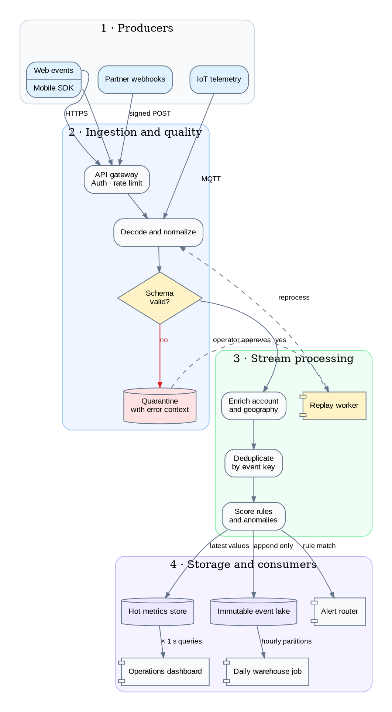

# Graphviz data lineage

Use one `graph` or `digraph` block for a static Graphviz diagram. This example maps a complete
event path across four clusters, with record ports for the primary payload and side paths for
rejected data, metrics, and replay.

The offline WebAssembly renderer supports the verified `dot`, `neato`, `circo`, `fdp`, `osage`,
`patchwork`, and `twopi` layout engines, including clusters, record ports, and HTML-like labels.
