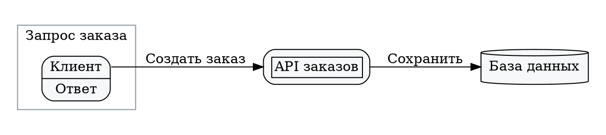
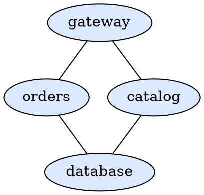

# Graphviz diagrams

Use one `graph` or `digraph` block for a static Graphviz diagram. The renderer supports clusters,
record ports, HTML-like labels, and local layout engines.

## Order flow

## Service links

