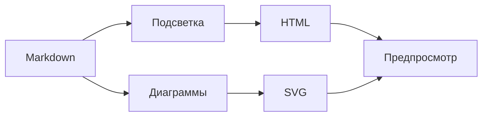
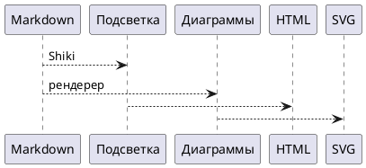

# Подсветка обычных блоков кода

Пример показывает, как читать технические фрагменты в плане. Язык указывается после открывающих обратных кавычек.

## JSON

```json
{
  "name": "blueprint4llm",
  "output": "html",
  "syntaxHighlighting": true,
  "languages": ["json", "typescript", "bash", "yaml"]
}
```

## TypeScript

```typescript
interface RenderOptions {
  format: 'html' | 'pdf';
  highlightCode: boolean;
}

export function resolveFormat(options: RenderOptions): string {
  return options.highlightCode ? `${options.format}:highlighted` : options.format;
}
```

## Bash

```bash
blueprint4llm examples/blueprint-highlight.md --out=./dist/blueprint-highlight.html
blueprint4llm examples/blueprint-highlight.md --format=pdf --out=./dist/blueprint-highlight.pdf
```

## YAML

```yaml
renderer:
  engine: shiki
  theme:
    light: github-light
    dark: github-dark
```

## Без языковой метки

Блок без языка сохраняет обычный вид и не требует угадывать синтаксис:

```
Этот фрагмент останется моноширинным текстом без раскраски токенов.
```

## Mermaid, PlantUML и Balsamiq по-прежнему визуализируются





```balsamiq
{
  "mockup": {
    "measuredW": 376,
    "measuredH": 813,
    "controls": {
      "control": [
        {
          "ID": "control-1",
          "typeID": "Rectangle",
          "x": 0,
          "y": 0,
          "w": 375,
          "h": 812,
          "zOrder": 0,
          "properties": {
            "color": "#ffffff"
          }
        },
        {
          "ID": "control-2",
          "typeID": "Label",
          "x": 32,
          "y": 32,
          "w": 311,
          "h": 34,
          "zOrder": 1,
          "properties": {
            "text": "Подсветка кода",
            "size": 22,
            "bold": true
          }
        },
        {
          "ID": "control-3",
          "typeID": "Rectangle",
          "x": 32,
          "y": 82,
          "w": 311,
          "h": 40,
          "zOrder": 2,
          "properties": {
            "text": "JSON, TypeScript и другие блоки удобно просматривать в плане.",
            "color": "#eaf2ff",
            "size": 14
          }
        },
        {
          "ID": "control-4",
          "typeID": "TextInput",
          "x": 32,
          "y": 138,
          "w": 311,
          "h": 36,
          "zOrder": 3,
          "properties": {
            "text": "Язык: typescript"
          }
        },
        {
          "ID": "control-5",
          "typeID": "Button",
          "x": 32,
          "y": 190,
          "w": 146,
          "h": 38,
          "zOrder": 4,
          "properties": {
            "text": "Открыть пример",
            "bold": true
          }
        }
      ]
    }
  }
}
```
