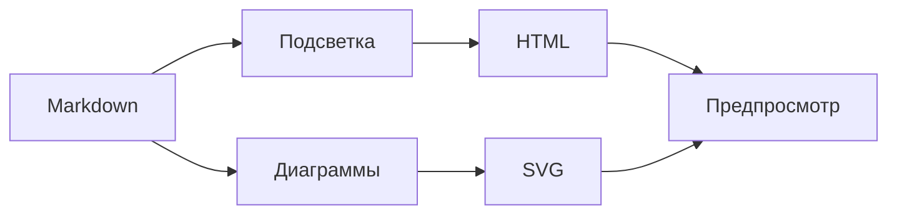
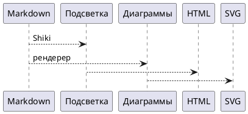

# Подсветка обычных блоков кода

Пример показывает, как читать технические фрагменты в плане. Язык указывается после открывающих обратных кавычек.

## JSON

```json
{
  "name": "blueprint4llm",
  "output": "html",
  "syntaxHighlighting": true,
  "languages": ["json", "typescript", "bash", "yaml"]
}
```

## TypeScript

```typescript
interface RenderOptions {
  format: 'html' | 'pdf';
  highlightCode: boolean;
}

export function resolveFormat(options: RenderOptions): string {
  return options.highlightCode ? `${options.format}:highlighted` : options.format;
}
```

## Bash

```bash
blueprint4llm examples/blueprint-highlight.md --out=./dist/blueprint-highlight.html
blueprint4llm examples/blueprint-highlight.md --format=pdf --out=./dist/blueprint-highlight.pdf
```

## YAML

```yaml
renderer:
  engine: shiki
  theme:
    light: github-light
    dark: github-dark
```

## Без языковой метки

Блок без языка сохраняет обычный вид и не требует угадывать синтаксис:

```
Этот фрагмент останется моноширинным текстом без раскраски токенов.
```

## Mermaid, PlantUML и Wiremark по-прежнему визуализируются





```wireframe
Wireframe #highlight-example mobile padding=2 gap=2
  Stack column gap=2 padding=2
    Typography h4 "Подсветка кода"
    Alert "JSON, TypeScript и другие блоки удобно просматривать в плане." severity=info
    TextField "Язык: typescript"
    Button "Открыть пример" contained
```
