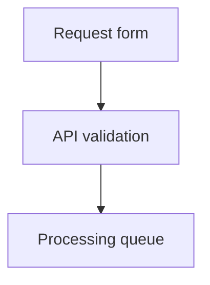

# Request workflow

Review the flow and the screen before implementation.

## Request flow



## New request screen

```wireframe
Wireframe #request w=420 h=300
  Stack column gap=2 padding=2
    Typography h4 "New request"
    TextField "Title"
    TextField "Description"
    Button "Submit request" contained
```
