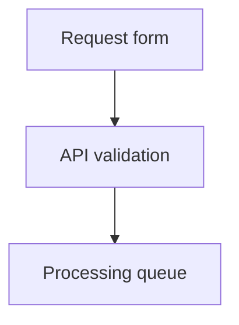

# Request workflow

Review the flow and the screen before implementation.

## Request flow



## New request screen

```balsamiq
{
  "mockup": {
    "measuredW": 421,
    "measuredH": 301,
    "controls": {
      "control": [
        {
          "ID": "control-1",
          "typeID": "Rectangle",
          "x": 0,
          "y": 0,
          "w": 420,
          "h": 300,
          "zOrder": 0,
          "properties": {
            "color": "#ffffff"
          }
        },
        {
          "ID": "control-2",
          "typeID": "Label",
          "x": 16,
          "y": 16,
          "w": 388,
          "h": 34,
          "zOrder": 1,
          "properties": {
            "text": "New request",
            "size": 22,
            "bold": true
          }
        },
        {
          "ID": "control-3",
          "typeID": "TextInput",
          "x": 16,
          "y": 66,
          "w": 388,
          "h": 36,
          "zOrder": 2,
          "properties": {
            "text": "Title"
          }
        },
        {
          "ID": "control-4",
          "typeID": "TextInput",
          "x": 16,
          "y": 118,
          "w": 388,
          "h": 36,
          "zOrder": 3,
          "properties": {
            "text": "Description"
          }
        },
        {
          "ID": "control-5",
          "typeID": "Button",
          "x": 16,
          "y": 170,
          "w": 146,
          "h": 38,
          "zOrder": 4,
          "properties": {
            "text": "Submit request",
            "bold": true
          }
        }
      ]
    }
  }
}
```

## Request status mix

Illustrative data for 100 requests.

```echarts width=360 height=280
{
  "color": ["#7564d8", "#52a8a0", "#efb45a"],
  "title": {
    "text": "100",
    "subtext": "requests",
    "left": "center",
    "top": "31%",
    "itemGap": 0,
    "textStyle": { "color": "#14243a", "fontSize": 26, "fontWeight": 700 },
    "subtextStyle": { "color": "#62748b", "fontSize": 12 }
  },
  "legend": {
    "bottom": 4,
    "left": "center",
    "itemWidth": 10,
    "itemHeight": 10,
    "textStyle": { "color": "#334155", "fontSize": 12 }
  },
  "series": [
    {
      "type": "pie",
      "radius": ["43%", "67%"],
      "center": ["50%", "43%"],
      "label": { "show": false },
      "data": [
        { "name": "Queued", "value": 50 },
        { "name": "Validating", "value": 28 },
        { "name": "New", "value": 22 }
      ]
    }
  ]
}
```
