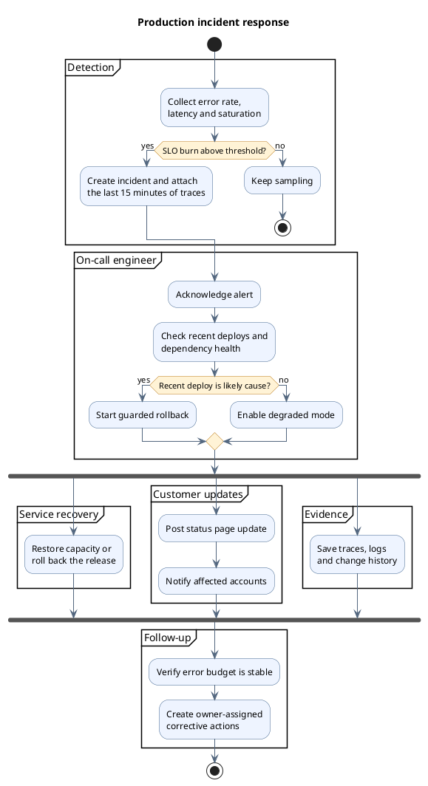

# PlantUML incident response

The activity diagram separates automated detection from the on-call workflow, shows decision
paths, and joins independent recovery actions before the service is closed.

