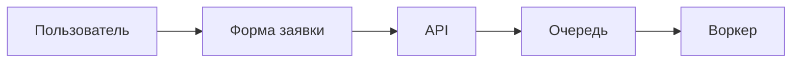
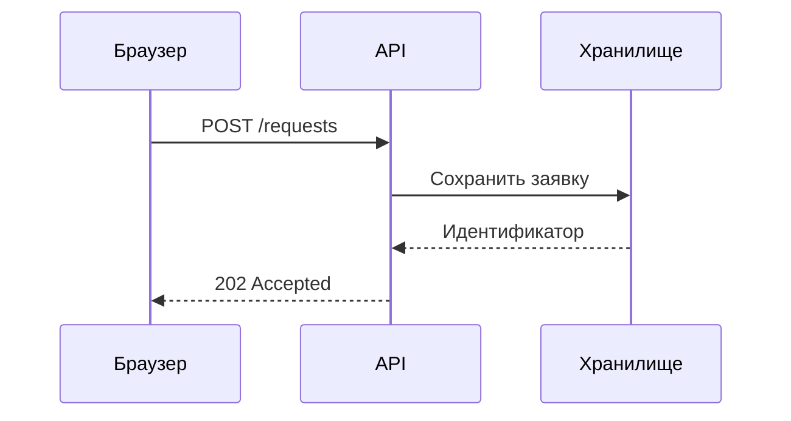
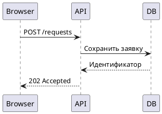

# Blueprint: обработка заявки

Небольшой пример документа с обычным Markdown, таблицей, Mermaid, PlantUML и Wiremark. Все диаграммы
рендерятся в SVG во время сборки и встраиваются в HTML.

## Компоненты

| Компонент  | Ответственность                     | Вход                 |
| ---------- | ----------------------------------- | -------------------- |
| Веб-клиент | Заполняет и отправляет заявку       | Данные формы         |
| API        | Проверяет запрос и сохраняет заявку | HTTP                 |
| Очередь    | Передаёт заявку на обработку        | Идентификатор заявки |

Перед отправкой клиент проверяет обязательные поля:

- [x] Заголовок и описание заполнены
- [x] Пользователь подтвердил отправку
- [ ] Воркер обработал заявку

## Поток обработки



## Обмен с API



## Экран отправки

```wireframe
Wireframe #request mobile
  Stack column gap=2 padding=2
    Typography h4 "Новая заявка"
    TextField "Заголовок"
    TextField "Описание"
    Button "Отправить" contained to=#confirmation
```

## Обмен с API на PlantUML



## Пример запроса

```json
{
  "title": "Подключить новый источник",
  "description": "Добавить импорт CSV"
}
```
