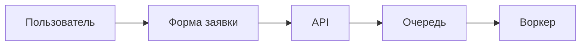
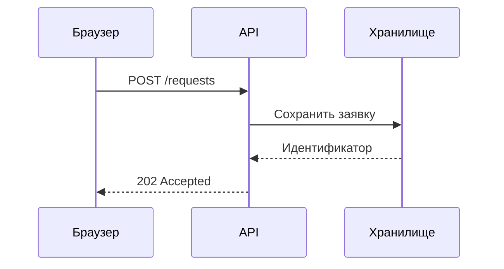
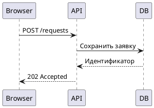

# Blueprint: обработка заявки

Небольшой пример документа с обычным Markdown, таблицей, Mermaid, PlantUML и Balsamiq. Все диаграммы
рендерятся в SVG во время сборки и встраиваются в HTML.

## Компоненты

| Компонент  | Ответственность                     | Вход                 |
| ---------- | ----------------------------------- | -------------------- |
| Веб-клиент | Заполняет и отправляет заявку       | Данные формы         |
| API        | Проверяет запрос и сохраняет заявку | HTTP                 |
| Очередь    | Передаёт заявку на обработку        | Идентификатор заявки |

Перед отправкой клиент проверяет обязательные поля:

- [x] Заголовок и описание заполнены
- [x] Пользователь подтвердил отправку
- [ ] Воркер обработал заявку

## Поток обработки



## Обмен с API



## Экран отправки

```balsamiq
{
  "mockup": {
    "measuredW": 376,
    "measuredH": 813,
    "controls": {
      "control": [
        {
          "ID": "control-1",
          "typeID": "Rectangle",
          "x": 0,
          "y": 0,
          "w": 375,
          "h": 812,
          "zOrder": 0,
          "properties": {
            "color": "#ffffff"
          }
        },
        {
          "ID": "control-2",
          "typeID": "Label",
          "x": 16,
          "y": 16,
          "w": 343,
          "h": 34,
          "zOrder": 1,
          "properties": {
            "text": "Новая заявка",
            "size": 22,
            "bold": true
          }
        },
        {
          "ID": "control-3",
          "typeID": "TextInput",
          "x": 16,
          "y": 66,
          "w": 343,
          "h": 36,
          "zOrder": 2,
          "properties": {
            "text": "Заголовок"
          }
        },
        {
          "ID": "control-4",
          "typeID": "TextInput",
          "x": 16,
          "y": 118,
          "w": 343,
          "h": 36,
          "zOrder": 3,
          "properties": {
            "text": "Описание"
          }
        },
        {
          "ID": "control-5",
          "typeID": "Button",
          "x": 16,
          "y": 170,
          "w": 106,
          "h": 38,
          "zOrder": 4,
          "properties": {
            "text": "Отправить",
            "bold": true
          }
        }
      ]
    }
  }
}
```

## Обмен с API на PlantUML



## Пример запроса

```json
{
  "title": "Подключить новый источник",
  "description": "Добавить импорт CSV"
}
```
