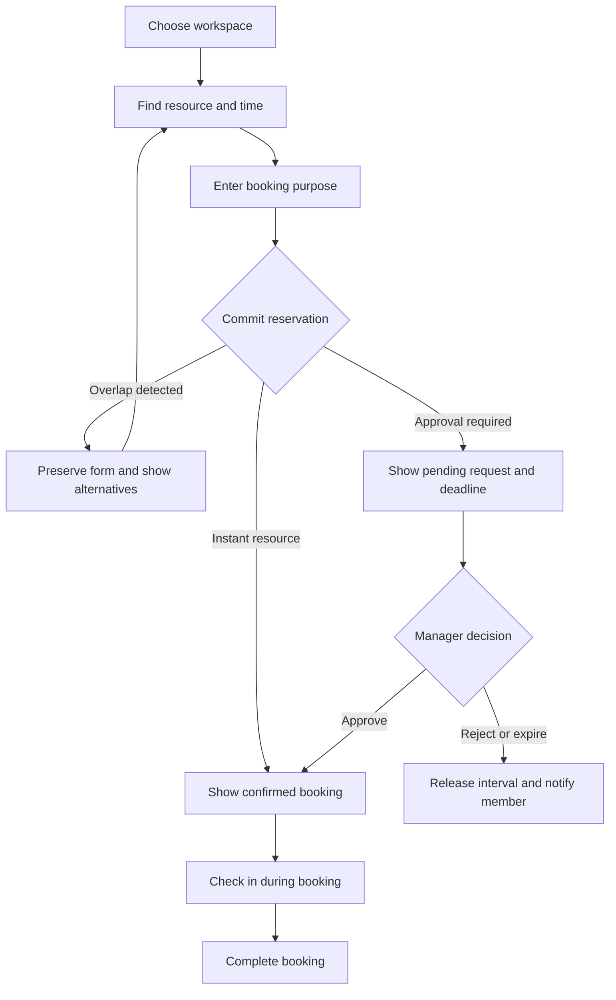
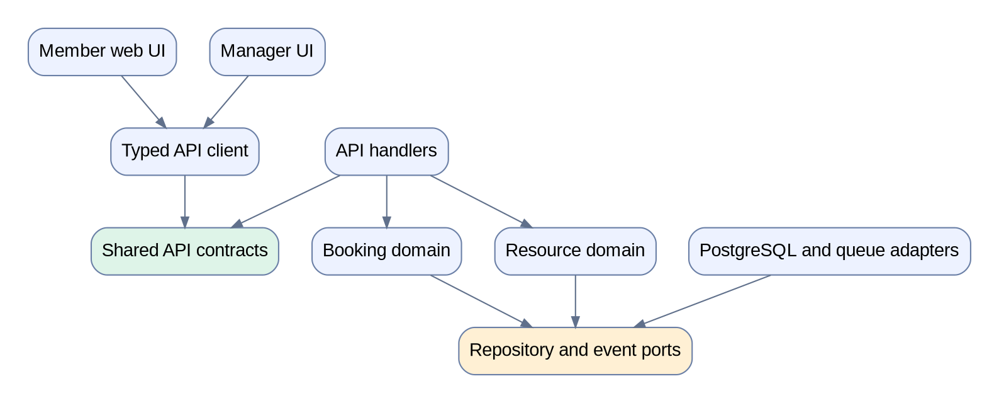
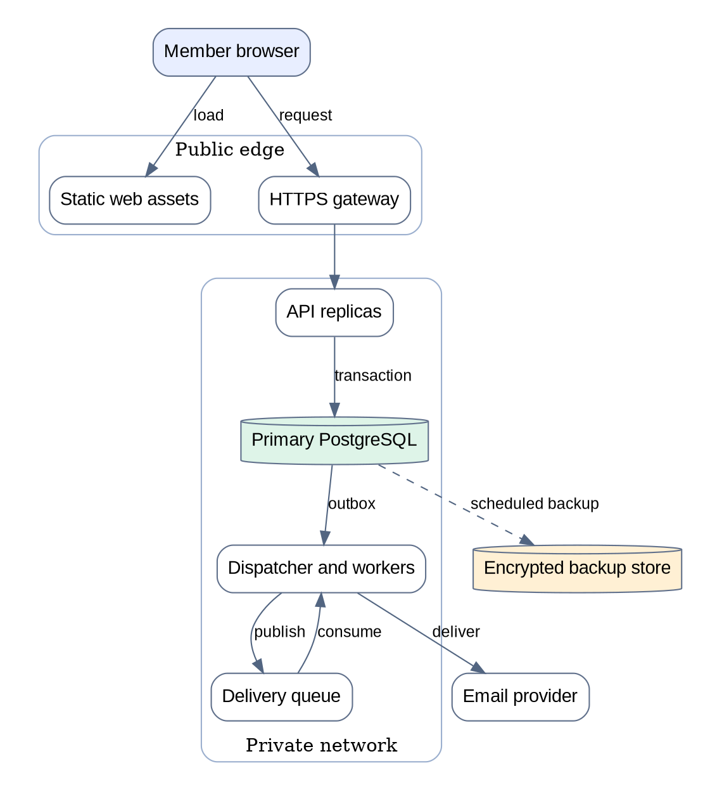
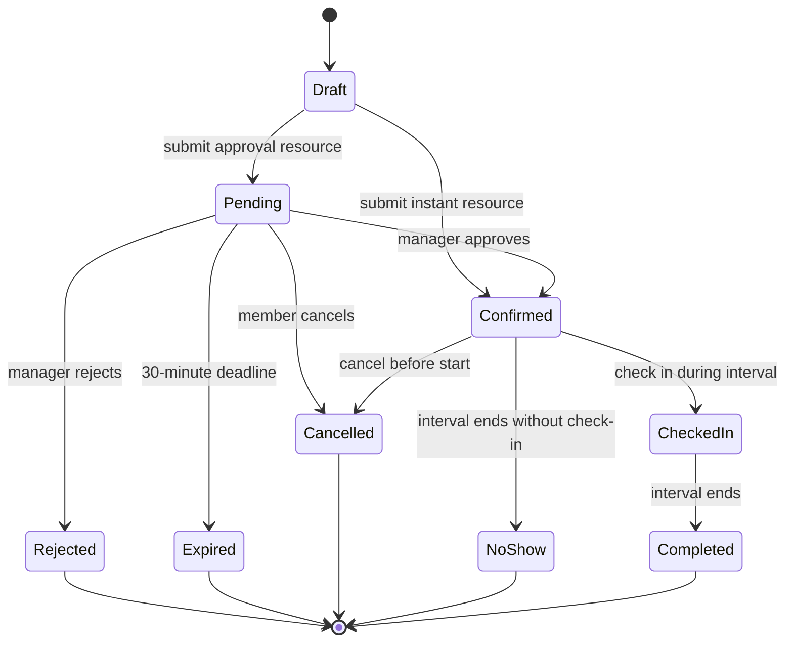
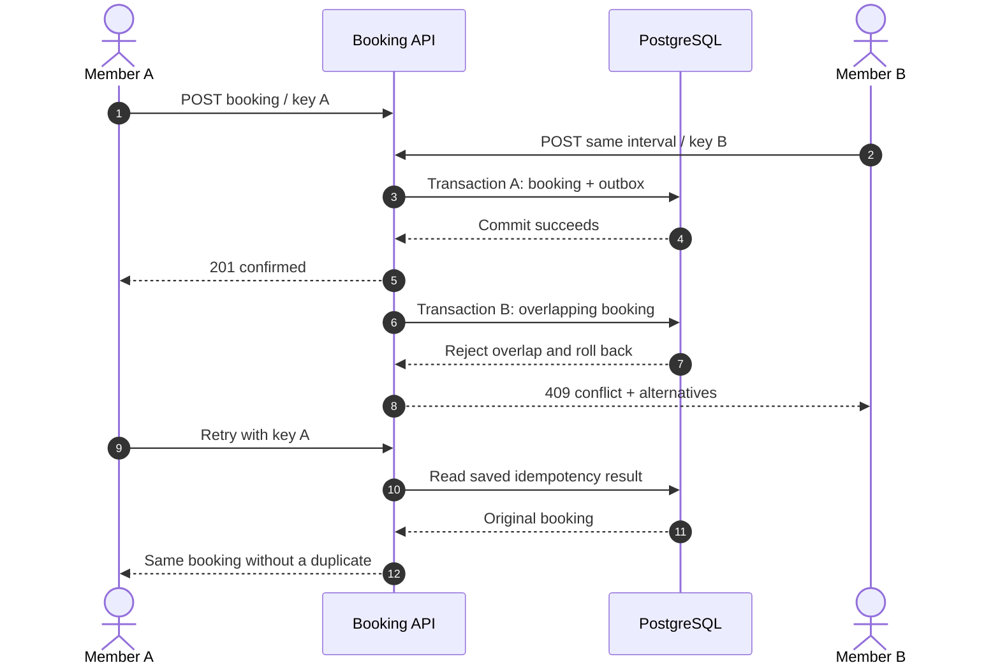
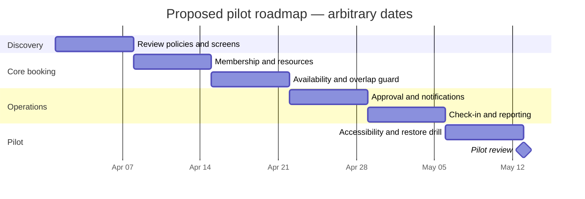
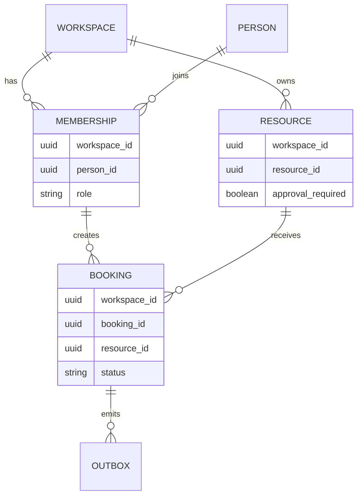
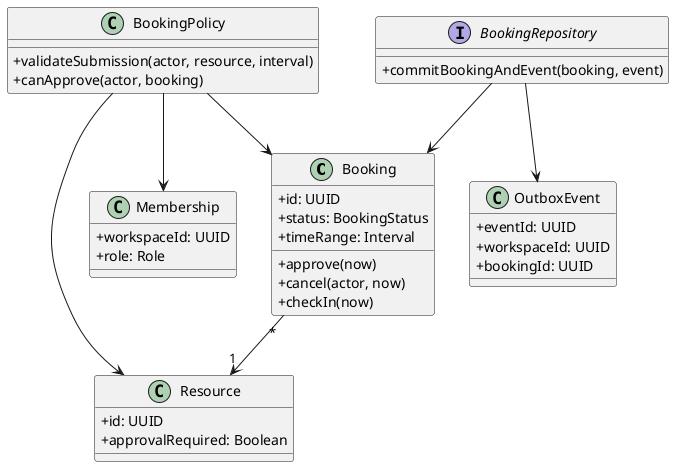
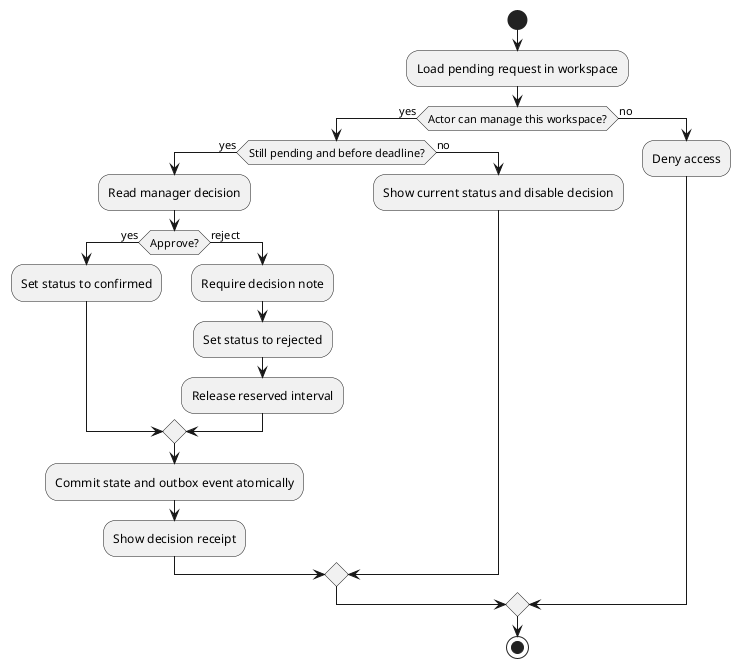
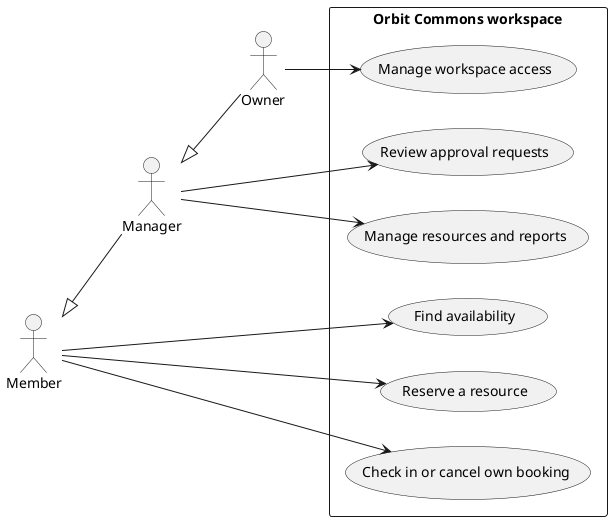

# Orbit Commons — Visual Product and Delivery Plan

**Status:** Fictional concept for review. No product implementation is implied.  
**Audience:** Product, design, engineering, operations, and pilot workspace managers.  
**Purpose:** Help people find, reserve, and use shared rooms, desks, and equipment.

All policies below are proposed assumptions. All names, dates, metrics, scores, and chart data are synthetic. Charts illustrate potential reporting views; they do not report measured product results. The roadmap uses an arbitrary start date.

## 1. Product frame

| Decision     | Proposed default                                                         | Review condition                                                  |
| ------------ | ------------------------------------------------------------------------ | ----------------------------------------------------------------- |
| Workspace    | One organization owns its resources and memberships.                     | Confirm with pilot managers.                                      |
| Roles        | Members book; managers approve; owners manage access.                    | Review the role matrix before development.                        |
| Reservation  | A booking covers one exclusive resource and a half-open time interval.   | Group bookings are a later candidate.                             |
| Availability | Pending, confirmed, and checked-in bookings block overlapping intervals. | Enforce this rule in the database.                                |
| Approval     | Selected equipment requires a manager decision within 30 minutes.        | Pending requests reserve the interval until a decision or expiry. |
| Confirmation | A booking succeeds only after the write transaction commits.             | A conflict preserves entered details and shows alternatives.      |
| Retry        | A submission carries a key scoped to workspace and member.               | Repeated submissions return the original result.                  |
| Time         | Store instants in UTC; show the workspace time zone.                     | The sample workspace displays Europe/London.                      |
| Attendance   | Check-in is allowed only during a confirmed booking.                     | An unvisited booking becomes a no-show at its end.                |
| Delivery     | Notifications use a transactional outbox and retries.                    | Delivery failure does not revoke a booking.                       |
| Scope        | Search, booking, approval, check-in, cancellation, and reports.          | Payments and recurring reservations are later candidates.         |

| Role    | Find availability | Own bookings                          | Approve requests | Manage resources | Manage access |
| ------- | ----------------- | ------------------------------------- | ---------------- | ---------------- | ------------- |
| Member  | Yes               | Create, check in, cancel before start | No               | No               | No            |
| Manager | Yes               | Yes                                   | Yes              | Yes              | No            |
| Owner   | Yes               | Yes                                   | Yes              | Yes              | Yes           |

## 2. Screen prototypes

Each block shows one screen or one state. Controls describe intended behavior; these static prototypes are not an interactive application. Screen formats vary to demonstrate three supported UI renderers.

### U01 — Find an available resource

Member desktop search. The selected resource has a clear reservation action and an explicit time zone.

```balsamiq
{
  "mockup": {
    "version": "1.0",
    "measuredW": "1120",
    "measuredH": "860",
    "controls": {
      "control": [
        {
          "ID": "brand",
          "typeID": "Title",
          "x": "32",
          "y": "24",
          "w": "400",
          "h": "32",
          "zOrder": "1",
          "properties": {
            "text": "Orbit Commons",
            "size": "20",
            "bold": "true"
          }
        },
        {
          "ID": "workspace",
          "typeID": "Label",
          "x": "840",
          "y": "26",
          "w": "170",
          "h": "28",
          "zOrder": "1",
          "properties": {
            "text": "North Hub",
            "align": "right"
          }
        },
        {
          "ID": "member",
          "typeID": "Rectangle",
          "x": "1032",
          "y": "20",
          "w": "56",
          "h": "40",
          "zOrder": "0",
          "properties": {
            "text": "AM"
          }
        },
        {
          "ID": "header-divider",
          "typeID": "Line",
          "x": "32",
          "y": "76",
          "w": "1056",
          "h": "0",
          "zOrder": "1",
          "properties": {}
        },
        {
          "ID": "sidebar",
          "typeID": "Rectangle",
          "x": "32",
          "y": "100",
          "w": "208",
          "h": "706",
          "zOrder": "0",
          "properties": {}
        },
        {
          "ID": "sidebar-title",
          "typeID": "Title",
          "x": "48",
          "y": "120",
          "w": "176",
          "h": "28",
          "zOrder": "1",
          "properties": {
            "text": "Workspace",
            "size": "18",
            "bold": "true"
          }
        },
        {
          "ID": "nav-search",
          "typeID": "Button",
          "x": "48",
          "y": "170",
          "w": "176",
          "h": "42",
          "zOrder": "1",
          "properties": {
            "text": "Find a space",
            "color": "#DBEAFE",
            "bold": "true"
          }
        },
        {
          "ID": "nav-bookings",
          "typeID": "Button",
          "x": "48",
          "y": "224",
          "w": "176",
          "h": "42",
          "zOrder": "1",
          "properties": {
            "text": "My bookings"
          }
        },
        {
          "ID": "nav-requests",
          "typeID": "Button",
          "x": "48",
          "y": "278",
          "w": "176",
          "h": "42",
          "zOrder": "1",
          "properties": {
            "text": "Requests"
          }
        },
        {
          "ID": "nav-reports",
          "typeID": "Button",
          "x": "48",
          "y": "332",
          "w": "176",
          "h": "42",
          "zOrder": "1",
          "properties": {
            "text": "Reports"
          }
        },
        {
          "ID": "sidebar-divider",
          "typeID": "Line",
          "x": "48",
          "y": "402",
          "w": "176",
          "h": "0",
          "zOrder": "1",
          "properties": {}
        },
        {
          "ID": "timezone-label",
          "typeID": "Label",
          "x": "48",
          "y": "420",
          "w": "176",
          "h": "24",
          "zOrder": "1",
          "properties": {
            "text": "Time zone",
            "size": "12"
          }
        },
        {
          "ID": "timezone",
          "typeID": "Label",
          "x": "48",
          "y": "452",
          "w": "176",
          "h": "24",
          "zOrder": "1",
          "properties": {
            "text": "Europe/London"
          }
        },
        {
          "ID": "title",
          "typeID": "Title",
          "x": "272",
          "y": "100",
          "w": "816",
          "h": "40",
          "zOrder": "1",
          "properties": {
            "text": "Find your next space",
            "size": "28",
            "bold": "true"
          }
        },
        {
          "ID": "date-context",
          "typeID": "Label",
          "x": "272",
          "y": "150",
          "w": "816",
          "h": "26",
          "zOrder": "1",
          "properties": {
            "text": "18 April 2030 · Times shown in Europe/London"
          }
        },
        {
          "ID": "date-label",
          "typeID": "Label",
          "x": "272",
          "y": "182",
          "w": "220",
          "h": "22",
          "zOrder": "1",
          "properties": {
            "text": "Date"
          }
        },
        {
          "ID": "date",
          "typeID": "TextInput",
          "x": "272",
          "y": "210",
          "w": "220",
          "h": "42",
          "zOrder": "1",
          "properties": {
            "text": "18 Apr 2030"
          }
        },
        {
          "ID": "from-label",
          "typeID": "Label",
          "x": "516",
          "y": "182",
          "w": "160",
          "h": "22",
          "zOrder": "1",
          "properties": {
            "text": "From"
          }
        },
        {
          "ID": "from",
          "typeID": "TextInput",
          "x": "516",
          "y": "210",
          "w": "160",
          "h": "42",
          "zOrder": "1",
          "properties": {
            "text": "10:00"
          }
        },
        {
          "ID": "until-label",
          "typeID": "Label",
          "x": "700",
          "y": "182",
          "w": "160",
          "h": "22",
          "zOrder": "1",
          "properties": {
            "text": "Until"
          }
        },
        {
          "ID": "until",
          "typeID": "TextInput",
          "x": "700",
          "y": "210",
          "w": "160",
          "h": "42",
          "zOrder": "1",
          "properties": {
            "text": "11:00"
          }
        },
        {
          "ID": "search",
          "typeID": "Button",
          "x": "884",
          "y": "210",
          "w": "204",
          "h": "42",
          "zOrder": "1",
          "properties": {
            "text": "Search",
            "color": "#DBEAFE",
            "bold": "true"
          }
        },
        {
          "ID": "filter-type",
          "typeID": "Button",
          "x": "272",
          "y": "274",
          "w": "152",
          "h": "36",
          "zOrder": "1",
          "properties": {
            "text": "All types"
          }
        },
        {
          "ID": "filter-location",
          "typeID": "Button",
          "x": "440",
          "y": "274",
          "w": "152",
          "h": "36",
          "zOrder": "1",
          "properties": {
            "text": "North Hub"
          }
        },
        {
          "ID": "filter-available",
          "typeID": "CheckBox",
          "x": "612",
          "y": "278",
          "w": "270",
          "h": "28",
          "zOrder": "1",
          "properties": {
            "text": "Available only",
            "checked": "true"
          }
        },
        {
          "ID": "availability",
          "typeID": "Rectangle",
          "x": "272",
          "y": "332",
          "w": "816",
          "h": "44",
          "zOrder": "0",
          "properties": {
            "text": "3 resources are available for your full time range.",
            "color": "#EFF6FF"
          }
        },
        {
          "ID": "resource-table",
          "typeID": "Rectangle",
          "x": "272",
          "y": "398",
          "w": "816",
          "h": "196",
          "zOrder": "0",
          "properties": {
            "color": "#FFFFFF"
          }
        },
        {
          "ID": "table-header",
          "typeID": "Rectangle",
          "x": "272",
          "y": "398",
          "w": "816",
          "h": "40",
          "zOrder": "0",
          "properties": {
            "color": "#E2E8F0"
          }
        },
        {
          "ID": "selected-row",
          "typeID": "Rectangle",
          "x": "272",
          "y": "438",
          "w": "816",
          "h": "52",
          "zOrder": "0",
          "properties": {
            "color": "#DBEAFE"
          }
        },
        {
          "ID": "header-0",
          "typeID": "Label",
          "x": "288",
          "y": "406",
          "w": "240",
          "h": "24",
          "zOrder": "1",
          "properties": {
            "text": "Resource",
            "bold": "true"
          }
        },
        {
          "ID": "header-1",
          "typeID": "Label",
          "x": "546",
          "y": "406",
          "w": "130",
          "h": "24",
          "zOrder": "1",
          "properties": {
            "text": "Capacity",
            "bold": "true"
          }
        },
        {
          "ID": "header-2",
          "typeID": "Label",
          "x": "702",
          "y": "406",
          "w": "210",
          "h": "24",
          "zOrder": "1",
          "properties": {
            "text": "Location",
            "bold": "true"
          }
        },
        {
          "ID": "header-3",
          "typeID": "Label",
          "x": "936",
          "y": "406",
          "w": "136",
          "h": "24",
          "zOrder": "1",
          "properties": {
            "text": "Approval",
            "bold": "true"
          }
        },
        {
          "ID": "cedar-0",
          "typeID": "Label",
          "x": "288",
          "y": "450",
          "w": "240",
          "h": "24",
          "zOrder": "1",
          "properties": {
            "text": "Cedar Room",
            "bold": "true"
          }
        },
        {
          "ID": "cedar-1",
          "typeID": "Label",
          "x": "546",
          "y": "450",
          "w": "130",
          "h": "24",
          "zOrder": "1",
          "properties": {
            "text": "6 people",
            "bold": "true"
          }
        },
        {
          "ID": "cedar-2",
          "typeID": "Label",
          "x": "702",
          "y": "450",
          "w": "210",
          "h": "24",
          "zOrder": "1",
          "properties": {
            "text": "Floor 2",
            "bold": "true"
          }
        },
        {
          "ID": "cedar-3",
          "typeID": "Label",
          "x": "936",
          "y": "450",
          "w": "136",
          "h": "24",
          "zOrder": "1",
          "properties": {
            "text": "Instant",
            "bold": "true"
          }
        },
        {
          "ID": "willow-0",
          "typeID": "Label",
          "x": "288",
          "y": "502",
          "w": "240",
          "h": "24",
          "zOrder": "1",
          "properties": {
            "text": "Willow Room"
          }
        },
        {
          "ID": "willow-1",
          "typeID": "Label",
          "x": "546",
          "y": "502",
          "w": "130",
          "h": "24",
          "zOrder": "1",
          "properties": {
            "text": "8 people"
          }
        },
        {
          "ID": "willow-2",
          "typeID": "Label",
          "x": "702",
          "y": "502",
          "w": "210",
          "h": "24",
          "zOrder": "1",
          "properties": {
            "text": "Floor 1"
          }
        },
        {
          "ID": "willow-3",
          "typeID": "Label",
          "x": "936",
          "y": "502",
          "w": "136",
          "h": "24",
          "zOrder": "1",
          "properties": {
            "text": "Instant"
          }
        },
        {
          "ID": "studio-0",
          "typeID": "Label",
          "x": "288",
          "y": "554",
          "w": "240",
          "h": "24",
          "zOrder": "1",
          "properties": {
            "text": "Studio Kit"
          }
        },
        {
          "ID": "studio-1",
          "typeID": "Label",
          "x": "546",
          "y": "554",
          "w": "130",
          "h": "24",
          "zOrder": "1",
          "properties": {
            "text": "1 kit"
          }
        },
        {
          "ID": "studio-2",
          "typeID": "Label",
          "x": "702",
          "y": "554",
          "w": "210",
          "h": "24",
          "zOrder": "1",
          "properties": {
            "text": "Equipment desk"
          }
        },
        {
          "ID": "studio-3",
          "typeID": "Label",
          "x": "936",
          "y": "554",
          "w": "136",
          "h": "24",
          "zOrder": "1",
          "properties": {
            "text": "Manager"
          }
        },
        {
          "ID": "row-divider-1",
          "typeID": "Line",
          "x": "272",
          "y": "490",
          "w": "816",
          "h": "0",
          "zOrder": "1",
          "properties": {}
        },
        {
          "ID": "row-divider-2",
          "typeID": "Line",
          "x": "272",
          "y": "542",
          "w": "816",
          "h": "0",
          "zOrder": "1",
          "properties": {}
        },
        {
          "ID": "selected-resource",
          "typeID": "Rectangle",
          "x": "272",
          "y": "618",
          "w": "816",
          "h": "164",
          "zOrder": "0",
          "properties": {}
        },
        {
          "ID": "selected-name",
          "typeID": "Title",
          "x": "292",
          "y": "634",
          "w": "450",
          "h": "28",
          "zOrder": "1",
          "properties": {
            "text": "Cedar Room",
            "size": "20",
            "bold": "true"
          }
        },
        {
          "ID": "selected-features",
          "typeID": "Label",
          "x": "292",
          "y": "672",
          "w": "760",
          "h": "24",
          "zOrder": "1",
          "properties": {
            "text": "Screen, whiteboard, and video call equipment"
          }
        },
        {
          "ID": "selected-time",
          "typeID": "Label",
          "x": "292",
          "y": "714",
          "w": "470",
          "h": "24",
          "zOrder": "1",
          "properties": {
            "text": "18 Apr · 10:00–11:00 · 6 people"
          }
        },
        {
          "ID": "reserve",
          "typeID": "Button",
          "x": "792",
          "y": "714",
          "w": "276",
          "h": "44",
          "zOrder": "1",
          "properties": {
            "text": "Reserve Cedar Room",
            "color": "#DBEAFE",
            "bold": "true"
          }
        },
        {
          "ID": "footer",
          "typeID": "Label",
          "x": "272",
          "y": "804",
          "w": "816",
          "h": "24",
          "zOrder": "1",
          "properties": {
            "text": "Availability is checked again when you reserve.",
            "size": "12"
          }
        }
      ]
    }
  }
}
```

### U02 — First booking: empty state

A first-time member receives a useful next step, a secondary browse action, and an explanation of what will appear here.

```balsamiq
{
  "mockup": {
    "version": "1.0",
    "measuredW": "860",
    "measuredH": "590",
    "controls": {
      "control": [
        {
          "ID": "brand",
          "typeID": "Title",
          "x": "32",
          "y": "26",
          "w": "340",
          "h": "28",
          "zOrder": "1",
          "properties": {
            "text": "Orbit Commons",
            "size": "20",
            "bold": "true"
          }
        },
        {
          "ID": "section",
          "typeID": "Label",
          "x": "650",
          "y": "26",
          "w": "178",
          "h": "28",
          "zOrder": "1",
          "properties": {
            "text": "My bookings",
            "align": "right"
          }
        },
        {
          "ID": "header-divider",
          "typeID": "Line",
          "x": "32",
          "y": "78",
          "w": "796",
          "h": "0",
          "zOrder": "1",
          "properties": {}
        },
        {
          "ID": "title",
          "typeID": "Title",
          "x": "32",
          "y": "110",
          "w": "796",
          "h": "40",
          "zOrder": "1",
          "properties": {
            "text": "Make room for your next idea",
            "size": "28",
            "bold": "true"
          }
        },
        {
          "ID": "empty-message",
          "typeID": "Label",
          "x": "32",
          "y": "164",
          "w": "796",
          "h": "26",
          "zOrder": "1",
          "properties": {
            "text": "You do not have any upcoming bookings."
          }
        },
        {
          "ID": "getting-started",
          "typeID": "Rectangle",
          "x": "32",
          "y": "218",
          "w": "796",
          "h": "208",
          "zOrder": "0",
          "properties": {}
        },
        {
          "ID": "card-title",
          "typeID": "Title",
          "x": "56",
          "y": "240",
          "w": "748",
          "h": "30",
          "zOrder": "1",
          "properties": {
            "text": "Start with a resource and a time",
            "size": "20",
            "bold": "true"
          }
        },
        {
          "ID": "card-description",
          "typeID": "Label",
          "x": "56",
          "y": "286",
          "w": "748",
          "h": "26",
          "zOrder": "1",
          "properties": {
            "text": "Search rooms, desks, and equipment in North Hub."
          }
        },
        {
          "ID": "find",
          "typeID": "Button",
          "x": "56",
          "y": "346",
          "w": "220",
          "h": "44",
          "zOrder": "1",
          "properties": {
            "text": "Find a resource",
            "color": "#DBEAFE",
            "bold": "true"
          }
        },
        {
          "ID": "browse",
          "typeID": "Button",
          "x": "296",
          "y": "346",
          "w": "220",
          "h": "44",
          "zOrder": "1",
          "properties": {
            "text": "Browse all resources",
            "color": "#FFFFFF"
          }
        },
        {
          "ID": "booking-guidance",
          "typeID": "Rectangle",
          "x": "32",
          "y": "454",
          "w": "796",
          "h": "52",
          "zOrder": "0",
          "properties": {
            "text": "Your confirmed bookings and approval requests will appear here.",
            "color": "#EFF6FF"
          }
        },
        {
          "ID": "footer",
          "typeID": "Label",
          "x": "32",
          "y": "538",
          "w": "796",
          "h": "24",
          "zOrder": "1",
          "properties": {
            "text": "Times are shown in Europe/London.",
            "size": "12"
          }
        }
      ]
    }
  }
}
```

### U03 — Booking conflict: recover without retyping

The conflict state preserves input, disables the stale action, and offers two concrete recovery paths.

```balsamiq
{
  "mockup": {
    "version": "1.0",
    "measuredW": "940",
    "measuredH": "780",
    "controls": {
      "control": [
        {
          "ID": "brand",
          "typeID": "Title",
          "x": "32",
          "y": "24",
          "w": "400",
          "h": "32",
          "zOrder": "1",
          "properties": {
            "text": "Orbit Commons",
            "size": "20",
            "bold": "true"
          }
        },
        {
          "ID": "section",
          "typeID": "Label",
          "x": "688",
          "y": "26",
          "w": "220",
          "h": "28",
          "zOrder": "1",
          "properties": {
            "text": "Review booking",
            "align": "right"
          }
        },
        {
          "ID": "title",
          "typeID": "Title",
          "x": "32",
          "y": "88",
          "w": "876",
          "h": "40",
          "zOrder": "1",
          "properties": {
            "text": "Choose another available slot",
            "size": "28",
            "bold": "true"
          }
        },
        {
          "ID": "conflict-alert",
          "typeID": "Rectangle",
          "x": "32",
          "y": "150",
          "w": "876",
          "h": "54",
          "zOrder": "0",
          "properties": {
            "text": "Cedar Room was booked by another member. Your details are saved.",
            "color": "#FEE2E2"
          }
        },
        {
          "ID": "saved-details",
          "typeID": "Rectangle",
          "x": "32",
          "y": "232",
          "w": "410",
          "h": "472",
          "zOrder": "0",
          "properties": {}
        },
        {
          "ID": "details-title",
          "typeID": "Title",
          "x": "52",
          "y": "250",
          "w": "370",
          "h": "30",
          "zOrder": "1",
          "properties": {
            "text": "Your booking details",
            "size": "20",
            "bold": "true"
          }
        },
        {
          "ID": "purpose-label",
          "typeID": "Label",
          "x": "52",
          "y": "298",
          "w": "370",
          "h": "22",
          "zOrder": "1",
          "properties": {
            "text": "Purpose"
          }
        },
        {
          "ID": "purpose",
          "typeID": "TextInput",
          "x": "52",
          "y": "326",
          "w": "370",
          "h": "42",
          "zOrder": "1",
          "properties": {
            "text": "Design workshop"
          }
        },
        {
          "ID": "date-label",
          "typeID": "Label",
          "x": "52",
          "y": "382",
          "w": "370",
          "h": "22",
          "zOrder": "1",
          "properties": {
            "text": "Date"
          }
        },
        {
          "ID": "date",
          "typeID": "TextInput",
          "x": "52",
          "y": "410",
          "w": "370",
          "h": "42",
          "zOrder": "1",
          "properties": {
            "text": "18 Apr 2030"
          }
        },
        {
          "ID": "from-label",
          "typeID": "Label",
          "x": "52",
          "y": "466",
          "w": "174",
          "h": "22",
          "zOrder": "1",
          "properties": {
            "text": "From"
          }
        },
        {
          "ID": "from",
          "typeID": "TextInput",
          "x": "52",
          "y": "494",
          "w": "174",
          "h": "42",
          "zOrder": "1",
          "properties": {
            "text": "10:00"
          }
        },
        {
          "ID": "until-label",
          "typeID": "Label",
          "x": "248",
          "y": "466",
          "w": "174",
          "h": "22",
          "zOrder": "1",
          "properties": {
            "text": "Until"
          }
        },
        {
          "ID": "until",
          "typeID": "TextInput",
          "x": "248",
          "y": "494",
          "w": "174",
          "h": "42",
          "zOrder": "1",
          "properties": {
            "text": "11:00"
          }
        },
        {
          "ID": "resource",
          "typeID": "Label",
          "x": "52",
          "y": "552",
          "w": "370",
          "h": "26",
          "zOrder": "1",
          "properties": {
            "text": "Resource: Cedar Room · 6 people"
          }
        },
        {
          "ID": "timezone",
          "typeID": "Label",
          "x": "52",
          "y": "586",
          "w": "370",
          "h": "24",
          "zOrder": "1",
          "properties": {
            "text": "Time zone: Europe/London",
            "size": "12"
          }
        },
        {
          "ID": "confirm-disabled",
          "typeID": "Rectangle",
          "x": "52",
          "y": "630",
          "w": "370",
          "h": "44",
          "zOrder": "0",
          "properties": {
            "text": "Confirm original slot (disabled)",
            "color": "#E5E7EB"
          }
        },
        {
          "ID": "alternatives-title",
          "typeID": "Title",
          "x": "466",
          "y": "232",
          "w": "442",
          "h": "30",
          "zOrder": "1",
          "properties": {
            "text": "Available alternatives",
            "size": "20",
            "bold": "true"
          }
        },
        {
          "ID": "alternative-willow",
          "typeID": "Rectangle",
          "x": "466",
          "y": "282",
          "w": "442",
          "h": "154",
          "zOrder": "0",
          "properties": {}
        },
        {
          "ID": "willow-name",
          "typeID": "Title",
          "x": "486",
          "y": "300",
          "w": "402",
          "h": "28",
          "zOrder": "1",
          "properties": {
            "text": "Willow Room",
            "size": "20",
            "bold": "true"
          }
        },
        {
          "ID": "willow-details",
          "typeID": "Label",
          "x": "486",
          "y": "340",
          "w": "402",
          "h": "24",
          "zOrder": "1",
          "properties": {
            "text": "Same time · 10:00–11:00 · 8 people"
          }
        },
        {
          "ID": "choose-willow",
          "typeID": "Button",
          "x": "486",
          "y": "382",
          "w": "402",
          "h": "36",
          "zOrder": "1",
          "properties": {
            "text": "Choose Willow",
            "color": "#DBEAFE",
            "bold": "true"
          }
        },
        {
          "ID": "alternative-cedar",
          "typeID": "Rectangle",
          "x": "466",
          "y": "460",
          "w": "442",
          "h": "154",
          "zOrder": "0",
          "properties": {}
        },
        {
          "ID": "cedar-name",
          "typeID": "Title",
          "x": "486",
          "y": "478",
          "w": "402",
          "h": "28",
          "zOrder": "1",
          "properties": {
            "text": "Cedar Room",
            "size": "20",
            "bold": "true"
          }
        },
        {
          "ID": "cedar-details",
          "typeID": "Label",
          "x": "486",
          "y": "518",
          "w": "402",
          "h": "24",
          "zOrder": "1",
          "properties": {
            "text": "Later today · 11:00–12:00 · 6 people"
          }
        },
        {
          "ID": "choose-later",
          "typeID": "Button",
          "x": "486",
          "y": "560",
          "w": "402",
          "h": "36",
          "zOrder": "1",
          "properties": {
            "text": "Choose later slot",
            "color": "#FFFFFF"
          }
        },
        {
          "ID": "change-search",
          "typeID": "Button",
          "x": "466",
          "y": "644",
          "w": "200",
          "h": "44",
          "zOrder": "1",
          "properties": {
            "text": "Change search",
            "color": "#FFFFFF"
          }
        },
        {
          "ID": "footer",
          "typeID": "Label",
          "x": "32",
          "y": "730",
          "w": "876",
          "h": "24",
          "zOrder": "1",
          "properties": {
            "text": "An alternative is reserved only after you confirm it.",
            "size": "12"
          }
        }
      ]
    }
  }
}
```

### U04 — Resource editor

Manager desktop editor. Approval is a visible resource policy; the form exposes the reservation effect of pending requests.

```balsamiq
{
  "mockup": {
    "version": "1.0",
    "measuredW": "840",
    "measuredH": "652",
    "controls": {
      "control": [
        {
          "ID": "title",
          "typeID": "Title",
          "x": "32",
          "y": "26",
          "w": "720",
          "h": "38",
          "zOrder": "1",
          "properties": {
            "text": "Edit resource",
            "size": "26",
            "bold": "true"
          }
        },
        {
          "ID": "sub",
          "typeID": "Label",
          "x": "32",
          "y": "78",
          "w": "760",
          "h": "26",
          "zOrder": "1",
          "properties": {
            "text": "North Hub / Equipment / Studio Kit"
          }
        },
        {
          "ID": "name-label",
          "typeID": "Label",
          "x": "32",
          "y": "126",
          "w": "340",
          "h": "22",
          "zOrder": "1",
          "properties": {
            "text": "Resource name"
          }
        },
        {
          "ID": "name",
          "typeID": "TextInput",
          "x": "32",
          "y": "154",
          "w": "356",
          "h": "42",
          "zOrder": "1",
          "properties": {
            "text": "Studio Kit"
          }
        },
        {
          "ID": "kind-label",
          "typeID": "Label",
          "x": "432",
          "y": "126",
          "w": "340",
          "h": "22",
          "zOrder": "1",
          "properties": {
            "text": "Type"
          }
        },
        {
          "ID": "kind",
          "typeID": "ComboBox",
          "x": "432",
          "y": "154",
          "w": "356",
          "h": "42",
          "zOrder": "1",
          "properties": {
            "text": "Equipment"
          }
        },
        {
          "ID": "location-label",
          "typeID": "Label",
          "x": "32",
          "y": "222",
          "w": "340",
          "h": "22",
          "zOrder": "1",
          "properties": {
            "text": "Location"
          }
        },
        {
          "ID": "location",
          "typeID": "TextInput",
          "x": "32",
          "y": "250",
          "w": "356",
          "h": "42",
          "zOrder": "1",
          "properties": {
            "text": "Equipment desk, Floor 1"
          }
        },
        {
          "ID": "capacity-label",
          "typeID": "Label",
          "x": "432",
          "y": "222",
          "w": "340",
          "h": "22",
          "zOrder": "1",
          "properties": {
            "text": "Capacity"
          }
        },
        {
          "ID": "capacity",
          "typeID": "TextInput",
          "x": "432",
          "y": "250",
          "w": "356",
          "h": "42",
          "zOrder": "1",
          "properties": {
            "text": "1 exclusive kit"
          }
        },
        {
          "ID": "notes-label",
          "typeID": "Label",
          "x": "32",
          "y": "320",
          "w": "720",
          "h": "22",
          "zOrder": "1",
          "properties": {
            "text": "Instructions for members"
          }
        },
        {
          "ID": "notes",
          "typeID": "TextArea",
          "x": "32",
          "y": "350",
          "w": "756",
          "h": "78",
          "zOrder": "1",
          "properties": {
            "text": "Collect the kit from the equipment desk.\nReturn all cables after use."
          }
        },
        {
          "ID": "approval",
          "typeID": "CheckBox",
          "x": "32",
          "y": "452",
          "w": "700",
          "h": "28",
          "zOrder": "1",
          "properties": {
            "text": "Require manager approval",
            "checked": "true"
          }
        },
        {
          "ID": "expiry",
          "typeID": "Label",
          "x": "32",
          "y": "492",
          "w": "750",
          "h": "24",
          "zOrder": "1",
          "properties": {
            "text": "Pending requests reserve the slot for up to 30 minutes."
          }
        },
        {
          "ID": "line",
          "typeID": "Line",
          "x": "32",
          "y": "538",
          "w": "756",
          "h": "0",
          "zOrder": "1",
          "properties": {
            "text": ""
          }
        },
        {
          "ID": "cancel",
          "typeID": "Button",
          "x": "474",
          "y": "568",
          "w": "140",
          "h": "44",
          "zOrder": "1",
          "properties": {
            "text": "Cancel"
          }
        },
        {
          "ID": "save",
          "typeID": "Button",
          "x": "634",
          "y": "568",
          "w": "154",
          "h": "44",
          "zOrder": "1",
          "properties": {
            "text": "Save resource"
          }
        }
      ]
    }
  }
}
```

### U05 — Manager approval review

A manager can inspect the purpose, see the expiry time, and submit an explicit approval or rejection.

```balsamiq
{
  "mockup": {
    "version": "1.0",
    "measuredW": "780",
    "measuredH": "596",
    "controls": {
      "control": [
        {
          "ID": "title",
          "typeID": "Title",
          "x": "32",
          "y": "24",
          "w": "700",
          "h": "36",
          "zOrder": "1",
          "properties": {
            "text": "Review equipment request",
            "size": "25",
            "bold": "true"
          }
        },
        {
          "ID": "status",
          "typeID": "Label",
          "x": "32",
          "y": "82",
          "w": "680",
          "h": "25",
          "zOrder": "1",
          "properties": {
            "text": "Pending approval · Expires at 09:35 Europe/London"
          }
        },
        {
          "ID": "line",
          "typeID": "Line",
          "x": "32",
          "y": "124",
          "w": "696",
          "h": "0",
          "zOrder": "1",
          "properties": {
            "text": ""
          }
        },
        {
          "ID": "who",
          "typeID": "SubTitle",
          "x": "32",
          "y": "150",
          "w": "680",
          "h": "30",
          "zOrder": "1",
          "properties": {
            "text": "Alex Morgan · Studio Kit"
          }
        },
        {
          "ID": "when",
          "typeID": "Label",
          "x": "32",
          "y": "196",
          "w": "680",
          "h": "26",
          "zOrder": "1",
          "properties": {
            "text": "18 Apr 2030 · 10:00–11:00 · North Hub"
          }
        },
        {
          "ID": "why",
          "typeID": "Paragraph",
          "x": "32",
          "y": "242",
          "w": "680",
          "h": "66",
          "zOrder": "1",
          "properties": {
            "text": "Purpose: Record the team product demo.\nThe requested interval is reserved while this request is pending."
          }
        },
        {
          "ID": "note-label",
          "typeID": "Label",
          "x": "32",
          "y": "336",
          "w": "680",
          "h": "24",
          "zOrder": "1",
          "properties": {
            "text": "Decision note (required for rejection)"
          }
        },
        {
          "ID": "note",
          "typeID": "TextInput",
          "x": "32",
          "y": "368",
          "w": "696",
          "h": "42",
          "zOrder": "1",
          "properties": {
            "text": "Equipment safety briefing completed."
          }
        },
        {
          "ID": "reject",
          "typeID": "Button",
          "x": "348",
          "y": "454",
          "w": "174",
          "h": "46",
          "zOrder": "1",
          "properties": {
            "text": "Reject request"
          }
        },
        {
          "ID": "approve",
          "typeID": "Button",
          "x": "542",
          "y": "454",
          "w": "186",
          "h": "46",
          "zOrder": "1",
          "properties": {
            "text": "Approve booking"
          }
        },
        {
          "ID": "footer",
          "typeID": "Label",
          "x": "32",
          "y": "534",
          "w": "696",
          "h": "24",
          "zOrder": "1",
          "properties": {
            "text": "The decision is applied only if the request is still pending."
          }
        }
      ]
    }
  }
}
```

### U06 — Mobile booking details before start

Mobile detail screen. Status, place, time, purpose, and cancellation are visible. Check-in is disabled before the booking starts.

```pencil
{
  "version": "2.21",
  "children": [
    {
      "id": "booking-mobile",
      "type": "frame",
      "x": 0,
      "y": 0,
      "width": 390,
      "height": 760,
      "layout": "none",
      "clip": true,
      "cornerRadius": 24,
      "fill": "#F3F6FC",
      "stroke": "#BFCADD",
      "strokeWidth": 1,
      "children": [
        {
          "id": "brand",
          "type": "text",
          "x": 24,
          "y": 26,
          "width": 342,
          "height": 30,
          "content": "ORBIT COMMONS",
          "textGrowth": "fixed-width",
          "fontFamily": "Arial",
          "fontSize": 14,
          "fontWeight": 700,
          "textAlign": "left",
          "fill": "#465777"
        },
        {
          "id": "title",
          "type": "text",
          "x": 24,
          "y": 80,
          "width": 342,
          "height": 44,
          "content": "Your booking",
          "textGrowth": "fixed-width",
          "fontFamily": "Arial",
          "fontSize": 28,
          "fontWeight": 700,
          "textAlign": "left",
          "fill": "#17233D"
        },
        {
          "id": "status-bg",
          "type": "rectangle",
          "x": 24,
          "y": 140,
          "width": 128,
          "height": 30,
          "fill": "#DDF4E8",
          "cornerRadius": 15
        },
        {
          "id": "status",
          "type": "text",
          "x": 34,
          "y": 144,
          "width": 108,
          "height": 24,
          "content": "CONFIRMED",
          "textGrowth": "fixed-width",
          "fontFamily": "Arial",
          "fontSize": 12,
          "fontWeight": 700,
          "textAlign": "center",
          "fill": "#19633E"
        },
        {
          "id": "details",
          "type": "rectangle",
          "x": 24,
          "y": 194,
          "width": 342,
          "height": 236,
          "fill": "#FFFFFF",
          "cornerRadius": 12
        },
        {
          "id": "resource",
          "type": "text",
          "x": 44,
          "y": 216,
          "width": 302,
          "height": 36,
          "content": "Cedar Room",
          "textGrowth": "fixed-width",
          "fontFamily": "Arial",
          "fontSize": 23,
          "fontWeight": 700,
          "textAlign": "left",
          "fill": "#17233D"
        },
        {
          "id": "when",
          "type": "text",
          "x": 44,
          "y": 266,
          "width": 302,
          "height": 28,
          "content": "18 April 2030",
          "textGrowth": "fixed-width",
          "fontFamily": "Arial",
          "fontSize": 17,
          "fontWeight": 400,
          "textAlign": "left",
          "fill": "#17233D"
        },
        {
          "id": "time",
          "type": "text",
          "x": 44,
          "y": 304,
          "width": 302,
          "height": 28,
          "content": "10:00–11:00",
          "textGrowth": "fixed-width",
          "fontFamily": "Arial",
          "fontSize": 22,
          "fontWeight": 700,
          "textAlign": "left",
          "fill": "#17233D"
        },
        {
          "id": "tz",
          "type": "text",
          "x": 44,
          "y": 342,
          "width": 302,
          "height": 24,
          "content": "Europe/London · Floor 2",
          "textGrowth": "fixed-width",
          "fontFamily": "Arial",
          "fontSize": 14,
          "fontWeight": 400,
          "textAlign": "left",
          "fill": "#465777"
        },
        {
          "id": "purpose",
          "type": "text",
          "x": 44,
          "y": 380,
          "width": 302,
          "height": 26,
          "content": "Design workshop · 6 people",
          "textGrowth": "fixed-width",
          "fontFamily": "Arial",
          "fontSize": 14,
          "fontWeight": 400,
          "textAlign": "left",
          "fill": "#465777"
        },
        {
          "id": "info",
          "type": "rectangle",
          "x": 24,
          "y": 454,
          "width": 342,
          "height": 78,
          "fill": "#E7EEFF",
          "cornerRadius": 12
        },
        {
          "id": "checkin-help",
          "type": "text",
          "x": 40,
          "y": 470,
          "width": 310,
          "height": 48,
          "content": "Check in during your booking.\nThe button is ready at 10:00.",
          "textGrowth": "fixed-width",
          "fontFamily": "Arial",
          "fontSize": 14,
          "fontWeight": 400,
          "textAlign": "left",
          "fill": "#29437C"
        },
        {
          "id": "checkin-button",
          "type": "rectangle",
          "x": 24,
          "y": 556,
          "width": 342,
          "height": 52,
          "fill": "#D9DFE9",
          "cornerRadius": 12
        },
        {
          "id": "checkin-label",
          "type": "text",
          "x": 36,
          "y": 571,
          "width": 318,
          "height": 26,
          "content": "Check in · available at 10:00",
          "textGrowth": "fixed-width",
          "fontFamily": "Arial",
          "fontSize": 15,
          "fontWeight": 700,
          "textAlign": "center",
          "fill": "#56637A"
        },
        {
          "id": "cancel-button",
          "type": "rectangle",
          "x": 24,
          "y": 624,
          "width": 342,
          "height": 48,
          "fill": "#FFFFFF",
          "cornerRadius": 12
        },
        {
          "id": "cancel-label",
          "type": "text",
          "x": 36,
          "y": 638,
          "width": 318,
          "height": 26,
          "content": "Cancel booking",
          "textGrowth": "fixed-width",
          "fontFamily": "Arial",
          "fontSize": 16,
          "fontWeight": 600,
          "textAlign": "center",
          "fill": "#A42B3C"
        },
        {
          "id": "footer",
          "type": "text",
          "x": 24,
          "y": 704,
          "width": 342,
          "height": 24,
          "content": "Booking OC-1042 · Last updated 09:06",
          "textGrowth": "fixed-width",
          "fontFamily": "Arial",
          "fontSize": 12,
          "fontWeight": 400,
          "textAlign": "left",
          "fill": "#465777"
        }
      ]
    }
  ]
}
```

### U07 — Instant booking confirmation

Detailed confirmation state. A committed reservation is visibly confirmed; the next action opens its details.

```figma node=10:1
{
  "name": "Orbit Commons / confirmed",
  "document": {
    "id": "0:0",
    "name": "Document",
    "type": "DOCUMENT",
    "children": [
      {
        "id": "1:1",
        "name": "Booking results",
        "type": "CANVAS",
        "children": [
          {
            "id": "10:1",
            "name": "10:1",
            "type": "FRAME",
            "absoluteBoundingBox": {
              "x": 0,
              "y": 0,
              "width": 760,
              "height": 616
            },
            "fills": [
              {
                "type": "SOLID",
                "color": {
                  "r": 1.0,
                  "g": 1.0,
                  "b": 1.0,
                  "a": 1
                }
              }
            ],
            "cornerRadius": 16,
            "clipsContent": true,
            "children": [
              {
                "id": "confirmed-top",
                "name": "confirmed-top",
                "type": "RECTANGLE",
                "absoluteBoundingBox": {
                  "x": 0,
                  "y": 0,
                  "width": 760,
                  "height": 68
                },
                "fills": [
                  {
                    "type": "SOLID",
                    "color": {
                      "r": 0.09019607843137255,
                      "g": 0.13725490196078433,
                      "b": 0.23921568627450981,
                      "a": 1
                    }
                  }
                ]
              },
              {
                "id": "confirmed-brand",
                "name": "confirmed-brand",
                "type": "TEXT",
                "absoluteBoundingBox": {
                  "x": 30,
                  "y": 23,
                  "width": 400,
                  "height": 26
                },
                "fills": [
                  {
                    "type": "SOLID",
                    "color": {
                      "r": 1.0,
                      "g": 1.0,
                      "b": 1.0,
                      "a": 1
                    }
                  }
                ],
                "characters": "ORBIT COMMONS / NORTH HUB",
                "style": {
                  "fontFamily": "Arial",
                  "fontSize": 15,
                  "fontWeight": 700
                }
              },
              {
                "id": "confirmed-badge",
                "name": "confirmed-badge",
                "type": "ELLIPSE",
                "absoluteBoundingBox": {
                  "x": 32,
                  "y": 102,
                  "width": 52,
                  "height": 52
                },
                "fills": [
                  {
                    "type": "SOLID",
                    "color": {
                      "r": 0.8784313725490196,
                      "g": 0.9568627450980393,
                      "b": 0.9137254901960784,
                      "a": 1
                    }
                  }
                ]
              },
              {
                "id": "confirmed-icon",
                "name": "confirmed-icon",
                "type": "TEXT",
                "absoluteBoundingBox": {
                  "x": 48,
                  "y": 113,
                  "width": 26,
                  "height": 30
                },
                "fills": [
                  {
                    "type": "SOLID",
                    "color": {
                      "r": 0.09019607843137255,
                      "g": 0.4117647058823529,
                      "b": 0.28627450980392155,
                      "a": 1
                    }
                  }
                ],
                "characters": "✓",
                "style": {
                  "fontFamily": "Arial",
                  "fontSize": 24,
                  "fontWeight": 700
                }
              },
              {
                "id": "confirmed-heading",
                "name": "confirmed-heading",
                "type": "TEXT",
                "absoluteBoundingBox": {
                  "x": 108,
                  "y": 104,
                  "width": 600,
                  "height": 38
                },
                "fills": [
                  {
                    "type": "SOLID",
                    "color": {
                      "r": 0.09019607843137255,
                      "g": 0.13725490196078433,
                      "b": 0.23921568627450981,
                      "a": 1
                    }
                  }
                ],
                "characters": "Your room is reserved",
                "style": {
                  "fontFamily": "Arial",
                  "fontSize": 28,
                  "fontWeight": 700
                }
              },
              {
                "id": "confirmed-subtitle",
                "name": "confirmed-subtitle",
                "type": "TEXT",
                "absoluteBoundingBox": {
                  "x": 108,
                  "y": 151,
                  "width": 600,
                  "height": 26
                },
                "fills": [
                  {
                    "type": "SOLID",
                    "color": {
                      "r": 0.27450980392156865,
                      "g": 0.3411764705882353,
                      "b": 0.4666666666666667,
                      "a": 1
                    }
                  }
                ],
                "characters": "You can find this booking in My bookings.",
                "style": {
                  "fontFamily": "Arial",
                  "fontSize": 16,
                  "fontWeight": 400
                }
              },
              {
                "id": "confirmed-panel",
                "name": "confirmed-panel",
                "type": "RECTANGLE",
                "absoluteBoundingBox": {
                  "x": 32,
                  "y": 204,
                  "width": 696,
                  "height": 172
                },
                "fills": [
                  {
                    "type": "SOLID",
                    "color": {
                      "r": 0.9529411764705882,
                      "g": 0.9647058823529412,
                      "b": 0.9882352941176471,
                      "a": 1
                    }
                  }
                ],
                "cornerRadius": 12
              },
              {
                "id": "confirmed-resource",
                "name": "confirmed-resource",
                "type": "TEXT",
                "absoluteBoundingBox": {
                  "x": 54,
                  "y": 224,
                  "width": 600,
                  "height": 32
                },
                "fills": [
                  {
                    "type": "SOLID",
                    "color": {
                      "r": 0.09019607843137255,
                      "g": 0.13725490196078433,
                      "b": 0.23921568627450981,
                      "a": 1
                    }
                  }
                ],
                "characters": "Cedar Room",
                "style": {
                  "fontFamily": "Arial",
                  "fontSize": 23,
                  "fontWeight": 700
                }
              },
              {
                "id": "confirmed-time",
                "name": "confirmed-time",
                "type": "TEXT",
                "absoluteBoundingBox": {
                  "x": 54,
                  "y": 268,
                  "width": 600,
                  "height": 26
                },
                "fills": [
                  {
                    "type": "SOLID",
                    "color": {
                      "r": 0.09019607843137255,
                      "g": 0.13725490196078433,
                      "b": 0.23921568627450981,
                      "a": 1
                    }
                  }
                ],
                "characters": "18 April 2030 · 10:00–11:00 · Europe/London",
                "style": {
                  "fontFamily": "Arial",
                  "fontSize": 16,
                  "fontWeight": 400
                }
              },
              {
                "id": "confirmed-location",
                "name": "confirmed-location",
                "type": "TEXT",
                "absoluteBoundingBox": {
                  "x": 54,
                  "y": 308,
                  "width": 600,
                  "height": 24
                },
                "fills": [
                  {
                    "type": "SOLID",
                    "color": {
                      "r": 0.27450980392156865,
                      "g": 0.3411764705882353,
                      "b": 0.4666666666666667,
                      "a": 1
                    }
                  }
                ],
                "characters": "Floor 2 · 6 people · Video call equipment",
                "style": {
                  "fontFamily": "Arial",
                  "fontSize": 15,
                  "fontWeight": 400
                }
              },
              {
                "id": "confirmed-notice",
                "name": "confirmed-notice",
                "type": "RECTANGLE",
                "absoluteBoundingBox": {
                  "x": 32,
                  "y": 396,
                  "width": 696,
                  "height": 64
                },
                "fills": [
                  {
                    "type": "SOLID",
                    "color": {
                      "r": 0.8784313725490196,
                      "g": 0.9568627450980393,
                      "b": 0.9137254901960784,
                      "a": 1
                    }
                  }
                ],
                "cornerRadius": 10
              },
              {
                "id": "confirmed-notice-text",
                "name": "confirmed-notice-text",
                "type": "TEXT",
                "absoluteBoundingBox": {
                  "x": 50,
                  "y": 413,
                  "width": 660,
                  "height": 32
                },
                "fills": [
                  {
                    "type": "SOLID",
                    "color": {
                      "r": 0.09019607843137255,
                      "g": 0.4117647058823529,
                      "b": 0.28627450980392155,
                      "a": 1
                    }
                  }
                ],
                "characters": "Confirmed. Check in when your booking starts at 10:00.",
                "style": {
                  "fontFamily": "Arial",
                  "fontSize": 15,
                  "fontWeight": 600
                }
              },
              {
                "id": "confirmed-button",
                "name": "confirmed-button",
                "type": "RECTANGLE",
                "absoluteBoundingBox": {
                  "x": 32,
                  "y": 488,
                  "width": 260,
                  "height": 48
                },
                "fills": [
                  {
                    "type": "SOLID",
                    "color": {
                      "r": 0.19215686274509805,
                      "g": 0.34901960784313724,
                      "b": 0.7843137254901961,
                      "a": 1
                    }
                  }
                ],
                "cornerRadius": 8
              },
              {
                "id": "confirmed-button-label",
                "name": "confirmed-button-label",
                "type": "TEXT",
                "absoluteBoundingBox": {
                  "x": 54,
                  "y": 502,
                  "width": 220,
                  "height": 26
                },
                "fills": [
                  {
                    "type": "SOLID",
                    "color": {
                      "r": 1.0,
                      "g": 1.0,
                      "b": 1.0,
                      "a": 1
                    }
                  }
                ],
                "characters": "View booking",
                "style": {
                  "fontFamily": "Arial",
                  "fontSize": 16,
                  "fontWeight": 700
                }
              },
              {
                "id": "confirmed-secondary",
                "name": "confirmed-secondary",
                "type": "TEXT",
                "absoluteBoundingBox": {
                  "x": 324,
                  "y": 502,
                  "width": 380,
                  "height": 26
                },
                "fills": [
                  {
                    "type": "SOLID",
                    "color": {
                      "r": 0.19215686274509805,
                      "g": 0.34901960784313724,
                      "b": 0.7843137254901961,
                      "a": 1
                    }
                  }
                ],
                "characters": "Find another resource",
                "style": {
                  "fontFamily": "Arial",
                  "fontSize": 16,
                  "fontWeight": 600
                }
              },
              {
                "id": "confirmed-footer",
                "name": "confirmed-footer",
                "type": "TEXT",
                "absoluteBoundingBox": {
                  "x": 32,
                  "y": 562,
                  "width": 696,
                  "height": 24
                },
                "fills": [
                  {
                    "type": "SOLID",
                    "color": {
                      "r": 0.27450980392156865,
                      "g": 0.3411764705882353,
                      "b": 0.4666666666666667,
                      "a": 1
                    }
                  }
                ],
                "characters": "Booking OC-1042 · Confirmation sent to your inbox",
                "style": {
                  "fontFamily": "Arial",
                  "fontSize": 13,
                  "fontWeight": 400
                }
              }
            ]
          }
        ]
      }
    ]
  }
}
```

### U08 — Approval request submitted

Equipment uses a different result state: pending approval, a clear deadline, and a cancel action. Submission is not presented as final approval.

```figma node=10:1
{
  "name": "Orbit Commons / pending",
  "document": {
    "id": "0:0",
    "name": "Document",
    "type": "DOCUMENT",
    "children": [
      {
        "id": "1:1",
        "name": "Booking results",
        "type": "CANVAS",
        "children": [
          {
            "id": "10:1",
            "name": "10:1",
            "type": "FRAME",
            "absoluteBoundingBox": {
              "x": 0,
              "y": 0,
              "width": 760,
              "height": 616
            },
            "fills": [
              {
                "type": "SOLID",
                "color": {
                  "r": 1.0,
                  "g": 1.0,
                  "b": 1.0,
                  "a": 1
                }
              }
            ],
            "cornerRadius": 16,
            "clipsContent": true,
            "children": [
              {
                "id": "pending-top",
                "name": "pending-top",
                "type": "RECTANGLE",
                "absoluteBoundingBox": {
                  "x": 0,
                  "y": 0,
                  "width": 760,
                  "height": 68
                },
                "fills": [
                  {
                    "type": "SOLID",
                    "color": {
                      "r": 0.09019607843137255,
                      "g": 0.13725490196078433,
                      "b": 0.23921568627450981,
                      "a": 1
                    }
                  }
                ]
              },
              {
                "id": "pending-brand",
                "name": "pending-brand",
                "type": "TEXT",
                "absoluteBoundingBox": {
                  "x": 30,
                  "y": 23,
                  "width": 400,
                  "height": 26
                },
                "fills": [
                  {
                    "type": "SOLID",
                    "color": {
                      "r": 1.0,
                      "g": 1.0,
                      "b": 1.0,
                      "a": 1
                    }
                  }
                ],
                "characters": "ORBIT COMMONS / NORTH HUB",
                "style": {
                  "fontFamily": "Arial",
                  "fontSize": 15,
                  "fontWeight": 700
                }
              },
              {
                "id": "pending-badge",
                "name": "pending-badge",
                "type": "ELLIPSE",
                "absoluteBoundingBox": {
                  "x": 32,
                  "y": 102,
                  "width": 52,
                  "height": 52
                },
                "fills": [
                  {
                    "type": "SOLID",
                    "color": {
                      "r": 1.0,
                      "g": 0.9450980392156862,
                      "b": 0.8431372549019608,
                      "a": 1
                    }
                  }
                ]
              },
              {
                "id": "pending-icon",
                "name": "pending-icon",
                "type": "TEXT",
                "absoluteBoundingBox": {
                  "x": 48,
                  "y": 113,
                  "width": 26,
                  "height": 30
                },
                "fills": [
                  {
                    "type": "SOLID",
                    "color": {
                      "r": 0.596078431372549,
                      "g": 0.3803921568627451,
                      "b": 0.06666666666666667,
                      "a": 1
                    }
                  }
                ],
                "characters": "…",
                "style": {
                  "fontFamily": "Arial",
                  "fontSize": 24,
                  "fontWeight": 700
                }
              },
              {
                "id": "pending-heading",
                "name": "pending-heading",
                "type": "TEXT",
                "absoluteBoundingBox": {
                  "x": 108,
                  "y": 104,
                  "width": 600,
                  "height": 38
                },
                "fills": [
                  {
                    "type": "SOLID",
                    "color": {
                      "r": 0.09019607843137255,
                      "g": 0.13725490196078433,
                      "b": 0.23921568627450981,
                      "a": 1
                    }
                  }
                ],
                "characters": "Request sent for approval",
                "style": {
                  "fontFamily": "Arial",
                  "fontSize": 28,
                  "fontWeight": 700
                }
              },
              {
                "id": "pending-subtitle",
                "name": "pending-subtitle",
                "type": "TEXT",
                "absoluteBoundingBox": {
                  "x": 108,
                  "y": 151,
                  "width": 600,
                  "height": 26
                },
                "fills": [
                  {
                    "type": "SOLID",
                    "color": {
                      "r": 0.27450980392156865,
                      "g": 0.3411764705882353,
                      "b": 0.4666666666666667,
                      "a": 1
                    }
                  }
                ],
                "characters": "A manager will review your equipment request.",
                "style": {
                  "fontFamily": "Arial",
                  "fontSize": 16,
                  "fontWeight": 400
                }
              },
              {
                "id": "pending-panel",
                "name": "pending-panel",
                "type": "RECTANGLE",
                "absoluteBoundingBox": {
                  "x": 32,
                  "y": 204,
                  "width": 696,
                  "height": 172
                },
                "fills": [
                  {
                    "type": "SOLID",
                    "color": {
                      "r": 0.9529411764705882,
                      "g": 0.9647058823529412,
                      "b": 0.9882352941176471,
                      "a": 1
                    }
                  }
                ],
                "cornerRadius": 12
              },
              {
                "id": "pending-resource",
                "name": "pending-resource",
                "type": "TEXT",
                "absoluteBoundingBox": {
                  "x": 54,
                  "y": 224,
                  "width": 600,
                  "height": 32
                },
                "fills": [
                  {
                    "type": "SOLID",
                    "color": {
                      "r": 0.09019607843137255,
                      "g": 0.13725490196078433,
                      "b": 0.23921568627450981,
                      "a": 1
                    }
                  }
                ],
                "characters": "Studio Kit",
                "style": {
                  "fontFamily": "Arial",
                  "fontSize": 23,
                  "fontWeight": 700
                }
              },
              {
                "id": "pending-time",
                "name": "pending-time",
                "type": "TEXT",
                "absoluteBoundingBox": {
                  "x": 54,
                  "y": 268,
                  "width": 600,
                  "height": 26
                },
                "fills": [
                  {
                    "type": "SOLID",
                    "color": {
                      "r": 0.09019607843137255,
                      "g": 0.13725490196078433,
                      "b": 0.23921568627450981,
                      "a": 1
                    }
                  }
                ],
                "characters": "18 April 2030 · 10:00–11:00 · Europe/London",
                "style": {
                  "fontFamily": "Arial",
                  "fontSize": 16,
                  "fontWeight": 400
                }
              },
              {
                "id": "pending-location",
                "name": "pending-location",
                "type": "TEXT",
                "absoluteBoundingBox": {
                  "x": 54,
                  "y": 308,
                  "width": 600,
                  "height": 24
                },
                "fills": [
                  {
                    "type": "SOLID",
                    "color": {
                      "r": 0.27450980392156865,
                      "g": 0.3411764705882353,
                      "b": 0.4666666666666667,
                      "a": 1
                    }
                  }
                ],
                "characters": "Equipment desk · Floor 1",
                "style": {
                  "fontFamily": "Arial",
                  "fontSize": 15,
                  "fontWeight": 400
                }
              },
              {
                "id": "pending-notice",
                "name": "pending-notice",
                "type": "RECTANGLE",
                "absoluteBoundingBox": {
                  "x": 32,
                  "y": 396,
                  "width": 696,
                  "height": 64
                },
                "fills": [
                  {
                    "type": "SOLID",
                    "color": {
                      "r": 1.0,
                      "g": 0.9450980392156862,
                      "b": 0.8431372549019608,
                      "a": 1
                    }
                  }
                ],
                "cornerRadius": 10
              },
              {
                "id": "pending-notice-text",
                "name": "pending-notice-text",
                "type": "TEXT",
                "absoluteBoundingBox": {
                  "x": 50,
                  "y": 413,
                  "width": 660,
                  "height": 32
                },
                "fills": [
                  {
                    "type": "SOLID",
                    "color": {
                      "r": 0.596078431372549,
                      "g": 0.3803921568627451,
                      "b": 0.06666666666666667,
                      "a": 1
                    }
                  }
                ],
                "characters": "Reserved while pending. Approval deadline: today at 09:35.",
                "style": {
                  "fontFamily": "Arial",
                  "fontSize": 15,
                  "fontWeight": 600
                }
              },
              {
                "id": "pending-button",
                "name": "pending-button",
                "type": "RECTANGLE",
                "absoluteBoundingBox": {
                  "x": 32,
                  "y": 488,
                  "width": 260,
                  "height": 48
                },
                "fills": [
                  {
                    "type": "SOLID",
                    "color": {
                      "r": 0.19215686274509805,
                      "g": 0.34901960784313724,
                      "b": 0.7843137254901961,
                      "a": 1
                    }
                  }
                ],
                "cornerRadius": 8
              },
              {
                "id": "pending-button-label",
                "name": "pending-button-label",
                "type": "TEXT",
                "absoluteBoundingBox": {
                  "x": 54,
                  "y": 502,
                  "width": 220,
                  "height": 26
                },
                "fills": [
                  {
                    "type": "SOLID",
                    "color": {
                      "r": 1.0,
                      "g": 1.0,
                      "b": 1.0,
                      "a": 1
                    }
                  }
                ],
                "characters": "View request",
                "style": {
                  "fontFamily": "Arial",
                  "fontSize": 16,
                  "fontWeight": 700
                }
              },
              {
                "id": "pending-secondary",
                "name": "pending-secondary",
                "type": "TEXT",
                "absoluteBoundingBox": {
                  "x": 324,
                  "y": 502,
                  "width": 380,
                  "height": 26
                },
                "fills": [
                  {
                    "type": "SOLID",
                    "color": {
                      "r": 0.19215686274509805,
                      "g": 0.34901960784313724,
                      "b": 0.7843137254901961,
                      "a": 1
                    }
                  }
                ],
                "characters": "Cancel request",
                "style": {
                  "fontFamily": "Arial",
                  "fontSize": 16,
                  "fontWeight": 600
                }
              },
              {
                "id": "pending-footer",
                "name": "pending-footer",
                "type": "TEXT",
                "absoluteBoundingBox": {
                  "x": 32,
                  "y": 562,
                  "width": 696,
                  "height": 24
                },
                "fills": [
                  {
                    "type": "SOLID",
                    "color": {
                      "r": 0.27450980392156865,
                      "g": 0.3411764705882353,
                      "b": 0.4666666666666667,
                      "a": 1
                    }
                  }
                ],
                "characters": "Request OC-1043 · Submitted at 09:05",
                "style": {
                  "fontFamily": "Arial",
                  "fontSize": 13,
                  "fontWeight": 400
                }
              }
            ]
          }
        ]
      }
    ]
  }
}
```

## 3. Product flows and system design

The following diagrams propose a small service architecture. A workspace identifier accompanies every request and event. The database is the authority for overlapping reservations.

### D01 — Member booking journey

The main task includes successful booking, concurrent conflicts, and manager approval.



### D02 — System context

People and external boundaries. Calendar support starts with a downloadable file; provider synchronization is a later option.

```d2
direction: down
member: Workspace member {shape: person}
manager: Workspace manager {shape: person}
orbit: Orbit Commons {
  style.fill: "#E7EEFF"
  label: Orbit Commons reservation platform
}
identity: Organization identity provider
email: Email provider
calendar: Member calendar
member -> orbit: find and reserve
manager -> orbit: approve and manage
orbit -> identity: verify identity
orbit -> email: send notifications
orbit -> calendar: provide calendar file
```

### D03 — Runtime containers and write boundary

Booking and outbox records share a transaction. A queue failure is retried without creating another reservation.

```d2
direction: down
vars: {d2-config: {layout-engine: elk}}
client: Browser and mobile web
service: App services {
  label.near: top-left
  api: Workspace API
  policy: Booking policy
  db: PostgreSQL (bookings and outbox) {shape: cylinder}
  dispatch: Outbox dispatcher
  queue: Delivery queue {shape: queue}
  notify: Notification worker
  api -> policy: validate role and resource
  policy -> db: commit booking and event
  db -> dispatch: read unsent events
  dispatch -> queue: publish with event ID
  queue -> notify: deliver and retry
}
provider: Email provider
client -> service.api: HTTPS with workspace context
service.notify -> provider: send reminder or decision
```

### D04 — Reservation storage model

Tables show the reservation write path. Add a database exclusion constraint on workspace, resource, and overlapping time ranges for blocking statuses.

```d2
direction: down
workspace: workspaces {
  shape: sql_table
  id: uuid {constraint: primary_key}
  name: text
  time_zone: text
}
resource: resources {
  shape: sql_table
  id: uuid {constraint: primary_key}
  workspace_id: uuid {constraint: foreign_key}
  name: text
  approval_required: boolean
}
booking: bookings {
  shape: sql_table
  id: uuid {constraint: primary_key}
  workspace_id: uuid {constraint: foreign_key}
  resource_id: uuid {constraint: foreign_key}
  member_id: uuid
  time_range: tstzrange
  status: text
  expires_at: timestamptz
}
outbox: outbox_events {
  shape: sql_table
  id: uuid {constraint: primary_key}
  workspace_id: uuid
  booking_id: uuid {constraint: foreign_key}
  event_type: text
  sent_at: timestamptz
}
workspace -> resource: owns
resource -> booking: reserved by
booking -> outbox: emits
```

### D05 — Module dependencies

Arrows mean “depends on.” Domain modules use ports; storage and queue adapters implement those ports.



### D06 — Deployment zones

A proposed single-region topology. Restore drills and worker queue recovery are release criteria; multi-region operation is outside the first pilot.



### D07 — Reliable booking event delivery

Structural draw.io JSON groups the transaction and delivery boundaries. The renderer chooses node positions automatically.

```drawio page=events direction=LR
{
  "version": "26.0",
  "pages": [
    {
      "id": "events",
      "name": "Booking event delivery",
      "cells": [
        {
          "id": "layer",
          "type": "layer"
        },
        {
          "id": "write",
          "type": "group",
          "parent": "layer",
          "label": "One database transaction"
        },
        {
          "id": "booking",
          "type": "node",
          "parent": "write",
          "label": "Create booking"
        },
        {
          "id": "event",
          "type": "node",
          "parent": "write",
          "label": "Append outbox event"
        },
        {
          "id": "atomic",
          "type": "edge",
          "parent": "write",
          "source": "booking",
          "target": "event",
          "label": "atomic"
        },
        {
          "id": "async",
          "type": "group",
          "parent": "layer",
          "label": "Asynchronous delivery"
        },
        {
          "id": "relay",
          "type": "node",
          "parent": "async",
          "label": "Read committed event"
        },
        {
          "id": "send",
          "type": "node",
          "parent": "async",
          "label": "Send notification"
        },
        {
          "id": "forward",
          "type": "edge",
          "parent": "async",
          "source": "relay",
          "target": "send",
          "label": "retry"
        },
        {
          "id": "handoff",
          "type": "edge",
          "parent": "layer",
          "source": "event",
          "target": "relay",
          "label": "after commit"
        },
        {
          "id": "receipt",
          "type": "node",
          "parent": "layer",
          "label": "Record delivery receipt"
        },
        {
          "id": "done",
          "type": "edge",
          "parent": "layer",
          "source": "send",
          "target": "receipt",
          "label": "acknowledged"
        }
      ]
    }
  ]
}
```

### D08 — Problem and opportunity map

A positioned discovery sketch connects three member problems to proposed product responses. Arrows express a hypothesis, not measured causation.

```excalidraw
{
  "type": "excalidraw",
  "version": 2,
  "elements": [
    {
      "strokeColor": "#34435E",
      "backgroundColor": "transparent",
      "fillStyle": "solid",
      "strokeWidth": 2,
      "strokeStyle": "solid",
      "roughness": 0,
      "opacity": 100,
      "groupIds": [],
      "roundness": null,
      "isDeleted": false,
      "id": "pain-head",
      "type": "text",
      "x": 20,
      "y": 4,
      "width": 240,
      "height": 30,
      "text": "Member problems",
      "fontSize": 20,
      "fontFamily": 2,
      "textAlign": "center",
      "lineHeight": 1.25
    },
    {
      "strokeColor": "#34435E",
      "backgroundColor": "transparent",
      "fillStyle": "solid",
      "strokeWidth": 2,
      "strokeStyle": "solid",
      "roughness": 0,
      "opacity": 100,
      "groupIds": [],
      "roundness": null,
      "isDeleted": false,
      "id": "action-head",
      "type": "text",
      "x": 350,
      "y": 4,
      "width": 260,
      "height": 30,
      "text": "Product opportunities",
      "fontSize": 20,
      "fontFamily": 2,
      "textAlign": "center",
      "lineHeight": 1.25
    },
    {
      "strokeColor": "#34435E",
      "backgroundColor": "transparent",
      "fillStyle": "solid",
      "strokeWidth": 2,
      "strokeStyle": "solid",
      "roughness": 0,
      "opacity": 100,
      "groupIds": [],
      "roundness": null,
      "isDeleted": false,
      "id": "outcome-head",
      "type": "text",
      "x": 690,
      "y": 4,
      "width": 250,
      "height": 30,
      "text": "Intended outcome",
      "fontSize": 20,
      "fontFamily": 2,
      "textAlign": "center",
      "lineHeight": 1.25
    },
    {
      "strokeColor": "#34435E",
      "backgroundColor": "#FFF0D4",
      "fillStyle": "solid",
      "strokeWidth": 2,
      "strokeStyle": "solid",
      "roughness": 0,
      "opacity": 100,
      "groupIds": [],
      "roundness": null,
      "isDeleted": false,
      "id": "pain0",
      "type": "rectangle",
      "x": 20,
      "y": 70,
      "width": 240,
      "height": 86
    },
    {
      "strokeColor": "#34435E",
      "backgroundColor": "transparent",
      "fillStyle": "solid",
      "strokeWidth": 2,
      "strokeStyle": "solid",
      "roughness": 0,
      "opacity": 100,
      "groupIds": [],
      "roundness": null,
      "isDeleted": false,
      "id": "pain-text0",
      "type": "text",
      "x": 34,
      "y": 94,
      "width": 212,
      "height": 44,
      "text": "Unclear availability",
      "fontSize": 17,
      "fontFamily": 2,
      "textAlign": "center",
      "lineHeight": 1.25
    },
    {
      "strokeColor": "#34435E",
      "backgroundColor": "#E7EEFF",
      "fillStyle": "solid",
      "strokeWidth": 2,
      "strokeStyle": "solid",
      "roughness": 0,
      "opacity": 100,
      "groupIds": [],
      "roundness": null,
      "isDeleted": false,
      "id": "action0",
      "type": "rectangle",
      "x": 350,
      "y": 70,
      "width": 260,
      "height": 86
    },
    {
      "strokeColor": "#34435E",
      "backgroundColor": "transparent",
      "fillStyle": "solid",
      "strokeWidth": 2,
      "strokeStyle": "solid",
      "roughness": 0,
      "opacity": 100,
      "groupIds": [],
      "roundness": null,
      "isDeleted": false,
      "id": "action-text0",
      "type": "text",
      "x": 364,
      "y": 92,
      "width": 232,
      "height": 48,
      "text": "Show live time ranges",
      "fontSize": 17,
      "fontFamily": 2,
      "textAlign": "center",
      "lineHeight": 1.25
    },
    {
      "strokeColor": "#34435E",
      "backgroundColor": "transparent",
      "fillStyle": "solid",
      "strokeWidth": 2,
      "strokeStyle": "solid",
      "roughness": 0,
      "opacity": 100,
      "groupIds": [],
      "roundness": null,
      "isDeleted": false,
      "id": "first-arrow0",
      "type": "arrow",
      "x": 264,
      "y": 113,
      "width": 78,
      "height": 0,
      "points": [
        [
          0,
          0
        ],
        [
          78,
          0
        ]
      ],
      "startArrowhead": null,
      "endArrowhead": "triangle",
      "elbowed": false
    },
    {
      "strokeColor": "#34435E",
      "backgroundColor": "#FFF0D4",
      "fillStyle": "solid",
      "strokeWidth": 2,
      "strokeStyle": "solid",
      "roughness": 0,
      "opacity": 100,
      "groupIds": [],
      "roundness": null,
      "isDeleted": false,
      "id": "pain1",
      "type": "rectangle",
      "x": 20,
      "y": 212,
      "width": 240,
      "height": 86
    },
    {
      "strokeColor": "#34435E",
      "backgroundColor": "transparent",
      "fillStyle": "solid",
      "strokeWidth": 2,
      "strokeStyle": "solid",
      "roughness": 0,
      "opacity": 100,
      "groupIds": [],
      "roundness": null,
      "isDeleted": false,
      "id": "pain-text1",
      "type": "text",
      "x": 34,
      "y": 236,
      "width": 212,
      "height": 44,
      "text": "Repeated booking forms",
      "fontSize": 17,
      "fontFamily": 2,
      "textAlign": "center",
      "lineHeight": 1.25
    },
    {
      "strokeColor": "#34435E",
      "backgroundColor": "#E7EEFF",
      "fillStyle": "solid",
      "strokeWidth": 2,
      "strokeStyle": "solid",
      "roughness": 0,
      "opacity": 100,
      "groupIds": [],
      "roundness": null,
      "isDeleted": false,
      "id": "action1",
      "type": "rectangle",
      "x": 350,
      "y": 212,
      "width": 260,
      "height": 86
    },
    {
      "strokeColor": "#34435E",
      "backgroundColor": "transparent",
      "fillStyle": "solid",
      "strokeWidth": 2,
      "strokeStyle": "solid",
      "roughness": 0,
      "opacity": 100,
      "groupIds": [],
      "roundness": null,
      "isDeleted": false,
      "id": "action-text1",
      "type": "text",
      "x": 364,
      "y": 234,
      "width": 232,
      "height": 48,
      "text": "Keep details on conflict",
      "fontSize": 17,
      "fontFamily": 2,
      "textAlign": "center",
      "lineHeight": 1.25
    },
    {
      "strokeColor": "#34435E",
      "backgroundColor": "transparent",
      "fillStyle": "solid",
      "strokeWidth": 2,
      "strokeStyle": "solid",
      "roughness": 0,
      "opacity": 100,
      "groupIds": [],
      "roundness": null,
      "isDeleted": false,
      "id": "first-arrow1",
      "type": "arrow",
      "x": 264,
      "y": 255,
      "width": 78,
      "height": 0,
      "points": [
        [
          0,
          0
        ],
        [
          78,
          0
        ]
      ],
      "startArrowhead": null,
      "endArrowhead": "triangle",
      "elbowed": false
    },
    {
      "strokeColor": "#34435E",
      "backgroundColor": "#FFF0D4",
      "fillStyle": "solid",
      "strokeWidth": 2,
      "strokeStyle": "solid",
      "roughness": 0,
      "opacity": 100,
      "groupIds": [],
      "roundness": null,
      "isDeleted": false,
      "id": "pain2",
      "type": "rectangle",
      "x": 20,
      "y": 354,
      "width": 240,
      "height": 86
    },
    {
      "strokeColor": "#34435E",
      "backgroundColor": "transparent",
      "fillStyle": "solid",
      "strokeWidth": 2,
      "strokeStyle": "solid",
      "roughness": 0,
      "opacity": 100,
      "groupIds": [],
      "roundness": null,
      "isDeleted": false,
      "id": "pain-text2",
      "type": "text",
      "x": 34,
      "y": 378,
      "width": 212,
      "height": 44,
      "text": "Unused reserved rooms",
      "fontSize": 17,
      "fontFamily": 2,
      "textAlign": "center",
      "lineHeight": 1.25
    },
    {
      "strokeColor": "#34435E",
      "backgroundColor": "#E7EEFF",
      "fillStyle": "solid",
      "strokeWidth": 2,
      "strokeStyle": "solid",
      "roughness": 0,
      "opacity": 100,
      "groupIds": [],
      "roundness": null,
      "isDeleted": false,
      "id": "action2",
      "type": "rectangle",
      "x": 350,
      "y": 354,
      "width": 260,
      "height": 86
    },
    {
      "strokeColor": "#34435E",
      "backgroundColor": "transparent",
      "fillStyle": "solid",
      "strokeWidth": 2,
      "strokeStyle": "solid",
      "roughness": 0,
      "opacity": 100,
      "groupIds": [],
      "roundness": null,
      "isDeleted": false,
      "id": "action-text2",
      "type": "text",
      "x": 364,
      "y": 376,
      "width": 232,
      "height": 48,
      "text": "Offer check-in reminders",
      "fontSize": 17,
      "fontFamily": 2,
      "textAlign": "center",
      "lineHeight": 1.25
    },
    {
      "strokeColor": "#34435E",
      "backgroundColor": "transparent",
      "fillStyle": "solid",
      "strokeWidth": 2,
      "strokeStyle": "solid",
      "roughness": 0,
      "opacity": 100,
      "groupIds": [],
      "roundness": null,
      "isDeleted": false,
      "id": "first-arrow2",
      "type": "arrow",
      "x": 264,
      "y": 397,
      "width": 78,
      "height": 0,
      "points": [
        [
          0,
          0
        ],
        [
          78,
          0
        ]
      ],
      "startArrowhead": null,
      "endArrowhead": "triangle",
      "elbowed": false
    },
    {
      "strokeColor": "#34435E",
      "backgroundColor": "#DDF4E8",
      "fillStyle": "solid",
      "strokeWidth": 2,
      "strokeStyle": "solid",
      "roughness": 0,
      "opacity": 100,
      "groupIds": [],
      "roundness": null,
      "isDeleted": false,
      "id": "outcome",
      "type": "ellipse",
      "x": 700,
      "y": 184,
      "width": 240,
      "height": 142
    },
    {
      "strokeColor": "#34435E",
      "backgroundColor": "transparent",
      "fillStyle": "solid",
      "strokeWidth": 2,
      "strokeStyle": "solid",
      "roughness": 0,
      "opacity": 100,
      "groupIds": [],
      "roundness": null,
      "isDeleted": false,
      "id": "outcome-text",
      "type": "text",
      "x": 728,
      "y": 226,
      "width": 184,
      "height": 62,
      "text": "More useful\nshared space",
      "fontSize": 21,
      "fontFamily": 2,
      "textAlign": "center",
      "lineHeight": 1.25
    },
    {
      "strokeColor": "#34435E",
      "backgroundColor": "transparent",
      "fillStyle": "solid",
      "strokeWidth": 2,
      "strokeStyle": "solid",
      "roughness": 0,
      "opacity": 100,
      "groupIds": [],
      "roundness": null,
      "isDeleted": false,
      "id": "result-arrow0",
      "type": "arrow",
      "x": 614,
      "y": 113,
      "width": 82,
      "height": 142,
      "points": [
        [
          0,
          0
        ],
        [
          42,
          0
        ],
        [
          82,
          142
        ]
      ],
      "startArrowhead": null,
      "endArrowhead": "triangle",
      "elbowed": false
    },
    {
      "strokeColor": "#34435E",
      "backgroundColor": "transparent",
      "fillStyle": "solid",
      "strokeWidth": 2,
      "strokeStyle": "solid",
      "roughness": 0,
      "opacity": 100,
      "groupIds": [],
      "roundness": null,
      "isDeleted": false,
      "id": "result-arrow1",
      "type": "arrow",
      "x": 614,
      "y": 255,
      "width": 82,
      "height": 0,
      "points": [
        [
          0,
          0
        ],
        [
          42,
          0
        ],
        [
          82,
          0
        ]
      ],
      "startArrowhead": null,
      "endArrowhead": "triangle",
      "elbowed": false
    },
    {
      "strokeColor": "#34435E",
      "backgroundColor": "transparent",
      "fillStyle": "solid",
      "strokeWidth": 2,
      "strokeStyle": "solid",
      "roughness": 0,
      "opacity": 100,
      "groupIds": [],
      "roundness": null,
      "isDeleted": false,
      "id": "result-arrow2",
      "type": "arrow",
      "x": 614,
      "y": 397,
      "width": 82,
      "height": 142,
      "points": [
        [
          0,
          0
        ],
        [
          42,
          0
        ],
        [
          82,
          -142
        ]
      ],
      "startArrowhead": null,
      "endArrowhead": "triangle",
      "elbowed": false
    }
  ],
  "appState": {
    "viewBackgroundColor": "#FFFFFF"
  },
  "files": {}
}
```

### D09 — Booking lifecycle

Draft is local form state. Pending, confirmed, and checked-in states block overlaps. Terminal states release the reservation; time ranges are still enforced for active states.



### D10 — Concurrent submissions for one resource

The database selects the winner. A retry returns the stored result. A losing request produces neither a booking nor an outbox event.



### D11 — Illustrative six-week delivery roadmap

Sequential work packages make dependencies visible. Dates are a demonstration schedule, not a delivery commitment.



### D12 — Membership and reservation cardinalities

A person can belong to several workspaces. Reservation relationships must preserve the same workspace across membership, resource, booking, and event.



### D13 — Domain responsibilities

The booking owns state transitions. A policy checks access and resource rules; one repository operation commits the booking and its event.



### D14 — Approval decision activity

The write rechecks status and expiry inside the transaction. A concurrent expiry or earlier decision makes a stale approval action fail safely.



### D15 — Role use cases

Manager and owner inherit member capabilities. All actions are scoped to the actor’s active workspace membership.



### D16 — Booking API contract slice

A compact write/read slice. Every operation requires authenticated workspace membership. Approval, check-in, cancellation, expiry, and authentication endpoints need a complete contract before implementation.

```openapi
openapi: 3.1.1
info:
  title: Orbit Commons Booking API
  version: 0.1.0
  description: Proposed workspace-scoped booking contract.
paths:
  /workspaces/{workspaceId}/bookings:
    parameters:
      - $ref: '#/components/parameters/WorkspaceId'
    post:
      summary: Reserve an exclusive resource
      parameters:
        - name: Idempotency-Key
          in: header
          required: true
          schema:
            type: string
      requestBody:
        required: true
        content:
          application/json:
            schema:
              $ref: '#/components/schemas/NewBooking'
      responses:
        '201':
          description: Created as confirmed or pending approval.
          content:
            application/json:
              schema:
                $ref: '#/components/schemas/Booking'
        '409':
          description: Another booking blocks this interval.
          content:
            application/json:
              schema:
                $ref: '#/components/schemas/Conflict'
  /workspaces/{workspaceId}/bookings/{bookingId}:
    get:
      summary: Read the current booking state
      parameters:
        - $ref: '#/components/parameters/WorkspaceId'
        - name: bookingId
          in: path
          required: true
          schema:
            type: string
      responses:
        '200':
          description: Current booking within the active workspace.
          content:
            application/json:
              schema:
                $ref: '#/components/schemas/Booking'
        '404':
          description: No visible booking in this workspace.
components:
  parameters:
    WorkspaceId:
      name: workspaceId
      in: path
      required: true
      schema:
        type: string
  schemas:
    NewBooking:
      type: object
      required: [resourceId, startsAt, endsAt, purpose]
      properties:
        resourceId:
          type: string
        startsAt:
          type: string
          format: date-time
        endsAt:
          type: string
          format: date-time
        purpose:
          type: string
    Booking:
      type: object
      required: [id, resourceId, startsAt, endsAt, status]
      properties:
        id:
          type: string
        resourceId:
          type: string
        startsAt:
          type: string
          format: date-time
        endsAt:
          type: string
          format: date-time
        status:
          type: string
          enum: [pending, confirmed, checked_in, completed, cancelled, rejected, expired, no_show]
        expiresAt:
          type: string
          format: date-time
    Conflict:
      type: object
      required: [code, message]
      properties:
        code:
          type: string
          enum: [BOOKING_OVERLAP]
        message:
          type: string
        alternativeResourceIds:
          type: array
          items:
            type: string
```

## 4. Analytics and operational chart gallery

Every chart uses embedded synthetic rows. Views are separate so each chart can be reviewed or exported on its own. Reporting must apply workspace access rules before aggregation.

| Metric               | Proposed definition                               | Interpretation limit                                           |
| -------------------- | ------------------------------------------------- | -------------------------------------------------------------- |
| Resource utilization | Reserved hours / published available hours.       | Exclude closed hours from the denominator.                     |
| Booking volume       | New bookings created in a workspace and period.   | A booking is counted once; delivery retries do not add volume. |
| Attendance rate      | Checked-in eligible bookings / eligible bookings. | Define the observation window before using this metric.        |
| Booking lead time    | Booking start instant minus creation instant.     | Sample distributions below are illustrative.                   |
| Request latency      | End-to-end request duration in milliseconds.      | Raw samples and p95 summaries use different charts.            |
| Release coverage     | Accepted criteria / agreed criteria.              | Example scores do not indicate implementation progress.        |

### C01 — Bar chart: utilization by resource type

Compare utilization levels. Percentages use the same illustrative reporting period and denominator definition.

```vega-lite
{
  "$schema": "https://vega.github.io/schema/vega-lite/v6.json",
  "title": "Synthetic utilization by resource type",
  "width": 640,
  "height": 300,
  "data": {
    "values": [
      {
        "type": "Meeting rooms",
        "utilization": 68
      },
      {
        "type": "Focus rooms",
        "utilization": 54
      },
      {
        "type": "Studios",
        "utilization": 42
      },
      {
        "type": "Equipment",
        "utilization": 36
      }
    ]
  },
  "mark": {
    "type": "bar",
    "cornerRadiusTopLeft": 5,
    "cornerRadiusTopRight": 5,
    "color": "#3159C8"
  },
  "encoding": {
    "x": {
      "field": "type",
      "type": "nominal",
      "title": "Resource type",
      "sort": null,
      "axis": {
        "labelAngle": 0
      }
    },
    "y": {
      "field": "utilization",
      "type": "quantitative",
      "title": "Available hours reserved (%)",
      "scale": {
        "domain": [
          0,
          100
        ]
      }
    }
  },
  "config": {
    "font": "Arial",
    "axis": {
      "labelFontSize": 12,
      "titleFontSize": 13
    },
    "title": {
      "fontSize": 18,
      "anchor": "start"
    }
  }
}
```

### C02 — Line chart: weekly booking volume

Show a trend without implying a forecast. Values are scenario data, not observed adoption.

```vega-lite
{
  "$schema": "https://vega.github.io/schema/vega-lite/v6.json",
  "title": "Synthetic weekly booking volume",
  "width": 640,
  "height": 300,
  "data": {
    "values": [
      {
        "week": "W1",
        "bookings": 80
      },
      {
        "week": "W2",
        "bookings": 95
      },
      {
        "week": "W3",
        "bookings": 110
      },
      {
        "week": "W4",
        "bookings": 126
      },
      {
        "week": "W5",
        "bookings": 141
      },
      {
        "week": "W6",
        "bookings": 160
      },
      {
        "week": "W7",
        "bookings": 178
      },
      {
        "week": "W8",
        "bookings": 196
      }
    ]
  },
  "mark": {
    "type": "line",
    "point": true,
    "strokeWidth": 3,
    "color": "#176949"
  },
  "encoding": {
    "x": {
      "field": "week",
      "type": "ordinal",
      "title": "Pilot week",
      "sort": [
        "W1",
        "W2",
        "W3",
        "W4",
        "W5",
        "W6",
        "W7",
        "W8"
      ],
      "axis": {
        "labelAngle": 0
      }
    },
    "y": {
      "field": "bookings",
      "type": "quantitative",
      "title": "Bookings created"
    }
  },
  "config": {
    "font": "Arial",
    "axis": {
      "labelFontSize": 12,
      "titleFontSize": 13
    },
    "title": {
      "fontSize": 18,
      "anchor": "start"
    }
  }
}
```

### C03 — Stacked area chart: changing booking mix

A stacked area view shows composition and total volume. Weekly totals match W1–W4 in C02.

```vega-lite
{
  "$schema": "https://vega.github.io/schema/vega-lite/v6.json",
  "title": "Synthetic booking mix over time",
  "width": 640,
  "height": 300,
  "data": {
    "values": [
      {
        "week": "W1",
        "resource": "Rooms",
        "bookings": 50
      },
      {
        "week": "W1",
        "resource": "Desks",
        "bookings": 20
      },
      {
        "week": "W1",
        "resource": "Equipment",
        "bookings": 10
      },
      {
        "week": "W2",
        "resource": "Rooms",
        "bookings": 60
      },
      {
        "week": "W2",
        "resource": "Desks",
        "bookings": 25
      },
      {
        "week": "W2",
        "resource": "Equipment",
        "bookings": 10
      },
      {
        "week": "W3",
        "resource": "Rooms",
        "bookings": 70
      },
      {
        "week": "W3",
        "resource": "Desks",
        "bookings": 28
      },
      {
        "week": "W3",
        "resource": "Equipment",
        "bookings": 12
      },
      {
        "week": "W4",
        "resource": "Rooms",
        "bookings": 80
      },
      {
        "week": "W4",
        "resource": "Desks",
        "bookings": 32
      },
      {
        "week": "W4",
        "resource": "Equipment",
        "bookings": 14
      }
    ]
  },
  "mark": {
    "type": "area",
    "opacity": 0.85
  },
  "encoding": {
    "x": {
      "field": "week",
      "type": "ordinal",
      "title": "Pilot week",
      "axis": {
        "labelAngle": 0
      }
    },
    "y": {
      "field": "bookings",
      "type": "quantitative",
      "title": "Bookings created",
      "stack": "zero"
    },
    "color": {
      "field": "resource",
      "type": "nominal",
      "title": "Resource",
      "scale": {
        "range": [
          "#3159C8",
          "#22A67B",
          "#E4A539"
        ]
      },
      "legend": {
        "orient": "bottom"
      }
    }
  },
  "config": {
    "font": "Arial",
    "axis": {
      "labelFontSize": 12,
      "titleFontSize": 13
    },
    "title": {
      "fontSize": 18,
      "anchor": "start"
    }
  }
}
```

### C04 — Scatter plot: lead time and satisfaction

Each point represents a fictional survey response. A visible association would not establish causation.

```vega-lite
{
  "$schema": "https://vega.github.io/schema/vega-lite/v6.json",
  "title": "Synthetic lead time and satisfaction",
  "width": 640,
  "height": 300,
  "data": {
    "values": [
      {
        "lead": 1,
        "score": 3.2
      },
      {
        "lead": 3,
        "score": 4.0
      },
      {
        "lead": 5,
        "score": 3.5
      },
      {
        "lead": 8,
        "score": 4.2
      },
      {
        "lead": 12,
        "score": 4.5
      },
      {
        "lead": 18,
        "score": 3.8
      },
      {
        "lead": 24,
        "score": 4.4
      },
      {
        "lead": 30,
        "score": 4.0
      },
      {
        "lead": 36,
        "score": 4.7
      },
      {
        "lead": 48,
        "score": 4.3
      },
      {
        "lead": 60,
        "score": 4.6
      },
      {
        "lead": 72,
        "score": 4.1
      }
    ]
  },
  "mark": {
    "type": "point",
    "filled": true,
    "size": 110,
    "opacity": 0.8,
    "color": "#7C56B7"
  },
  "encoding": {
    "x": {
      "field": "lead",
      "type": "quantitative",
      "title": "Booking lead time (hours)"
    },
    "y": {
      "field": "score",
      "type": "quantitative",
      "title": "Satisfaction score / 5",
      "scale": {
        "domain": [
          1,
          5
        ]
      }
    }
  },
  "config": {
    "font": "Arial",
    "axis": {
      "labelFontSize": 12,
      "titleFontSize": 13
    },
    "title": {
      "fontSize": 18,
      "anchor": "start"
    }
  }
}
```

### C05 — Histogram: distribution of booking lead time

A true histogram bins a continuous variable into 12-hour intervals. This differs from the categorical bar chart in C01.

```vega-lite
{
  "$schema": "https://vega.github.io/schema/vega-lite/v6.json",
  "title": "Synthetic lead-time distribution",
  "width": 640,
  "height": 300,
  "data": {
    "values": [
      {
        "hours": 1
      },
      {
        "hours": 2
      },
      {
        "hours": 2
      },
      {
        "hours": 3
      },
      {
        "hours": 4
      },
      {
        "hours": 6
      },
      {
        "hours": 7
      },
      {
        "hours": 8
      },
      {
        "hours": 9
      },
      {
        "hours": 10
      },
      {
        "hours": 10
      },
      {
        "hours": 12
      },
      {
        "hours": 14
      },
      {
        "hours": 16
      },
      {
        "hours": 18
      },
      {
        "hours": 22
      },
      {
        "hours": 24
      },
      {
        "hours": 25
      },
      {
        "hours": 28
      },
      {
        "hours": 32
      },
      {
        "hours": 36
      },
      {
        "hours": 40
      },
      {
        "hours": 48
      },
      {
        "hours": 54
      },
      {
        "hours": 60
      },
      {
        "hours": 66
      },
      {
        "hours": 72
      },
      {
        "hours": 80
      },
      {
        "hours": 90
      },
      {
        "hours": 96
      },
      {
        "hours": 110
      },
      {
        "hours": 120
      }
    ]
  },
  "mark": {
    "type": "bar",
    "color": "#22A67B",
    "binSpacing": 2
  },
  "encoding": {
    "x": {
      "field": "hours",
      "type": "quantitative",
      "bin": {
        "step": 12
      },
      "title": "Booking lead time (hours)"
    },
    "y": {
      "aggregate": "count",
      "type": "quantitative",
      "title": "Number of bookings"
    }
  },
  "config": {
    "font": "Arial",
    "axis": {
      "labelFontSize": 12,
      "titleFontSize": 13
    },
    "title": {
      "fontSize": 18,
      "anchor": "start"
    }
  }
}
```

### C06 — Box plot: request latency spread

Raw request samples show medians, interquartile ranges, whiskers, and outliers. These values are not p95 aggregates.

```vega-lite
{
  "$schema": "https://vega.github.io/schema/vega-lite/v6.json",
  "title": "Synthetic request latency distributions",
  "width": 640,
  "height": 300,
  "data": {
    "values": [
      {
        "endpoint": "Availability",
        "ms": 45
      },
      {
        "endpoint": "Availability",
        "ms": 51
      },
      {
        "endpoint": "Availability",
        "ms": 56
      },
      {
        "endpoint": "Availability",
        "ms": 60
      },
      {
        "endpoint": "Availability",
        "ms": 65
      },
      {
        "endpoint": "Availability",
        "ms": 70
      },
      {
        "endpoint": "Availability",
        "ms": 76
      },
      {
        "endpoint": "Availability",
        "ms": 80
      },
      {
        "endpoint": "Availability",
        "ms": 86
      },
      {
        "endpoint": "Availability",
        "ms": 95
      },
      {
        "endpoint": "Availability",
        "ms": 105
      },
      {
        "endpoint": "Availability",
        "ms": 140
      },
      {
        "endpoint": "Create booking",
        "ms": 80
      },
      {
        "endpoint": "Create booking",
        "ms": 90
      },
      {
        "endpoint": "Create booking",
        "ms": 94
      },
      {
        "endpoint": "Create booking",
        "ms": 100
      },
      {
        "endpoint": "Create booking",
        "ms": 110
      },
      {
        "endpoint": "Create booking",
        "ms": 120
      },
      {
        "endpoint": "Create booking",
        "ms": 130
      },
      {
        "endpoint": "Create booking",
        "ms": 138
      },
      {
        "endpoint": "Create booking",
        "ms": 148
      },
      {
        "endpoint": "Create booking",
        "ms": 165
      },
      {
        "endpoint": "Create booking",
        "ms": 185
      },
      {
        "endpoint": "Create booking",
        "ms": 240
      },
      {
        "endpoint": "Check in",
        "ms": 38
      },
      {
        "endpoint": "Check in",
        "ms": 45
      },
      {
        "endpoint": "Check in",
        "ms": 49
      },
      {
        "endpoint": "Check in",
        "ms": 52
      },
      {
        "endpoint": "Check in",
        "ms": 58
      },
      {
        "endpoint": "Check in",
        "ms": 63
      },
      {
        "endpoint": "Check in",
        "ms": 67
      },
      {
        "endpoint": "Check in",
        "ms": 74
      },
      {
        "endpoint": "Check in",
        "ms": 82
      },
      {
        "endpoint": "Check in",
        "ms": 90
      },
      {
        "endpoint": "Check in",
        "ms": 102
      },
      {
        "endpoint": "Check in",
        "ms": 135
      }
    ]
  },
  "mark": {
    "type": "boxplot",
    "extent": 1.5,
    "size": 50
  },
  "encoding": {
    "x": {
      "field": "endpoint",
      "type": "nominal",
      "title": "Endpoint",
      "axis": {
        "labelAngle": 0
      }
    },
    "y": {
      "field": "ms",
      "type": "quantitative",
      "title": "Request duration (ms)"
    },
    "color": {
      "field": "endpoint",
      "type": "nominal",
      "legend": null,
      "scale": {
        "range": [
          "#3159C8",
          "#22A67B",
          "#E4A539"
        ]
      }
    }
  },
  "config": {
    "font": "Arial",
    "axis": {
      "labelFontSize": 12,
      "titleFontSize": 13
    },
    "title": {
      "fontSize": 18,
      "anchor": "start"
    }
  }
}
```

### C07 — Layered range chart: a capacity scenario

The band is a manually chosen planning range around a central scenario. It is not a statistical confidence interval.

```vega-lite
{
  "$schema": "https://vega.github.io/schema/vega-lite/v6.json",
  "title": "Illustrative future booking range",
  "width": 640,
  "height": 300,
  "data": {
    "values": [
      {
        "week": "W9",
        "lower": 190,
        "central": 210,
        "upper": 230
      },
      {
        "week": "W10",
        "lower": 200,
        "central": 225,
        "upper": 250
      },
      {
        "week": "W11",
        "lower": 210,
        "central": 240,
        "upper": 270
      },
      {
        "week": "W12",
        "lower": 215,
        "central": 255,
        "upper": 295
      }
    ]
  },
  "encoding": {
    "x": {
      "field": "week",
      "type": "ordinal",
      "title": "Scenario week",
        "sort": ["W9", "W10", "W11", "W12"],
      "axis": {
        "labelAngle": 0
      }
    }
  },
  "layer": [
    {
      "mark": {
        "type": "area",
        "color": "#BBCBF5",
        "opacity": 0.65
      },
      "encoding": {
        "y": {
          "field": "lower",
          "type": "quantitative",
          "title": "Bookings per week",
          "scale": {
            "zero": false
          }
        },
        "y2": {
          "field": "upper"
        }
      }
    },
    {
      "mark": {
        "type": "line",
        "point": true,
        "strokeWidth": 3,
        "color": "#3159C8"
      },
      "encoding": {
        "y": {
          "field": "central",
          "type": "quantitative",
          "title": "Bookings per week"
        }
      }
    }
  ],
  "config": {
    "font": "Arial",
    "title": {
      "fontSize": 18,
      "anchor": "start"
    }
  }
}
```

### C08 — Mixed chart: bookings against a plan

Bars and a dashed line share one unit. Booking values match W5–W8 in C02; the target is a separate illustrative plan.

```echarts width=860 height=460
{
  "textStyle": { "fontFamily": "Arial" },
  "title": {
    "text": "Synthetic bookings and planning target",
    "left": "center",
    "textStyle": {
      "fontSize": 19
    }
  },
  "color": [
    "#3159C8",
    "#22A67B",
    "#E4A539",
    "#9A6BC2",
    "#DC6A71"
  ],
  "legend": {
    "data": [
      "Bookings",
      "Planning target"
    ],
    "top": 42
  },
  "grid": {
    "left": 86,
    "right": 38,
    "top": 90,
    "bottom": 68
  },
  "xAxis": {
    "type": "category",
    "data": [
      "W5",
      "W6",
      "W7",
      "W8"
    ],
    "name": "Week",
    "nameLocation": "middle",
    "nameGap": 32
  },
  "yAxis": {
    "type": "value",
    "name": "Bookings"
  },
  "series": [
    {
      "type": "bar",
      "name": "Bookings",
      "data": [
        141,
        160,
        178,
        196
      ],
      "label": {
        "show": true,
        "position": "insideTop",
        "color": "#FFFFFF"
      },
      "itemStyle": {
        "borderRadius": 4
      }
    },
    {
      "type": "line",
      "name": "Planning target",
      "data": [
        150,
        165,
        180,
        195
      ],
      "symbolSize": 9,
      "lineStyle": {
        "width": 3,
        "type": "dashed"
      }
    }
  ]
}
```

### C09 — Pie chart: booking purpose

A conventional pie chart shows a small set of categories that total 100%. It is separate from the ring chart below.

```echarts width=860 height=480
{
  "textStyle": { "fontFamily": "Arial" },
  "title": {
    "text": "Synthetic bookings by purpose",
    "left": "center",
    "textStyle": {
      "fontSize": 19
    }
  },
  "color": [
    "#3159C8",
    "#22A67B",
    "#E4A539",
    "#9A6BC2",
    "#DC6A71"
  ],
  "legend": {
    "data": [
      "Team work",
      "Individual focus",
      "Training",
      "Content creation"
    ],
    "bottom": 12
  },
  "series": [
    {
      "type": "pie",
      "radius": "62%",
      "center": [
        "50%",
        "48%"
      ],
      "label": {
        "show": true,
        "formatter": "{b}: {d}%"
      },
      "data": [
        {
          "name": "Team work",
          "value": 46
        },
        {
          "name": "Individual focus",
          "value": 28
        },
        {
          "name": "Training",
          "value": 16
        },
        {
          "name": "Content creation",
          "value": 10
        }
      ]
    }
  ]
}
```

### C10 — Donut chart: reservation channel

The ring view shows how members initiated bookings. Channel shares total 100%; they do not reuse the purpose breakdown.

```echarts width=860 height=480
{
  "textStyle": { "fontFamily": "Arial" },
  "title": {
    "text": "Synthetic bookings by channel",
    "left": "center",
    "textStyle": {
      "fontSize": 19
    }
  },
  "color": [
    "#3159C8",
    "#22A67B",
    "#E4A539",
    "#9A6BC2",
    "#DC6A71"
  ],
  "legend": {
    "data": [
      "Desktop web",
      "Mobile web",
      "Manager assisted"
    ],
    "bottom": 12
  },
  "series": [
    {
      "type": "pie",
      "radius": [
        "34%",
        "64%"
      ],
      "center": [
        "50%",
        "48%"
      ],
      "label": {
        "show": true,
        "formatter": "{b}: {d}%"
      },
      "data": [
        {
          "name": "Desktop web",
          "value": 58
        },
        {
          "name": "Mobile web",
          "value": 34
        },
        {
          "name": "Manager assisted",
          "value": 8
        }
      ]
    }
  ]
}
```

### C11 — Radar chart: illustrative pilot readiness

Five sample checklist scores reveal uneven readiness. Scores are illustrative; they are not evidence that any feature exists.

```echarts width=860 height=520
{
  "textStyle": { "fontFamily": "Arial" },
  "title": {
    "text": "Illustrative readiness profile",
    "left": "center",
    "textStyle": {
      "fontSize": 19
    }
  },
  "color": [
    "#3159C8",
    "#22A67B",
    "#E4A539",
    "#9A6BC2",
    "#DC6A71"
  ],
  "legend": {
    "data": [
      "Scenario score"
    ],
    "bottom": 12
  },
  "radar": {
    "indicator": [
      {
        "name": "Booking rules",
        "max": 100
      },
      {
        "name": "Accessibility",
        "max": 100
      },
      {
        "name": "Operations",
        "max": 100
      },
      {
        "name": "Reporting",
        "max": 100
      },
      {
        "name": "Support",
        "max": 100
      }
    ],
    "shape": "polygon",
    "radius": "58%",
    "center": [
      "50%",
      "52%"
    ],
    "splitNumber": 4
  },
  "series": [
    {
      "type": "radar",
      "name": "Readiness",
      "data": [
        {
          "name": "Scenario score",
          "value": [
            85,
            72,
            80,
            66,
            75
          ]
        }
      ],
      "areaStyle": {
        "opacity": 0.2
      },
      "label": {
        "show": true
      }
    }
  ]
}
```

### C12 — Heatmap: occupancy by weekday and time

Color shows the share of available capacity reserved within each time block. Cell labels repeat the values so color is not the only cue.

```echarts width=860 height=480
{
  "textStyle": { "fontFamily": "Arial" },
  "title": {
    "text": "Synthetic occupancy by time block (%)",
    "left": "center",
    "textStyle": {
      "fontSize": 19
    }
  },
  "color": [
    "#3159C8",
    "#22A67B",
    "#E4A539",
    "#9A6BC2",
    "#DC6A71"
  ],
  "grid": {
    "left": 82,
    "right": 42,
    "top": 70,
    "bottom": 108
  },
  "xAxis": {
    "type": "category",
    "data": [
      "Mon",
      "Tue",
      "Wed",
      "Thu",
      "Fri"
    ]
  },
  "yAxis": {
    "type": "category",
    "data": [
      "09:00",
      "11:00",
      "13:00",
      "15:00",
      "17:00"
    ]
  },
  "visualMap": {
    "min": 0,
    "max": 100,
    "dimension": 2,
    "orient": "horizontal",
    "left": "center",
    "bottom": 18,
    "inRange": {
      "color": [
        "#EEF3FF",
        "#AAC1F1",
        "#3159C8"
      ]
    }
  },
  "series": [
    {
      "type": "heatmap",
      "name": "Occupancy",
      "data": [
        [
          0,
          0,
          32
        ],
        [
          1,
          0,
          38
        ],
        [
          2,
          0,
          44
        ],
        [
          3,
          0,
          40
        ],
        [
          4,
          0,
          30
        ],
        [
          0,
          1,
          58
        ],
        [
          1,
          1,
          64
        ],
        [
          2,
          1,
          78
        ],
        [
          3,
          1,
          70
        ],
        [
          4,
          1,
          56
        ],
        [
          0,
          2,
          68
        ],
        [
          1,
          2,
          76
        ],
        [
          2,
          2,
          88
        ],
        [
          3,
          2,
          82
        ],
        [
          4,
          2,
          66
        ],
        [
          0,
          3,
          62
        ],
        [
          1,
          3,
          70
        ],
        [
          2,
          3,
          80
        ],
        [
          3,
          3,
          72
        ],
        [
          4,
          3,
          60
        ],
        [
          0,
          4,
          38
        ],
        [
          1,
          4,
          44
        ],
        [
          2,
          4,
          52
        ],
        [
          3,
          4,
          46
        ],
        [
          4,
          4,
          34
        ]
      ],
      "label": {
        "show": true
      }
    }
  ]
}
```

### C13 — Gauge: example acceptance coverage

A single-value gauge demonstrates a hypothetical 78% result. A real release decision must use the acceptance evidence table, not this sample number.

```echarts width=860 height=500
{
  "textStyle": { "fontFamily": "Arial" },
  "title": {
    "text": "Illustrative acceptance coverage",
    "left": "center",
    "textStyle": {
      "fontSize": 19
    }
  },
  "color": [
    "#3159C8",
    "#22A67B",
    "#E4A539",
    "#9A6BC2",
    "#DC6A71"
  ],
  "series": [
    {
      "type": "gauge",
      "min": 0,
      "max": 100,
      "radius": "68%",
      "center": [
        "50%",
        "48%"
      ],
      "progress": {
        "show": false,
        "width": 18
      },
      "axisLine": {
        "lineStyle": {
          "width": 18,
          "color": [
            [
              0.6,
              "#DC6A71"
            ],
            [
              0.85,
              "#E4A539"
            ],
            [
              1,
              "#22A67B"
            ]
          ]
        }
      },
      "axisTick": {
        "show": false
      },
      "splitLine": {
        "length": 12
      },
      "axisLabel": {
        "distance": 22
      },
      "detail": {
        "formatter": "{value}%",
        "fontSize": 32,
        "offsetCenter": [
          0,
          "62%"
        ]
      },
      "data": [
        {
          "name": "Scenario only",
          "value": 78
        }
      ]
    }
  ]
}
```

### C14 — Scatter chart: load-test planning points

Each point is a fictional load-test scenario. This chart uses p95 per scenario; C06 uses individual request samples.

```echarts width=860 height=460
{
  "textStyle": { "fontFamily": "Arial" },
  "title": {
    "text": "Synthetic load and p95 latency",
    "left": "center",
    "textStyle": {
      "fontSize": 19
    }
  },
  "color": [
    "#3159C8",
    "#22A67B",
    "#E4A539",
    "#9A6BC2",
    "#DC6A71"
  ],
  "grid": {
    "left": 88,
    "right": 48,
    "top": 70,
    "bottom": 78
  },
  "xAxis": {
    "type": "value",
    "name": "Requests / second",
    "nameLocation": "middle",
    "nameGap": 38
  },
  "yAxis": {
    "type": "value",
    "name": "p95 latency (ms)"
  },
  "series": [
    {
      "type": "scatter",
      "name": "Planning points",
      "symbolSize": 15,
      "data": [
        [
          40,
          95
        ],
        [
          80,
          110
        ],
        [
          120,
          130
        ],
        [
          160,
          165
        ],
        [
          220,
          225
        ],
        [
          280,
          330
        ],
        [
          340,
          520
        ],
        [
          400,
          790
        ]
      ]
    }
  ]
}
```

### C15 — Stacked horizontal bars: support ticket mix

Horizontal stacks compare both total support volume and issue categories. These tickets are unrelated to booking lifecycle states.

```echarts width=860 height=460
{
  "textStyle": { "fontFamily": "Arial" },
  "title": {
    "text": "Synthetic support tickets by state",
    "left": "center",
    "textStyle": {
      "fontSize": 19
    }
  },
  "color": [
    "#3159C8",
    "#22A67B",
    "#E4A539",
    "#9A6BC2",
    "#DC6A71"
  ],
  "legend": {
    "data": [
      "Access",
      "Booking",
      "Equipment"
    ],
    "top": 42
  },
  "grid": {
    "left": 100,
    "right": 52,
    "top": 90,
    "bottom": 65
  },
  "xAxis": {
    "type": "value",
    "name": "Tickets",
    "nameLocation": "middle",
    "nameGap": 32
  },
  "yAxis": {
    "type": "category",
    "data": [
      "Open",
      "Waiting",
      "Resolved"
    ]
  },
  "series": [
    {
      "type": "bar",
      "name": "Access",
      "stack": "tickets",
      "data": [
        4,
        2,
        18
      ],
      "label": {
        "show": true,
        "position": "inside"
      }
    },
    {
      "type": "bar",
      "name": "Booking",
      "stack": "tickets",
      "data": [
        7,
        3,
        24
      ],
      "label": {
        "show": true,
        "position": "inside"
      }
    },
    {
      "type": "bar",
      "name": "Equipment",
      "stack": "tickets",
      "data": [
        3,
        5,
        12
      ],
      "label": {
        "show": true,
        "position": "inside"
      }
    }
  ]
}
```

## 5. Acceptance evidence to collect

These checks are planned work. No row claims a passing implementation result.

| Area                | Concrete check                                                   | Required evidence                                                            |
| ------------------- | ---------------------------------------------------------------- | ---------------------------------------------------------------------------- |
| Search              | Change date or resource filters and read updated availability.   | Browser session with keyboard-only navigation.                               |
| Concurrent booking  | Submit the same interval from two sessions.                      | One committed booking; one 409; no duplicate event.                          |
| Idempotency         | Repeat the same scoped key and payload.                          | The same booking ID; no extra reservation.                                   |
| Approval expiry     | Race a manager decision with the expiry worker.                  | Exactly one terminal decision; interval state remains consistent.            |
| Workspace isolation | Use a valid member identity against another workspace.           | No foreign booking, resource, or aggregate is exposed.                       |
| Time boundaries     | Submit adjacent intervals and a daylight-saving transition.      | Adjacent bookings succeed; ambiguous local input receives explicit feedback. |
| Check-in            | Attempt check-in before, during, and after a confirmed interval. | Only the permitted transition is committed.                                  |
| Notifications       | Retry a delivery after an acknowledgement is lost.               | Stable event ID and recorded delivery outcome; no extra booking.             |
| Accessibility       | Complete search, conflict recovery, approval, and cancellation.  | Visible focus, useful labels, status text, and readable error feedback.      |
| Operations          | Restore a backup and resume the queue in a rehearsal.            | Verified records, replay results, and a recorded recovery duration.          |
| Reporting           | Recompute a small fixture by hand.                               | Chart totals match authorized source rows and stated denominators.           |

## 6. Open decisions

| Question                                           | Proposed starting point                                           | Decision owner              |
| -------------------------------------------------- | ----------------------------------------------------------------- | --------------------------- |
| Can managers approve their own requests?           | Ask another manager to decide.                                    | Product and workspace owner |
| What happens when no manager responds?             | Expire after 30 minutes and release the interval.                 | Product and operations      |
| Should a reminder use email, in-app, or both?      | Start with email and an in-app status.                            | Product                     |
| How long should audit history remain available?    | Define a retention period before the pilot.                       | Workspace owner             |
| Should resource opening hours differ by location?  | One schedule per resource in the first pilot.                     | Product                     |
| What is an acceptable latency and recovery target? | Agree thresholds after representative load and restore exercises. | Engineering and operations  |

## 7. Visual format coverage

The gallery uses 12 formats supported by the installed blueprint4llm profile. Aliases are not counted as additional formats.

| Category | Format             | Visual blocks | What it demonstrates                                                     |
| -------- | ------------------ | ------------- | ------------------------------------------------------------------------ |
| UI       | Balsamiq Mockups 3 | U01–U05       | Search, empty, conflict, resource editor, and manager review states      |
| UI       | Pencil 2.21        | U06           | Positioned mobile details                                                |
| UI       | Figma JSON         | U07–U08       | Detailed confirmation and pending states                                 |
| Diagrams | Mermaid            | D01, D09–D12  | Flowchart, state, sequence, Gantt, and ER diagrams                       |
| Diagrams | D2                 | D02–D04       | Context, runtime containers, and SQL tables                              |
| Diagrams | Graphviz DOT       | D05–D06       | Dependencies and deployment clusters                                     |
| Diagrams | draw.io JSON       | D07           | Grouped transaction and delivery graph                                   |
| Diagrams | Excalidraw v2      | D08           | Positioned discovery map                                                 |
| Diagrams | PlantUML           | D13–D15       | Class, activity, and use-case diagrams                                   |
| Diagrams | OpenAPI 3.1.1      | D16           | Operations, responses, and linked schemas                                |
| Charts   | Vega-Lite 6        | C01–C07       | Bar, line, stacked area, scatter, histogram, box plot, and layered range |
| Charts   | ECharts            | C08–C15       | Mixed, pie, donut, radar, heatmap, gauge, scatter, and stacked bars      |

**Inventory:** 39 visual blocks: 8 UI prototypes, 16 diagrams/API visuals, and 15 charts.

## 8. Review and source notes

Markdown is the source of truth. Keep one visual per fenced block so it can be inspected in isolation. Preserve the block language and metadata when rendering a review image.

| Action             | Command                                       |
| ------------------ | --------------------------------------------- |
| Validate the plan  | `blueprint4llm ./plan.md --check`             |
| Start live preview | `blueprint4llm ./plan.md --serve --port=8811` |

UI prototypes use Balsamiq Mockups 3, Pencil 2.21, and local Figma JSON. D2 label placement follows the [D2 positioning guide](https://d2lang.com/tour/positions/). Renderer capabilities follow the installed blueprint4llm README. Figma blocks are local API-shaped JSON examples; they do not refer to an external design file. The API block is a proposed contract slice. No external assets or credentials are required.

HTML and PDF exports are optional review artifacts. Choose a format and output path before creating either export.
