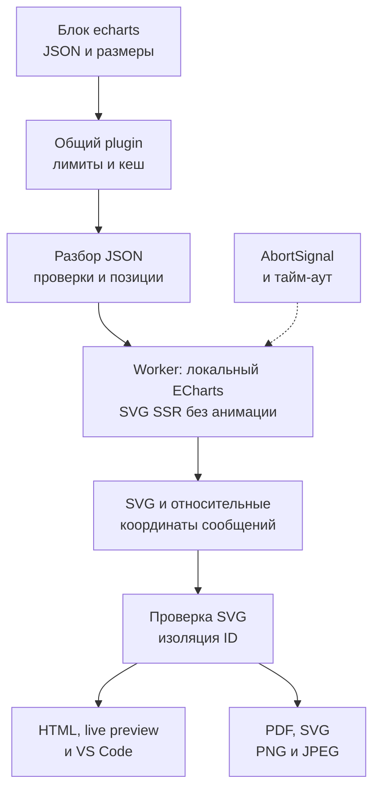

# Поддержка Apache ECharts

Статус: план, реализация не начата. Дата: 2026-10-23.

## Цель и границы первой версии

Автор вставляет JSON-конфигурацию графика в блок `echarts`. Читатель видит график рядом с архитектурой и прототипами. Один SVG используется в HTML, live preview, VS Code, PDF и экспорте изображений.

| Решение         | Контракт                                                                                           |
| --------------- | -------------------------------------------------------------------------------------------------- |
| Вход            | Один строгий JSON-объект ECharts option на блок `echarts`; без оболочки `option`                   |
| Размер          | Метаданные `width=800 height=450` по умолчанию; целые пиксели, каждое значение от 240 до 1600      |
| Выход           | Статический SVG через локальный ECharts SVG SSR; анимация принудительно отключена                  |
| Графики         | `bar`, `line`, `pie`, `scatter`, `radar`, `heatmap`, `gauge`; несколько серий и смешанный bar/line |
| Данные          | Встроенные `series.data` или табличный `dataset.source` с `encode`; без transform                  |
| Оформление      | Заголовок, легенда, сетка, оси, подписи, цвета и простые градиенты; светлая тема по умолчанию      |
| Совместимость   | Fence `json` остаётся кодом; новых CLI-флагов и публичных API-опций не требуется                   |
| За границами    | JavaScript, callbacks, custom series, карты, расширения, GL, внешние данные и изображения          |
| Интерактивность | Tooltip, toolbox, dataZoom, brush, timeline и переключение легенды не входят в первую версию       |

Это предлагаемый профиль поддержки, а не обещание полной совместимости со всеми ECharts options. Неизвестные поля и неподдерживаемые сочетания должны давать диагностику до вызова ECharts.

## Результат для читателя

Ниже — прототип содержимого плана в существующем preview. Он показывает итоговый статический график, а не результат уже подключённого ECharts. Панель preview и экспорт PDF сохраняют текущие действия. Новых экранов и элементов управления не требуется.

<!-- prettier-ignore -->
```pencil
{
  "version": "2.21",
  "children": [{
    "id": "chart-preview", "type": "frame", "x": 0, "y": 0, "width": 760, "height": 480,
    "layout": "none", "fill": "#FFFFFF", "stroke": "#CBD5E1", "strokeWidth": 1,
    "children": [
      {"id": "heading", "type": "text", "x": 28, "y": 20, "width": 700, "height": 32, "content": "План: нагрузка сервиса", "fontSize": 24, "fill": "#0F172A"},
      {"id": "intro", "type": "text", "x": 28, "y": 64, "width": 700, "height": 26, "content": "Прогноз запросов по кварталам", "fontSize": 17, "fill": "#475569"},
      {"id": "chart-title", "type": "text", "x": 88, "y": 110, "width": 570, "height": 28, "content": "Запросы, тыс.", "fontSize": 20, "fill": "#0F172A"},
      {"id": "axis-y", "type": "rectangle", "x": 88, "y": 158, "width": 1, "height": 220, "fill": "#64748B"},
      {"id": "axis-x", "type": "rectangle", "x": 88, "y": 378, "width": 580, "height": 1, "fill": "#64748B"},
      {"id": "zero", "type": "text", "x": 55, "y": 363, "width": 28, "height": 24, "content": "0", "fontSize": 16, "fill": "#475569"},
      {"id": "bar-q1", "type": "rectangle", "x": 132, "y": 258, "width": 72, "height": 120, "fill": "#5470C6"},
      {"id": "value-q1", "type": "text", "x": 144, "y": 230, "width": 56, "height": 24, "content": "120", "fontSize": 16, "fill": "#0F172A"},
      {"id": "label-q1", "type": "text", "x": 150, "y": 390, "width": 50, "height": 24, "content": "Q1", "fontSize": 16, "fill": "#475569"},
      {"id": "bar-q2", "type": "rectangle", "x": 272, "y": 178, "width": 72, "height": 200, "fill": "#5470C6"},
      {"id": "value-q2", "type": "text", "x": 284, "y": 150, "width": 56, "height": 24, "content": "200", "fontSize": 16, "fill": "#0F172A"},
      {"id": "label-q2", "type": "text", "x": 290, "y": 390, "width": 50, "height": 24, "content": "Q2", "fontSize": 16, "fill": "#475569"},
      {"id": "bar-q3", "type": "rectangle", "x": 412, "y": 228, "width": 72, "height": 150, "fill": "#5470C6"},
      {"id": "value-q3", "type": "text", "x": 424, "y": 200, "width": 56, "height": 24, "content": "150", "fontSize": 16, "fill": "#0F172A"},
      {"id": "label-q3", "type": "text", "x": 430, "y": 390, "width": 50, "height": 24, "content": "Q3", "fontSize": 16, "fill": "#475569"},
      {"id": "bar-q4", "type": "rectangle", "x": 552, "y": 198, "width": 72, "height": 180, "fill": "#5470C6"},
      {"id": "value-q4", "type": "text", "x": 564, "y": 170, "width": 56, "height": 24, "content": "180", "fontSize": 16, "fill": "#0F172A"},
      {"id": "label-q4", "type": "text", "x": 570, "y": 390, "width": 50, "height": 24, "content": "Q4", "fontSize": 16, "fill": "#475569"},
      {"id": "footer", "type": "text", "x": 28, "y": 438, "width": 700, "height": 24, "content": "Прогноз используется при выборе мощности сервиса.", "fontSize": 16, "fill": "#475569"}
    ]
  }]
}
```

При ошибке использовать текущую диагностику с файлом, строкой и столбцом. Сейчас ошибка renderer останавливает сборку; собственный UI ошибок ECharts не вводить. Отображение ошибок на месте блока относится к отдельному [плану диагностики](plan-feat-05-diagnostics.md).

## Синтаксис для автора

Пример ниже — будущий вход. В этом плане он показан как код Markdown, поскольку renderer ECharts ещё отсутствует.

````markdown
```echarts width=800 height=450
{
  "title": { "text": "Запросы, тыс." },
  "grid": { "left": 60, "right": 30, "top": 70, "bottom": 50 },
  "xAxis": { "type": "category", "data": ["Q1", "Q2", "Q3", "Q4"] },
  "yAxis": { "type": "value" },
  "series": [
    {
      "type": "bar",
      "data": [120, 200, 150, 180],
      "label": { "show": true, "position": "top" }
    }
  ]
}
```
````

Метаданные допускают только `width` и `height` в любом порядке. Неизвестные, повторные, дробные и некорректные значения отклонять. Пустые метаданные используют оба значения по умолчанию; отсутствие одного параметра сохраняет его значение по умолчанию. Размер холста задавать через `init`, а не через поля JSON.

## Архитектура



SVG SSR соответствует текущему конвейеру проекта. ECharts предоставляет `init(null, null, { renderer: 'svg', ssr: true, width, height })` и `renderToSVGString()`. SSR требует заданного размера; экземпляр следует освобождать после работы. Анимация SSR может попасть в SVG как CSS, поэтому адаптер задаёт `animation: false`. Основание: [официальная документация SVG SSR](https://echarts.apache.org/handbook/en/how-to/cross-platform/server/).

| Файл или модуль                                                                      | Изменение при реализации                                                                                        |
| ------------------------------------------------------------------------------------ | --------------------------------------------------------------------------------------------------------------- |
| `package.json`                                                                       | Добавить прямую runtime-зависимость `echarts` с точной проверенной версией; использовать поставляемые типы      |
| `src/renderers/echarts.ts`                                                           | Реализовать `DiagramRenderer`: `name: 'echarts'`, `languages: ['echarts']`, лимиты, очередь, кеш и вызов worker |
| `src/renderers/echarts-source.ts`                                                    | Строгий JSON, метаданные, позиции JSON Pointer и ограничения структуры                                          |
| `src/renderers/echarts-options.ts`                                                   | Проверяемый профиль options, типы серий, данные и нормализация статического вывода                              |
| `src/renderers/echarts-worker.ts`                                                    | Зарегистрировать разрешённые charts/components и SVGRenderer; выполнить SSR, освободить экземпляр в `finally`   |
| `src/renderers/echarts-runner.ts`                                                    | Жизненный цикл worker, протокол сообщений, тайм-аут, отмена и завершение при ошибке                             |
| `src/compiler.ts`                                                                    | Зарегистрировать renderer в обоих списках: `compileMarkdown()` и `checkMarkdown()`                              |
| `src/plugins/remark-diagrams.ts`                                                     | Использовать существующий контракт, контейнер `bp-diagram--echarts`, проверку SVG и изоляцию ID                 |
| `src/renderers/cache.ts`                                                             | Использовать существующий кеш; он уже включает исходник и metadata в ключ                                       |
| `examples/blueprint-echarts.md`                                                      | Примеры всех разрешённых типов, смешанный график, dataset и кириллические подписи                               |
| `README.md`, `skills/blueprint4llm/SKILL.md`                                         | Добавить формат, синтаксис, профиль, ограничения и правила визуальной проверки                                  |
| `vscode-extension/scripts/package-smoke.mjs`, `vscode-extension/test/suite/index.ts` | Проверить renderer и worker из упакованного расширения, preview и PDF                                           |

Каждый новый модуль имеет одну ответственность и unit-тесты для всех функций. Делить по функциям, сохраняя ориентир 300–500 строк на файл. Новые публичные exports для ECharts не нужны: API уже принимает Markdown.

## Профиль options и диагностика

До интеграции зафиксировать в валидаторе и README точную таблицу разрешённых путей и типов options. Тип `EChartsOption` помогает реализации, но не заменяет runtime-проверку JSON.

| Область             | Правило                                                                                                                                                                                 |
| ------------------- | --------------------------------------------------------------------------------------------------------------------------------------------------------------------------------------- |
| JSON                | Использовать `jsonc-parser`, уже прямую зависимость: запретить комментарии и trailing comma; корень — объект; дубли ключей — ошибка                                                     |
| Структура           | До преобразования проверить глубину и число AST-узлов; отклонять `__proto__`, `prototype`, `constructor`; обходить собственные поля                                                     |
| Числа               | Требовать конечные числа, включая результат разбора `1e999`; `null` допустим как пропуск данных, где это поддерживает профиль                                                           |
| Серии               | Требовать непустой массив `series`; неизвестный `type` и несовместимую систему координат отклонять                                                                                      |
| Данные              | Проверять форму scalar/pair/tuple/object для типа серии; dataset — прямоугольная таблица, `encode` с существующими измерениями; ссылки на отсутствующие оси или dataset — ошибка        |
| Подписи             | Разрешить строки и ограниченные шаблоны `label.formatter`; строки никогда не преобразовывать в функции; rich text первой версии не поддерживать                                         |
| Нормализация        | Принудительно задать `animation: false`, `silent: true`; отключить emphasis/select effects и анимацию отдельных серий; при явном запросе несовместимого поведения выдать предупреждение |
| Интерактивные опции | Наличие tooltip, toolbox, dataZoom, brush или timeline — ошибка профиля, без молчаливого удаления                                                                                       |
| Неизвестные опции   | Ошибка с JSON Pointer; не полагаться на молчаливое игнорирование и console warnings ECharts                                                                                             |
| Позиции             | Сохранять локальные `line`/`column` с единицы и JSON Pointer; перенос в строку Markdown выполняет общий plugin                                                                          |
| Ошибка движка       | Если указатель неизвестен, привязать ошибку к блоку; не придумывать позицию в JSON                                                                                                      |

Начать профиль с полей для опубликованных примеров и расширять его вместе с тестами. Для radar разрешить `radar.indicator`; для heatmap — соответствующие оси и `visualMap`; для pie/gauge — их собственные параметры. `graphic`, `media`, `baseOption`, `options`, `dataset.transform`, ссылки, изображения, `image://` и пользовательские регистрации отклонять. Строки данных, похожие на URL или JavaScript, оставлять данными: запреты должны зависеть от назначения поля.

ECharts предполагает доверенные options; ряд полей принимает HTML, URL или функции, а dataset filter с regex требует отдельного контроля. Поэтому ограниченный профиль проверяется до SSR. Основание: [официальные рекомендации ECharts по безопасности](https://echarts.apache.org/handbook/en/best-practices/security/).

## Выполнение, SVG и кеш

| Решение             | Требование                                                                                                                                                                        |
| ------------------- | --------------------------------------------------------------------------------------------------------------------------------------------------------------------------------- |
| Зависимости         | Проверить актуальную стабильную версию ECharts и совместимость с Node.js проекта при реализации; не добавлять CDN, canvas, jsdom или GL                                           |
| Изоляция выполнения | Синхронный `setOption()` запускать в worker thread. `Promise.race()` в главном потоке не прерывает заблокированный SSR                                                            |
| Очередь             | Использовать `ConcurrencyLimiter` с двумя активными render; повторно проверять AbortSignal после ожидания очереди                                                                 |
| Worker              | Передавать только проверенные JSON-данные и размер; не передавать токены и контекст Figma. Worker — механизм отмены и ограничения ресурсов, а не песочница для произвольного кода |
| Завершение          | По тайм-ауту и abort вызвать `terminate()` и дождаться завершения; снять listeners и таймеры при любом исходе; отменённый результат не кешировать                                 |
| SSR                 | Разрешённые модули подключать через модульный API ECharts; создавать отдельный chart на блок; `dispose()` выполнять в `finally` при обычном завершении и ошибке                   |
| Текст               | Задать семейство Noto Sans с существующими fallback-шрифтами; проверить кириллицу, длинные подписи и разницу измерения текста SSR и Chrome                                        |
| SVG                 | Сохранить общую `parseAndValidateSvg()` без исключений; проверить градиенты, clipPath, текст и размеры на реальном SVG ECharts                                                    |
| Стили               | Проверить, что hover CSS и одинаковые классы SVG не влияют на соседние графики. Если движок выводит такие стили, убрать эффекты в адаптере либо изолировать селекторы с тестами   |
| ID                  | Использовать общую `scopeSvgIds()` после получения результата из кеша; несколько одинаковых графиков не должны делить clipPath или gradient ID                                    |
| Кеш                 | Включить точную версию ECharts, версию профиля, шрифт и режим SSR в `cacheKey`; metadata уже входит в общий ключ. Не включать строки файла и diagramId                            |
| Экспорт             | Существующий SVG экспортирует ровно один visual block; PNG/JPEG и PDF продолжают использовать Chrome. Новый worker должен попасть в npm tarball и VSIX                            |

Не обещать побайтовое равенство SVG между независимыми процессами: внутренние ID ECharts могут различаться. В тестах проверять структуру, содержимое и связи ID. Кеш хранит исходный SVG до общей изоляции ID и сообщения с относительными координатами.

Предлагаемые лимиты первой версии нужно зафиксировать константами и проверить на граничных значениях:

| Ресурс         | Лимит                                                                                              |
| -------------- | -------------------------------------------------------------------------------------------------- |
| Исходник       | 256 KiB UTF-8 на блок; общие 5 MiB Markdown и 100 visual blocks сохраняются                        |
| Структура JSON | Глубина 32; до 100 000 AST-узлов; не более 4 KiB UTF-8 на одну строку                              |
| Объём данных   | До 20 серий; суммарно до 10 000 точек, включая строки dataset; не более 32 ячеек на строку dataset |
| Холст          | 240–1600 px по каждой стороне; по умолчанию 800 × 450                                              |
| Выполнение     | До 10 секунд после запуска worker, включая импорт движка; отмена также действует во время очереди  |
| Worker         | `resourceLimits.maxOldGenerationSizeMb: 128`; это предел JS heap, а не гарантия общего RSS         |
| Результат      | До 4 MiB UTF-8 SVG; при превышении вернуть ошибку до встраивания в документ                        |

Лимиты данных считать по фактическим входным данным: используемый несколькими сериями dataset учитывать один раз. Декартово произведение или вычисляемые transforms не поддерживать. Проверить время и память на максимальных разрешённых fixtures; при необходимости уменьшить лимиты до выпуска.

## Проверки и критерии готовности

| Уровень             | Что доказывает проверка                                                                                                                                      |
| ------------------- | ------------------------------------------------------------------------------------------------------------------------------------------------------------ |
| Парсер              | Валидный JSON; ошибочная грамматика, комментарии, trailing comma, дубли, запрещённые ключи, числа и позиции ошибок                                           |
| Metadata            | Значения по умолчанию; каждый параметр отдельно; порядок; дубли; неизвестные параметры; нули, отрицательные, дробные и граничные размеры                     |
| Options             | Каждый разрешённый тип серии и каждое правило профиля; смешанные серии, dataset/encode, несовместимые оси, неподдерживаемые поля                             |
| Лимиты              | Значения ровно на границе и выше для каждого ограничения; учёт UTF-8; ранний отказ до SSR                                                                    |
| Runner              | Успех, исключение, worker crash, тайм-аут, abort до запуска, в очереди и во время SSR; освобождение очереди, отсутствие утечек и кеша отменённого результата |
| Renderer            | Семь типов, подписи и легенда; `dispose()` при успехе и ошибке; отсутствие анимации, внешних ресурсов и скрытых предупреждений движка                        |
| SVG и кеш           | Несколько графиков с clipPath/градиентами; повтор одного графика из кеша; различие размеров; перенос блока сохраняет верные позиции диагностики              |
| Компилятор          | Регистрация в compile и check; класс `bp-diagram--echarts`; обычный JSON остаётся кодом; смесь с Mermaid и OpenAPI                                           |
| CLI                 | `--check` без выходного файла; HTML/PDF; один график в SVG/PNG/JPEG; отказ экспорта изображения при нескольких visual blocks                                 |
| Preview             | Обновление после сохранения, ошибка и исправление JSON; отмена устаревшей сборки; шрифты и читаемость в светлой и тёмной теме                                |
| Поставка            | `npm pack` и VSIX содержат worker и runtime-зависимости; упакованный renderer работает без исходников и сети                                                 |
| Визуальный просмотр | Все семь типов, длинные подписи, кириллица, legend и dataset; полный кадр и нижний край в HTML, VS Code и PDF                                                |

Структурные unit-тесты дополнить реальным SSR и экспортом через существующий CLI. Не заменять проверку видимости поиском текста в SVG. Перед приёмкой экспортировать каждый новый пример отдельно и просмотреть изображение целиком.

## Этапы реализации

| Этап                       | Результат и условие перехода                                                                                                               |
| -------------------------- | ------------------------------------------------------------------------------------------------------------------------------------------ |
| 1. Проверка движка         | Выбрать точную версию; получить SVG для bar, pie и heatmap; проверить общий SVG validator, стили, шрифты, упаковку и время запуска worker  |
| 2. Вход и профиль          | Реализовать metadata, строгий JSON, позиции, лимиты и таблицу разрешённых options; все правила покрыть unit-тестами                        |
| 3. SSR и отмена            | Реализовать worker/runner, очередь, dispose, тайм-аут и AbortSignal; проверить аварийные пути и ресурсные лимиты                           |
| 4. Подключение             | Зарегистрировать renderer в compile/check; проверить кеш, ID, диагностику, все форматы экспорта и live preview                             |
| 5. Документация и поставка | Добавить примеры, README и skill; проверить VS Code, npm tarball и VSIX; визуально просмотреть все примеры                                 |
| 6. Выпуск                  | Прогнать все проверки; увеличить minor-версию корневого package.json для новой функциональности; проверить необходимость версии расширения |

Команды приёмки после реализации:

```bash
npm run build
npm run typecheck
npm run lint
npm run format:check
npm test
npm --prefix vscode-extension run build
npm --prefix vscode-extension test
node dist/cli.js examples/blueprint-echarts.md --check
```

Готовность: каждый опубликованный пример проходит check и экспорт, диагностика указывает на исходник, отмена освобождает worker, графики видны полностью, существующие тесты и сборки проходят без ошибок и предупреждений. Код ECharts и поддержка fence будут добавлены отдельной реализацией этого плана.
