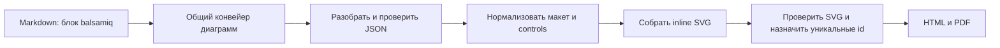

# План: импорт макетов Balsamiq

## Цель

Добавить локальный рендеринг JSON одного макета Balsamiq в SVG через fenced-блок Markdown. Макет должен компилироваться в HTML и PDF тем же конвейером, что Mermaid, PlantUML, Wiremark и Figma.

### Формат первой версии

Поддержать JSON отдельного wireframe со структурой `mockup.controls.control`, которую описывает документация Balsamiq Mockups 3. В Markdown использовать метку `balsamiq`:

```balsamiq
{
  "mockup": {
    "version": "1.0",
    "mockupW": "360",
    "mockupH": "640",
    "controls": {
      "control": [
        {
          "ID": "1",
          "typeID": "Canvas",
          "x": "0",
          "y": "0",
          "w": "360",
          "h": "640",
          "zOrder": "0"
        },
        {
          "ID": "2",
          "typeID": "Button",
          "x": "24",
          "y": "80",
          "w": "312",
          "h": "48",
          "zOrder": "1",
          "properties": { "text": "Продолжить" }
        }
      ]
    }
  }
}
```

Это формат JSON отдельного макета, а не файл проекта `.bmpr`. Сейчас Balsamiq описывает `.bmpr` как файл проекта; он основан на SQLite и может содержать несколько досок и ресурсов. Поддержка `.bmpr` потребует отдельного чтения контейнера и выбора доски. Старый `.bmml` — XML и также не входит в эту задачу. См. [описание экспорта](https://balsamiq.com/support/sharing/exporting/), [документацию JSON Mockups 3](https://balsamiq.com/assets/product/mockups3fordesktop/balsamiq-mockups-3-for-desktop-documentation.pdf) и [историю формата BMPR](https://balsamiq.com/learn/3-2/).

## Поток рендеринга



Рендерер работает офлайн. Он не читает произвольные файлы, не выполняет код из JSON и не загружает ресурсы из сети. Итоговый SVG проходит существующую SVG-проверку проекта.

## Поведение рендерера

1. Зарегистрировать `balsamiqRenderer` в `src/compiler.ts` с языком блока `balsamiq` и версией кэша.
2. Ограничить исходник размером, числом controls и глубиной JSON до его обработки.
3. Проверить корень `mockup`, массив `controls.control`, типы значений, конечные координаты и размеры. В JSON координаты часто записаны строками, поэтому парсер должен преобразовывать их в конечные числа.
4. Определить холст по размерам `mockupW`/`mockupH`; использовать control `Canvas` как фон и запасной источник размеров, если корневые размеры отсутствуют.
5. Отсортировать controls по `zOrder` и отрисовать их в порядке слоёв. Перенести координаты, размеры, видимый текст и базовые свойства типовых элементов.
6. Начать с распространённых элементов: Canvas, Label, Title, SubTitle, Paragraph, TextInput, TextArea, Button, CheckBox, RadioButton, ComboBox, List, Rectangle и Line. Зафиксировать реальные `typeID` по примерам экспорта.
7. Для неизвестного `typeID` завершать рендер с понятной диагностикой, содержащей тип и `ID` элемента. Не пропускать элемент молча.
8. Экранировать все строки для SVG. Не вставлять SVG/HTML, URL, стили или атрибуты напрямую из пользовательского JSON.
9. Возвращать SVG через общий кэш, SVG sanitizer и механизм scope ID. Ошибки JSON привязывать к строке fenced-блока, а при наличии позиции парсера — к строке и колонке внутри блока.

## Модули

| Файл | Ответственность |
| --- | --- |
| `src/renderers/balsamiq.ts` | Адаптер `DiagramRenderer`, лимит исходника и вызов парсера/рендерера |
| `src/renderers/balsamiq-json.ts` | Разбор JSON, проверка структуры и нормализация полей controls |
| `src/renderers/balsamiq-svg.ts` | Рендер поддержанных controls в SVG и проверка их свойств |
| `src/compiler.ts` | Регистрация нового renderer |
| `tests/balsamiq-json.test.ts` | Структура, преобразование строковых чисел, пределы и ошибки JSON |
| `tests/balsamiq-svg.test.ts` | Отрисовка controls, порядок слоёв, XML escaping и неподдержанные типы |
| `tests/balsamiq.test.ts` | Компиляция Markdown, class SVG, диагностика и отсутствие сетевых вызовов |
| `examples/blueprint-balsamiq.md` | Пример блока и перечень поддержанных элементов |
| `README.md` | Синтаксис fenced-блока, область поддержки и ограничения |

Не добавлять зависимость для JSON или SVG. Если renderer вырастет за установленный размер файла, вынести геометрию и отдельные группы controls в небольшие модули.

## Целевой вид результата

Каждая Wiremark-диаграмма ниже показывает самостоятельный экран; это отдельные блоки, как и отдельные макеты в Markdown.

### Экран входа

```wireframe
Wireframe #balsamiq-login mobile padding=2 gap=2
  Stack column gap=2 padding=2
    Typography h4 "Вход"
    TextField "Электронная почта"
    TextField "Пароль"
    Button "Продолжить" contained
```

### Список проектов

```wireframe
Wireframe #balsamiq-projects landscape padding=2 gap=2
  AppBar dense
    Toolbar dense
      Typography h6 "Проекты"
  Stack column gap=2 padding=2
    Typography h4 "Последние макеты"
    Box 100% 72px solid padding=2
      Typography h6 "Личный кабинет"
    Box 100% 72px solid padding=2
      Typography h6 "Настройки профиля"
```

## Проверки и критерии готовности

- Unit-тестами покрыть каждую добавленную функцию парсера и рендерера.
- Проверить JSON из зафиксированных примеров Balsamiq, пустой и неверный `controls.control`, отсутствующие/нечисловые размеры, некорректный `zOrder`, дублированные ID, слишком большой и слишком глубоко вложенный ввод.
- Проверить корректный SVG для нескольких элементов, порядок слоёв, отображение текста с `&`, `<` и переводами строк, сообщение об неизвестном `typeID`.
- Проверить сквозную компиляцию в HTML и PDF, `--check`, диагностику с исходным файлом и строкой Markdown, повторное использование кэша и отсутствие сетевых вызовов.
- Повторно проверить Mermaid, PlantUML, Wiremark и Figma через существующий набор тестов.
- Обновить README и добавить рабочий пример. После успешных проверок увеличить minor-версию `package.json` с `0.9.2` до `0.10.0`.
- Не коммитить изменения без прямой просьбы.

## Вне первой версии

- `.bmpr`: SQLite-файл проекта, несколько досок, assets и symbols.
- `.bmml`: устаревший XML-формат.
- Внешние изображения, custom assets, symbols, prototype links и точное воспроизведение всех Balsamiq skins.

После подтверждения рендеринга JSON можно отдельно спланировать `.bmpr`: чтение read-only, безопасное извлечение ресурсов и выбор доски через metadata блока, например `board=<id>`.
