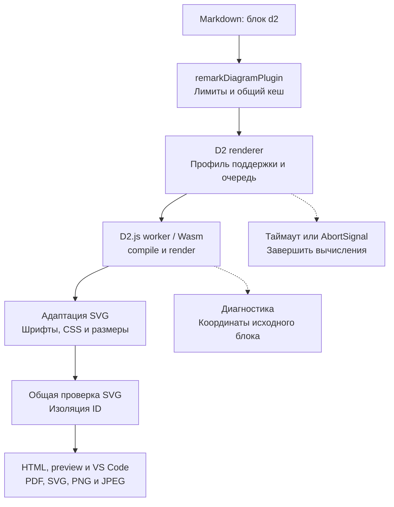

# План: поддержка D2

Статус: план реализации; D2 пока не зарегистрирован в компиляторе. Дата: 2026-10-23. Основа плана — текущие исходники, тесты и README.

## Результат и границы первой версии

Автор вставляет исходник D2 в блок `d2`. blueprint4llm локально создаёт статический SVG и использует его в HTML, браузерном preview, VS Code, PDF и экспорте одной диаграммы в SVG/PNG/JPEG. Установка Go, нативного D2 CLI и обращение к серверу рендера не нужны.

| Область      | Предлагаемый контракт                                                                                                                       |
| ------------ | ------------------------------------------------------------------------------------------------------------------------------------------- |
| Вход         | Один самостоятельный документ D2 на fence `d2`; без алиасов и загрузки `.d2` по пути или URL                                                |
| Диаграммы    | Узлы, связи, подписи, вложенные контейнеры, стили и классы; SQL tables, UML classes и sequence diagrams — с отдельными приёмочными fixtures |
| Раскладка    | `dagre` по умолчанию; `elk` через `vars.d2-config.layout-engine` после проверки выбранного пакета                                           |
| Направление  | Сохранять `direction` из D2; преобразование направления Mermaid не применять                                                                |
| Оформление   | Одна светлая статическая тема; исходные цвета и обычные текстовые подписи, включая кириллицу                                                |
| Настройки    | Нативный `vars.d2-config` с проверенным списком полей; metadata fence в первой версии не поддерживать                                       |
| Ресурсы      | Только текст текущего блока и локальные ресурсы самого пакета; без импортов других документов, изображений и внешних шрифтов                |
| За границами | Layers, scenarios, steps, анимация, TALA, sketch, Markdown/LaTeX-подписи, HTML, кликабельные ссылки и tooltips                              |

Это профиль интеграции, а не полная поддержка D2 CLI. Неподдерживаемые возможности отклонять с понятной диагностикой. Не пропускать их молча и не выбирать только корневой board из многостраничного документа. Новые экраны и элементы управления не требуются: диаграмма использует существующий контейнер и экспорт.

## Будущий синтаксис

Пример обёрнут внешним Markdown-fence: текущая версия может проверить и отрендерить этот план до реализации D2.

````markdown
```d2
direction: down

client: Клиент
backend: Сервис заказов {
  api: API заказов
  database: База данных {
    shape: cylinder
  }
  api -> database: Сохранить заказ
}

client -> backend.api: Создать заказ
```

```d2
vars: {
  d2-config: {
    layout-engine: elk
  }
}
direction: right

gateway: Шлюз
orders: Заказы
catalog: Каталог
gateway -> orders
gateway -> catalog
```
````

Пустой блок и блок без видимых объектов считать ошибкой. Любые непустые metadata, например `d2 layout=elk`, отклонять с подсказкой использовать `vars.d2-config`. Для первой версии разрешить в `d2-config` только `layout-engine` со значениями `dagre`/`elk` и `theme-id` из зафиксированного на этапе 1 списка статических тем. Остальные поля отклонять; значения по умолчанию задавать адаптером. Не предоставлять два конкурирующих способа настройки раскладки.

Сам язык имеет импорты и композицию нескольких boards. Их наличие не означает поддержку в этой интеграции. [Импорты D2](https://d2lang.com/tour/imports/), [композиция D2](https://d2lang.com/tour/composition/).

## Подключение к текущей архитектуре



| Текущий модуль                                                                                  | Действие при реализации                                                                                                           |
| ----------------------------------------------------------------------------------------------- | --------------------------------------------------------------------------------------------------------------------------------- |
| [types.ts](src/renderers/types.ts)                                                              | Реализовать `DiagramRenderer`: `name: 'd2'`, `languages: ['d2']`; результат — `DiagramResult`                                     |
| [compiler.ts](src/compiler.ts)                                                                  | Зарегистрировать `d2Renderer` в обоих списках: `compileMarkdown()` и `checkMarkdown()`                                            |
| [remark-diagrams.ts](src/plugins/remark-diagrams.ts)                                            | Использовать существующие лимиты, `bp-diagram--d2` и преобразование локальных координат в координаты Markdown                     |
| [cache.ts](src/renderers/cache.ts)                                                              | Переиспользовать кеш исходного SVG; добавить версии движка, профиль настроек, шрифты и адаптацию SVG в `cacheKey`                 |
| [concurrency-limiter.ts](src/renderers/concurrency-limiter.ts)                                  | Использовать лимит параллельности; отдельно обеспечить удаление отменённых задач из очереди — текущий `run()` не принимает signal |
| [parse-and-validate.ts](src/svg/parse-and-validate.ts)                                          | Сохранить общие ограничения активного содержимого, ссылок и CSS; не разрешать `foreignObject` ради D2                             |
| [scope-ids.ts](src/svg/scope-ids.ts)                                                            | Проверить ID и ссылки; отдельно решить изоляцию классов и CSS, которую префиксы ID сами по себе не обеспечивают                   |
| [image-export.ts](src/image-export.ts), [print-html.ts](src/print-html.ts)                      | Проверить экспорт, размеры и печать через общий SVG; PDF уже ограничивает высоту диаграммы 220 mm                                 |
| [server.ts](src/server.ts), [preview-controller.ts](vscode-extension/src/preview-controller.ts) | Проверить обновление и отмену устаревшей сборки через общий компилятор                                                            |

Предлагаемые новые модули:

| Модуль                            | Одна ответственность                                                |
| --------------------------------- | ------------------------------------------------------------------- |
| `src/renderers/d2.ts`             | Контракт renderer, размер входа, metadata, вызов runner и ключ кеша |
| `src/renderers/d2-runner.ts`      | Жизненный цикл движка, очередь, таймаут, отмена и очистка           |
| `src/renderers/d2-policy.ts`      | Проверка поддерживаемых конструкций и настроек по AST/графу движка  |
| `src/renderers/d2-svg.ts`         | Узкая адаптация SVG: шрифты, служебная оболочка, CSS и размеры      |
| `src/renderers/d2-diagnostics.ts` | Разбор сообщений движка и локальных координат                       |

Дополнительный `d2-worker.ts` нужен только если опубликованный пакет не позволяет надёжно остановить собственный worker. Не создавать лишнюю вложенность workers без проверки. Держать модули связными и соблюдать предел 300–500 строк из AGENTS.md; каждую новую функцию покрыть unit-тестами.

## Выбор движка и проверка совместимости

Предпочтительный путь — официальный D2.js через Wasm. Документация основной ветки рекомендует `@d2lang/d2`; `@terrastruct/d2` сохранён для совместимости. Она описывает `compile()`, `render()` и `dispose()`, который завершает worker. Эти сведения нужно сверить с опубликованным артефактом, а не переносить из основной ветки без проверки. [Официальный D2.js](https://github.com/d2lang/d2/tree/master/d2js/js).

На дату плана npm сообщает версии `@d2lang/d2@0.1.34` и `@terrastruct/d2@0.1.33`. Кандидат для spike — `@d2lang/d2@0.1.34`; зависимость пока не добавлять. Проверить ESM, TypeScript, минимальную Node.js 22.13.0 и Node.js в extension host VS Code 1.101.0. Зафиксировать точную версию только после успешного spike. [Пакет @d2lang/d2](https://www.npmjs.com/package/@d2lang/d2), [пакет совместимости](https://www.npmjs.com/package/@terrastruct/d2).

В основной ветке заявлены также TALA и дополнительные режимы. Первая версия интеграции ограничена проверенными `dagre` и `elk`; состав нативного CLI не определяет возможности выбранного npm-пакета. [Типы D2.js](https://github.com/d2lang/d2/blob/master/d2js/js/index.d.ts).

| Проверка этапа 1     | Условие перехода к реализации                                                                       |
| -------------------- | --------------------------------------------------------------------------------------------------- |
| Установка и лицензии | Wasm и worker входят в npm-пакет; условия MPL-2.0 и notices зависимостей учтены в npm/VSIX          |
| Жизненный цикл       | После успеха, ошибки, таймаута и отмены процесс завершается; worker не остаётся активным            |
| Политика языка       | Доступны AST/граф и координаты, достаточные для отказа от импортов, boards и неподдерживаемых полей |
| SVG                  | Обычные подписи и обе раскладки совместимы с общей проверкой после узкой адаптации                  |
| Производительность   | Измерены холодный запуск, два параллельных рендера, плотные графы, память и размер SVG              |
| Поставка             | Установленные tarball и VSIX находят Wasm/worker без checkout, CDN и нативного D2                   |

Если опубликованный API не даёт завершить вычисления, рассмотреть управляемый внешний worker и подтвердить остановку всех дочерних ресурсов. `Promise.race()` без фактического завершения worker недостаточен. Если нельзя проверить профиль языка или получить совместимый SVG, остановить основную интеграцию и уточнить этот план. Не добавлять скрытый fallback на CLI или удалённый сервис.

## Выполнение, лимиты и кеш

Создавать экземпляр D2 лениво на одно задание; освобождать в `finally`. Передавать исходник как единственный виртуальный файл с постоянным именем, например `index.d2`. Не предоставлять resolver к диску или сети. Импорты должны завершаться диагностикой; если движок разрешает их раньше проверки графа, виртуальная файловая система всё равно не должна содержать другие файлы. Текст вроде `@file` в строках и комментариях не считать импортом по регулярному выражению.

| Ресурс           | Предлагаемый предел                                                                                     |
| ---------------- | ------------------------------------------------------------------------------------------------------- |
| Markdown / блоки | Существующие 5 MiB на документ и 100 визуальных блоков                                                  |
| D2               | 256 KiB UTF-8, в том числе при прямом вызове renderer                                                   |
| Задание          | 30 секунд на инициализацию, compile, проверку профиля и render; ожидание очереди отменяется отдельно    |
| Параллельность   | Не более двух активных заданий D2 на процесс                                                            |
| SVG              | Не более 4 MiB UTF-8 и 8192 px по каждой стороне; конечные положительные размеры и корректный `viewBox` |
| Память           | Измерить Wasm на этапе 1; worker `resourceLimits` не считать полным ограничением памяти Wasm            |

Проверять размер результата до тяжёлого разбора SVG. Отмена до запуска, в очереди и в процессе должна освобождать ресурсы и позволять следующую сборку. Обрабатывать ошибку запуска, аварийный выход worker и одновременное наступление отмены/таймаута/ответа без двойного завершения Promise.

В кеше хранить SVG без `diagramId` и диагностику только с координатами блока. Путь Markdown и абсолютную строку подставляет общий plugin после чтения кеша. Не кешировать ошибки, таймауты и отменённые результаты. Проверить, что одинаковый блок, перемещённый по документу, получает правильные координаты и уникальные ID. Пул постоянных экземпляров отложить до измерений.

## SVG, шрифты и границы поддержки

D2 включает CSS в SVG; часть режимов подписей может потребовать HTML-содержимое. Текущий валидатор запрещает `foreignObject`, внешние `href` и нефрагментные CSS `url()`, включая встроенные font data URL. Поэтому совместимость обычного D2 SVG — обязательный результат spike, а не предположение. [Экспорт SVG в D2](https://d2lang.com/tour/exports/), [текст и специальные подписи](https://d2lang.com/tour/text/).

| Риск                         | Решение и проверка                                                                                                                                                         |
| ---------------------------- | -------------------------------------------------------------------------------------------------------------------------------------------------------------------------- |
| Встроенные `@font-face`      | Сначала проверить режим вывода без встроенных font data URL. Если его нет, адаптер может удалить только известные служебные font-face правила движка с помощью CSS-парсера |
| Различие метрик шрифтов      | Передать локальные Noto Sans движку для измерения, если API это поддерживает; согласовать итоговое семейство в SVG, HTML и экспорте, проверить кириллицу и переносы        |
| HTML/Markdown/LaTeX          | Отклонять неподдерживаемые подписи до render по структуре движка; не вырезать готовое содержимое с потерей смысла                                                          |
| Утечка CSS между блоками     | Изолировать селекторы служебного CSS в корневом SVG, включая классы и keyframes при их наличии; проверить два одинаковых D2 и соседний Mermaid                             |
| ID и фрагментные ссылки      | Использовать общий `scopeSvgIds`; проверить маркеры стрелок, clipPath, маски, `use` и ссылки из CSS                                                                        |
| XML-оболочка                 | Предпочесть `noXMLTag`, если оно доступно в выбранном API; иначе удалять только известную декларацию до общего разбора                                                     |
| Изображения, ссылки, события | Отклонять `icon`, image-объекты, `link`, tooltip и активное содержимое; не загружать ресурсы для последующей очистки                                                       |
| Исходные настройки           | Проверять `vars.d2-config` и итоговые render options; не позволять исходнику включать boards, анимацию или неподдержанный движок                                           |

Нельзя удалить все `<style>`: это может разрушить подписи, цвета и стрелки. Любую адаптацию ограничить известным выводом закреплённой версии и покрыть fixtures; неожиданный SVG отклонять. Не расширять общий список разрешённых ресурсов ради встроенных шрифтов D2. Самостоятельный экспорт SVG должен оставаться читаемым без CSS страницы; этот случай проверить отдельно от HTML.

## Диагностика

Сохранять доступные строку и столбец в координатах текста fence. Ошибку адаптера передавать с полями `line`/`column` для существующего `remarkDiagramPlugin`. Проверить базу координат движка, кириллицу, табы, несколько ошибок и блоки внутри списков/цитат. Если точных координат нет, указывать начало fence без выдуманных чисел.

Имя виртуального `index.d2` не должно подменять путь исходного Markdown. Успешные предупреждения возвращать через `DiagramWarning[]`, если API их предоставляет. Исключение renderer сейчас останавливает сборку; восстановление отдельных блоков и новый интерфейс ошибок остаются вне этой задачи.

## Этапы реализации

1. **Подтвердить совместимость.** Проверить опубликованный пакет, лицензии, Node.js и extension host, шрифты, SVG, профиль языка, обе раскладки и остановку worker. Зафиксировать список поддержанных конструкций, тем и ограничений. До этого не объявлять поддержку D2 в README.
2. **Создать адаптер.** Реализовать runner, renderer, политику языка, диагностику и SVG-адаптацию. Покрыть новые функции unit-тестами; проверить реальные Wasm-вызовы, отмену и очередь.
3. **Подключить конвейер.** Зарегистрировать renderer в compile/check, проверить кеш, контейнер, экспорт одной диаграммы, browser preview и VS Code.
4. **Проверить поставку.** Установить npm tarball вне checkout; собрать VSIX и проверить наличие Wasm/worker в установленном расширении. Выполнить smoke на Linux, macOS и Windows.
5. **Добавить примеры и документацию.** Создать `examples/blueprint-d2.md`: архитектура с контейнерами, ELK, SQL table, UML class и sequence diagram. Обновить README и `skills/blueprint4llm/SKILL.md`: выбор D2, синтаксис, профиль, offline-режим и ограничения.
6. **Принять результат.** Осмотреть каждый пример целиком в HTML/preview, светлой и тёмной теме, PDF и отдельном PNG/SVG. После успешных проверок реализации повысить minor-версию и синхронизировать lockfile. Не коммитить без прямого запроса пользователя.

## Проверки и критерии готовности

| Уровень            | Обязательные сценарии                                                                                                                              |
| ------------------ | -------------------------------------------------------------------------------------------------------------------------------------------------- |
| Unit               | Каждая новая функция; metadata, профиль, настройки, диагностика, размеры, CSS/шрифты и ключ кеша                                                   |
| Движок             | Узлы, все направления связей, вложенные контейнеры, стили/классы, SQL/UML/sequence, обе раскладки, кириллица и длинные подписи                     |
| Ошибки             | Пустой блок, неверный D2, неизвестные настройки/движок, неподдерживаемые конструкции; пути и локальные координаты                                  |
| Изоляция           | Импорты и path traversal, URL, внешние изображения/шрифты, HTML, события, CSS-ресурсы; отсутствие вызовов диска/сети из пользовательского D2       |
| Жизненный цикл     | Таймаут, отмена до запуска/в очереди/во время рендера, авария, очистка listeners и worker, следующий успешный запуск                               |
| Компилятор         | Compile/check, fence в списке/цитате, смешанный документ, уникальность ID, отсутствие влияния CSS на страницу, работа кеша после перемещения блока |
| CLI и экспорт      | `--check` без файлов, HTML/PDF, одиночный SVG/PNG/JPEG; несколько визуальных блоков дают прежнюю ошибку одиночного экспорта                        |
| Preview и поставка | Обновление файла и unsaved buffer VS Code, отмена устаревшей сборки, tarball и VSIX вне checkout                                                   |

Общий кеш сейчас сохраняет любой возвращённый `DiagramResult`, включая `errors`. Для D2 ошибки компиляции должны выбрасываться, а не возвращаться как успешный SVG с `errors`; отдельно проверить отсутствие ошибок в кеше.

Команды приёмки реализации:

```bash
npm run build
npm run typecheck
npm run lint
npm run format:check
npm test
npm --prefix vscode-extension run build
xvfb-run -a npm --prefix vscode-extension test
blueprint4llm examples/blueprint-d2.md --check
```

Поддержка готова, когда все проверки проходят без ошибок и предупреждений, каждый заявленный тип диаграммы подтверждён fixture, SVG проходит общий валидатор, отмена останавливает вычисления, а установленный пакет работает локально без D2 CLI. В PDF подписи должны оставаться извлекаемым текстом; широкие схемы должны прокручиваться в preview и вписываться при печати без обрезки. Наличие этого плана не означает выполнение этих критериев.
