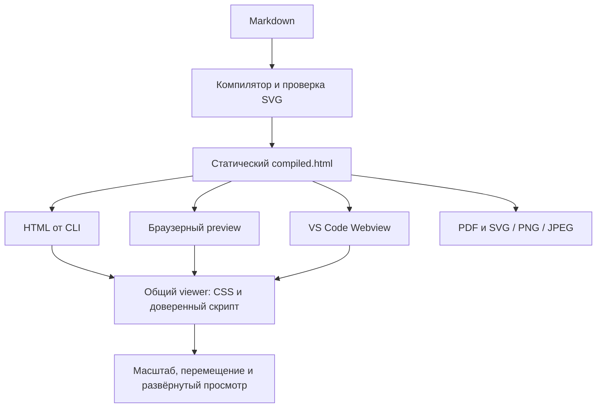

# FEAT-03: удобное чтение больших схем

Статус: план реализации; задача остаётся открытой. Источник: [FEAT-03 в очереди](plan-features-todo.md#feat-03-чтение-больших-схем).

## Цель и границы

Читатель открывает большую схему, видит её целиком, увеличивает нужный участок и перемещается к соседним узлам. Для этого ему не нужно менять Markdown или экспортировать схему в другой редактор.

| Область              | Результат первой версии                                                                                    |
| -------------------- | ---------------------------------------------------------------------------------------------------------- |
| Среды                | Одинаковые средства просмотра в HTML от CLI, браузерном `--serve` и preview VS Code                        |
| Управление           | Увеличить, уменьшить, показать `100 %`, вписать, переместить и развернуть схему                            |
| Форматы              | Все существующие SVG-диаграммы и UI-прототипы; интерфейс не зависит от renderer                            |
| Полный обзор         | Видны все края схемы; после увеличения можно добраться до каждой подписи и связи                           |
| Доступность          | Настоящие кнопки, управление с клавиатуры, видимый фокус, светлая, тёмная и контрастная темы               |
| Статический документ | Без JavaScript остаются исходный SVG и прокрутка; PDF и экспорт SVG/PNG/JPEG используют исходную геометрию |

«На весь экран» означает всю область страницы браузера или панели preview VS Code. Использовать модальное окно внутри документа; переход в полноэкранный режим операционной системы не требуется. Мобильные жесты, миникарта и сохранение масштаба между пересборками в первую версию не входят.

## Будущий интерфейс

Макеты показывают ожидаемое поведение. Схема в них условная; проценты и размеры приведены для примера. Кнопки темы и скачивания PDF уже есть в браузерном preview; в самостоятельном HTML их добавлять не нужно.

### Браузер: вся схема вписана

```wireframe
Wireframe #diagram-fit w=1120 h=750
  Stack column gap=2 padding=3
    Typography h5 "Blueprint · Архитектура заказов"
    Stack row gap=2
      Button "Тёмная тема"
      Button "Скачать PDF"
    Typography h6 "Обработка заказа"
    Stack row gap=1
      Button "−"
      Button "+"
      Typography body2 "Масштаб: 42 %"
      Button "100 %"
      Button "Вписать"
      Button "На весь экран"
    Placeholder "Вся схема: Клиент → API → Очередь → Обработчик → БД" 1040px 300px
    Typography body2 "Пробел + перетаскивание: переместить схему"
    Typography caption "Клавиши + / −: масштаб · 0: вписать · стрелки: перемещение"
    Typography body2 "После схемы продолжается текст плана и критерии приёмки."
```

### Развёрнутый просмотр: увеличенный участок

```wireframe
Wireframe #diagram-expanded w=1120 h=790
  Stack column gap=2 padding=3
    Typography h5 "Обработка заказа · развёрнутый просмотр"
    Stack row gap=1
      Button "−"
      Button "+"
      Typography body2 "Масштаб: 100 %"
      Button "100 %"
      Button "Вписать"
      Button "Закрыть"
    Alert "Схема увеличена. Перемещайтесь, чтобы осмотреть остальные узлы." severity=info
    Placeholder "Фрагмент: API → Очередь → Обработчик" 1040px 410px
    Typography body2 "Пробел + перетаскивание или стрелки: перемещение"
    Typography caption "Вписать: показать всю схему · Esc: вернуться в документ"
    Typography caption "После закрытия восстановятся прежние масштаб, положение и фокус."
```

### VS Code: схема в узкой панели

```wireframe
Wireframe #diagram-vscode w=1200 h=770
  Stack column gap=2 padding=2
    Typography h6 "VS Code · architecture.md"
    Stack row gap=2
      Box 420px 640px outline=solid
        Stack column gap=2 padding=2
          Typography h6 "Редактор Markdown"
          Placeholder "Исходник плана и схемы" 376px 490px
          Typography caption "Изменения обновляют preview"
      Box 720px 640px outline=solid
        Stack column gap=2 padding=2
          Typography h6 "Blueprint Preview · Обработка заказа"
          Stack row gap=1
            Button "−"
            Button "+"
            Typography body2 "28 %"
            Button "100 %"
            Button "Вписать"
          Button "На весь экран предпросмотра"
          Placeholder "Полная схема в границах панели" 660px 340px
          Typography caption "Пробел + перетаскивание: перемещение"
          Typography caption "Развёрнутый режим занимает всю панель preview"
          Typography body2 "Далее: критерии приёмки функции."
```

## Текущее устройство и точки изменения

| Модуль                                                                                                     | Что есть сейчас                                                                              | Что изменить                                                                                  |
| ---------------------------------------------------------------------------------------------------------- | -------------------------------------------------------------------------------------------- | --------------------------------------------------------------------------------------------- |
| [remark-diagrams.ts](src/plugins/remark-diagrams.ts)                                                       | Проверяет SVG, изолирует ID и создаёт `figure.bp-diagram` с корневым SVG и `data-diagram-id` | Сохранить формат результата renderer и геометрию SVG                                          |
| [template.ts](src/template.ts)                                                                             | Самостоятельный HTML без скриптов; схема имеет горизонтальную прокрутку                      | Сохранить статический шаблон; добавить отдельное подключение viewer после компиляции          |
| [cli.ts](src/cli.ts)                                                                                       | Передаёт `compiled.html` в writer при HTML-экспорте                                          | Подключать viewer только к HTML; PDF и изображения получают исходный результат                |
| [server/html.ts](src/server/html.ts)                                                                       | Добавляет тему, скачивание PDF и live reload                                                 | Подключить общий viewer один раз; сохранить существующие средства preview                     |
| [extension.ts](vscode-extension/src/extension.ts), [webview-html.ts](vscode-extension/src/webview-html.ts) | Webview имеет `enableScripts: false` и CSP `script-src 'none'`                               | Включить скрипты, разрешить по nonce только доверенный viewer; сохранить ограничения ресурсов |
| [print-html.ts](src/print-html.ts), [image-export.ts](src/image-export.ts)                                 | Печатают статический результат или извлекают прямого SVG-потомка figure                      | Проверить независимость экспорта от состояния viewer и печать интерактивной страницы          |

`compileMarkdown()` и `renderHtmlPage()` по умолчанию остаются без скриптов. Это сохраняет текущий контракт API и проверку в [template.test.ts](tests/template.test.ts). Интерактивный HTML — отдельное представление того же результата компиляции.



## Модули будущей реализации

| Новый модуль               | Ответственность                                                                               |
| -------------------------- | --------------------------------------------------------------------------------------------- |
| `src/viewer/geometry.ts`   | Чистые функции: размеры, вписывание, масштабирование вокруг точки и границы перемещения       |
| `src/viewer/controller.ts` | Состояние одной схемы, события кнопок, указателя, клавиатуры и resize; освобождение ресурсов  |
| `src/viewer/dialog.ts`     | Развёрнутый просмотр, перенос существующего узла, закрытие и восстановление фокуса            |
| `src/viewer/styles.ts`     | Экранные стили viewer, состояния фокуса, перенос панели кнопок и правила печати               |
| `src/viewer/browser.ts`    | Точка входа в браузере: найти схемы, создать контроллеры, закрыть их при уходе со страницы    |
| `src/viewer/html.ts`       | `withDiagramViewer(html, options)`: вернуть HTML с CSS и одним встроенным клиентским скриптом |

Названия фиксируют разделение ответственности, а не обязательные размеры файлов. Соблюдать пределы и связность модулей из `AGENTS.md`; каждую функцию покрыть подходящим unit-тестом.

Для клиентского кода добавить отдельную конфигурацию TypeScript с DOM-типами. Общую Node-конфигурацию не расширять DOM-глобалами. Добавить прямую dev-зависимость `esbuild` и собирать `browser.ts` в один IIFE-файл `dist/viewer/client.js` без внешних импортов. Включить эту сборку в `build` и проверку клиентских типов в `typecheck`.

`withDiagramViewer()` читает подготовленный артефакт относительно `import.meta.url` и встраивает его содержимое. Экспортировать helper и тип его опций через [index.ts](src/index.ts). `files: ["dist", ...]` уже включает выходной каталог; package smoke-тест должен доказать наличие и работу артефакта в установленном пакете и VSIX.

## Контракт просмотра

| Действие           | Правило                                                                                                                              |
| ------------------ | ------------------------------------------------------------------------------------------------------------------------------------ |
| Открытие           | Для каждой схемы отдельное состояние; начальный режим — «Вписать», без увеличения маленьких схем сверх `100 %`                       |
| Кнопки `+` и `−`   | Изменять масштаб в 1,25 раза вокруг центра viewport; на границе диапазона отключать кнопку                                           |
| `100 %`            | Вернуть исходный размер SVG; центр текущего участка сохранить, затем ограничить перемещение                                          |
| «Вписать»          | Показать весь SVG с отступом 16 CSS px со всех сторон, центрировать                                                                  |
| Перемещение        | Пробел + перетаскивание основной кнопкой либо средняя кнопка; обычное выделение текста и ссылки сохраняются                          |
| Колесо             | Обычная прокрутка продолжает прокручивать документ; Ctrl/Meta + колесо внутри viewport меняет масштаб вокруг указателя               |
| Клавиатура         | При фокусе на viewport: `+`/`−`, `0` для вписывания, `1` для `100 %`, стрелки для сдвига на 32 px; Shift увеличивает сдвиг до 128 px |
| Разворот           | Открыть модальный `dialog` на всю область просмотра, перенести существующую схему и вписать её в новые размеры                       |
| Закрытие           | Кнопка или Esc закрывает dialog; вернуть схему на прежнее место, восстановить снимок состояния и фокус кнопки открытия               |
| Изменение размеров | В режиме «Вписать» пересчитать fit; в ручном режиме сохранить масштаб и точку схемы в центре viewport, затем ограничить перемещение  |
| Пересборка preview | Новый документ начинает с fit; состояние не переносится по порядковому `bp-diagram-NNN`, который может обозначать другую схему       |

Обрабатывать сочетания клавиш только внутри активного viewer. Не перехватывать их у текстовых полей, кнопок и ссылок. `preventDefault()` вызывать только для обработанного действия. При потере фокуса, `pointercancel` или отпускании Пробела завершать перемещение и освобождать pointer capture.

### Геометрия и DOM

1. Прочитать конечные положительные размеры корневого SVG. Числовые `width`/`height` в px имеют приоритет; `viewBox` служит резервным источником размера и сохраняет исходное начало координат. Нулевые, неизвестные и нечисловые размеры оставляют статический SVG без viewer.
2. После успешной инициализации добавить панель кнопок, viewport и stage. Перенести SVG в stage. Состояние хранит исходные `width`, `height`, `viewBox` и стили; не переписывать пути, текст или исходный `viewBox`.
3. Задать экранному viewport ширину контейнера и высоту `clamp(240px, 60vh, 640px)`. В узком окне ограничить её доступной высотой. Панель кнопок переносится на следующие строки. При нулевом размере скрытой панели отложить fit до появления положительных размеров.
4. Преобразовывать stage с `transform-origin: 0 0`: экранная точка равна `s × точка + смещение`. При zoom в точке `p` использовать `tNew = p − (p − tOld) × sNew / sOld` отдельно для обеих осей.
5. Вычислять `sFit = min((viewportWidth − 32) / width, (viewportHeight − 32) / height, 1)`. Диапазон масштаба: от `min(0.1, sFit)` до `8`. Fit очень большой схемы не должен упираться в жёсткий минимум `10 %`. Малые проценты показывать с достаточной точностью, без ложного `0 %`.
6. Для каждой оси центрировать схему, если она помещается целиком. Иначе ограничить сдвиг интервалом от `viewportSize − scaledSize − 16` до `16`. Это даёт доступ к обоим краям и не позволяет потерять схему за пределами поля.

В dialog переносить узел, не клонировать SVG: иначе продублируются ID и ссылки внутри схемы. Оставить placeholder для возврата узла. Сам dialog вставлять рядом с ним в исходном месте схемы: модальный слой не требует переноса в конец `body`, а порядок печати сохраняется. Использовать нативную модальность, доступное имя dialog и восстановление фокуса. Одновременно открыт один dialog. При закрытии документа отключать `ResizeObserver`, обработчики и захват указателя.

Сначала подготовить контроллер, затем заменить статическое представление. При ошибке инициализации вернуть исходный DOM и стили. Без JavaScript панель управления отсутствует, а SVG остаётся доступным через существующую прокрутку.

## Подключение, темы и экспорт

| Среда              | Подключение и ограничения                                                                                                                                                                                                            |
| ------------------ | ------------------------------------------------------------------------------------------------------------------------------------------------------------------------------------------------------------------------------------ |
| HTML от CLI        | В `runBuild()` вызывать helper перед записью HTML. Встроенные CSS и JS работают при открытии через `file://`, без сервера и сети                                                                                                     |
| `--serve`          | Вызывать helper в `createPreviewHtml()`; тему и live reload добавлять отдельно. Исходный `CompiledBlueprint` и PDF cache не изменять                                                                                                 |
| VS Code            | После подстановки локальных изображений создать криптографически случайный nonce для этой HTML-страницы. Передать его helper, добавить к доверенному `<script>` и в CSP `script-src 'nonce-…'`                                       |
| Webview            | Установить `enableScripts: true`. Сохранить `default-src 'none'`, `connect-src 'none'`, запрет форм и ограниченные `localResourceRoots`. Не разрешать `unsafe-inline` для скриптов, `eval`, внешние скрипты или новый message bridge |
| Ошибка компиляции  | Страница диагностики без SVG не требует viewer; её CSP может остаться `script-src 'none'`                                                                                                                                            |
| Темы               | Кнопки и фокус используют переменные Blueprint/VS Code. Обновить селекторы тёмной темы: корневой SVG теперь может находиться внутри stage; не применять фильтр к панели кнопок                                                       |
| PDF и изображения  | Передавать исходный `compiled.html` в существующие `renderPdf()` и `renderDiagramImage()`; геометрия и извлечение SVG не зависят от действий читателя                                                                                |
| Печать из браузера | В `@media print` скрывать кнопки и подсказки, убирать transform и фиксированную высоту, раскрывать overflow и масштабировать SVG по существующим правилам печати                                                                     |

В `beforeprint` временно закрыть открытый dialog и вернуть схему в исходное место документа. В `afterprint` восстановить развёрнутый просмотр и его состояние, если документ ещё открыт. Печатный CSS скрывает управление и снимает экранные ограничения схемы. Проверить этот цикл отдельно: одного CSS недостаточно, чтобы вернуть модальный dialog из верхнего слоя в поток страницы. Без JavaScript dialog не создаётся и печатается статический SVG. CLI PDF всегда формируется из статического документа.

Не вставлять исходный Markdown, подписи SVG или заголовки в JavaScript. Текст интерфейса создавать через `textContent`, nonce экранировать как HTML-атрибут. Helper должен быть идемпотентным: повторное подключение не создаёт вторую панель или второй скрипт. Проверки SVG и изоляцию ID не менять.

FEAT-03 можно реализовать до [FEAT-05](plan-feat-05-diagnostics.md). Viewer подключается только к контейнерам с корневым SVG; текстовые сообщения об ошибках не получают панель. Безопасный error-SVG PlantUML можно осматривать теми же средствами; текст диагностики остаётся вне трансформируемого stage.

## Шаги реализации

| Шаг | Изменения                                                                       | Проверяемый результат                                                                                                   |
| --- | ------------------------------------------------------------------------------- | ----------------------------------------------------------------------------------------------------------------------- |
| 1   | Geometry и fixtures широкого, высокого, малого SVG и SVG со смещённым `viewBox` | Fit, zoom вокруг точки и ограничения перемещения проверены чистыми unit-тестами                                         |
| 2   | Контроллер, стили, dialog, браузерная сборка и типы                             | На отдельной тестовой HTML-странице работают кнопки, клавиатура, перемещение, resize, закрытие и cleanup                |
| 3   | Helper, экспорт API, HTML от CLI и браузерный preview                           | Самостоятельный HTML работает офлайн; SSE и тема сохраняются; исходный compiled-результат статичен                      |
| 4   | Скрипты Webview, CSP с nonce и темы VS Code                                     | Viewer работает в расширении; неподписанный скрипт не исполняется; ресурсы доступны только по прежним правилам          |
| 5   | Печать и проверки экспорта                                                      | Видны края и подписи в статическом PDF; viewer не попадает в SVG/PNG/JPEG; печать страницы не теряет схему из dialog    |
| 6   | README, README расширения и `examples/blueprint-large-diagrams.md`              | Описаны сочетания клавиш, границы развёрнутого просмотра, fallback и сброс при пересборке; пример воспроизводит приёмку |

## Проверки и приёмка

Основная fixture содержит широкую схему, высокую схему, маленький прототип и текст между блоками. На краях больших схем разместить узнаваемые подписи: «ЛЕВЫЙ КРАЙ», «ПРАВЫЙ КРАЙ», «ВЕРХ» и «НИЗ». Использовать масштаб, близкий к существующим ограничениям SVG, без увеличения этих ограничений.

| Проверка               | Тесты и ожидаемый результат                                                                                                                                                                                                   |
| ---------------------- | ----------------------------------------------------------------------------------------------------------------------------------------------------------------------------------------------------------------------------- |
| Математика             | Новый `tests/viewer-geometry.test.ts`: масштаб вокруг точки, min/max, все границы, разные aspect ratio, ненулевое начало `viewBox`, невалидные размеры и скрытый viewport                                                     |
| Взаимодействие         | Новый `tests/viewer-browser.test.ts` с Puppeteer: крайние подписи доступны при fit и после перемещения; клавиши действуют только в viewer; pointer cancel и resize не теряют схему                                            |
| Независимость и dialog | Тот же браузерный набор: масштаб второй схемы не меняется; нет повторных SVG ID; Esc и «Закрыть» восстанавливают положение, состояние и фокус; повторное открытие работает                                                    |
| Статика и подключение  | Новый `tests/viewer-html.test.ts`, существующие `tests/template.test.ts`, `tests/compiler.test.ts`: исходный HTML без скриптов; helper идемпотентен; fallback читаем при отключённом JS или сбое инициализации                |
| CLI и сервер           | `tests/cli-integration.test.ts`, `tests/server.test.ts`: автономный HTML работает через `file://`; `--serve` подключает viewer один раз, обновляет документ и выдаёт прежний PDF                                              |
| Изоляция Webview       | `vscode-extension/test/suite/webview-html.test.ts`: nonce уникален, совпадает в CSP и script; неподписанный скрипт заблокирован; запреты сети и ресурсов сохранены. Browser-тест подтверждает исполнение viewer при такой CSP |
| Расширение и упаковка  | `preview-controller.test.ts` и host/package smoke: пересборка и закрытие панели сохраняют lifecycle, браузерный артефакт входит в пакет и VSIX и загружается без Node API                                                     |
| Экспорт и печать       | `tests/image-export.test.ts`, `tests/print-html.test.ts`, `tests/pdf.test.ts`: исходные размеры и подписи; в результате нет кнопок и обрезки. Browser-тест печатает страницу после zoom и при открытом dialog                 |

Проверки положения сравнивают координаты меток с границами viewport; наличие текста в DOM не доказывает видимость. Для Puppeteer использовать существующую настройку Chrome и sandbox, не добавлять глобальное отключение защиты. Не удалять текущую проверку отсутствия скриптов у статического шаблона.

Ручная приёмка: открыть пример в самостоятельном HTML, `--serve` и настоящем VS Code. В каждой среде вписать схему, увеличить до `100 %`, дойти до всех четырёх краёв, развернуть и закрыть просмотр. Изменить размер окна, проверить клавиатуру, светлую, тёмную и высококонтрастную темы. Осмотреть весь PDF и изображения, включая нижний край. Убедиться, что текст документа и другая схема не меняют положение от управления активной схемой.

```bash
npm run build
npm run typecheck
npm run lint
npm run format:check
npm test
npm --prefix vscode-extension run build
# Для headless Linux:
xvfb-run -a npm --prefix vscode-extension test
```

После реализации все тесты и сборки должны пройти без ошибок и предупреждений. Затем увеличить minor-версию корневого пакета по `AGENTS.md`; версию расширения обновить при выпуске изменённого расширения. Отметить FEAT-03 выполненной только после приёмки. Этот документ описывает будущую реализацию; viewer пока не добавлен.
