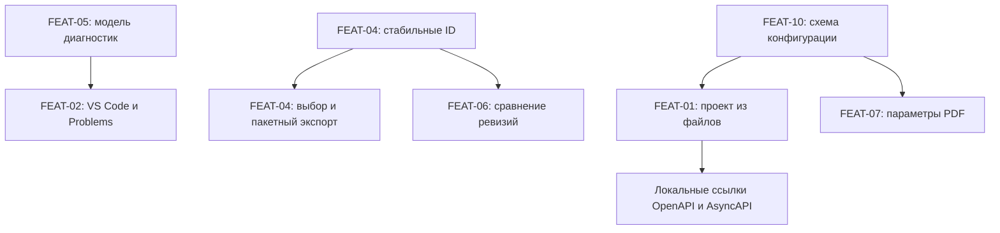

# План развития blueprint4llm

Статус: список задач для будущих изменений. Все пункты открыты.

Приоритеты основаны на пользе для пользователей проекта и распространённости в разработке. Это экспертная оценка, а не результат измерения спроса. Порядок сохранён отдельно для форматов (`FMT-01`–`FMT-10`) и функций (`FEAT-01`–`FEAT-10`). Номер в одном списке не задаёт приоритет относительно другого списка.

## Текущее состояние

Основа: [README](README.md), исходный код, тесты и [расширение VS Code](vscode-extension/README.md). Старые планы в `dev-docs/` служат историей изменений.

| Область      | Уже реализовано                                                    | Что расширить                                                  |
| ------------ | ------------------------------------------------------------------ | -------------------------------------------------------------- |
| Форматы      | Mermaid, PlantUML, Wiremark, draw.io JSON, Pencil, Balsamiq, Figma | Добавить десять форматов из списка ниже                        |
| Экспорт      | HTML, PDF, SVG, PNG, JPEG                                          | Выбор схем, пакетный экспорт, настройки печати и переносимость |
| Предпросмотр | CLI live preview и VS Code Webview                                 | Навигация, связь с исходником, масштабирование и сравнение     |
| Проверка     | `--check`, предупреждения и некоторые ошибки рендереров            | Структурированные сообщения и продолжение после ошибки блока   |
| Вход         | Один Markdown-файл; изображения относительно него                  | Сборка проекта из нескольких файлов                            |

## Предварительные макеты

Макеты показывают основные сценарии будущего интерфейса. Подписи и расположение элементов предварительные; они не описывают уже реализованное поведение.

### Проект, навигация и просмотр схемы — FEAT-01, FEAT-03, FEAT-04

```wireframe
Wireframe #project-preview w=1160 h=620
  Stack column gap=2 padding=3
    Typography h5 "Blueprint · Архитектура проекта"
    Stack row gap=3
      Card 260px 440px
        CardContent
          Stack column gap=2
            TextField "Поиск по проекту" value="API"
            Typography h6 "Документы"
            List
              ListItem "Обзор"
              ListItem "Архитектура · выбрано"
              ListItem "Контракты API"
            Typography body2 "Найдено: 3 совпадения"
            Link "Контракты API / Заказы"
      Card 800px 440px
        CardContent
          Stack column gap=2
            Typography h6 "Схема: order-service"
            Stack row gap=1
              Button "−"
              Chip "100%"
              Button "+"
              Button "Вписать"
              Button "На весь экран"
            Placeholder "Клиент → API → Сервис заказов" 720px 160px
            Stack row gap=1
              Button "К исходнику"
              Button "Экспорт схемы"
              Button "Экспорт всех схем"
            Alert "Проект обновлён · 3 документа" severity=success
```

### Редактор, синхронизация и ошибки — FEAT-02, FEAT-05

```wireframe
Wireframe #editor-diagnostics w=1160 h=620
  Stack column gap=2 padding=3
    Stack row gap=2
      Typography h5 "VS Code · architecture.md"
      Control switch checked
      Typography body2 "Синхронная прокрутка"
    Stack row gap=3
      Card 520px 280px
        CardContent
          Stack column gap=2
            Typography h6 "Исходник · строка 42"
            Typography body2 "Выделен блок диаграммы order-service"
            Typography body2 "Ошибка: неизвестный идентификатор узла"
            Link "Открыть подсказку синтаксиса"
      Card 540px 280px
        CardContent
          Stack column gap=2
            Typography h6 "Предпросмотр"
            Alert "Не удалось обновить схему order-service" severity=error
            Button "Перейти к строке 42" outlined
            Typography body2 "Остальные блоки доступны для просмотра"
    Card 1080px 160px
      CardContent
        Stack column gap=1
          Typography h6 "Problems · 1 ошибка"
          Link "architecture.md:42:5 · Неизвестный идентификатор узла"
          Typography body2 "После исправления сообщение исчезнет"
```

### Сравнение ревизий — FEAT-06

```wireframe
Wireframe #revision-comparison w=1160 h=540
  Stack column gap=2 padding=3
    Typography h5 "Изменения схемы order-service"
    Stack row gap=2
      TextField "Базовая ревизия" value="main"
      TextField "Новая ревизия" value="Рабочее дерево"
      Button "Сравнить" contained
    Stack row gap=3
      Card 520px 280px
        CardContent
          Stack column gap=2
            Typography h6 "До · main"
            Placeholder "Клиент → API → База данных" 460px 180px
      Card 540px 280px
        CardContent
          Stack column gap=2
            Typography h6 "После · Рабочее дерево"
            Placeholder "Клиент → API → Сервис → База" 480px 180px
    Typography body2 "Схемы сопоставлены по стабильному ID"
```

## Форматы: 10 задач в порядке приоритета

### FMT-01. draw.io XML / .drawio

Ценность: расширить существующую интеграцию и сохранять исходные координаты и оформление. Текущий JSON-рендерер сохраняет структуру, но строит новую раскладку. [Форматы сохранения draw.io](https://www.drawio.com/docs/manual/editor/save-file-formats/).

- [ ] Добавить чтение XML из `.drawio`, включая сжатые и несжатые страницы; сохранить поддержку текущего JSON.
- [ ] Сохранять геометрию узлов, групп, рёбер и подписей, а также согласованный набор стилей. Явно описать ограничения воспроизведения.
- [ ] Проверять выбор страницы, повреждённый XML и неподдержанные элементы. Сравнить результат с исходными схемами в редакторе.

### FMT-02. Excalidraw / .excalidraw

Ценность: включать архитектурные наброски и схемы обсуждений прямо в план. [JSON-схема Excalidraw](https://docs.excalidraw.com/docs/codebase/json-schema/).

- [ ] Принимать JSON-сцену `.excalidraw` и согласовать поддерживаемую версию схемы.
- [ ] Отображать основные фигуры, текст, стрелки и группы с сохранением координат и оформления.
- [ ] Определить поддержку шрифтов и встроенных изображений. Проверить границы сцены и ошибки ссылок между элементами.

### FMT-03. OpenAPI YAML/JSON

Ценность: получать документацию API из контракта рядом с архитектурой, сокращая ручное дублирование. [Спецификация OpenAPI](https://spec.openapis.org/oas/latest.html).

- [ ] Принимать YAML и JSON; явно определить поддерживаемые версии OpenAPI.
- [ ] Показывать методы, пути, параметры, модели, тела запросов, ответы и примеры.
- [ ] Поддержать внутренние `$ref`; согласовать локальные ссылки между файлами с FEAT-01. Проверять неразрешённые ссылки и циклы без бесконечного раскрытия моделей.

### FMT-04. Vega-Lite JSON

Ценность: показывать нагрузку, задержки, стоимость и продуктовые метрики из декларативного описания. [Документация Vega-Lite](https://vega.github.io/vega-lite/).

- [ ] Принимать спецификацию JSON и рендерить статический SVG с локальными данными.
- [ ] Проверить линейные и столбчатые графики, оси, легенды, агрегирование и несколько рядов данных.
- [ ] Определить работу с отдельными файлами данных и интерактивными возможностями; обеспечить понятный статический результат при печати.

### FMT-05. DBML

Ценность: подключать существующую модель БД с точными таблицами, ключами, индексами и связями. Общие ER-диаграммы уже доступны через текущие инструменты. [Синтаксис DBML](https://dbml.dbdiagram.io/docs/).

- [ ] Разбирать таблицы, столбцы, типы, первичные и внешние ключи, индексы и связи.
- [ ] Строить читаемую схему и сохранять описание ограничений, которые не помещаются на диаграмме.
- [ ] Проверить составные ключи, связи между схемами БД и диагностику неизвестных таблиц или столбцов.

### FMT-06. D2

Ценность: ещё один текстовый язык архитектурных схем с автоматическим размещением, удобный для работы агента. [Введение в D2](https://d2lang.com/tour/intro/).

- [ ] Выбрать локальный способ запуска и документировать необходимые зависимости.
- [ ] Добавить рендеринг узлов, контейнеров, подписей и связей в SVG.
- [ ] Проверить ошибки синтаксиса, большие графы, ограничения времени и правила локальных импортов.

### FMT-07. LaTeX-формулы в Markdown

Ценность: описывать алгоритмы, расчёты ёмкости, SLA и ML-спецификации. MathJax поддерживает SVG-вывод. [SVG в MathJax](https://docs.mathjax.org/en/latest/output/svg.html).

- [ ] Поддержать строчные `$…$` и отдельные `$$…$$` формулы с локальным рендерингом.
- [ ] Согласовать экранирование знака `$`; сохранить обычный текст, inline-код и fenced-блоки без ложного распознавания формул.
- [ ] Проверить дроби, матрицы, длинные формулы, ошибки TeX и вывод в HTML, предпросмотре и PDF.

### FMT-08. BPMN 2.0 XML

Ценность: включать готовые бизнес-процессы с событиями, шлюзами и дорожками участников. [Инструментарий bpmn-js](https://bpmn.io/toolkit/bpmn-js/).

- [ ] Импортировать BPMN XML и сохранять размещение из BPMN DI.
- [ ] Отображать задачи, события, шлюзы, потоки, пулы и дорожки в SVG.
- [ ] Определить поведение при отсутствии BPMN DI и неподдержанных расширениях; проверить совместную работу нескольких процессов.

### FMT-09. Structurizr DSL

Ценность: получать несколько согласованных представлений C4 из одной модели с общими компонентами и связями. [Документация Structurizr DSL](https://docs.structurizr.com/dsl).

- [ ] Выбрать локальный parser/renderer и определить поддерживаемое подмножество DSL.
- [ ] Добавить выбор представления по ключу и рендеринг контекста, контейнеров и компонентов из одной модели.
- [ ] Проверить повторное использование элементов, связи и диагностику неизвестного представления; определить правила `!include`.

### FMT-10. AsyncAPI YAML/JSON

Ценность: документировать событийные системы с каналами, сообщениями и операциями рядом с HTTP API. [Спецификация AsyncAPI](https://www.asyncapi.com/docs/reference/specification/latest).

- [ ] Принимать YAML и JSON; явно определить поддерживаемые версии AsyncAPI.
- [ ] Показывать каналы, сообщения, операции, схемы данных и примеры.
- [ ] Переиспользовать подход к ссылкам из OpenAPI; проверить неразрешённые ссылки и поддерживаемые протокольные bindings.

## Функции: 10 задач в порядке приоритета

### FEAT-01. Проект из нескольких файлов

Ценность: сопровождать большие спецификации без копирования блоков между документами.

- [ ] Добавить сборку каталога Markdown с явным порядком документов, общей навигацией и поиском.
- [ ] Подключать схемы из отдельных файлов; корректно разрешать относительные изображения, ссылки и якоря.
- [ ] Отслеживать изменения зависимостей в preview. Проверять отсутствующие файлы, циклы подключений и конфликты якорей.

Готово, когда проект из трёх документов с общей схемой собирается, ищется и обновляется после изменения подключённого файла.

### FEAT-02. Связь исходника и preview в VS Code

Ценность: ускорить повседневное редактирование и исправление схем.

- [ ] Передавать диапазоны строк исходника в preview; добавить синхронную прокрутку и переход от схемы к её fenced-блоку.
- [ ] Показывать ошибки и предупреждения в Problems с переходом к строке и удалять устаревшие сообщения после исправления.
- [ ] Добавить подсказки имён форматов и metadata. Использовать структурированные диагностики FEAT-05.

Готово, когда переходы работают с несохранённым буфером, а прокрутка и диагностики сохраняют правильные строки после вставки текста.

### FEAT-03. Масштабирование и полноэкранный просмотр схем

Ценность: читать большие схемы и прослеживать связи без постоянной прокрутки документа.

- [ ] Добавить увеличение, уменьшение, перемещение, сброс и «вписать целиком» для каждой схемы.
- [ ] Добавить полноэкранный режим с выходом по `Esc` и доступными с клавиатуры кнопками.
- [ ] Проверить работу в браузерном preview и VS Code; сохранять корректный вид схемы при печати.

Готово, когда широкую схему можно полностью осмотреть и вернуть к исходному виду без потери положения в документе.

### FEAT-04. Экспорт выбранной схемы и всех схем документа

Ценность: экспортировать изображения без разрезания Markdown на отдельные файлы.

- [ ] Ввести явный стабильный ID блока и проверку дубликатов. Текущие порядковые `bp-diagram-001` не подходят как постоянные ссылки.
- [ ] Добавить выбор по ID, экспорт всех схем, предсказуемые имена файлов и отчёт об ошибках отдельных блоков.
- [ ] Настраивать разрешение PNG; поддержать SVG/PNG/JPEG и сохранить текущий сценарий экспорта документа с одной схемой.

Готово, когда добавление схемы в начало документа не меняет экспорт по ID, а пакетный экспорт создаёт отдельные изображения для всех схем.

### FEAT-05. Структурированная диагностика для агентов и CI

Ценность: дать агенту точное место исправления, а CI — сообщения, привязанные к исходному файлу и строке.

- [ ] Ввести общую модель: код, severity, сообщение, файл, диапазон строк/столбцов, формат и ID блока.
- [ ] Добавить JSON и SARIF для `--check`; собирать ошибки независимых блоков за один запуск, включая ошибки, которые сейчас прерывают обход.
- [ ] Добавить строгий режим для предупреждений, документировать коды завершения и сохранить человекочитаемый вывод по умолчанию.

Готово, когда документ с двумя ошибочными блоками и предупреждением выдаёт полный отчёт, а строгий режим завершает проверку ненулевым кодом.

### FEAT-06. Визуальное сравнение версий

Ценность: проверять изменения схем и экранов между ревизиями Git, в том числе после работы LLM.

- [ ] Выбирать базовую и новую ревизии, включая рабочее дерево; сопоставлять блоки по стабильному ID из FEAT-04.
- [ ] Показывать «до/после» для изменённых схем и прототипов, отдельно отмечать добавленные и удалённые блоки.
- [ ] Зафиксировать параметры рендеринга для сравнения и обработку ресурсов каждой ревизии.

Готово, когда изменение одной схемы отображается как изменение этой схемы, а вставка нового блока не сдвигает все пары сравнения.

### FEAT-07. Настраиваемый PDF

Ценность: печатать широкие архитектурные схемы в подходящем формате. Сейчас A4 и поля заданы в `src/pdf.ts`.

- [ ] Добавить A3/A4, книжную и альбомную ориентацию, поля и настройки разрывов страниц.
- [ ] Добавить закладки по заголовкам и проверить переходы по ним.
- [ ] Передавать одинаковые параметры через CLI, браузерный preview и VS Code; подключить FEAT-10 после появления общего конфига.

Готово, когда широкая схема экспортируется в A3 landscape без обрезки, а заголовки доступны в закладках PDF.

### FEAT-08. Один переносимый HTML-файл

Ценность: передавать документ одним файлом. Сейчас локальные изображения копируются в соседний `assets/`.

- [ ] Добавить режим встраивания локальных изображений в HTML.
- [ ] Предусмотреть альтернативный ZIP с HTML и ресурсами; определить политику внешних HTTP(S)-изображений.
- [ ] Проверить размеры результата, повторное использование одинаковых ресурсов и открытие из другой директории без сети.

Готово, когда HTML со всеми локальными изображениями открывается после переноса одного файла; ZIP работает после распаковки.

### FEAT-09. Кликабельные прототипы Wiremark

Ценность: проверять пользовательские сценарии и состояния интерфейса непосредственно в плане.

- [ ] Проверить существующие возможности Wiremark `to`/`href`; определить контракт переходов между экранами и блоками документа.
- [ ] Добавить переходы по кнопкам и ссылкам, возврат и отображение отдельных состояний интерфейса.
- [ ] Диагностировать отсутствующие цели; согласовать интерактивность с проверкой SVG и политикой VS Code Webview, где скрипты сейчас отключены.

Готово, когда сценарий «форма → ошибка → успешное состояние → возврат» проходится в preview, а печатный экспорт сохраняет читаемые экраны.

### FEAT-10. Общий конфиг и шаблоны документов

Ценность: единообразно настраивать CLI и VS Code и быстро создавать типовые планы.

- [ ] Ввести конфиг оформления, печати и рендереров с проверкой схемы и понятной диагностикой неизвестных параметров.
- [ ] Определить поиск конфига и приоритет значений CLI, настроек VS Code, проекта и значений по умолчанию.
- [ ] Добавить шаблоны ADR, архитектурного описания и спецификации функции с рабочими примерами поддерживаемых блоков.

Готово, когда одинаковый документ с общим конфигом имеет согласованное оформление в CLI и VS Code, а шаблоны проходят `--check`.

## Зависимости и порядок реализации

Приоритет отражает пользу. Технические зависимости могут требовать предварительной небольшой задачи из менее приоритетного пункта. Стрелки ниже показывают переиспользование общей основы, а не обязательный порядок выпуска всех двадцати задач.



| Этап                               | Задачи                                                                       | Проверяемый результат                                                                    |
| ---------------------------------- | ---------------------------------------------------------------------------- | ---------------------------------------------------------------------------------------- |
| Общая основа                       | Модель диагностик FEAT-05, стабильные ID FEAT-04, минимальный конфиг FEAT-10 | Общие контракты для CLI, preview и расширения                                            |
| Основной пользовательский сценарий | FEAT-01, FEAT-02, FEAT-03; FMT-01, FMT-02                                    | Большой проект удобно редактировать и просматривать; исходные схемы сохраняют размещение |
| Контракты и экспорт                | FEAT-04, FEAT-05, FEAT-07, FEAT-08; FMT-03, FMT-04, FMT-05                   | Контракты и метрики входят в план, результаты удобно проверять и передавать              |
| Расширенные сценарии               | FEAT-06, FEAT-09, оставшаяся часть FEAT-10; FMT-06–FMT-10                    | Сравнение ревизий, сценарии прототипов, шаблоны и дополнительные языки                   |

Этапы — предложение для реализации. Сроки и трудоёмкость определить после выбора движков и согласования границ первой версии каждой задачи.

## Общие критерии готовности

- [ ] Для каждого нового формата определены имя fenced-блока, версия входной схемы, metadata, ограничения и поведение неподдержанных элементов.
- [ ] Новый формат включён и в `compileMarkdown()`, и в `checkMarkdown()`; пример работает в HTML, PDF, CLI preview и VS Code. Для схем проверен SVG/PNG/JPEG, для формул — сценарии документа.
- [ ] Новые источники из отдельных файлов включены в отслеживание зависимостей и корректно влияют на кэш.
- [ ] Добавлены unit-тесты изменённого поведения и функций, нужные интеграционные тесты, пример в `examples/`, документация в README и обновления навыка `skills/blueprint4llm`.
- [ ] Все новые схемы и макеты осмотрены целиком после рендеринга; нет обрезанных подписей, потерянных элементов и нечитаемых связей.
- [ ] Пройдены тесты и сборки основного пакета и расширения без ошибок и предупреждений. Проверки не ослаблены; версия увеличена согласно `AGENTS.md`.

## Решения перед началом отдельных задач

| Вопрос                                                                       | Когда решить                                        |
| ---------------------------------------------------------------------------- | --------------------------------------------------- |
| Какие версии и подмножества новых форматов поддерживать сначала?             | Перед реализацией соответствующего `FMT`            |
| Какие движки подходят по лицензии, локальному запуску, размеру и скорости?   | Перед добавлением зависимостей                      |
| Как задавать ID блоков, подключения файлов и корень проекта?                 | При проектировании FEAT-01 и FEAT-04                |
| Какой формат конфига выбрать и как разрешать конфликты настроек?             | В общей основе FEAT-10                              |
| Где нужны интерактивные экраны, а где достаточно статического представления? | При детализации FEAT-03, FEAT-06, FEAT-07 и FEAT-09 |
