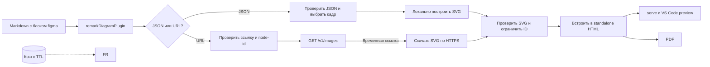

# План: поддержка Figma JSON и ссылок на Figma Design

## Цель

Добавить в Markdown блок `figma` с двумя вариантами источника: встроенный JSON дерева документа Figma и ссылка на кадр Figma Design. Оба варианта показываются в HTML, локальном предпросмотре, VS Code preview и PDF. Скомпилированный документ должен содержать inline SVG и открываться без сетевых запросов.

## Решение и границы первой версии

`figma` блок принимает JSON в формате ответа Figma REST API или ссылку на кадр. Режим определяется по содержимому блока: JSON начинается с `{`, ссылка — с `https://`.

Пример JSON-источника. `document` и типы узлов соответствуют дереву, которое Figma возвращает через REST API; `node=12:34` выбирает конкретный кадр. Если параметр не указан, в JSON должен быть ровно один кадр верхнего уровня.

````markdown
```figma node=12:34
{
  "name": "Профиль",
  "document": {
    "id": "0:0",
    "name": "Document",
    "type": "DOCUMENT",
    "children": [
      {
        "id": "1:1",
        "name": "Page 1",
        "type": "CANVAS",
        "children": [
          {
            "id": "12:34",
            "name": "Profile",
            "type": "FRAME",
            "absoluteBoundingBox": { "x": 0, "y": 0, "width": 360, "height": 640 },
            "fills": [
              { "type": "SOLID", "color": { "r": 1, "g": 1, "b": 1, "a": 1 } }
            ],
            "children": [
              {
                "id": "12:35",
                "name": "Title",
                "type": "TEXT",
                "absoluteBoundingBox": { "x": 24, "y": 32, "width": 240, "height": 32 },
                "characters": "Профиль",
                "style": { "fontFamily": "Inter", "fontSize": 24, "fontWeight": 600 },
                "fills": [
                  { "type": "SOLID", "color": { "r": 0.12, "g": 0.12, "b": 0.12, "a": 1 } }
                ]
              },
              {
                "id": "12:36",
                "name": "Save button",
                "type": "RECTANGLE",
                "absoluteBoundingBox": { "x": 24, "y": 96, "width": 312, "height": 48 },
                "cornerRadius": 8,
                "fills": [
                  { "type": "SOLID", "color": { "r": 0.1, "g": 0.35, "b": 0.85, "a": 1 } }
                ]
              }
            ]
          }
        ]
      }
    ]
  }
}
```
````

JSON-режим работает локально и не требует токена. Поддерживается ограниченная подмножина дерева Figma: контейнеры `FRAME`, `GROUP`, `COMPONENT`, `INSTANCE`; фигуры `RECTANGLE`, `ELLIPSE`, `LINE`; текст `TEXT`; векторные пути `VECTOR`, если JSON содержит геометрию. Рендерер собирает SVG из геометрии, заливок, обводок, скруглений и текстовых свойств. Градиенты, эффекты, маски, встроенные изображения и сложные текстовые переопределения нужно либо реализовать отдельно, либо диагностировать как неподдерживаемые. Для сложных макетов подходит ссылочный режим.

JSON-контракт основан на Figma REST API: корневой объект ответа содержит `document`, а `document` — дерево `DOCUMENT` → `CANVAS` → слои. Векторная геометрия не всегда включена в JSON по умолчанию, поэтому для узлов `VECTOR` исходный ответ должен быть получен с `geometry=paths`. Источники: [структура Figma-файла](https://developers.figma.com/docs/rest-api/files/), [типы узлов](https://developers.figma.com/docs/rest-api/file-node-types/) и [параметры endpoint-а](https://developers.figma.com/docs/rest-api/file-endpoints/).

Ссылочный вариант сохраняется: один блок с URL кадра Figma Design:

````markdown
```figma
https://www.figma.com/design/FILE_KEY/Account?node-id=12-34
```
````

Для ссылочного блока рендерер разбирает URL, находит ключ файла и `node-id`, затем запрашивает SVG кадра через официальный Figma REST API. Для старых ссылок принимается путь `/file/`; поддерживаются только Figma Design и один кадр на блок. ID из URL нормализуется из `12-34` в API-формат `12:34`. При наличии `version-id` используется указанная версия. Прочие параметры запроса, например `t`, игнорируются и не передаются Figma API.

Локальные `.fig`, `.jam` и другие бинарные файлы Figma напрямую не разбираются. Figma называет эти форматы проприетарными и рекомендует сторонним инструментам использовать официальные API: [сохранение локальной копии](https://help.figma.com/hc/en-us/articles/8403626871063-Save-a-local-copy-of-files). Для локального офлайн-сценария можно вставить экспортированный PNG/SVG как обычное Markdown-изображение.

Сеть и учётные данные нужны только ссылочному режиму. Токен ищется в таком порядке: `CompileOptions.figmaAccessToken`, переменная окружения `FIGMA_ACCESS_TOKEN`, затем `FIGMA_ACCESS_TOKEN` из файла `.env` в текущей рабочей папке, если такой файл есть. Значения из настроек и окружения имеют приоритет над `.env`; файл не обязателен. Нужен доступ на чтение содержимого файла (`file_content:read`). Токен передаётся API в `X-Figma-Token` и никогда не попадает в Markdown, SVG, HTML, PDF или сообщения диагностики. Для локального инструмента достаточно токена пользователя; OAuth-flow в первую версию не входит. См. [аутентификацию Figma API](https://developers.figma.com/docs/rest-api/authentication/) и [персональные токены](https://developers.figma.com/docs/rest-api/personal-access-tokens/).

Официальный endpoint `GET /v1/images/:key` возвращает временную ссылку на изображение узла. Рендерер сразу скачивает SVG по HTTPS, проверяет его и встраивает содержимое в страницу. Готовый документ не использует временную ссылку. Параметры и требуемый scope описаны в [документации endpoint-ов файлов](https://developers.figma.com/docs/rest-api/file-endpoints/).

## Текущее устройство проекта

- `src/compiler.ts` подключает диаграммные рендереры в едином Markdown pipeline для компиляции и `--check`.
- `src/plugins/remark-diagrams.ts` выбирает рендерер по языку fenced-блока и помещает проверенный inline SVG в `<figure>`. Для выбора кадра из JSON нужно также передать рендереру metadata блока, например `node=12:34`.
- Контракт `DiagramRenderer` и общий SVG-проверяющий код уже дают основу для нового адаптера. Результат компиляции используется и для HTML, и для PDF; предпросмотр и расширение VS Code вызывают тот же компилятор.
- `DiagramRenderCache` — ограниченный LRU-кэш без срока действия. Для удалённого содержимого нужен небольшой TTL, чтобы повторная сборка могла получить обновлённый кадр.

Для JSON нужен локальный Figma JSON → SVG renderer; для ссылок — адаптер Figma REST API. Оба должны вернуть SVG, прошедший существующие проверки небезопасных элементов, событий и внешних ресурсов; ID SVG обрабатываются общей функцией. Для большого JSON-блока установить отдельный лимит внутри общего ограничения Markdown 5 MiB и лимиты на число/глубину узлов.

## Поток данных



## Макет кадра в предпросмотре

В документе кадр выглядит как самостоятельная фигура с подписью источника. В реальном предпросмотре содержимое карточки заменяется SVG, экспортированным из Figma; Wiremark здесь показывает окружение кадра и подпись.

```wireframe
Wireframe #figma-frame-preview landscape
  Stack column gap=2 padding=3
    Breadcrumbs
      Link "Blueprint"
      Link "Профиль пользователя"
    Typography h4 "Профиль пользователя"
    Card
      CardHeader title="Настройки профиля" subheader="Figma Design · node 12:34"
      CardContent
        Stack column gap=1
          Typography h5 "Личные данные"
          Typography body2 "Имя и контактная информация"
          TextField "Имя"
          TextField "Электронная почта"
          Button "Сохранить" contained
    Stack row gap=1
      Chip "Источник: Figma"
      Chip "Открыть кадр по ссылке"
```

## Пример в `examples`

В рамках реализации обязательно создать новый файл [`examples/blueprint-figma.md`](examples/blueprint-figma.md). В нём показать рабочий JSON-блок, который рендерится локально без токена, и отдельный пример URL-блока с инструкцией по токену через `CompileOptions.figmaAccessToken`, `FIGMA_ACCESS_TOKEN` или `.env` в текущей рабочей папке. URL-пример должен включать ссылку [на тестовый кадр Figma](https://www.figma.com/design/zLHKskbfyMxqt2Clt6iYui/test?node-id=1-2&t=ZyN0zfK7kUYBitwx-4); параметр `t` нужен только как часть исходного примера и не передаётся API. Этот файл должен служить проверяемым образцом синтаксиса и демонстрацией обеих возможностей; существующие примеры не заменять.

## План реализации

- [ ] Научить `figma` renderer различать JSON и URL. Для JSON принимать ответ `GET /v1/files/:key` с `document` типа `DOCUMENT`; читать `node=ID` из metadata fenced-блока, выбирать указанный `FRAME`/`COMPONENT`/`INSTANCE`, а без него требовать ровно один кадр верхнего уровня. Передать metadata кода через `DiagramRenderContext` и валидировать типы, координаты, размер JSON, число и глубину узлов.
- [ ] Разделить реализацию на parser/validator JSON и SVG renderer. Поддержать группы/кадры и базовые фигуры, solid fills/strokes, opacity, corner radius, rotation и простой текст; обработать `VECTOR` при наличии `geometry=paths`. Порядок детей в JSON сохраняет порядок слоёв. Для неподдерживаемых узлов и paints выдавать точную диагностику с ID/именем узла; не генерировать некорректный или активный SVG.
- [ ] Для URL-режима добавить отдельный парсер: разрешить только HTTPS и хост `figma.com` или `www.figma.com`; принимать пути `/design/:key/…` и `/file/:key/…`; требовать один корректный `node-id`; распознавать необязательный `version-id`; игнорировать прочие query-параметры (например, `t`) и не отправлять их API. Не использовать введённый URL как адрес сетевого запроса.
- [ ] Реализовать API-клиент URL-режима в `src/renderers/figma.ts` или отдельном модуле. Использовать встроенный в поддерживаемый Node.js `fetch`, не добавляя зависимость. Запрашивать `format=svg` у `GET /v1/images/:key`, передавать нормализованный ID и версию, если она указана. Текст SVG по умолчанию оставить текстом для поиска и выделения в PDF; проверить визуальное соответствие шрифтам Figma.
- [ ] Ограничить сеть и обработку SVG: Figma API вызывать только для URL-режима; использовать тайм-аут, `AbortSignal`, лимит размера ответа и ограничение параллельных запросов. Ключ API передавать только на `api.figma.com`; URL картинки принимать только по HTTPS и скачивать без токена. Не ослаблять общий SVG sanitizer: разрешить только ограниченные base64 PNG/JPEG-ссылки на `<image>`, если они нужны для растровых заливок URL-экспорта; запрещать другие внешние ресурсы, активные элементы и обработчики.
- [ ] Добавить `figma` в список рендереров для `compileMarkdown()` и `checkMarkdown()`. Токен из `CompileOptions.figmaAccessToken`, переменной окружения `FIGMA_ACCESS_TOKEN` или `.env` в текущей рабочей папке (в этом порядке приоритета) использовать только для URL; включить отпечаток токена в ключ кэша, не сохраняя и не печатая сам секрет. Добавить TTL для удалённого рендера; локальный JSON кэшировать как обычную диаграмму.
- [ ] Сформировать диагностику с файлом и строкой Markdown для некорректного JSON/схемы, неоднозначного или отсутствующего кадра, неподдерживаемого типа слоя, отсутствующего токена, неверной ссылки, недоступного файла/узла, истёкших прав, ответа `429`, тайм-аута и неподдерживаемого SVG. Тело ответа, JSON исходника и временную ссылку не выводить целиком.
- [ ] Добавить unit-тесты JSON парсера, выбора кадра и SVG геометрии; тесты для поддерживаемых узлов и понятного отказа для неподдерживаемых; тесты URL парсера, API-ответов/ошибок, отмены/тайм-аута, лимита размера, санитаризации и кэширования с TTL. Локальный JSON режим должен проходить с запрещённым сетевым `fetch`; ссылочные ответы тестировать подменой `fetch`.
- [ ] Добавить тесты компилятора на совместную работу обоих вариантов `figma` с Mermaid, PlantUML и Wiremark, а также на отображение и диагностики в `--check`. Проверить, что секрет и содержимое JSON не попадают в HTML/PDF и логи.
- [ ] Создать `examples/blueprint-figma.md` по требованиям раздела «Пример в `examples`», включая указанный тестовый URL. Проверить статический HTML/PDF на JSON-фикстуре без сети и `--serve` на авторизованном тестовом кадре; после сборки отключить сеть и убедиться, что оба SVG остаются видимыми. Обновить README: обе формы блока, JSON-подмножество, поиск токена в `CompileOptions.figmaAccessToken`, `FIGMA_ACCESS_TOKEN` и `.env` из текущей папки, scope токена и сетевые запросы только в ссылочном режиме.
- [ ] Выполнить сборку и полный набор проверок проекта. После успешных проверок увеличить patch-версию `package.json`, так как это добавление поддержки внешнего формата.

## Критерии готовности

- Блок `figma` принимает Figma REST API JSON из Markdown и локально отображает выбранный кадр в HTML, `--serve`, VS Code preview и PDF без токена и сети.
- Тот же блок принимает ссылку на один кадр Figma Design; SVG скачивается при компиляции, очищается существующим sanitizer и встраивается в документ.
- Скомпилированные документы не зависят от временных URL Figma. API вызывается только для ссылочного блока; без него проект работает офлайн.
- Ошибки JSON, выбора кадра, неподдерживаемых узлов, ссылки, авторизации, доступа, лимита API и SVG указывают Markdown-файл и строку, не раскрывая секреты и содержимое JSON.
- Существующие Mermaid, PlantUML и Wiremark продолжают работать; тесты и сборка проходят без ошибок и предупреждений.

## Ограничения и риски

- Figma API требует токен и разрешение на чтение файла; публичная ссылка сама по себе не гарантирует доступ API.
- Лимиты Figma зависят от тарифа и типа доступа. Повторные запросы сокращаются кэшем; `--serve` не опрашивает Figma постоянно и обновляет кадр при очередной компиляции после истечения TTL.
- JSON схема Figma богата и меняется; локальный рендерер поддерживает документированный MVP-набор node/paint типов, а не все возможности Figma. Большие ответы нужно сокращать до нужного узла; JSON-геометрия `VECTOR` требует API параметра `geometry=paths`.
- URL-экспорт SVG может содержать встроенные растровые заливки и отличаться по шрифтам. Поддержка допускает только безопасные, ограниченные изображения внутри SVG; неподдерживаемые конструкции завершаются понятной диагностикой.
- Первая версия не читает локальный `.fig`, FigJam, Figma Slides и прототипные переходы. Она отображает статичный кадр Figma Design.

## Официальные источники

- [Сохранение локальных копий и проприетарность форматов Figma](https://help.figma.com/hc/en-us/articles/8403626871063-Save-a-local-copy-of-files)
- [Figma REST API: получение и экспорт узлов файла](https://developers.figma.com/docs/rest-api/file-endpoints/)
- [Структура файла и дерево `DOCUMENT`/`CANVAS`](https://developers.figma.com/docs/rest-api/files/)
- [Свойства и типы узлов Figma](https://developers.figma.com/docs/rest-api/file-node-types/)
- [Аутентификация REST API и требуемые scopes](https://developers.figma.com/docs/rest-api/authentication/)
- [Персональные токены и заголовок `X-Figma-Token`](https://developers.figma.com/docs/rest-api/personal-access-tokens/)
