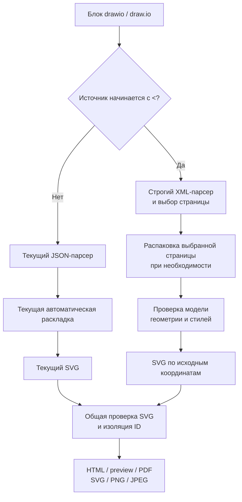

# FMT-01: draw.io XML и .drawio

Статус: план реализации; задача остаётся открытой. Источник: [FMT-01 в очереди форматов](plan-features-todo.md#новые-форматы).

## Цель и границы

Автор копирует XML из существующего `.drawio` в Markdown. Читатель видит знакомое размещение фигур, подписи и связи. Рендеринг работает локально через существующий SVG-конвейер.

| Решение первой версии | Граница поддержки                                                                               |
| --------------------- | ----------------------------------------------------------------------------------------------- |
| Вход                  | XML внутри существующего блока `drawio` или `draw.io`; обычный блок `xml` остаётся кодом        |
| Контейнеры            | Отдельный `mxGraphModel` или `mxfile` с элементами `diagram`; несжатые модели и сжатые страницы |
| Страницы              | Единственная страница выбирается автоматически; для нескольких нужен `page=<id>`, как у JSON    |
| Геометрия             | Исходные координаты, размеры, вложенные группы, относительные порты и явные точки связей        |
| Внешний вид           | Базовые фигуры, заливка, обводка, стрелки и текст в пределах таблицы поддержки ниже             |
| Совместимость         | Структурный JSON сохраняет текущую автоматическую раскладку и `direction=TB\|LR`                |
| Выход                 | HTML, браузерный preview, VS Code, PDF и экспорт одного блока в SVG/PNG/JPEG                    |

Для XML параметр `direction` отклонять с объяснением: направление задаёт исходная геометрия. Для отдельного `mxGraphModel` использовать синтетический ID страницы `main`. Подключение внешнего файла по пути, новый CLI для открытия `.drawio`, редактор и переключатель страниц в интерфейсе в эту задачу не входят. Для нескольких страниц автор создаёт несколько блоков с разными `page=<id>`.

Это выбранное подмножество XML draw.io, а не полная копия редактора. Атрибут `mxfile.version` сохранять как сведения об источнике; совместимость определять по поддерживаемым конструкциям. Добавить fixtures из реальных экспортов с зафиксированными версиями редактора.

## Подключение к текущему коду



| Существующая точка                                                                                                                                 | Что изменить или использовать                                                                                                                                        |
| -------------------------------------------------------------------------------------------------------------------------------------------------- | -------------------------------------------------------------------------------------------------------------------------------------------------------------------- |
| [drawio.ts](src/renderers/drawio.ts)                                                                                                               | Выбрать ветку по первому символу после BOM и пробелов; `<` означает XML, остальное передать прежнему JSON-парсеру. Ошибка XML не запускает повторный разбор как JSON |
| [drawio-json.ts](src/renderers/drawio-json.ts)                                                                                                     | Вынести чтение metadata в общий `drawio-options.ts`; сохранить валидацию JSON, выбор страницы, значения по умолчанию и ошибки                                        |
| [drawio-layout.ts](src/renderers/drawio-layout.ts), [drawio-svg.ts](src/renderers/drawio-svg.ts)                                                   | Оставить веткой JSON; XML не пропускать через автоматическую раскладку                                                                                               |
| [types.ts](src/renderers/types.ts)                                                                                                                 | Сохранить контракт `DiagramRenderer` и `DiagramResult`; предупреждения возвращать через `warnings`                                                                   |
| [compiler.ts](src/compiler.ts)                                                                                                                     | Renderer уже зарегистрирован в `compileMarkdown()` и `checkMarkdown()`; новый язык и второй renderer не нужны                                                        |
| [remark-diagrams.ts](src/plugins/remark-diagrams.ts), [parse-and-validate.ts](src/svg/parse-and-validate.ts), [scope-ids.ts](src/svg/scope-ids.ts) | Использовать существующие контейнер, диагностику, проверку SVG и изоляцию ID                                                                                         |
| [cache.ts](src/renderers/cache.ts)                                                                                                                 | Обновить `drawioRenderer.cacheKey`, включив версию XML-парсера и правила SVG; source и metadata уже входят в ключ                                                    |

FMT-01 не зависит от FEAT-03 и FEAT-05. Пока [FEAT-05](plan-feat-05-diagnostics.md) не реализована, исключение renderer останавливает сборку. Позже общая обработка покажет ту же ошибку на месте блока. Новый renderer не должен самостоятельно менять коды завершения CLI или добавлять отдельный отчёт.

## Контейнер, страницы и распаковка

В draw.io сжатая страница содержит XML, обработанный через URI-кодирование, raw DEFLATE и Base64. Обратный порядок: Base64 → `inflateRaw` → `decodeURIComponent` → разбор `mxGraphModel`. Несжатая страница содержит дочерний `mxGraphModel`. Эти варианты описаны в [официальном формате файла](https://github.com/jgraph/drawio/wiki/File-Format).

| Этап                 | Правило реализации                                                                                                                                                                |
| -------------------- | --------------------------------------------------------------------------------------------------------------------------------------------------------------------------------- |
| XML-парсер           | Добавить runtime-зависимость `saxes`. Использовать строгий разбор документа с позициями, а не HTML-парсер или регулярные выражения                                                |
| Внешняя оболочка     | Проверить корневой элемент, структуру страниц, непустые уникальные ID и предел числа страниц; `name` использовать в SVG title, при отсутствии — ID                                |
| Содержимое `diagram` | Допустить ровно одну вложенную модель или непустую строку Base64; смешанное содержимое и пустую страницу отклонять                                                                |
| Выбор                | Сначала разобрать оболочку и найти запрошенный ID, затем распаковать только выбранную страницу. Явно документировать: `--check` проверяет модель выбранной страницы               |
| Декодирование        | Разрешить пробелы и переводы строк вокруг и внутри Base64, затем проверить алфавит и padding. Отклонять повреждённые DEFLATE, URI-последовательности и UTF-8                      |
| Предел распаковки    | Использовать асинхронный `node:zlib.inflateRaw` с `maxOutputLength` до выделения полного результата; повторно проверить размер декодированного XML                                |
| Защита XML           | Отклонять DTD, объявления сущностей и инструкции обработки кроме XML declaration; разрешить стандартные XML entities и числовые ссылки. Не выполнять сетевые и файловые обращения |

Позиции `saxes` нормализовать к строкам и столбцам с единицы; детали API проверить по [документации парсера](https://github.com/lddubeau/saxes). Ограничение `maxOutputLength` доступно в поддерживаемом Node.js; использовать [документацию zlib](https://nodejs.org/api/zlib.html#class-options), не добавляя отдельную библиотеку DEFLATE.

## Модель и исходная геометрия

Ввести отдельные типы `DrawioXmlPage`, `DrawioXmlCell`, `DrawioXmlGeometry` и `DrawioXmlStyle`. Не дополнять структурный `DrawioGraph` полями, которые JSON не использует. Модель хранит ID, исходный порядок, parent, terminals, текст, стиль, геометрию и относительную позицию в источнике.

Поддержать обычный `mxCell` и обёртки `object` / `UserObject`: брать ID и `label` из обёртки, дочерний `mxCell` использовать для геометрии и связей. При конфликтующих ID выдавать ошибку. Произвольные пользовательские атрибуты не интерпретировать как код или стиль.

| Объект               | Правило                                                                                                                                |
| -------------------- | -------------------------------------------------------------------------------------------------------------------------------------- |
| Корень и слои        | Распознать служебный корень и его слои по структуре, без требования ID `0` и `1`; не рисовать их как фигуры                            |
| Ссылки               | Проверить уникальность ID, существование parent/source/target, отсутствие циклов parent и допустимые типы терминалов                   |
| Абсолютная фигура    | Суммировать координаты предков и `mxGeometry.x/y`, сохранять width/height; пропущенные x/y считать нулём                               |
| Относительная фигура | Для `relative=1` вычислить позицию через размеры родителя и добавить `offset`; применить к портам, вложенным в фигуру                  |
| Группа               | Сохранить исходные границы и вложенность; не менять размеры по детям. Поддержать невидимый контейнер `group` и обычную фигуру с детьми |
| Связь                | Сохранить source/target и `Array as="points"`; точки находятся в системе координат родителя связи                                      |
| Свободный конец      | При отсутствии terminal использовать sourcePoint/targetPoint; неизвестный ID или отсутствие обоих вариантов — ошибка                   |
| Порядок              | Сохранить порядок слоёв и детей внутри родителя; не переносить все связи на задний план автоматически                                  |
| Видимость            | `visible=0` скрывает элемент и его потомков; связи со скрытым terminal скрывать. `collapsed=1` пока отклонять                          |

Для геометрии ориентироваться на [официальную модель графа](https://github.com/jgraph/drawio/wiki/Graph-Model). Проверять конечность чисел и диапазоны до вычислений. Отрицательные координаты допустимы; размеры фигур должны быть положительными, нулевой размер разрешён только служебному порту.

SVG viewBox вычислять по объединению видимых фигур, текста, линий, толщины обводки и наконечников с полем 16 px. При отрицательных координатах сдвигать всю сцену одним transform. Относительные расстояния и размеры не менять. Пустая видимая страница даёт минимальный SVG с title.

## Поддерживаемые стили, связи и текст

Перечень ниже задаёт целевое подмножество первой версии. Названия свойств сверять с [официальной документацией стилей](https://github.com/jgraph/drawio/wiki/Styles). Стиль разбирать в типизированные значения; не переносить исходную строку в SVG/CSS.

| Область        | Поддержать                                                                                                                                                        |
| -------------- | ----------------------------------------------------------------------------------------------------------------------------------------------------------------- |
| Фигуры         | Прямоугольник по умолчанию, `rounded=1`, `ellipse`, `rhombus`, `text`, `group`                                                                                    |
| Цвет и линия   | `fillColor`, `strokeColor`, `fontColor`: hex и `none`; `strokeWidth`, `dashed`, `dashPattern`, `opacity`, `fillOpacity`, `strokeOpacity` с проверкой диапазонов   |
| Текст          | `fontSize`, `fontStyle` для bold/italic/underline, align/verticalAlign, whiteSpace=wrap, spacing и spacingTop/Right/Bottom/Left; использовать локальный Noto Sans |
| Наконечники    | startArrow/endArrow: none, classic, block, open, oval; startFill/endFill и startSize/endSize                                                                      |
| Соединение     | Прямая/ломаная и `edgeStyle=orthogonalEdgeStyle`; учитывать entryX/Y и exitX/Y, точки портов и явные waypoints                                                    |
| Подписи связей | `mxGeometry` самой связи и дочерние `edgeLabel`: положение вдоль пути, поперечное смещение и offset                                                               |

Для отсутствующего стиля зафиксировать детерминированные значения по умолчанию в fixtures. Другие именованные стили, фигуры stencil, swimlane, изображения, градиенты, тени, rotation и curved-связи отклонять с ID элемента и названием свойства. Не заменять неизвестную фигуру прямоугольником молча. Свойства редактора вроде `movable` или `locked` можно игнорировать; их закрытый список описать в README. Неизвестное визуальное свойство считать ошибкой.

Для прямой связи без waypoints найти пересечение с границей terminal; для прямоугольной трассы строить детерминированные горизонтальные и вертикальные сегменты через заданные точки. Полный алгоритм обхода препятствий draw.io не воспроизводить. Если исходник требует другого edgeStyle, выдавать ошибку ограничения. Совпадение автоматически построенных изгибов с редактором не гарантируется; координаты фигур и явных waypoints сохраняются.

При `html=1` разобрать подпись через уже имеющийся `hast-util-from-html`: сохранить текст и переводы строк от br/div/p, удалить script/style и активные атрибуты. Вывести экранированные SVG text/tspan без foreignObject. О потере inline-оформления сообщать предупреждением; общий fontStyle ячейки сохранять. Ссылки и tooltip не делать интерактивными, внешние шрифты и изображения не загружать.

Переносить длинные строки внутри исходной ширины, включая слова без пробелов. Не уменьшать шрифт и не менять размер фигуры автоматически. Если текст выходит за фигуру, сохранять его полностью, расширять viewBox и выдавать предупреждение с ID. Разницу метрик шрифтов с редактором описать как ограничение.

## Диагностика и пределы

| Событие                            | Ожидаемое сообщение                                                                                        |
| ---------------------------------- | ---------------------------------------------------------------------------------------------------------- |
| Синтаксис XML                      | Причина и позиция в блоке; общий plugin добавляет файл и строку Markdown                                   |
| Неверная сжатая страница           | ID страницы и этап: Base64, DEFLATE, URI или XML                                                           |
| Ошибка внутри распакованной модели | Позиция в Markdown у выбранного `diagram`; строка распакованного XML указывается только в тексте сообщения |
| Несколько страниц без выбора       | Число страниц, доступные ID и подсказка `page=<id>`                                                        |
| Неизвестная фигура или стиль       | ID страницы, ID ячейки, свойство и поддерживаемое подмножество                                             |
| Ошибочная ссылка или геометрия     | ID ячейки, имя поля и причина; без попытки исправить модель автоматически                                  |
| Превышение предела                 | Название, фактическое значение и максимум; без частично обрезанного SVG                                    |

Нельзя выдавать строку распакованной модели за строку Markdown. Для несжатого XML сохранять исходные позиции элементов. Ошибки выбрасывать с относительными `line`/`column`; предупреждения возвращать с теми же правилами. Не кешировать абсолютные координаты Markdown.

| Ресурс                | Предлагаемый предел XML-ветки                                                                                  |
| --------------------- | -------------------------------------------------------------------------------------------------------------- |
| Исходный блок         | 1 MiB UTF-8, как у текущего renderer; JSON-лимит сохранить                                                     |
| Распакованные данные  | 4 MiB URI-кодированных данных и 4 MiB XML выбранной страницы                                                   |
| Структура             | 100 страниц, 10 000 ячеек выбранной страницы, 100 000 XML-элементов, глубина 100                               |
| Дополнительные данные | 20 000 waypoints и 10 000 строк текста на выбранной странице                                                   |
| SVG                   | 4 MiB и 16 384 px на сторону, включая текст и наконечники                                                      |
| Время и отмена        | Бюджет 5 секунд на XML-ветку; проверять deadline и AbortSignal между порциями разбора, обхода и построения SVG |
| Документ              | Существующие 5 MiB Markdown и 100 блоков; общий лимит не увеличивать                                           |

Эти пределы — проектные решения. Проверить каждый на границе и за ней. Не полагаться на Promise timeout вокруг синхронного обхода: делить работу на порции и отдавать управление event loop. При отмене прерывать распаковку или отбрасывать её результат; устаревший preview не публиковать.

## Порядок реализации

Пути без ссылок ниже — новые модули, которые нужно создать при реализации, а не при подготовке плана.

| Шаг              | Модули и результат                                                                                                                                   |
| ---------------- | ---------------------------------------------------------------------------------------------------------------------------------------------------- |
| 1. Совместимость | `drawio-source.ts`, `drawio-options.ts`, существующие `drawio.ts` и `drawio-json.ts`: маршрутизация и общие metadata; прежние JSON-тесты проходят    |
| 2. Чтение XML    | `drawio-xml-source.ts`, `drawio-xml-types.ts`: строгий парсер, страницы, позиции, распаковка и пределы; зависимость saxes в package.json             |
| 3. Нормализация  | `drawio-xml-model.ts`: cells, wrappers, слои, ссылки, циклы и видимость; отдельная XML-модель                                                        |
| 4. Геометрия     | `drawio-xml-geometry.ts`: координаты групп и портов, трассы, подписи связей и границы сцены                                                          |
| 5. Вид           | `drawio-xml-style.ts`, `drawio-xml-label.ts`, `drawio-xml-svg.ts`: проверенное подмножество, текст, детерминированный SVG и warnings                 |
| 6. Интеграция    | Все новые renderer-модули разместить в `src/renderers/`; подключить XML-ветку в `drawio.ts`, обновить cacheKey, проверить общие экспорт и preview    |
| 7. Документация  | README, `examples/blueprint-drawio-xml.md`, `skills/blueprint4llm/SKILL.md`: вход, page, стили, пределы и ограничения; прежний пример JSON сохранить |
| 8. Приёмка       | Тесты и визуальная проверка; после реализации отметить FMT-01 выполненной и повысить minor-версию по AGENTS.md                                       |

Каждому модулю дать одну ответственность. Соблюдать предел 300–500 строк на code-файл и покрыть каждую добавленную или изменённую функцию unit-тестами. Не переносить XML-особенности в общий compiler или VS Code UI.

## Тесты и критерии приёмки

| Набор             | Обязательные проверки                                                                                                                                            |
| ----------------- | ---------------------------------------------------------------------------------------------------------------------------------------------------------------- |
| Source/options    | Оба alias, BOM, пробелы, XML declaration, комментарии; отсутствие fallback после ошибки XML; page и запрет direction для XML; прежние JSON-ошибки                |
| XML source        | raw mxGraphModel; сжатая и несжатая эквивалентные страницы; несколько страниц; неверные ID, Base64, DEFLATE, URI и XML; DTD/entities; все пределы                |
| XML model         | Произвольные ID корня/слоя, wrappers, дубли, потерянные terminals и parent, parent-циклы, скрытые элементы и отказ для collapsed                                 |
| Geometry          | Вложенные группы; относительные порты; отрицательные координаты; sourcePoint/targetPoint; waypoints; ортогональные связи; подписи и порядок наложения            |
| Style/label/SVG   | Каждое поддерживаемое свойство и отказ для неизвестного; HTML-подписи; кириллица; переносы; длинные слова; полный последний текст и границы viewBox; детерминизм |
| Безопасность      | script, события, URL, image/data URI и CSS url не попадают в SVG; общий валидатор не ослаблен; разным блокам назначаются разные marker ID                        |
| Renderer/cache    | compileMarkdown и checkMarkdown; JSON и XML вместе; повторный кеш, смена page и перенос блока; предупреждения с новыми координатами; отмена сборки               |
| CLI/export/server | `--check` не создаёт выходных файлов; ошибки с файлом и строкой, код 1; HTML/PDF; экспорт ровно одного блока; исправление XML обновляет preview                  |
| VS Code           | Добавить XML fixture в `vscode-extension/test/suite/index.ts`; проверить смену буфера и PDF через существующие preview-controller и pdf-export tests             |

Для новых модулей создать соответствующие `tests/drawio-xml-*.test.ts`, `drawio-source.test.ts` и `drawio-options.test.ts`. Расширить текущие `drawio-renderer.test.ts` и тесты CLI/export; все существующие JSON-тесты сохранить.

Контрольная схема содержит прямоугольник, ellipse, rhombus, вложенную группу с портом, две связи с waypoints и многострочную подпись у нижнего края. Сжатая и несжатая версии одной модели должны давать одинаковый SVG. Проверить численно исходные размеры и относительные расстояния после общего сдвига; одних SVG snapshots недостаточно.

Ручная приёмка: осмотреть контрольную схему целиком в HTML, браузерном preview и VS Code, в светлой и тёмной теме. В PDF и PNG проверить читаемость подписей, стрелки и нижнюю границу. Текущий [print-html.ts](src/print-html.ts) масштабирует схему до 220 mm по высоте: большие страницы могут стать мелкими; многостраничная печать одного блока в эту задачу не входит.

```bash
npm run build
npm run typecheck
npm run lint
npm run format:check
npm test
npm --prefix vscode-extension run build
xvfb-run -a npm --prefix vscode-extension test
blueprint4llm examples/blueprint-drawio-xml.md --check
```

FMT-01 готова, когда контрольные XML-варианты рендерятся во всех перечисленных средах, геометрия сохранена, JSON-регрессий нет, ограничения описаны, а тесты и сборки проходят без ошибок и предупреждений. Этот документ описывает будущую реализацию; поддержка XML сейчас не добавляется.
