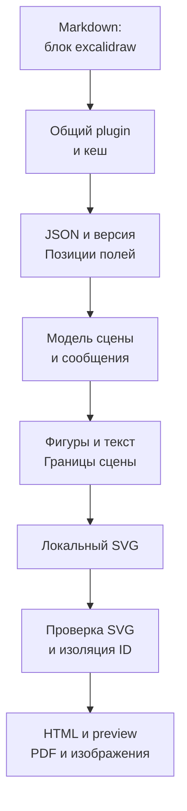
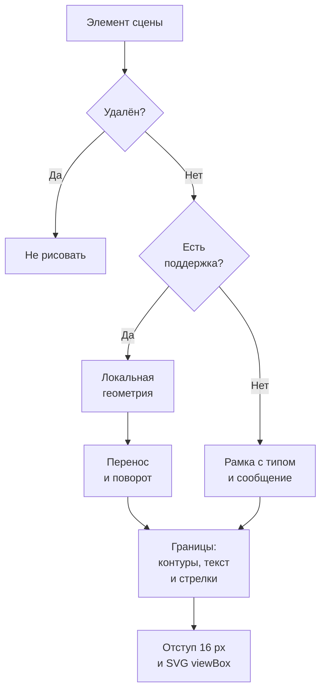

# FMT-02: Excalidraw в Markdown-планах

Статус: план реализации; задача остаётся открытой. Источник: [FMT-02 в очереди форматов](plan-features-todo.md#новые-форматы).

## Цель и границы первой версии

Автор вставляет JSON существующего архитектурного наброска в блок `excalidraw`. Читатель видит фигуры, подписи, стрелки и группы с исходными координатами. Сцена превращается в локальный SVG и проходит через существующий конвейер экспорта.

| Решение             | Граница поддержки                                                                                                                |
| ------------------- | -------------------------------------------------------------------------------------------------------------------------------- |
| Вход                | Один JSON-документ из файла `.excalidraw` внутри fence `excalidraw`; содержимое вставляется целиком, без чтения файла по пути    |
| Версия              | Корневые `type: "excalidraw"` и `version: 2`; другие версии отклонять с указанием поддерживаемой версии                          |
| Основные элементы   | `rectangle`, `ellipse`, `diamond`, `text`, `line` и обычная `arrow` с сохранённой ломаной                                        |
| Размещение          | Координаты, размеры, поворот и порядок элементов; принадлежность группам без автоматической раскладки                            |
| Среды               | HTML, браузерный preview, VS Code, PDF и существующий экспорт одной схемы в SVG/PNG/JPEG                                         |
| Рендеринг           | Статический SVG с ровными контурами; без редактора, React, сетевых запросов и новых runtime-зависимостей                         |
| За пределами версии | Clipboard JSON, библиотеки `.excalidrawlib`, URL сцен, встроенные сцены из PNG/SVG, изображения и оригинальные шрифты Excalidraw |

Корневая версия относится к документу. Поле `version` каждого элемента описывает его изменения и не выбирает версию формата. Это поддержка выбранного подмножества, а не полная совместимость со всеми сценами версии 2. Структура файлов описана в [официальной JSON Schema](https://docs.excalidraw.com/docs/codebase/json-schema).

## Сценарий и пример входа

1. Сохранить сцену в Excalidraw как `.excalidraw` и открыть её как текст.
2. Вставить JSON в Markdown-блок `excalidraw` рядом с пояснением архитектуры.
3. Запустить `blueprint4llm plan.md --check`, затем открыть preview или экспортировать документ.
4. Если сцена использует неподдерживаемые возможности, прочитать предупреждения и видимые обозначения пропущенных элементов.

Ниже — минимальный пример будущего синтаксиса. Внешний Markdown-fence позволяет показать его в этом плане до появления renderer.

````markdown
```excalidraw
{
  "type": "excalidraw",
  "version": 2,
  "elements": [
    { "id": "client", "type": "rectangle", "x": -160, "y": 20, "width": 160, "height": 80 },
    { "id": "api", "type": "ellipse", "x": 120, "y": 20, "width": 160, "height": 80 },
    {
      "id": "request", "type": "arrow", "x": 0, "y": 60,
      "width": 120, "height": 0, "points": [[0, 0], [120, 0]],
      "startArrowhead": null, "endArrowhead": "arrow"
    }
  ],
  "appState": { "viewBackgroundColor": "#ffffff" },
  "files": {}
}
```
````

Для необязательных полей этого подмножества задать документированные значения: `angle: 0`, `isDeleted: false`, `groupIds: []`, `strokeWidth: 1`, `strokeStyle: "solid"`, `strokeColor: "#1e1e1e"`, `backgroundColor: "transparent"`, `fillStyle: "solid"`, `opacity: 100`, `roughness: 0`, `roundness: null`, `elbowed: false`. Для текста: `fontSize: 20`, `lineHeight: 1.25`, `textAlign: "left"`. Не подменять неверные значения defaults. Приёмочные fixtures дополнительно брать из реальных экспортов Excalidraw; минимальный пример их не заменяет.

## Подключение к текущему коду



| Существующий модуль                                                                             | Что использовать или изменить                                                                                                  |
| ----------------------------------------------------------------------------------------------- | ------------------------------------------------------------------------------------------------------------------------------ |
| [types.ts](src/renderers/types.ts)                                                              | Реализовать `DiagramRenderer`; возвращать `DiagramResult` с SVG и относительными позициями предупреждений                      |
| [compiler.ts](src/compiler.ts)                                                                  | Добавить `excalidrawRenderer` в оба списка: `compileMarkdown()` и `checkMarkdown()`                                            |
| [remark-diagrams.ts](src/plugins/remark-diagrams.ts)                                            | Использовать выбор по языку, лимит размера, координаты Markdown, контейнер `bp-diagram--excalidraw` и текущую обработку ошибок |
| [cache.ts](src/renderers/cache.ts)                                                              | Кешировать результат через существующий API; включить версию JSON-парсера и правила геометрии, текста и стилей в `cacheKey`    |
| [parse-and-validate.ts](src/svg/parse-and-validate.ts), [scope-ids.ts](src/svg/scope-ids.ts)    | Сохранить общую проверку SVG и изоляцию ID маркеров между блоками                                                              |
| [image-export.ts](src/image-export.ts), [print-html.ts](src/print-html.ts)                      | Проверить экспорт и печать на новых fixtures; сохранить общие ограничения изображения и печатные шрифты                        |
| [server.ts](src/server.ts), [preview-controller.ts](vscode-extension/src/preview-controller.ts) | Проверить обновление сцены через существующий компилятор; отдельный путь рендеринга для preview не нужен                       |

FMT-02 не зависит от реализации FEAT-03 или FEAT-05. Сейчас исключение renderer прерывает сборку, а предупреждение сохраняет SVG. Продолжение после ошибок и JSON-отчёт описаны в [плане FEAT-05](plan-feat-05-diagnostics.md); новый формат не должен самостоятельно менять это поведение.

## Разбор и модель сцены

Использовать уже установленный `jsonc-parser` со строгими настройками: `disallowComments: true`, `allowTrailingComma: false`, `allowEmptyContent: false`. До рекурсивного разбора ограничить глубину, как это сделано для [Balsamiq](src/renderers/balsamiq-json.ts). Отслеживать дубли ключей, не полагаться на выбор последнего значения.

Парсер возвращает нормализованную сцену, список предупреждений и индекс позиций читаемых полей. Для каждого элемента хранить исходный ID, порядковый номер и JSON Pointer. Ошибки содержат `line` и `column` с единицы относительно содержимого блока; plugin преобразует их в координаты Markdown. В сообщении указывать путь поля, например `elements[2].points[1]`, без полного JSON.

| Область             | Правила                                                                                                                                      |
| ------------------- | -------------------------------------------------------------------------------------------------------------------------------------------- |
| Корень              | Требовать объект, корректные `type`, `version` и массив `elements`; `appState` и `files` необязательны, но при наличии должны быть объектами |
| Идентификаторы      | Требовать непустые уникальные ID; словари строить через `Map`; не переносить произвольные поля JSON в SVG                                    |
| Геометрия           | Проверять конечные числа; размеры неотрицательны, отрицательные координаты допустимы; нулевая ширина или высота допустима для линии          |
| Удалённые элементы  | Учитывать в лимите и проверке уникальности ID; при `isDeleted: true` не рендерить и не включать в границы сцены                              |
| Порядок             | Рисовать в порядке массива `elements`; служебный `index` не должен менять порядок сохранённого экспорта                                      |
| Группы              | Сохранить `groupIds` как принадлежность элемента группам; не добавлять рамки, смещения или повторный поворот                                 |
| Состояние редактора | Читать только `appState.viewBackgroundColor`; масштаб, прокрутку, выделение и настройки интерфейса игнорировать                              |
| Служебные данные    | `source`, `seed`, история изменения, блокировка и `customData` не влияют на геометрию; незнакомые служебные поля игнорировать                |

Пустая сцена, включая сцену только с удалёнными элементами, даёт небольшой SVG с текстом «Пустая сцена Excalidraw» и предупреждение. Это отличается от некорректного JSON, который считается ошибкой.

## Геометрия, текст и связи

Типы элементов и поля связей сверить с [официальными определениями Excalidraw](https://github.com/excalidraw/excalidraw/blob/master/packages/element/src/types.ts). При реализации сохранить экспорт и ссылку на конкретную ревизию источника рядом с fixture: одна корневая версия не фиксирует все возможности редактора.



| Часть                   | Правила отображения                                                                                                                                                        |
| ----------------------- | -------------------------------------------------------------------------------------------------------------------------------------------------------------------------- |
| Фигуры                  | Прямоугольник, эллипс и ромб по сохранённым размерам; `angle` в радианах, поворот вокруг центра элемента                                                                   |
| Линии                   | `points` задают локальные точки относительно `x`, `y`; не менее двух точек; сохранить отрицательные смещения и нулевые сегменты                                            |
| Стрелки                 | Рисовать сохранённую ломаную без пересчёта маршрута; поддержать `null`, `arrow` и `triangle` для обоих наконечников; направление брать по ближайшему ненулевому сегменту   |
| Вырожденные пути        | Если все точки совпадают, показать точку без наконечника и выдать предупреждение; не делить на нулевую длину                                                               |
| Привязки                | `startBinding`, `endBinding`, `containerId` и `boundElements` не перемещают элементы; отсутствующая или удалённая цель даёт предупреждение, сохранённая геометрия остаётся |
| Текст                   | Использовать сохранённый `text`, переносы строк, координаты, `fontSize`, `lineHeight`, `textAlign` и поворот; не пересчитывать переносы по `originalText`                  |
| Подписи фигур и стрелок | Рисовать соответствующий элемент `text` один раз на его сохранённом месте; не создавать второй текст из `boundElements` и не наследовать повторно поворот контейнера       |
| Группы                  | Оставить плоский порядок отрисовки и экранированные `data-group-ids`; вложенность групп не превращать в SVG transforms, которые сдвигают элементы                          |
| Границы                 | Объединить повёрнутые фигуры, точки линий, текст и наконечники с учётом толщины обводки; добавить отступ и явные положительные `width`, `height`, `viewBox`                |

Для текста использовать `sans-serif` в HTML/SVG и существующий Noto Sans при печати PDF. Сохранять все строки без обрезки по исходной высоте. При замене шрифта учитывать возможный выход глифов за сохранённый прямоугольник при расчёте границ и проверять его реальным рендерингом. Оригинальная ширина надписей не гарантируется; о замене шрифта сообщать один раз на семейство.

Группа не является отдельной фигурой. Не собирать её элементы в общий `<g>`, если это меняет перекрытия с элементами других групп. Сохранение групп в первой версии означает сохранение принадлежности и взаимного расположения; интерактивное выделение групп отложено.

## Стили и ограничения воспроизведения

| Возможность         | Поведение первой версии                                                                                                                            |
| ------------------- | -------------------------------------------------------------------------------------------------------------------------------------------------- |
| Цвет и прозрачность | Поддержать `#RGB`, `#RGBA`, `#RRGGBB`, `#RRGGBBAA`, `transparent`; `strokeWidth`, `opacity` от 0 до 100, `solid`/`dashed`/`dotted`                 |
| Фон                 | Использовать допустимый `viewBackgroundColor`, иначе белый; неверный цвет считать ошибкой; тема документа не должна менять исходные цвета сцены    |
| Заливка             | `solid` воспроизводить; hachure и другие виды штриховки заменять сплошной заливкой с предупреждением                                               |
| Рисованный контур   | Ненулевой `roughness` отображать ровным контуром с предупреждением; побитовое совпадение с RoughJS не входит в задачу                              |
| Скругления          | Непустой `roundness` упрощать до острых углов с предупреждением; сохранённые точки обычной линии остаются                                          |
| Наконечники         | Неподдерживаемый непустой вид заменять на `arrow` с предупреждением; явный `null` сохранять                                                        |
| Изображения         | `image` обозначать рамкой «Изображение не поддерживается» на исходном месте; содержимое `files` не декодировать и не загружать                     |
| Остальные элементы  | `freedraw`, `frame`, `magicframe`, `iframe`, `embeddable`, новые типы и `arrow` с `elbowed: true` показывать обозначенной рамкой с предупреждением |
| Frames              | Дочерние элементы сохраняют координаты сцены; рамка не вводит clip или смещение; отсутствие clipping явно указать в предупреждении                 |
| Ссылки              | `link` не превращать в активную ссылку; непустое значение отмечать предупреждением, без вывода URL в SVG                                           |

В предупреждении указывать ID и тип элемента либо путь поля. Повторяющиеся упрощения объединять по виду с числом затронутых элементов и позицией первого; сведения о неподдерживаемых элементах дополнительно видны на самой схеме. Чистая fixture из поддерживаемых элементов должна проходить `--check` без предупреждений.

## Лимиты и безопасный SVG

| Ограничение       | Значение первой версии                                                                                                |
| ----------------- | --------------------------------------------------------------------------------------------------------------------- |
| Размер JSON       | 1 MiB UTF-8; установить `maxSourceBytes` renderer, не менять общий лимит остальных форматов                           |
| Число элементов   | 3 000, включая удалённые и неподдерживаемые                                                                           |
| Глубина JSON      | 100; проверять до рекурсивного AST-разбора                                                                            |
| Точки линий       | 10 000 на элемент и 100 000 на сцену                                                                                  |
| Группы            | Не более 100 ID в `groupIds` одного элемента                                                                          |
| Числа             | Модуль координат и размеров до 1 000 000; `fontSize` от 1 до 512; `lineHeight` от 0.5 до 4; `strokeWidth` от 0 до 100 |
| Размер результата | SVG до 4 MiB UTF-8; проверять при накоплении вывода                                                                   |
| Экспорт растра    | Сохранить существующие ограничения 8 192 px на сторону и 32 млн пикселей; применять общее масштабирование экспорта    |

Превышение лимита — ошибка с именем ограничения. Проверки размеров и количества выполнять до построения больших промежуточных массивов. Длинные надписи ограничены размером входа и результата; не обрезать их молча.

Текст и атрибуты экранировать. Цвета проверять по разрешённой грамматике, не вставлять произвольный CSS. ID маркеров генерировать из порядковых номеров; не использовать пользовательский ID как fragment без преобразования. Запретить активный HTML, `foreignObject`, обработчики событий, внешние ресурсы и `url()` из JSON. Существующая проверка SVG остаётся обязательной; ради нового формата её не ослаблять.

Проверять `AbortSignal` до разбора и между крупными фазами. Не добавлять отдельный кеш. В кешируемом результате хранить локальные позиции, чтобы перенос fence в Markdown обновлял координаты сообщений.

## Модули и порядок реализации

| Шаг                    | Файлы                                                                                                                  | Проверяемый результат                                                                                         |
| ---------------------- | ---------------------------------------------------------------------------------------------------------------------- | ------------------------------------------------------------------------------------------------------------- |
| 1. Контракт и fixtures | Новые `tests/fixtures/excalidraw/`, `src/renderers/excalidraw-schema.ts`                                               | Сохранены реальный экспорт версии 2, минимальная сцена, группы, подписи, повороты и неподдерживаемые элементы |
| 2. Строгий разбор      | Новые `excalidraw-json.ts`, `excalidraw-json-error.ts`, при необходимости `excalidraw-json-tree.ts` в `src/renderers/` | Модель сцены, defaults, лимиты, дубли ключей и ID, локальные позиции ошибок                                   |
| 3. Геометрия           | Новые `src/renderers/excalidraw-geometry.ts`, `excalidraw-svg-text.ts`                                                 | Трансформации, направления наконечников, текст и полные границы; нет повторного смещения групп                |
| 4. SVG и renderer      | Новые `src/renderers/excalidraw-svg.ts`, `excalidraw.ts`                                                               | Детерминированный SVG, placeholders, предупреждения, отмена и версионированный `cacheKey`                     |
| 5. Интеграция          | `src/compiler.ts`, существующие интеграционные тесты                                                                   | Новый fence одинаково работает в `compileMarkdown()`, `checkMarkdown()`, preview и экспорте                   |
| 6. Документация        | `README.md`, `docs/reference.md`, новый `examples/blueprint-excalidraw.md`, `skills/blueprint4llm/SKILL.md`            | Описаны версия, подмножество, изображения, шрифты и упрощения; пример проверен и отрендерен                   |

Каждому модулю дать одну ответственность. Соблюдать предел 300–500 строк на code-файл; разделять по функциям, сохраняя связность. Каждую новую функцию покрыть unit-тестами. Не импортировать приватные helpers другого формата ради сокращения кода; общий модуль выделять только при реальном совпадении правил.

## Проверки и приёмка

Основная fixture: прямоугольник «Клиент» с отрицательными координатами, эллипс «API», ромб решения, подписанная стрелка из нескольких сегментов, повёрнутая фигура, многострочная подпись и две вложенные группы. Добавить удалённый элемент далеко от сцены: он не должен увеличивать её размер. Отдельная fixture показывает изображения, неподдерживаемый тип и замену стилей.

| Уровень           | Тесты и ожидаемый результат                                                                                                                                                                                                       |
| ----------------- | --------------------------------------------------------------------------------------------------------------------------------------------------------------------------------------------------------------------------------- |
| JSON и позиции    | Новый `tests/excalidraw-json.test.ts`: реальный экспорт и defaults, комментарии, trailing comma, дубли ключей/ID, неверная версия, clipboard, типы, переполнение числа, точные строки/столбцы, CRLF                               |
| Ограничения       | Пограничные и превышенные размер, глубина, элементы, точки и группы; не смешивать корневую версию и `element.version`                                                                                                             |
| Геометрия         | Новый `tests/excalidraw-geometry.test.ts`: отрицательные координаты, радианы, поворот центра, направленные наконечники, повторяющиеся точки, текст за исходной высотой, viewBox без удалённых элементов                           |
| SVG и стили       | Новый `tests/excalidraw-svg.test.ts`: порядок перекрытий, многострочный текст, группы без transforms, единичные подписи, placeholders, стили и детерминированность SVG                                                            |
| Безопасность      | HTML в тексте/ID, CSS и URL в цветах, `link`, данные `files`; результат проходит `parseAndValidateSvg()`; ни renderer, ни экспорт готового документа не обращаются к сети                                                         |
| Контракт renderer | Новый `tests/excalidraw-renderer.test.ts`: язык, размер блока, warnings, локальная позиция ошибки, abort до работы; менять `cacheKey` при изменении правил вывода                                                                 |
| Общий конвейер    | `tests/compiler.test.ts`, `tests/remark-diagrams.test.ts`, `tests/diagram-cache.test.ts`, `tests/diagram-limits.test.ts`: оба API, смешанный документ, два одинаковых блока с разными SVG ID, перенос fence, общий счётчик блоков |
| CLI и экспорт     | `tests/cli-integration.test.ts`, `tests/image-export.test.ts`, `tests/pdf.test.ts`: `--check` без выходных файлов, неправильная версия с кодом `1`, HTML/PDF и одна сцена в SVG/PNG/JPEG                                          |
| Preview           | `tests/server.test.ts`, `vscode-extension/test/suite/preview-controller.test.ts`: новая сцена появляется после изменения Markdown; никаких специальных обходов renderer                                                           |

Не заменять проверки смыслового результата снимком одной длинной SVG-строки. Проверять конкретные координаты, тексты, порядок элементов, границы и сообщения. Все существующие форматы должны сохранить прежнее поведение.

Ручная приёмка: открыть основную fixture в HTML, браузерном preview и VS Code, затем проверить PDF, SVG и PNG. Сравнить координаты и перекрытия с экспортом из Excalidraw; допустимы только перечисленные упрощения. Осмотреть все подписи, нижние элементы и наконечники. Проверить светлую и тёмную темы документа и работу без сети. В сцене с ограничениями должны быть видны placeholders и доступны предупреждения.

Большая сцена в PDF подчиняется текущему масштабированию схем до 220 mm по высоте и может стать мелкой. Многостраничную печать одной сцены и точное воспроизведение оригинальных шрифтов отложить; ограничения включить в документацию.

```bash
npm run build
npm run typecheck
npm run lint
npm run format:check
npm test
npm --prefix vscode-extension run build
# Для headless Linux:
xvfb-run -a npm --prefix vscode-extension test
blueprint4llm examples/blueprint-excalidraw.md --check
```

После реализации все тесты и сборки должны пройти без ошибок и предупреждений. Затем увеличить minor-версию корневого пакета по `AGENTS.md`. FMT-02 отметить выполненной в очереди только после приёмки. Создание этого плана не означает, что формат уже реализован.
