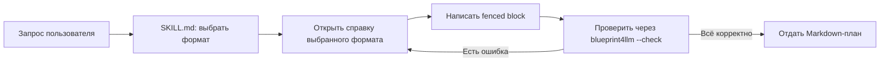

# План: LLM-справки по форматам

## Цель

Добавить краткие инструкции, по которым LLM сможет создавать блоки в форматах Blueprint4LLM с учётом именно тех версий и подмножеств, которые принимает проект. Связать эти инструкции с `SKILL.md`, чтобы агент открывал справку только для выбранного формата.

README остаётся обзором поддерживаемых форматов и ограничений. `SKILL.md` помогает выбрать формат и запускает workflow. Новые справки объясняют, как написать корректный блок для соответствующего рендерера. Источники истины — текущие исходный код и целевые тесты; справки не должны требовать доступа к внешней документации или интернету.

## Рабочий процесс

## Какие справки создать

Приоритеты учитывают редкость синтаксиса и расхождение между форматом, знакомым LLM, и входом, который принимает локальный рендерер. Это экспертная оценка риска, а не результаты сравнительного тестирования моделей.

| Приоритет            | Файл в `skills/blueprint4llm/formats/` | Формат                  | Содержание справки                                                                                                                                                                                                                         |
| -------------------- | -------------------------------------- | ----------------------- | ------------------------------------------------------------------------------------------------------------------------------------------------------------------------------------------------------------------------------------------ |
| P0                   | `drawio-llm.md`                        | draw.io structural JSON | Минимальная структура `version` → `pages` → `cells`; типы `layer`, `group`, `node`, `edge`; правила `parent`, `source`, `target`, выбор страницы и направления. Явно показать, что рендерер принимает этот JSON, а не обычный draw.io XML. |
| P0                   | `pencil-llm.md`                        | Pencil JSONC 2.21       | Минимальный документ, поля и поддерживаемые типы узлов, абсолютная геометрия, правила вложенности. Перечислить неподдерживаемые изображения, компоненты, градиенты и эффекты.                                                              |
| P0                   | `balsamiq-llm.md`                      | Balsamiq Mockups 3 JSON | Каркас одного mockup, распространённые контролы и обязательные поля, координаты и текст. Отдельно указать, что `.bmpr`, `.bmml`, assets и symbols не принимаются.                                                                          |
| P1                   | `excalidraw-llm.md`                    | Excalidraw JSON v2      | Каркас сцены, обязательные поля элементов, координаты, группы, текст и стрелки. Уточнить, что нужен `.excalidraw` JSON v2, а clipboard JSON и неподдерживаемые элементы не подходят.                                                       |
| P1                   | `figma-llm.md`                         | Figma REST API JSON     | Минимальный `DOCUMENT` с `CANVAS` и `FRAME`, выбор кадра через `node=<id>`, поддерживаемые узлы и fills. Развести режим локального JSON и URL-режим с токеном; не предлагать выдумывать credentials.                                       |
| P1                   | `echarts-llm.md`                       | ECharts static profile  | Чистый JSON, поддерживаемые типы графиков и серии, размеры блока, рабочие примеры. Указать ограничения статического рендеринга и частые опции вне разрешённого профиля.                                                                    |
| P1                   | `vega-lite-llm.md`                     | Vega-Lite 6             | Каноническая v6-спецификация с встроенными данными, базовые encoding и layering. Указать локальную схему, статический SVG, отсутствие внешних ресурсов и интерактивных selections.                                                         |
| P1                   | `openapi-llm.md`                       | OpenAPI 3.1.1           | Минимальный YAML/JSON контракт, operations, components и локальные `$ref`. Перечислить ограничения JSON Schema, локального renderer и поля, которые могут вызвать предупреждения.                                                          |
| P2, по необходимости | `d2-llm.md`                            | D2                      | Создавать после повторяющихся ошибок генерации. Зафиксировать проверенный синтаксис проекта для containers, connections, tables, UML и sequences, включая поддерживаемый профиль layout.                                                   |

Для Mermaid, Graphviz DOT и PlantUML отдельные файлы пока не планировать: их типовой синтаксис хорошо знаком LLM, а текущие краткие правила, README и целевые тесты дают достаточную отправную точку. Вернуться к этим форматам, если появятся повторяющиеся ошибки в реальных планах.

## Требования к каждой справке

Каждый файл должен:

- называть fence и версию/профиль, который фактически принимает текущий renderer;
- давать минимальный полный пример, который проходит `blueprint4llm --check`;
- объяснять обязательные поля и типовые структуры по исходному коду и целевым тестам, а не повторять полный стандарт формата;
- показывать неподдерживаемые конструкции, которые LLM вероятно добавит по привычке;
- перечислять частые ошибки и способ проверки;
- сверяться с актуальными исходным кодом и целевыми тестами.

Source-код и тесты определяют поведение, если они расходятся со старым планом или формулировкой в README. В справках описывать только возможности существующего renderer; расширение форматов не входит в этот план.

## Изменения в `SKILL.md`

1. В таблицах `Supported visual formats` превратить названия восьми форматов P0/P1 в относительные ссылки на соответствующие файлы в `formats/`.
2. Добавить короткое правило: перед авторингом открыть справку выбранного формата; не загружать остальные справки без необходимости.
3. Сохранить краткие рекомендации по выбору формата и ограничения рядом с таблицами, чтобы выбор не требовал чтения каждой справки.
4. Для D2 оставить текущую инструкцию; если будет создан `d2-llm.md`, добавить ссылку тем же способом.

## Этапы

1. Сверить P0 профили с текущими renderers и целевыми тестами; создать три справки с полными валидными примерами.
2. Создать пять компактных P1-справок, уделяя основное внимание локальным ограничениям форматов.
3. Добавить относительные ссылки и правило выборочной загрузки в `SKILL.md`.
4. Проверить ссылки, fence-теги, версии и примеры; прогнать `blueprint4llm --check` для затронутых документов. Выполнить сборку и полный набор тестов согласно `AGENTS.md`.
5. Добавлять D2-справку отдельно, если наблюдения за использованием покажут повторяющиеся ошибки, которые не устраняются справкой и проверкой CLI.

## Критерии готовности

- В `skills/blueprint4llm/formats/` есть все три P0 и пять P1-справок.
- `SKILL.md` ссылается на каждую созданную справку относительным путём и инструктирует читать только справку выбранного формата.
- Полные fenced-примеры каждой справки принимаются текущим renderer; относительные ссылки на справки и файлы разрешаются.
- Справки не обещают возможности сверх поддерживаемого профиля и не меняют поведение renderer.
- Сборка и тесты проходят; D2 остаётся отложенным, пока нет данных о повторяющихся ошибках.

## Results

Все восемь относительных ссылок из `SKILL.md` разрешаются в существующие файлы. Перед созданием блока агент должен открыть только справку выбранного формата. Справки опираются на исходный код и тесты, содержат самодостаточные инструкции и не требуют внешней документации. Материалы и ссылки из `examples/` не использовались.

| Формат     | Справка и ссылка                   | `--check`                                         |
| ---------- | ---------------------------------- | ------------------------------------------------- |
| draw.io    | `formats/drawio-llm.md` — есть     | PASS, 0 ошибок и предупреждений                   |
| Pencil     | `formats/pencil-llm.md` — есть     | PASS, 0 ошибок и предупреждений                   |
| Balsamiq   | `formats/balsamiq-llm.md` — есть   | PASS, 0 ошибок и предупреждений                   |
| Excalidraw | `formats/excalidraw-llm.md` — есть | PASS, 0 ошибок и предупреждений                   |
| Figma      | `formats/figma-llm.md` — есть      | PASS, 0 ошибок и предупреждений                   |
| ECharts    | `formats/echarts-llm.md` — есть    | PASS, оба fenced-блока; 0 ошибок и предупреждений |
| Vega-Lite  | `formats/vega-lite-llm.md` — есть  | PASS, 0 ошибок и предупреждений                   |
| OpenAPI    | `formats/openapi-llm.md` — есть    | PASS, 0 ошибок и предупреждений                   |

Проверки репозитория после изменения версии: `npm run build`, `npm run typecheck`, `npm run lint`, `npm run format:check` и `npm test` проходят. Полный набор тестов: 75 файлов, 700 тестов пройдено. CLI `--check` запускался на каждом документе справки; ошибок и предупреждений нет.

Версия повышена с `0.22.7` до `0.23.0` после успешных проверок. Финальный verification worker завис в контейнере и был остановлен по просьбе пользователя; контейнер не имел системной библиотеки `libglib-2.0.so.0`, поэтому его браузерные проверки завершились с ошибками. Проверки были повторены на хосте, где системные библиотеки Chrome доступны; все восемь справок и полный набор тестов прошли. Изменения рендереров не требовались. Справки не содержат ссылок на внешнюю документацию; локальные профили описаны без необходимости обращаться в интернет. Figma URL-режим указан как сетевой вариант, а JSON-режим — офлайн. D2 остаётся отложенным.
