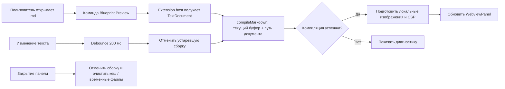

# План расширения blueprint4llm для Visual Studio Code

> В этом плане «VS Studio» означает Visual Studio Code (VS Code), настольную версию. Расширение открывает предпросмотр Markdown рядом с редактором и использует существующий рендерер `blueprint4llm`.

## Цель и границы

Пользователь открывает `.md`-файл, запускает команду **Blueprint: Open Preview to the Side** и видит тот же документ, что создаёт `blueprint4llm`: Markdown, локальные изображения, Mermaid и Wiremark. Предпросмотр обновляется при редактировании, в том числе до сохранения файла.

Первая версия предназначена для настольного VS Code и файлов `.md` на диске. Она не заменяет текстовый редактор, не редактирует Markdown визуально и не публикуется в Marketplace в рамках реализации самого расширения.

## Что уже есть в проекте

| Возможность                                               | Текущая точка входа                                                     |
| --------------------------------------------------------- | ----------------------------------------------------------------------- |
| Компиляция текста Markdown в полный HTML-документ         | `compileMarkdown()` в `src/compiler.ts`                                 |
| Mermaid и Wiremark в SVG                                  | `src/renderers/mermaid.ts`, `src/renderers/wiremark.ts`                 |
| Проверка ссылок и SVG, безопасное экранирование HTML      | `src/plugins/remark-safe-links.ts`, `src/svg/` и `src/compiler.ts`      |
| Сбор локальных изображений в результат компиляции         | `src/assets.ts`; `CompiledBlueprint.assets` содержит байты и метаданные |
| Повторная сборка и просмотр сохранённого файла в браузере | `startPreviewServer()` в `src/server.ts`                                |
| Экспорт в PDF                                             | `renderPdf()` в `src/pdf.ts`                                            |

Для предпросмотра внутри редактора следует вызывать `compileMarkdown()` напрямую с текстом из `TextDocument.getText()`. `startPreviewServer()` читает файл с диска, поэтому не увидит несохранённые изменения без доработки своего контракта.

## Выбор UI и способа интеграции

Сделать расширение в отдельном пакете `vscode-extension/`, не смешивая его зависимости и manifest с CLI. Использовать `WebviewPanel`, открываемую в соседней колонке, и переиспользовать HTML, созданный компилятором.

Встроенный Markdown Preview VS Code расширяется через `markdown-it` plugins. `blueprint4llm` использует `remark`/`unified`, собственную обработку изображений и асинхронный рендеринг Mermaid. Webview сохраняет существующее поведение проекта без переноса конвейера на другой парсер. Подробнее: [Markdown Extension API](https://code.visualstudio.com/api/extension-guides/markdown-extension) и [Webview API](https://code.visualstudio.com/api/extension-guides/webview).

Для статической страницы предпросмотра отключить JavaScript в Webview. Сформировать Content Security Policy, разрешить только необходимые стили и изображения, задать узкий `localResourceRoots`. Локальные изображения из `CompiledBlueprint.assets` записывать в отдельную временную папку расширения, URL `assets/<outputName>` заменять на `webview.asWebviewUri(...)`, папку ограничить корнем ресурсов Webview и удалять после закрытия панели. Внешние HTTP(S)-изображения разрешать политикой CSP, как в текущем HTML-рендерере.

Для кеширования Mermaid добавить публичный экспорт `DiagramRenderCache` из корневого API либо небольшой публичный preview-session API. Кешировать только результаты диаграмм между пересборками одного документа.

## Основной экран

Редактор остаётся стандартным редактором VS Code; расширение показывает справа результат компиляции. Каждая Wiremark-диаграмма ниже описывает один отдельный экранный макет.

````wireframe
Wireframe #blueprint-preview landscape
  Stack row gap=2 padding=2
    Card
      CardHeader title="Редактор Markdown"
      CardContent
        Stack column gap=1
          Typography caption "blueprint.md · Markdown"
          Typography body1 "# Blueprint: обработка заявки"
          Typography body2 "## Компоненты"
          Typography body2 "| API | Проверяет и сохраняет заявку |"
          Typography body2 "## Поток обработки"
          Typography body2 "```mermaid · flowchart LR · User → API → Queue```"
          Typography caption "Изменения в редакторе сразу попадают в предпросмотр"
    Card
      CardHeader title="Blueprint Preview"
      CardContent
        Stack column gap=1
          Typography caption "Автообновление · Последняя сборка успешна"
          Typography h3 "Blueprint: обработка заявки"
          Typography h4 "Компоненты"
          Table
            TableHead
              TableRow
                TableCell "Компонент"
                TableCell "Ответственность"
            TableBody
              TableRow
                TableCell "API"
                TableCell "Проверяет и сохраняет заявку"
          Typography h4 "Поток обработки"
          Typography body2 "Скомпилированная диаграмма Mermaid / Wiremark"
````

## Экран ошибки сборки

При ошибке компиляции оставить панель открытой и показать диагностику с путём к файлу и строкой, если они доступны. После исправления документа автоматически вернуть нормальный предпросмотр.

````wireframe
Wireframe #blueprint-preview-error landscape
  Stack column gap=2 padding=3
    Typography h3 "Не удалось построить предпросмотр"
    Alert "blueprint.md:18: Mermaid: ошибка синтаксиса" severity=error
    Typography body2 "Исправьте блок диаграммы. Предпросмотр обновится после следующего изменения."
    Card
      CardHeader title="Диагностика"
      CardContent
        Typography body2 "```mermaid"
        Typography body2 "flowchart LR"
        Typography body2 "A -->"
````

## Поток данных и обновления



## Структура пакета расширения

```text
vscode-extension/
├── package.json                 # VS Code manifest, команды, меню, настройки
├── tsconfig.json
├── src/
│   ├── extension.ts             # регистрация команды и VS Code подписок
│   ├── preview-controller.ts    # сессии по документам, debounce, отмена и кеш
│   ├── webview-html.ts          # CSP, URL локальных ресурсов и экран ошибки
│   └── diagnostics.ts           # преобразование ошибок в UI / Output Channel
└── test/
    ├── preview-controller.test.ts
    └── webview-html.test.ts
```

Зависимость от `blueprint4llm` подключить как локальный пакет монорепозитория для разработки и как production dependency при сборке VSIX. Сборка расширения должна включать все необходимые runtime-пакеты Mermaid/Wiremark, но исключать `vscode` API из бандла. Перед выбором bundler проверить, что Mermaid CLI и Puppeteer находят собственные файлы и Chrome после упаковки.

## Команды и настройки расширения

| ID / настройка                     | Назначение                                                      |
| ---------------------------------- | --------------------------------------------------------------- |
| `blueprint4llm.openPreview`        | Открыть или сфокусировать предпросмотр активного Markdown-файла |
| `blueprint4llm.exportPdf`          | Экспортировать текущий результат предпросмотра в PDF; этап 4    |
| `blueprint4llm.preview.debounceMs` | Задержка перед пересборкой, по умолчанию около 200 мс           |

## Проверки и тесты

- Unit-тесты контроллера: debounce, изоляция документов, отмена старой сборки, порядок завершения сборок и закрытие панели.
- Unit-тесты HTML-адаптера: CSP, URL локальных ресурсов, отсутствие исполняемых скриптов, безопасная обработка диагностического текста.
- Тесты VS Code API: команда доступна только для Markdown, повторный вызов не создаёт лишнюю панель, изменения несохранённого документа обновляют её.
- Ручная проверка в Extension Development Host: обычный Markdown, Mermaid, Wiremark, локальные изображения, ошибочная диаграмма, тёмная и high contrast темы, закрытие и повторное открытие панели.
- Проверка release artifact: собрать VSIX и установить его в чистый профиль VS Code, проверить диагностику отсутствующего Chrome и работу с установленным Chrome.
- Существующие `npm test`, `npm run build`, `npm run typecheck`, `npm run lint` и `npm run format:check` должны оставаться зелёными; проверки расширения добавить отдельными скриптами в `vscode-extension/package.json`.

## Критерии готовности первой версии

- Команда открывает предпросмотр активного `.md` справа от редактора.
- Изменение текста обновляет панель без сохранения файла и не приводит к отображению устаревшего результата.
- Mermaid и Wiremark выглядят так же, как в HTML, собранном CLI/API.
- Локальные изображения доступны только через разрешённые Webview URI; сырой HTML из Markdown не исполняется.
- Ошибки показывают понятное сообщение и не закрывают панель; после исправления показывается актуальный результат.
- Закрытие панели освобождает её подписки, кеш и временные файлы.
- VSIX работает в заявленных версиях VS Code и документирует установку Chrome, необходимого Mermaid renderer.

## Ссылки

- [Исходный код и README blueprint4llm](README.md)
- [VS Code: Markdown Extension API](https://code.visualstudio.com/api/extension-guides/markdown-extension)
- [VS Code: Webview API и рекомендации по CSP](https://code.visualstudio.com/api/extension-guides/webview)
- [Wiremark: инструкция для LLM и синтаксис блоков](https://docs.wiremark.dev/wiremark-llm.md)

## Этапы реализации

### 1. Проверка runtime и упаковки — выполнено 2026-10-21

- [x] Создан отдельный минимальный пакет `vscode-extension/` с manifest, TypeScript-сборкой, Extension Development Host smoke-тестом и VSIX smoke-тестом. Локальная зависимость `file:..` устанавливается как копия через `.npmrc` (`install-links=true`), поэтому VSIX не зависит от symlink на каталог репозитория.
- [x] Нижняя граница VS Code установлена на `1.101.0` (`engines.vscode: ^1.101.0`). В release notes версии 1.101 указано, что Node.js extension host обновлён до `22.15.1`; минимальное требование проекта и Mermaid CLI — Node.js `>=22.13.0`, Puppeteer 25 требует `>=22.12.0`. Проверено фактическим запуском VS Code 1.101.0: Extension Development Host сообщает Node.js `22.15.1`.
- [x] Поддерживаемая граница платформ выбрана по пересечению требований VS Code и Chrome for Testing из Puppeteer: Windows x64, macOS x64/arm64, Linux x64/arm64 на совместимых дистрибутивах. Windows arm64 исключён: Puppeteer не предлагает там загрузку Chrome for Testing. На этой машине Extension Development Host и VSIX проверены только на Linux x64; остальные платформы зафиксированы по опубликованным требованиям, но отдельно здесь не запускались. Источники: [Node.js в VS Code 1.101](https://code.visualstudio.com/updates/v1_101), [требования Puppeteer](https://pptr.dev/guides/system-requirements), [платформы VS Code](https://code.visualstudio.com/Docs/supporting/requirements).
- [x] Собран VSIX размером 88.59 MiB. Тест распаковывает архив во временную папку, запускает именно этот пакет в Extension Development Host, проверяет импорт `blueprint4llm`, разрешение Mermaid CLI и Puppeteer и рендерит Mermaid в SVG. Отдельные проверки подтверждают отсутствие Chrome binary и npm-пакета `vscode` в VSIX.
- [x] Chrome остаётся внешним браузером в кеше Puppeteer. Smoke-тест с пустым `PUPPETEER_CACHE_DIR` проверяет, что ошибка содержит команду `npx puppeteer browsers install chrome`; эта инструкция также добавлена в `vscode-extension/README.md`.
- [x] VSCE сообщает advisory о большом production dependency tree (22 842 файла, 7 332 JavaScript-файла) и рекомендует bundling. Зафиксирован unbundled вариант с runtime-зависимостями: smoke-тест подтверждает работу Mermaid CLI/Puppeteer из VSIX. Размер артефакта — 88.59 MiB; сокращение пакета перед публикацией в Marketplace оставлено за границами этого этапа.
- [x] Проверки этапа: `xvfb-run -a npm test --prefix vscode-extension` (Extension Development Host и упакованный VSIX), корневые `npm test` (129/129), `npm run build`, `npm run typecheck` и `npm run lint` прошли. В `tests/cli.test.ts` фиксированная версия `0.1.0` заменена сравнением с версией корневого `package.json`. Изменённые файлы проходят Prettier; общий `npm run format:check` пока указывает на шесть ранее неформатированных файлов в `dev-docs/` и `examples/`, не затронутых этим этапом.

### 2. Контроллер предпросмотра — выполнено 2026-10-21

- [x] Зарегистрирована команда `blueprint4llm.openPreview` в Command Palette, заголовке и контекстном меню редактора Markdown. Команда работает с файловыми `.md`; повторный вызов фокусирует существующую панель этого документа. Настройка `blueprint4llm.preview.debounceMs` задаёт задержку обновления (200 мс по умолчанию, диапазон 0–2000 мс).
- [x] Создаётся отдельная `WebviewPanel` рядом с редактором для каждого URI. Компиляция получает актуальный несохранённый текст через `TextDocument.getText()` и использует общий `DiagramRenderCache` с новым публичным экспортом из корневого API.
- [x] События `workspace.onDidChangeTextDocument` фильтруются по открытым документам. Повторные события объединяются debounce; новая правка сразу отменяет текущую компиляцию через `AbortController`. Поколение сборки проверяется перед показом результата, поэтому поздний результат старой сборки не заменяет новый.
- [x] Предупреждения и ошибки Mermaid/Wiremark отправляются в Output Channel; ошибка компиляции показывается в Webview с путём и позицией, если они доступны. Сообщения диагностики экранируются.
- [x] Локальные изображения записываются в отдельные каталоги поколений предпросмотра и доступны Webview через `asWebviewUri`. Для Webview отключены скрипты, а CSP разрешает только встроенные стили и изображения из ресурсов Webview, data URI и HTTP(S).
- [x] При закрытии панели отменяется сборка, очищается кеш, снимается обработчик закрытия и удаляется каталог изображений; при деактивации расширения закрываются все сессии.
- [x] Добавлены тесты контроллера на debounce, повторное открытие и изоляцию документов, общую и независимую работу кешей, отмену и игнорирование устаревшей сборки, закрытие панели и диагностики. Проверки Webview покрывают CSP, замену URL изображений, stale-ресурсы и экранирование ошибок; Extension Development Host проверяет команду и повторное использование панели.
- [x] Проверки: корневой `npm test` (129/129), `npm run typecheck`, `npm run lint`, `xvfb-run -a npm test --prefix vscode-extension` (host и VSIX smoke) прошли. Все изменённые исходники и документация проходят Prettier; общий `npm run format:check` по-прежнему сообщает о шести ранее неформатированных файлах в `dev-docs/` и `examples/`, не затронутых этапом. Версии корневого пакета и расширения повышены до `0.2.0`.

### 3. HTML для Webview

- [x] Переиспользуется `CompiledBlueprint.html`; Webview не запускает HTTP-сервер.
- [x] URL локальных изображений заменяются на Webview-URI файлов из каталога ресурсов предпросмотра; туда записываются только `CompiledBlueprint.assets` текущей сборки.
- [x] CSP задаётся до содержимого документа: скрипты и соединения запрещены; разрешены встроенные стили, Webview-URI, data URI и HTTP(S)-изображения.
- [x] Сохраняется семантика компилятора: CommonMark/GFM, безопасные ссылки, экранирование raw HTML, inline SVG диаграмм и таблицы.
- [x] Ошибка компиляции отображается отдельной страницей диагностики с экранированным текстом.
- [ ] Поддержать светлую, тёмную и high contrast темы VS Code CSS-переменными и классами темы Webview.

### 4. Экспорт PDF и дополнительные функции

- После стабильного предпросмотра добавить команду `Blueprint: Export Preview as PDF` через имеющийся `renderPdf()`.
- Сохранять PDF через стандартный диалог VS Code; передавать тот же `CompiledBlueprint`, что показан в Webview.
- Добавить настройку внешних изображений и формата автообновления только если это потребуется по обратной связи.
- Поддержку VS Code Web, Codespaces и других удалённых/виртуальных файловых систем рассматривать отдельно: текущие Mermaid renderer и компилятор используют Node API и локальные пути.
