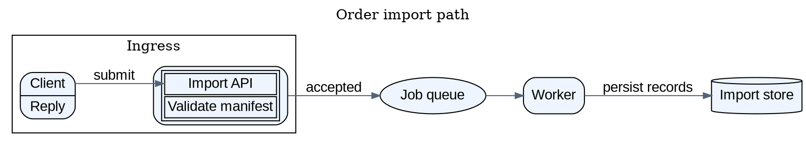

# Graphviz DOT

Graphviz is a graph-description and automatic-layout system. DOT is its declarative text language: describe nodes, edges, grouping, labels, and selected visual/layout attributes, then choose an engine to place and draw the graph. DOT captures graph structure rather than fixed drawing coordinates, so it suits dependency maps, directed processes, networks, and clustered relationships. The same DOT structure can look substantially different under different layout engines.

## Model and canonical syntax

A DOT document contains one `graph` (undirected) or `digraph` (directed), optionally prefixed with `strict`, optionally named, and followed by statements in braces. The edge operator must match the graph kind: `--` for `graph`, `->` for `digraph`. Directed edges have a tail and a head; in a `digraph`, the default edge is drawn with an arrowhead. Use `strict` when a pair of endpoints should identify at most one edge: a repeated edge statement updates that edge's attributes rather than adding a parallel edge. Without `strict`, parallel edges are allowed. In an undirected strict graph, reversing the endpoint order still identifies the same edge.

A node is created by naming it in a node statement or edge. IDs may be simple identifiers, numerals, quoted strings, or HTML strings. Use a stable, simple ID for references and a separate `label` for display text; quote labels containing spaces, punctuation, or DOT keywords. An edge may have a `label`, arrow/style/color attributes, and other edge properties. Statements may be separated by semicolons or commas where appropriate, but separators between statements are optional. DOT accepts `//`, `/* ... */`, and `#` comments.

The compact grammar pattern is:

```text
[strict] graph|digraph [name] {
  graph [attribute=value, ...]  // graph-wide settings
  node  [attribute=value, ...]  // defaults for later nodes
  edge  [attribute=value, ...]  // defaults for later edges
  node_id [attribute=value, ...]
  tail -> head [attribute=value, ...]
  subgraph name { ... }
}
```

Attribute values are commonly quoted strings, though simple values can be unquoted. `graph [...]`, `node [...]`, and `edge [...]` set defaults for objects of that kind defined afterward. A later default replaces the prior default for subsequently created objects; changing a default does not retroactively restyle objects already created. Attribute lists on an individual object override its defaults. A subgraph inherits the parent graph's attribute settings at the point where the subgraph is defined, and its local defaults apply to objects declared in that scope. Put defaults before the statements they should affect.

## Subgraphs, clusters, and constraints

A `subgraph` can group graph structure, establish a local attribute scope, or abbreviate edges: an edge from one subgraph to another expands to edges between every node on the left and every node on the right. That shorthand can create a complete bipartite set, so use it only when that is intended.

A subgraph whose name starts with `cluster` is conventionally treated by supporting engines as a cluster and drawn as an enclosing region. Clusters are a Graphviz layout convention, not a distinct construct in DOT's formal grammar; engine behavior can differ. Use clusters for meaningful boundaries such as a service, trust zone, or deployment boundary, not merely to color arbitrary collections. Keep each cluster's nodes and edges in the intended scope because edge membership can affect cluster layout.

The `dot` engine assigns nodes to ranks (layers) and routes edges between ranks. `rankdir=TB` is the default; use `LR`, `BT`, or `RL` when the flow reads better in another direction. For example, `subgraph { rank=same; cache; index; }` asks `dot` to align those nodes; `rank=min`, `rank=max`, `rank=source`, and `rank=sink` provide other rank constraints. A `constraint=false` edge still draws but is left out of `dot`'s rank assignment. Rank constraints and `rankdir` are `dot` features, not universal controls for every engine. Prefer letting the engine position nodes, then add only constraints that express a real reading order or grouping rule.

## Shapes, ports, and labels

The `shape` node attribute selects a built-in shape such as `box`, `ellipse`, `diamond`, or `cylinder`; `style`, `color`, `fillcolor`, `fontname`, and `fontsize` control appearance. Set common values once with node and edge defaults, then override individual objects as needed. Use clear labels and restrained styling so the structure remains primary.

For compact field-like nodes, `shape=record` (or `Mrecord`) uses a special label grammar: vertical bars divide fields, braces nest fields, and `<port>` names a field port. For example, `client [shape=record, label="<request> Request | <reply> Reply"]` defines two named attachment points. An edge can target a port as `client:request -> api`; `:n`, `:e`, `:s`, `:w`, and related compass points can further specify an attachment side. Ports affect where an edge meets a node, not the graph's endpoint identity. Record fields are convenient for a small number of labeled interfaces; use a table label when you need richer cell-level formatting.

An HTML-like label is a DOT HTML string, delimited with angle brackets, whose contents follow Graphviz's XML-like label grammar (not arbitrary browser HTML). It can describe aligned text or a table; cells can have attributes and named `PORT`s. Escape XML-sensitive literal characters such as `&`, `<`, and `>` as entities, and keep tags well-formed. An HTML-like label itself must be a `label` value; using HTML syntax as a node ID does not automatically make the node label a table. Prefer ordinary quoted labels for plain text, record labels for compact fields, and HTML-like tables only when their layout or per-cell markup adds meaning. Do not mix record and HTML label grammars on one node.

## Choosing a layout engine

DOT grammar is largely shared across engines, but layout attributes, constraints, and the visual result are engine-dependent. Choose based on the graph's structure, not simply on whichever output looks most compact:

| Engine      | Layout idea                                                                                                                    | Good fit                                                                                     |
| ----------- | ------------------------------------------------------------------------------------------------------------------------------ | -------------------------------------------------------------------------------------------- |
| `dot`       | Hierarchical/layered layout; aims directed edges in a common direction and reduces crossings and edge length.                  | Processes, dependency flow, and graphs where rank/order matters. It is the default.          |
| `neato`     | Spring/stress model that minimizes a global energy function.                                                                   | General networks, especially undirected graphs of moderate size, when no hierarchy is known. |
| `fdp`       | Force-directed placement, similar in spirit to `neato` but based on reducing forces.                                           | Non-hierarchical networks where a force-based arrangement is suitable.                       |
| `circo`     | Circular arrangement.                                                                                                          | Cyclic structures and networks where a ring-like overview is useful.                         |
| `twopi`     | Radial layout with concentric circles around a chosen or inferred root.                                                        | Neighborhoods and reachability from a central node.                                          |
| `osage`     | Recursively arranges nodes and cluster rectangles by packing; edges are routed after packing and do not determine the packing. | A cluster-heavy map where containment is more important than edge-driven ranks.              |
| `patchwork` | Squarified treemap; allocates nested regions according to node/cluster `area` values.                                          | Hierarchical composition or relative area, not a flow chart.                                 |

The official Graphviz distribution also documents engines such as `sfdp`; the local integration has a narrower verified engine list (see the compatibility profile). Avoid assuming that an engine-specific attribute or constraint has the same effect after changing engines.

## Practical example

This order-import graph uses `dot` ranks for left-to-right flow, shared visual defaults, a cluster for the ingress boundary, record and HTML-table ports, and labeled edges. It is a single DOT graph and is compatible with the local profile.



## blueprint4llm compatibility profile

This describes this repository's renderer, not all Graphviz installations or DOT capabilities.

- **Pinned implementation:** `package-lock.json` resolves `@viz-js/viz` **3.31.0**. The repository worker protocol checks the embedded Graphviz engine version **16.1.0**. `@viz-js/viz` runs the embedded engine from WebAssembly in a disposable worker; the adapter requests inline SVG (`svg_inline`) rather than invoking a remote Graphviz service.
- **Fence and engine selection:** Use a Markdown fence tagged `graphviz` or `dot`. Its optional metadata is a strict, whitespace-separated `key=value` list containing at most one `engine` key, for example ` ```dot engine=neato `. With absent or whitespace-only metadata, the default is `dot`; one quoted value such as `engine="neato"` is accepted. Empty values, duplicate `engine` keys, unknown keys, malformed key-value tokens, and unverified engine values are rejected. The verified choices are `circo`, `dot`, `fdp`, `neato`, `osage`, `patchwork`, and `twopi`; for example, upstream `sfdp` is not accepted as `engine=sfdp` here.
- **Source versus metadata:** `engine=...` is fence metadata, not DOT syntax. A DOT graph's own `layout` attribute is also passed to the embedded renderer: a focused repository test verifies that `layout=neato` with metadata `engine=dot` produces the same output as metadata `engine=neato`, and differs from default `dot`. Prefer one engine selector rather than setting conflicting values. This behavior is specific to the pinned wrapper/build.
- **One graph per fence:** A block must contain one graph document. The adapter rejects a second top-level graph or non-comment content after a detected graph; trailing whitespace and DOT comments are allowed. Nested subgraphs and clusters are part of that one graph and are supported. Malformed or non-graph source that the simple single-graph check does not recognize is left for Graphviz to diagnose.
- **Output and resource bounds:** Source is limited to 256 KiB, SVG output to 4 MiB, and either SVG dimension to 8192 px; rendering has a 30-second timeout and at most two Graphviz workers run concurrently. Graphviz warnings are returned with render results. These are project safeguards, not DOT language limits.
- **External references:** The renderer does not provide a general external-asset loading workflow. Tests verify that an HTTP `image` is not fetched, external stylesheet references are removed from inline SVG, non-fragment SVG links fail validation, and active HTML-like image labels are rejected. Prefer self-contained text, shapes, and labels.
- **Feature boundary:** The adapter passes DOT source to Viz.js and does not impose a general allowlist of node, edge, or graph attributes. The supported engine metadata list, one-graph rule, SVG-only output, and output/security checks above are local constraints. A valid upstream feature that depends on an engine absent from this Wasm build or on external assets is not thereby supported locally; validate source in the target project rather than inferring support from upstream Graphviz or from an example alone.

Local claims are based on `src/renderers/graphviz.ts`, `src/renderers/graphviz-source.ts`, `src/renderers/graphviz-worker.ts`, `src/renderers/graphviz-runner.ts`, `src/renderers/graphviz-worker-protocol.ts`, `src/renderers/graphviz-svg.ts`, `src/renderers/graphviz-limits.ts`, `package-lock.json`, and the `tests/graphviz-*.test.ts` suite. In particular, the focused tests exercise all seven verified engines and a directed cluster with ports, record and HTML-like labels.

## Validation

Validate the Markdown document and every Graphviz fence with the local project renderer:

```sh
blueprint4llm path/to/plan.md --check
```

A successful check confirms that the local renderer accepted the graph and produced SVG; it does not establish that another Graphviz version or engine will produce identical layout. When debugging, first check whether the graph kind matches its edge operator, quote special IDs and labels, and then check engine-specific layout settings.

## Official references

- [DOT language reference](https://graphviz.org/doc/info/lang.html) — grammar, IDs, statements, subgraphs, clusters, comments, and graph semantics.
- [Graphviz documentation index](https://graphviz.org/documentation/) — official index of language, engines, attributes, and output formats.
- [Node shapes and labels](https://graphviz.org/doc/info/shapes.html) — built-in shapes, record labels and ports, and HTML-like label grammar.
- [Node `shape` attribute](https://graphviz.org/docs/attrs/shape/), [label attribute](https://graphviz.org/docs/attrs/label/), and [rank constraints](https://graphviz.org/docs/attrs/rank/) — attribute details.
- [Layout engines overview](https://graphviz.org/docs/layouts/) and individual descriptions for [`dot`](https://graphviz.org/docs/layouts/dot/), [`neato`](https://graphviz.org/docs/layouts/neato/), [`fdp`](https://graphviz.org/docs/layouts/fdp/), [`circo`](https://graphviz.org/docs/layouts/circo/), [`twopi`](https://graphviz.org/docs/layouts/twopi/), [`osage`](https://graphviz.org/docs/layouts/osage/), and [`patchwork`](https://graphviz.org/docs/layouts/patchwork/).
- [`rankdir`](https://graphviz.org/docs/attrs/rankdir/) and [`constraint`](https://graphviz.org/docs/attrs/constraint/) — direction and edge ranking behavior in `dot`.

**Reviewed:** 2026-10-26
