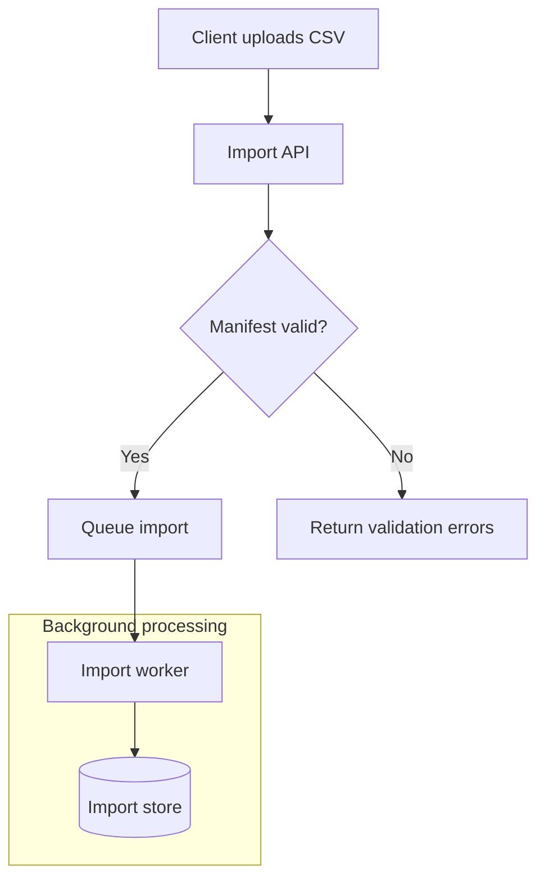
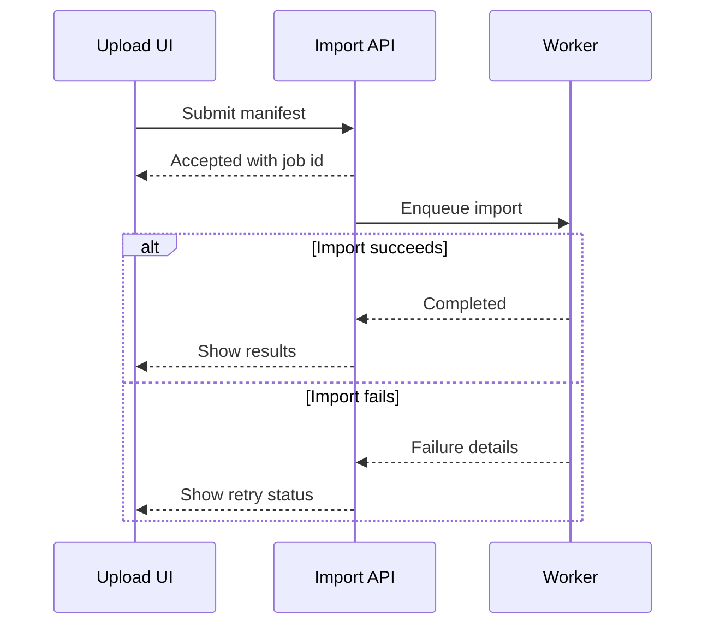
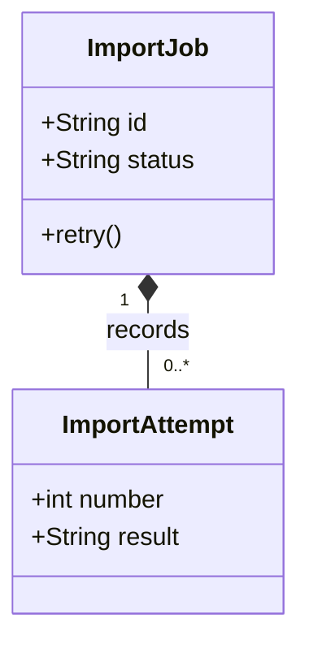
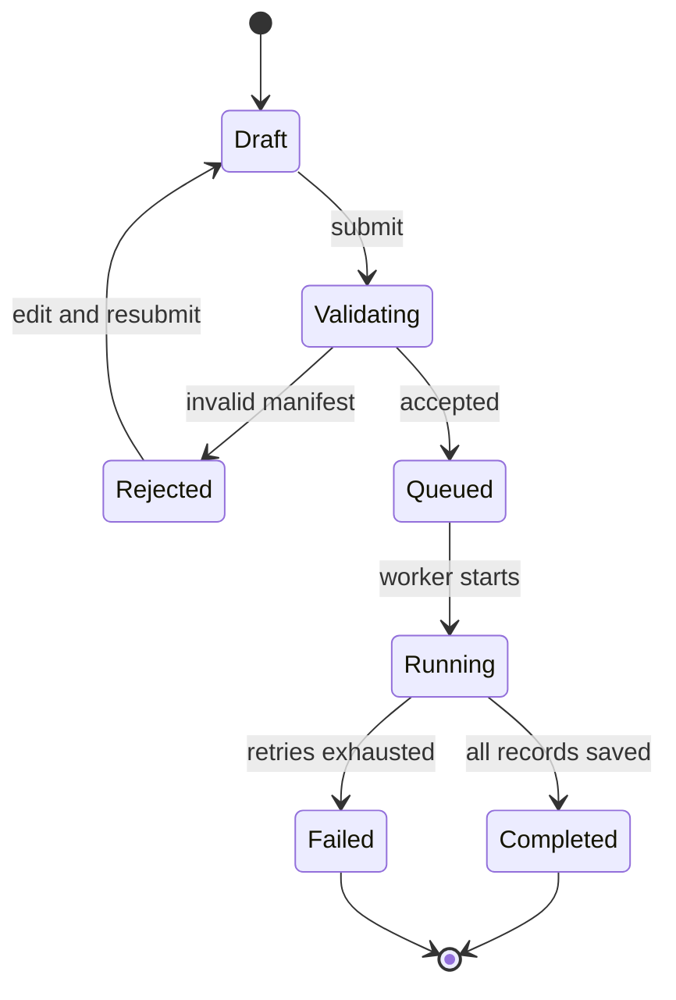
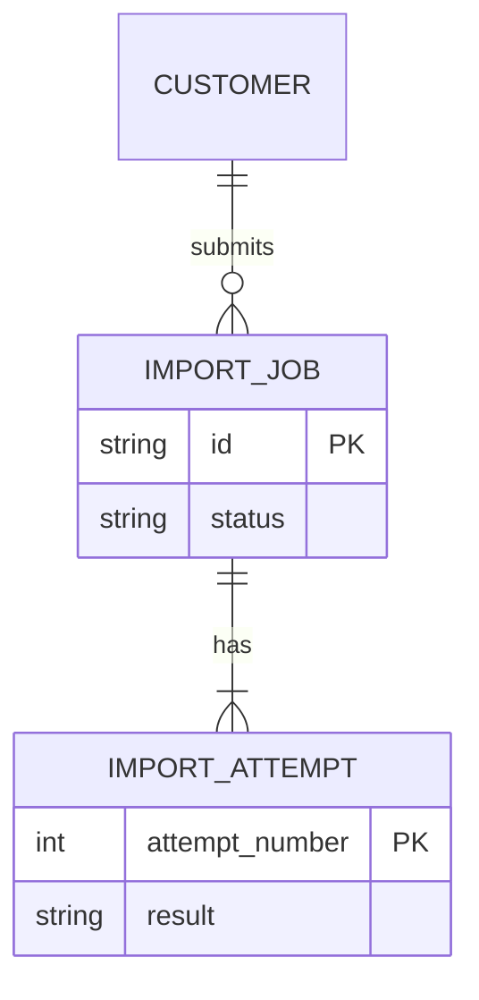

# Mermaid

Mermaid is a text-to-diagram language: a short, declarative description is parsed as a particular diagram grammar and laid out as a rendered graphic. It is useful when a diagram should live beside its explanation in Markdown and be maintained as reviewable source. Unlike a drawing canvas, Mermaid source normally describes relationships, events, or hierarchy rather than pixel coordinates; the selected diagram type determines the available vocabulary and layout semantics.

## Shared model and syntax

A Mermaid definition starts with a diagram declaration such as `flowchart`, `sequenceDiagram`, `classDiagram`, `stateDiagram-v2`, or `erDiagram`. That declaration selects the parser and meaning of the lines that follow. Mermaid does not have one universal graph grammar: a flowchart arrow, sequence message, UML relation, state transition, and ER cardinality are distinct constructs, even when they look superficially similar.

Common authoring conventions:

- Put one complete definition in each Markdown ` ```mermaid ` fence. Start its contents with the diagram declaration, then add diagram-specific statements. Mermaid has no required closing declaration.
- Identifiers provide stable references between statements; a label or alias supplies reader-facing text. In a flowchart, `api[Import API]` refers to node `api` while displaying “Import API.”
- Lines are generally sufficient separators. Semicolon separators are accepted by some syntaxes but are not needed in ordinary multi-line definitions; use one statement per line for easier diffs and diagnosis.
- `%%` begins a comment. Comment placement can vary by diagram grammar; a standalone comment line is the safest portable convention.
- Quoting, escaping, and punctuation rules differ by diagram family. Quote text containing syntax-like words or special characters rather than assuming all labels are parsed alike.
- Mermaid also has frontmatter and directives for configuration. These are deployment/configuration mechanisms, not a replacement for the diagram declaration; whether a host honors a setting depends on that host's configuration.

## Choose a diagram by the question

| Diagram family                                       | Model and useful choice                                                                                                                                                                                                                                |
| ---------------------------------------------------- | ------------------------------------------------------------------------------------------------------------------------------------------------------------------------------------------------------------------------------------------------------ |
| **Flowchart** (`flowchart`, legacy `graph`)          | Processes, decisions, dependencies, and routing. Nodes are connected by directed, undirected, dotted, or emphasized links; subgraphs group related steps. Use it when the important information is “what leads to what.”                               |
| **Sequence** (`sequenceDiagram`)                     | Ordered exchanges between participants over time. Lifelines, message arrow types, and `alt`, `opt`, `loop`, and `par` fragments show interaction order and control flow. Choose it for a request path or protocol rather than a static dependency map. |
| **Class** (`classDiagram`)                           | Static object-oriented structure: classes, attributes, methods, visibility, and relations such as inheritance, composition, aggregation, and dependency. Choose it when types and their structural relationships matter.                               |
| **State** (`stateDiagram-v2`, also `stateDiagram`)   | A state machine: named states and transitions, often labeled by an event or condition. Initial/final pseudostates, composite states, choices, and concurrency make it suitable for lifecycle behavior, not a general process checklist.                |
| **Entity relationship** (`erDiagram`)                | Data entities, attributes, and crow’s-foot cardinality. Choose it for conceptual or relational data models; omit implementation details that do not add meaning to the relationship.                                                                   |
| **Gantt** (`gantt`)                                  | Tasks, dates or durations, sections, milestones, and schedule dependencies. Use for a plan over calendar time, not merely a sequence of logical steps.                                                                                                 |
| **GitGraph** (`gitGraph`)                            | Commits, branch creation/checkouts, and merges. It depicts version-control history more directly than a generic flowchart.                                                                                                                             |
| **Mindmap** (`mindmap`) or **timeline** (`timeline`) | A mindmap expresses a hierarchy of ideas through indentation; a timeline emphasizes chronological events. Use these for exploration or chronology when edges and execution semantics are unnecessary.                                                  |

Other families include user journeys, requirements, use cases, C4, pie, quadrant, XY, Sankey, packet, architecture, and block diagrams. Consult the matching syntax page and check its availability in the Mermaid version used by the target host.

## Core syntax patterns

### Flowcharts: nodes, links, and groups

Flowcharts declare nodes by using them in a link or defining their label/shape explicitly. Common forms include `A[process]`, `B{decision}`, `C((event))`, and `D[(database)]`. The identifier is reused on later links; a later label for the same id becomes its displayed text. Links express relationships, not execution timing: `-->` is a directed arrow, `---` an open line, `-.->` a dotted arrow, and `==>` a thicker arrow. A label can be placed between link markers (`A -->|accepted| B`) or beside an edge (`A -- accepted --> B`). Chaining is concise, but split long chains when branches or labels would make them hard to follow.

`flowchart TB` (or `TD`) lays out top-to-bottom; `LR`, `RL`, and `BT` select other orientations. `subgraph id[Title] ... end` groups nodes. A subgraph may declare its own `direction`, although Mermaid documents that external links to its nodes can cause it to inherit its parent direction instead. Use subgraphs for meaningful boundaries, not as decoration. `classDef` and `class` can style related nodes consistently; keep styling subordinate to the structure.

### Sequence: participants and messages

Participants may be introduced explicitly and assigned display aliases (`participant API as Import API`), or inferred from messages. Explicit declarations establish a clear participant order and readable labels. A message has a sender, an arrow, a receiver, and optional text, for example `Client->>API: Submit job`; solid/dotted and open/closed arrowheads distinguish message styles. `activate`/`deactivate` can show execution when it matters. Use `alt`/`else` for alternatives, `opt` for optional work, `loop` for repetition, `par`/`and` for parallel work, and `end` to close each fragment. Keep message text about intent or payload, not a second copy of the system specification.

### Class: members and relationships

Declare a class with `class Name { ... }`; members without `()` are attributes and members with `()` are operations. Optional visibility markers are `+` public, `-` private, `#` protected, and `~` package/internal. For example, `+retry()` is a public operation. Mermaid's class relations include `<|--` inheritance, `*--` composition, `o--` aggregation, `-->` association, `..>` dependency, and `..|>` realization. Add relation labels and quoted multiplicities where they clarify the model. Use class diagrams for types and static relations; use ER diagrams for entity cardinality and data attributes.

### State: transitions and composite behavior

A state declaration can be as small as a transition between two named states. `[*] --> Ready` marks an initial transition, and a transition from a state to `[*]` marks a final transition. A label after `:` describes the event or guard, as in `Ready --> Running: start`. `state Parent { ... }` can contain a sub-state machine; `<<choice>>` and `<<fork>>`/`<<join>>` represent choice and concurrency points. Keep state names nouns/adjectives and transition labels event-like so that each arrow reads as a behavior rule.

### ER: entities and cardinality

An ER declaration uses `erDiagram`. A relation has the form `CUSTOMER ||--o{ ORDER : places`: the markers at both ends encode minimum/maximum cardinality, and `--` denotes identifying while `..` denotes non-identifying. Common end markers include `||` (exactly one), `o|` (zero or one), `|{` (one or more), and `o{` (zero or more). Entities can list attributes in braces, conventionally as `type name` with optional `PK`, `FK`, or `UK` key markers and a quoted comment. Entity labels are commonly singular nouns. Include foreign keys only when the implementation-level detail is useful; the relationship itself may already communicate the association.

### Other useful grammars

These types answer different questions and have their own statement forms; do not reuse flowchart links as if all Mermaid diagrams shared one grammar.

- **Schedule (`gantt`):** Start with `gantt`, set the input date format with `dateFormat`, then optionally add a title and `section` groups. A task row is `Label : [tags,] [id,] start-or-after, end-or-duration`; tasks without an explicit start default to the preceding task's end. Use this for dated work, durations, and task dependencies rather than an undated process flow.
- **Version history (`gitGraph`):** After `gitGraph`, write Git-like commands such as `commit`, `branch`, `checkout`, and `merge`. Mermaid applies them in source order, starting on `main`; choose it to show branch history and merge structure rather than arbitrary system relationships.
- **Idea hierarchy (`mindmap`):** Start with `mindmap`, put the root idea on the first content line, and use indentation to nest child ideas. It is a text outline rendered as a hierarchy, not a graph with labeled relationships.
- **Chronology (`timeline`):** Start with `timeline`, optionally add `title` and `section` lines, then write `period : event` entries. Multiple events can share a period by adding more colon-separated events. Source order controls the chronology, so choose it for dated eras and milestones rather than task durations.
- **Requirement traceability (`requirementDiagram`):** Define typed requirements with fields such as `id`, `text`, `risk`, and `verifymethod`; define `element` nodes for referenced system artifacts, then connect nodes with relations such as `satisfies`, `verifies`, or `traces`. Choose this for requirement-to-design or requirement-to-test traceability, not for a general dependency map.
- **Actor goals (`usecase-beta`):** Mermaid 12's use-case grammar starts with the exact `usecase-beta` declaration and puts each statement on its own physical line. Declare actors with `actor`; write use cases as ellipse calls such as `Login("Sign in")` or rectangle labels such as `Login[Sign in]`. Use solid associations for actor/use-case links and explicit include, extend, or generalization operators when those UML meanings matter. Use it when external actors and system goals are the point of the diagram; the beta keyword is part of the required syntax.

`gantt`, `gitGraph`, `mindmap`, `timeline`, `requirementDiagram`, and `usecase-beta` are documented upstream types. The project adapter recognizes and normalizes some of their directions, but the focused render tests listed in the compatibility profile cover only flowchart, sequence, class, state, and ER; validate these other families with the local CLI before relying on them in a plan.

## Examples

These examples are complete Mermaid definitions. They are deliberately written using core syntax available in the project's locked renderer as well as the upstream language.

### Practical workflow map

The declared `TB` direction is also the direction used by the local profile. The flow combines a validation decision with a subgraph for asynchronous work.



### Ordered interaction



### Static type model



### State lifecycle



### Data model



## blueprint4llm compatibility profile

This section describes the repository integration, not limits of Mermaid itself.

- **Pinned implementation:** `package.json` pins `@mermaid-js/mermaid-cli` to **12.0.0**. `package-lock.json` resolves its `mermaid` dependency to **12.2.0**. The adapter invokes that locally installed official CLI; it does not call Mermaid's hosted editor or a remote rendering API. The CLI uses Puppeteer/Chrome to produce SVG.
- **Markdown input:** The renderer handles fences tagged exactly `mermaid`. It passes source through after a narrow direction-normalization step; Mermaid still decides whether the syntax is valid. A source block is limited to 256 KiB, rendering has a 30-second timeout, and at most two Mermaid renders run concurrently. The adapter uses an isolated temporary directory for each invocation and removes it afterward.
- **Vertical-direction override:** `src/renderers/mermaid-direction.ts` rewrites recognized direction syntax before invoking the CLI. A `flowchart` or legacy `graph` header is made `TB` even when it says `LR`, `BT`, or another supported orientation. Explicit `direction ...` statements are changed to `direction TB` in flowchart/graph, class, state, ER, requirement, and use-case diagrams; absent statements are not inserted for these types. The adapter sets `timeline` headers to `TD`, `gitGraph` headers to `TB:`, and beta swimlane/agentflow headers to `TB`. A `sequenceDiagram` is left unchanged because its message ordering is already represented along its lifelines. Other declarations that the helper does not recognize are passed through unchanged. Thus, Mermaid's upstream orientation choices remain valid language features, but a local flowchart direction such as `LR` is not honored by this integration.
- **CLI configuration and output:** The wrapper writes a Mermaid config with `theme: "default"`, `securityLevel: "strict"`, `htmlLabels: false`, `startOnLoad: false`, and ER layout direction `TB`. It requests SVG with a transparent background and disables font embedding. This is a static output profile; it does not expose a separate renderer-options argument for a document author to choose a theme or direction policy.
- **Security and interactivity:** Mermaid's official configuration docs define `strict` as encoding HTML tags in text and disabling click functionality. `htmlLabels: false` opts out of HTML-based labels; focused renderer tests also check that representative flowchart, sequence, class, state, and ER output contains neither `<foreignObject>` nor `<script>`. Do not rely on click callbacks, embedded scripts, or a live Mermaid editor in the generated document. These are differences in the integration/output, not absences from Mermaid's broader syntax or other deployment modes.
- **What is and is not established:** The renderer passes Mermaid source to the pinned CLI rather than enforcing an allowlist of just the five types exercised in tests. Those tests prove flowchart, sequence, class, state, and ER examples render; they do not prove every upstream diagram family or every optional syntax/configuration works in this integration. A valid upstream feature not covered by those tests should be treated as unverified locally, not as rejected. Keep definitions self-contained and validate the exact block with this CLI.

The local profile above is evidenced by `src/renderers/mermaid.ts`, `src/renderers/mermaid-direction.ts`, `tests/mermaid.test.ts`, `tests/mermaid-direction.test.ts`, `package.json`, and `package-lock.json`.

## Validation

After adding or editing a diagram in a plan, validate the Markdown and render every Mermaid fence locally:

```sh
blueprint4llm path/to/plan.md --check
```

A successful check confirms the installed local CLI can parse and render each block. A Mermaid parse/render failure is reported as a diagram diagnostic at the source location. Validation is especially important after changing labels, punctuation, or direction: similar-looking syntax may mean different things across Mermaid diagram families, and the local adapter can normalize directions before rendering.

## Official references

- [Diagram syntax reference](https://mermaid.js.org/intro/syntax-reference.html) — declaration and syntax structure, comments, frontmatter, directives, layouts, and configuration concepts.
- [Flowchart syntax](https://mermaid.js.org/syntax/flowchart.html) — nodes, shapes, links, subgraphs, directions, and styling.
- [Sequence diagram syntax](https://mermaid.js.org/syntax/sequenceDiagram.html) — participants, messages, activations, notes, and control fragments.
- [Class diagram syntax](https://mermaid.js.org/syntax/classDiagram.html) — members, visibility, relationships, namespaces, and multiplicity.
- [State diagram syntax](https://mermaid.js.org/syntax/stateDiagram.html) — states, transitions, composite states, pseudostates, and direction.
- [Entity relationship syntax](https://mermaid.js.org/syntax/entityRelationshipDiagram.html) — entities, attributes, cardinality, and identifying relationships.
- [Gantt syntax](https://mermaid.js.org/syntax/gantt.html), [GitGraph syntax](https://mermaid.js.org/syntax/gitgraph.html), [mindmap syntax](https://mermaid.js.org/syntax/mindmap.html), and [timeline syntax](https://mermaid.js.org/syntax/timeline.html) — task, commit-history, hierarchy, and chronology models.
- [Requirement diagram syntax](https://mermaid.js.org/syntax/requirementDiagram.html) and [use-case diagram syntax](https://mermaid.js.org/syntax/usecase.html) — requirement traceability and actor-goal models.
- [Mermaid usage and security configuration](https://mermaid.js.org/config/usage.html) — security levels, rendering API, and deployment behavior.

**Reviewed:** 2026-10-26
