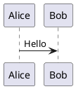
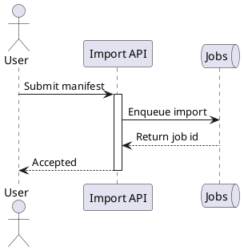
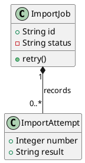
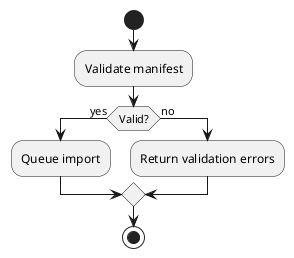
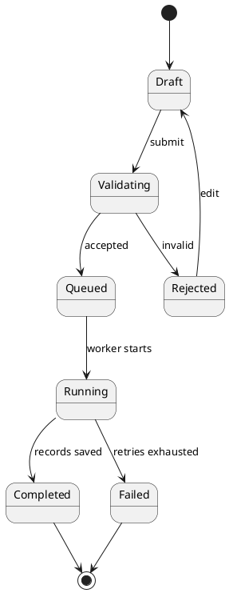
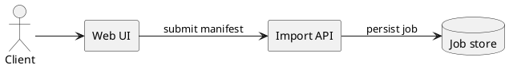
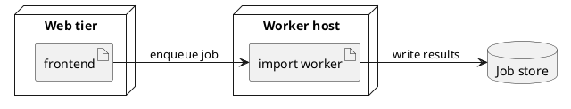

# PlantUML

PlantUML is a text-to-diagram language and renderer. A source file describes UML participants, types, states, actions, components, deployment nodes, and their relationships; PlantUML chooses positions and draws the result. It is useful when UML semantics matter and when a diagram should remain compact, diffable, and editable as source. The syntax is diagram-family-specific: arrows and keywords have meaning in the selected model, not one universal graph grammar.

## Source structure and conventions

A portable source block has one diagram enclosed by `@startuml` and `@enduml`. PlantUML can infer the diagram family from statements such as `Alice -> Bob`, `class Order`, `start`, `[*] --> Ready`, or `node Server`; there is usually no separate `diagram-type` declaration. Use one complete diagram per Markdown `plantuml` fence so it has an unambiguous purpose and can be checked independently.



Common conventions:

- Use one statement per line. A line beginning with `'` is a comment; `/' ... '/` can delimit a block comment.
- Give elements stable identifiers and use `as` to assign a concise alias to a display name with spaces or punctuation: `participant "Import API" as API`. Refer to `API` in later statements.
- Quote labels that contain spaces or syntax-like characters. Use `\n` for a deliberate line break where the diagram grammar supports it.
- A relationship label commonly follows `:`; syntax differs by diagram family. Keep IDs and labels descriptive and avoid putting long prose on edges.
- PlantUML has broad layout and styling commands. Prefer readable names and natural layout first; use direction hints, grouping, and restrained styling only when they clarify the model. `left to right direction` is useful for many structural diagrams. `skinparam` configures visual properties, and individual elements or links can often receive inline colors.

## Choose a diagram by the question

| Diagram family | What it models                                                                                              | Choose it when                                                                                                                                                            |
| -------------- | ----------------------------------------------------------------------------------------------------------- | ------------------------------------------------------------------------------------------------------------------------------------------------------------------------- |
| **Sequence**   | Participants and messages in time order, including alternatives, loops, and parallel interaction fragments. | You need to explain a protocol, request path, or actor-to-service interaction.                                                                                            |
| **Class**      | Static types, attributes, operations, and structural relationships.                                         | Object-oriented structure, interface implementation, ownership, or dependencies are central.                                                                              |
| **Activity**   | Workflow control flow: actions, decisions, loops, and parallel branches.                                    | You need to show a process or algorithm rather than messages exchanged by lifelines. Prefer the newer activity syntax for new diagrams; legacy syntax remains documented. |
| **State**      | A state machine: states, events/guards, transitions, and optionally nested or concurrent substates.         | Behavior depends on an object's lifecycle or mode. Use this rather than an activity diagram when transitions between persistent states are the subject.                   |
| **Component**  | Logical software building blocks, provided/used interfaces, and dependencies.                               | You need a high-level software architecture without physical deployment detail.                                                                                           |
| **Deployment** | Runtime nodes/devices and the artifacts or components placed on them.                                       | The important question is where software runs and how hosts or environments connect.                                                                                      |

Related PlantUML families include use-case, object, timing, and non-UML diagram languages. Choose the diagram whose concepts match the question: a class is not a runtime host, a sequence is not a workflow, and an activity action is not a persistent state.

## Core syntax by diagram family

### Sequence: participants and messages

Participants may be declared explicitly as `actor`, `participant`, `boundary`, `control`, `entity`, `database`, `queue`, and other participant kinds, or inferred when first used. Explicit declarations make order and roles clear; an `as` alias separates the readable label from the short identifier. Messages use arrows such as `A -> B: request` and `B --> A: response`; solid and dotted forms distinguish message styles. `activate`/`deactivate` can show execution on a lifeline. `alt`/`else`, `opt`, `loop`, `par`, `break`, and `group label` delimit nested message fragments, closed with `end`. Use these for interaction logic, not as a substitute for all process detail.

### Class: types and relations

Declare `class`, `interface`, `abstract class`, `enum`, and related types. A class body contains attributes and operations; `+`, `-`, `#`, and `~` conventionally indicate public, private, protected, and package visibility. Use an alias for a long display name. Common relation forms include `--` for association, `<|--` for generalization, `<|..` for realization, `*--` for composition, `o--` for aggregation, and `-->` for a directed dependency-style link. Put multiplicities in quotes at the endpoints and a short relationship name after `:`, for example `Order "1" *-- "0..*" LineItem : contains`. Use composition only for ownership/lifetime semantics, not merely to indicate that two classes are related.

### Activity: workflow and decisions

In the newer activity notation, write `start`, then action lines such as `:Validate manifest;`, followed by `stop` (or `end`). Ordered actions connect implicitly. `if (condition?) then (yes) ... else (no) ... endif` expresses a branch; `while`/`endwhile` and `repeat`/`repeat while` express loops; `fork`/`fork again`/`end fork` expresses parallel activity. Labels on branches should explain outcomes. PlantUML also retains an older activity syntax for existing diagrams, but the official guide recommends the newer syntax for new work.

### State: lifecycle and transitions

Use `[*]` for an initial or final pseudostate. A statement such as `Draft --> Validating : submit` defines a transition and optional event/guard label. A composite state can contain nested states and its own initial transition: `state Processing { ... }`. State diagrams can also express choice, history, and concurrency; use these only when they carry real lifecycle meaning. Keep states noun-like and transition labels event- or condition-like, so each arrow reads as a rule.

### Component and deployment: logical versus physical structure

For a component diagram, `[Import API] as API` declares a component; `() "Job Store API" as StoreAPI` or `interface StoreAPI` declares an interface. Connect elements with directed or dotted links and concise labels. `package`, `node`, `cloud`, `database`, and other groups can provide context, but avoid nesting that does not communicate a boundary. Use components for logical modules and dependencies.

For a deployment diagram, use elements such as `node`, `device`, `artifact`, `component`, `database`, and `cloud` to describe execution environments and deployed software. Nest an artifact inside the node where it runs, then connect nodes or artifacts to show communication or dependencies. Aliases and long descriptions work here too. A direction hint can help a deployment topology read left-to-right, but layout remains automatic rather than a set of coordinates.

## Practical examples

These examples are complete independent diagrams. They use ordinary PlantUML grammar and are also validated with the project's local renderer.

### Sequence: request and response



### Class: data ownership



### Activity: validation branch



### State: job lifecycle



### Component: logical services



### Deployment: hosts and artifacts



## blueprint4llm compatibility profile

This section describes this repository's adapter, not limits of PlantUML as a language.

- **Pinned engine:** `package.json` and `package-lock.json` pin `@plantuml/core` to **1.2026.9**. The package identifies itself as the PlantUML engine compiled to JavaScript with TeaVM; the renderer does not launch Java or contact a PlantUML server. It loads the package's `viz-global.js` and `plantuml.js` into a fresh Puppeteer-managed Chromium page and asks the engine for SVG. Chromium must be available to Puppeteer.
- **Input and family coverage:** Use a Markdown fence tagged `plantuml`; there is no fence metadata or project-specific option syntax. The adapter passes the body to the engine as source lines and does not impose a diagram-family allowlist or rewrite ordinary PlantUML source. Repository tests directly exercise sequence, class, component, and activity diagrams; this guide's state and deployment examples are also checked with the pinned engine. These checks do not establish every PlantUML command or diagram family, so validate uncommon features locally.
- **Offline loading policy:** The browser page has a restrictive Content Security Policy and request interception that allows the local page and `blob:`/`data:` resources, but no external network requests. The adapter also installs a file loader that rejects local `!include` files and a standard-library loader that rejects library/support-file loads, including `!include <...>`. The engine package's optional `themes.js` and standard-library bundles are not loaded. Do not rely on filesystem includes, remote includes, theme bundles, standard-library sprites/macros, or remote images. These are integration restrictions; includes and external resource workflows are supported in other PlantUML host setups when those hosts supply loaders/resources.
- **Styling and output:** The call passes `maxSvgSize` but no `dark: true` option, so the package API's default light-mode output is used. This does not disable source-level PlantUML styling such as ordinary `skinparam` or inline style statements. Output is SVG only; the adapter does not offer per-fence output-format, theme, or layout metadata. The cache key records the package version and `theme=light` policy.
- **Limits and diagnostics:** Source is limited to 256 KiB in UTF-8; one render is limited to 30 seconds and SVG dimensions to 8192 px. At most two renders run concurrently. Syntax errors and include-loader failures are returned as diagram errors; `--check` reports those errors as validation failures. These are project/runtime safeguards, not PlantUML language limits.
- **Feature boundary:** Use self-contained diagrams without external resources. The adapter does not filter every source command, so a feature's existence in upstream PlantUML does not guarantee its auxiliary files or behavior are locally available. Conversely, lack of a test for a command is not proof the adapter rejects it: run the precise document through `--check` before relying on it.

Local profile claims are based on `src/renderers/plantuml.ts`, `src/renderers/plantuml-page.ts`, `src/renderers/plantuml-diagnostics.ts`, `package.json`, `package-lock.json`, the `@plantuml/core@1.2026.9` package README, and `tests/plantuml.test.ts`.

## Validation

Validate the Markdown and each PlantUML fence with the project's local engine:

```sh
blueprint4llm path/to/plan.md --check
```

A successful check confirms that the installed local engine produced SVG without reported diagram errors; it does not prove the layout is clear or that every external PlantUML host behaves the same. Review the rendered output for readability, and use `--check` again after editing. If a diagram fails, first verify the diagram-family syntax and closing keywords, then remove any include or resource dependency and validate the source as a self-contained block.

## Official references

- [Quick Start Guide](https://plantuml.com/starting) — basic source form, rendering and tool context; it links to the official [PlantUML Language Reference Guide](https://plantuml.com/guide).
- [Sequence diagrams](https://plantuml.com/sequence-diagram) — participants, messages, aliases, lifeline activation, fragments, and notes.
- [Class diagrams](https://plantuml.com/class-diagram) — members, visibility, relations, multiplicity, packages, notes, and styling.
- [Activity diagrams](https://plantuml.com/activity-diagram-beta) — current activity syntax, decisions, loops, and parallel flows, with notes on the legacy syntax.
- [State diagrams](https://plantuml.com/state-diagram) — initial/final states, transitions, composite states, concurrency, aliases, and styles.
- [Component diagrams](https://plantuml.com/component-diagram) and [deployment diagrams](https://plantuml.com/deployment-diagram) — logical components/interfaces and runtime nodes/artifacts.

**Reviewed:** 2026-10-26
